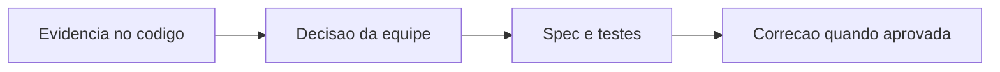

# TrainingSheet - Prescricao - Debitos Tecnicos

## Indice

- [1. Resumo Executivo](#resumo)
- [2. Problemas por Criticidade](#problemas)
- [3. Plano de Acao](#plano)
- [4. User Stories para Implementacao](#stories)

## 1. Resumo Executivo

**Estado atual**: dominio isolado, com factories/metodos e evidencias em [Fonte](../../../src/Steady.Domain/Coaching/TrainingSheet.cs) e [Testes](../../../tests/Steady.Domain.Tests/TrainingSheetTests.cs).
**Principais problemas**: Maximo de esforco nao respeita escala 1..10
**Impacto no negocio**: RunPrescription.BuildRange valida somente o minimo; perceivedEffortMin=6 e perceivedEffortMax=11 passam.
**Fontes**: [STORY-013](../../../specs/STORY-013/spec.bdd.md), [STORY-014](../../../specs/STORY-014/spec.bdd.md), [STORY-017](../../../specs/STORY-017/spec.bdd.md), [ADR-010](../../../docs/adr/ADR-010-ficha-com-prescricoes-de-corrida-por-dia.md), [ADR-012](../../../docs/adr/ADR-012-prescricao-de-corrida-estruturada.md), [ADR-019](../../../docs/adr/ADR-019-identidade-historica-do-exercicio.md). Calibracao de tolerancia e regras complexas aceitas nao sao classificadas como defeito.

## 2. Problemas por Criticidade

### Importante

**Maximo de esforco nao respeita escala 1..10**: RunPrescription.BuildRange valida somente o minimo; perceivedEffortMin=6 e perceivedEffortMax=11 passam.

**Acao recomendada**: Validar ambas as bordas conforme a escala ja usada para o minimo.

Demais niveis: nenhum debito comprovado nesta analise.

## 3. Plano de Acao

1. Criticos: nenhum identificado nesta unidade.
2. Importantes: validar a proposta abaixo e reproduzir a evidencia antes de implementar.
3. Menores: manter documentacao sincronizada ao alterar regras ou contratos.

## 4. User Stories para Implementacao

### Story proposta: Maximo de esforco nao respeita escala 1..10

**Contexto atual**: RunPrescription.BuildRange valida somente o minimo; perceivedEffortMin=6 e perceivedEffortMax=11 passam.
**Objetivo**: fechar a lacuna observada sem mudar o restante da regra.
**Regras de negocio**: preservar limites e semantica estabelecidos nas fontes citadas.
**Especificacao tecnica**: Validar ambas as bordas conforme a escala ja usada para o minimo.

**Criterios de aceite**:

- [ ] Maximo 11 deve ser recusado; faixa 6..10 e alvo 6 devem continuar validos.
- [ ] Cenários da regra atual continuam validos.
- [ ] Spec, testes e codigo refletem a decisao aceita pela equipe.

**Roteiro de teste**:

1. **Entrada**: `RunPrescription.Create("Corrida", perceivedEffortMin:6, perceivedEffortMax:11)`. **Resultado esperado**: Hoje aceita; apos correcao deve lancar ArgumentOutOfRangeException.
2. **Entrada**: `RunPrescription.Create("Corrida", perceivedEffortMin:6, perceivedEffortMax:10)`. **Resultado esperado**: Faixa 6..10 aceita.

Esta story e recomendacao documental, nao autorizacao de implementacao.

**Referencia funcional**: [Regras](../BusinessRulesDocs/Ficha-de-Treino-Prescricao-Rules.md). **Detalhes tecnicos**: [DevDocs](../DevDocs/TrainingSheet-Prescricao-DevDocs.md).
