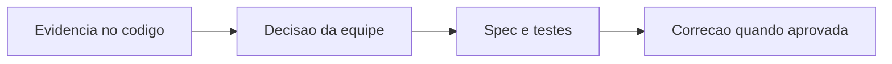

# WorkoutExecution - Execucao - Debitos Tecnicos

## Indice

- [1. Resumo Executivo](#resumo)
- [2. Problemas por Criticidade](#problemas)
- [3. Plano de Acao](#plano)
- [4. User Stories para Implementacao](#stories)

## 1. Resumo Executivo

**Estado atual**: dominio isolado, com factories/metodos e evidencias em [Fonte](../../../src/Steady.Domain/Coaching/WorkoutExecution.cs) e [Testes](../../../tests/Steady.Domain.Tests/WorkoutExecutionTests.cs).
**Principais problemas**: nenhum debito concreto identificado nesta unidade.
**Impacto no negocio**: as regras e seus limites estao descritos; nao se presume falha de producao.
**Fontes**: [STORY-013](../../../specs/STORY-013/spec.bdd.md), [STORY-014](../../../specs/STORY-014/spec.bdd.md), [ADR-009](../../../docs/adr/ADR-009-ficha-ativa-e-execucao-imutavel.md), [ADR-011](../../../docs/adr/ADR-011-registro-combinado-de-musculacao-e-corrida.md), [ADR-019](../../../docs/adr/ADR-019-identidade-historica-do-exercicio.md). Calibracao de tolerancia e regras complexas aceitas nao sao classificadas como defeito.

## 2. Problemas por Criticidade

### Criticos

Nenhum comprovado na analise desta unidade.

### Importantes

Nenhum comprovado na analise desta unidade.

### Menores

Nenhum comprovado. Limites de responsabilidade descritos em DevDocs nao sao automaticamente debitos.

## 3. Plano de Acao

1. Criticos: nenhum identificado nesta unidade.
2. Importantes: nenhuma mudanca proposta.
3. Menores: manter documentacao sincronizada ao alterar regras ou contratos.

## 4. User Stories para Implementacao

Nenhuma story de implementacao proposta sem defeito concreto nesta unidade. Controle externo de acesso, persistencia e operacao segue as fontes citadas, sem duplicar responsabilidade no dominio.

**Referencia funcional**: [Regras](../BusinessRulesDocs/Registro-da-Execucao-Execucao-Rules.md). **Detalhes tecnicos**: [DevDocs](../DevDocs/WorkoutExecution-Execucao-DevDocs.md).
