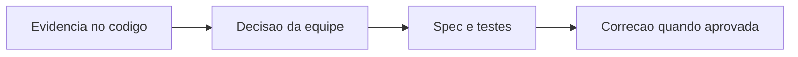

# WorkoutReview - Aderencia - Debitos Tecnicos

## Indice

- [1. Resumo Executivo](#resumo)
- [2. Problemas por Criticidade](#problemas)
- [3. Plano de Acao](#plano)
- [4. User Stories para Implementacao](#stories)

## 1. Resumo Executivo

**Estado atual**: dominio isolado, com factories/metodos e evidencias em [Fonte](../../../src/Steady.Domain/Adherence/WorkoutReview.cs) e [Testes](../../../tests/Steady.Domain.Tests/WorkoutReviewTests.cs).
**Principais problemas**: Bloqueio lexical nao cobre todas as afirmacoes inseguras
**Impacto no negocio**: TrySetExplanation usa uma lista finita de termos; por exemplo uma afirmacao de fratura nao contem nenhum termo da lista. Isso limita a garantia semantica exigida pela ADR-014.
**Fontes**: [STORY-014](../../../specs/STORY-014/spec.bdd.md), [ADR-014](../../../docs/adr/ADR-014-fronteira-deterministica-da-revisao.md), [ADR-015](../../../docs/adr/ADR-015-tolerancias-e-politicas-versionadas.md), [ADR-016](../../../docs/adr/ADR-016-provedor-da-explicacao-da-revisao.md), [ADR-018](../../../docs/adr/ADR-018-outbox-transacional-da-revisao.md). Calibracao de tolerancia e regras complexas aceitas nao sao classificadas como defeito.

## 2. Problemas por Criticidade

### Importante

**Bloqueio lexical nao cobre todas as afirmacoes inseguras**: TrySetExplanation usa uma lista finita de termos; por exemplo uma afirmacao de fratura nao contem nenhum termo da lista. Isso limita a garantia semantica exigida pela ADR-014.

**Acao recomendada**: Ampliar bateria de casos perigosos e definir validacao conservadora para termos e frases clinicas, mantendo rejeicao sem alterar acao.

Demais niveis: nenhum debito comprovado nesta analise.

## 3. Plano de Acao

1. Criticos: nenhum identificado nesta unidade.
2. Importantes: validar a proposta abaixo e reproduzir a evidencia antes de implementar.
3. Menores: manter documentacao sincronizada ao alterar regras ou contratos.

## 4. User Stories para Implementacao

### Story proposta: Bloqueio lexical nao cobre todas as afirmacoes inseguras

**Contexto atual**: TrySetExplanation usa uma lista finita de termos; por exemplo uma afirmacao de fratura nao contem nenhum termo da lista. Isso limita a garantia semantica exigida pela ADR-014.
**Objetivo**: fechar a lacuna observada sem mudar o restante da regra.
**Regras de negocio**: preservar limites e semantica estabelecidos nas fontes citadas.
**Especificacao tecnica**: Ampliar bateria de casos perigosos e definir validacao conservadora para termos e frases clinicas, mantendo rejeicao sem alterar acao.

**Criterios de aceite**:

- [ ] Casos atuais e novas parafrases diagnosticas devem ser rejeitados; texto factual valido e numeros permitidos continuam aceitos.
- [ ] Cenários da regra atual continuam validos.
- [ ] Spec, testes e codigo refletem a decisao aceita pela equipe.

**Roteiro de teste**:

1. **Entrada**: `Acao ReduceLoad, frase "Voce teve uma fratura.", lista de numeros vazia`. **Resultado esperado**: Hoje aceita por nao conter termo listado; apos endurecimento deve rejeitar UnsafeClaim.
2. **Entrada**: `Acao ReduceLoad, frase "Distancia 8 km, alvo 10 km.", allowedNumbers=[8,10]`. **Resultado esperado**: Explicacao aceita, status Available.

Esta story e recomendacao documental, nao autorizacao de implementacao.

**Referencia funcional**: [Regras](../BusinessRulesDocs/Revisao-do-Treino-Aderencia-Rules.md). **Detalhes tecnicos**: [DevDocs](../DevDocs/WorkoutReview-Aderencia-DevDocs.md).
