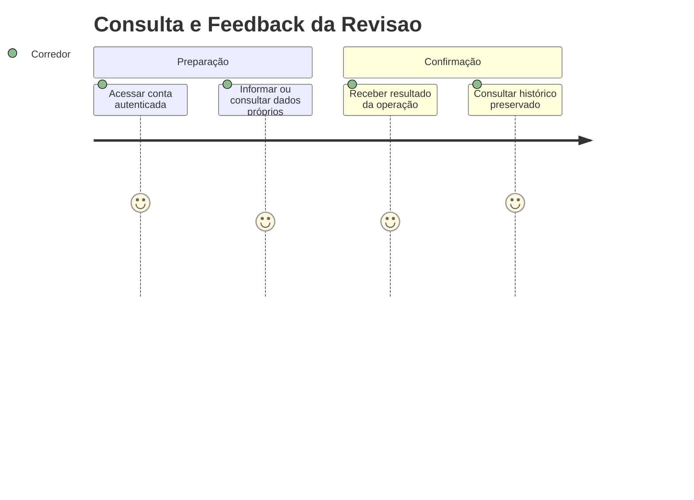
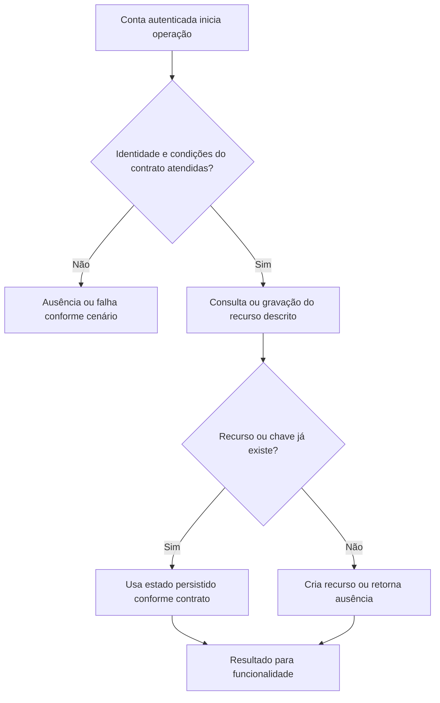

# Consulta e Feedback da Revisao - Persistencia-Revisao - Regras de Negócio

## Índice

- [Resumo](#resumo)
- [Jornada](#jornada)
- [Regras e restrições](#regras)
- [Fluxo](#fluxo)
- [Cenários](#cenarios)

## 1. Resumo da funcionalidade

Consultar revisão do próprio treino e registrar entendimento/contestação. Usuários: corredor e, nos recursos de coaching, personal autorizado por vínculo. A operação acontece nos registros/consultas do aplicativo ou no processamento de revisão. O valor é conservar histórico confiável e restringir acesso aos participantes autorizados.

## 2. Jornada do usuário

Pontos de contato: conta autenticada, funcionalidade de treino/planejamento/coaching e histórico ou revisão. Os repositórios não exibem telas; preservam os dados usados por esses pontos de contato.

## 3. Regras de negócio e restrições

- **GetLatestAsync**: Filtra corredor e ordena ExecutionDate/CreatedAt desc; FirstOrDefaultAsync retorna null se vazio.
- **GetByExecutionAsync**: Filtra corredor e executionId.
- **GetForPersonalAsync**: HasActiveAsync do par; sem vínculo null; autorizado delega GetByExecutionAsync.
- **GetByCorredorAsync**: Lista isolada, ordenação ExecutionDate/CreatedAt desc.
- **MarkUnderstoodAsync**: UpdateAsync define UnderstoodAt apenas se nulo, preservando primeira confirmação.
- **MarkContestedAsync**: UpdateAsync define Contested=true sem mudar Action.
- **UpdateAsync**: Busca reviewId/corredor; ausente false; aplica delegado, SaveChangesAsync, true.

A conta recebida vem da autenticação na API. Onde há personal, papel e vínculo têm funções diferentes: ter o papel não concede acesso a todo corredor. A regra específica de autorização está descrita acima e na documentação técnica. Inputs do domínio são validados antes da persistência; não há diagnóstico médico nesta camada.

## 4. Fluxos de processo

Integrações: autenticação fornece identidade; domínio valida prescrições/registros; persistência conserva estado; API traduz resultado para resposta.

## 5. Casos de uso e cenários

| Entrada | Pré-condição/ação | Resultado esperado |
|---|---|---|
| A marca revisão R como entendida duas vezes | R pertence a A | true nas duas; timestamp inicial preservado |
| B busca execução de A | GetByExecutionAsync(B,id) | null |
| A contesta R com Action=ReduceLoad | MarkContestedAsync | Contested=true, Action permanece ReduceLoad |

A e B representam contas diferentes; K uma chave de idempotência; P um personal; R/L/F identificadores de revisão, vínculo ou ficha. Cada cenário parte do estado indicado, executa o método citado e verifica tanto o retorno quanto a ausência de mudança em dados alheios.

Referências normativas e técnicas:

- [docs/adr/ADR-002-autenticacao-e-isolamento-de-dados.md](../../../docs/adr/ADR-002-autenticacao-e-isolamento-de-dados.md)
- [docs/adr/ADR-008-roles-vinculo-e-autorizacao-do-personal.md](../../../docs/adr/ADR-008-roles-vinculo-e-autorizacao-do-personal.md)
- [docs/adr/ADR-014-fronteira-deterministica-da-revisao.md](../../../docs/adr/ADR-014-fronteira-deterministica-da-revisao.md)
- [tests/Steady.Api.Tests/WorkoutReviewEndpointTests.cs](../../../tests/Steady.Api.Tests/WorkoutReviewEndpointTests.cs)
- [src/Steady.Infrastructure/Persistence/SteadyDbContext.cs](../../../src/Steady.Infrastructure/Persistence/SteadyDbContext.cs)
- [Detalhamento técnico](../DevDocs/WorkoutReviewRepository-Persistencia-Revisao-DevDocs.md)

Especificações de comportamento relacionadas:

- [STORY-014](../../../specs/STORY-014/spec.bdd.md)
