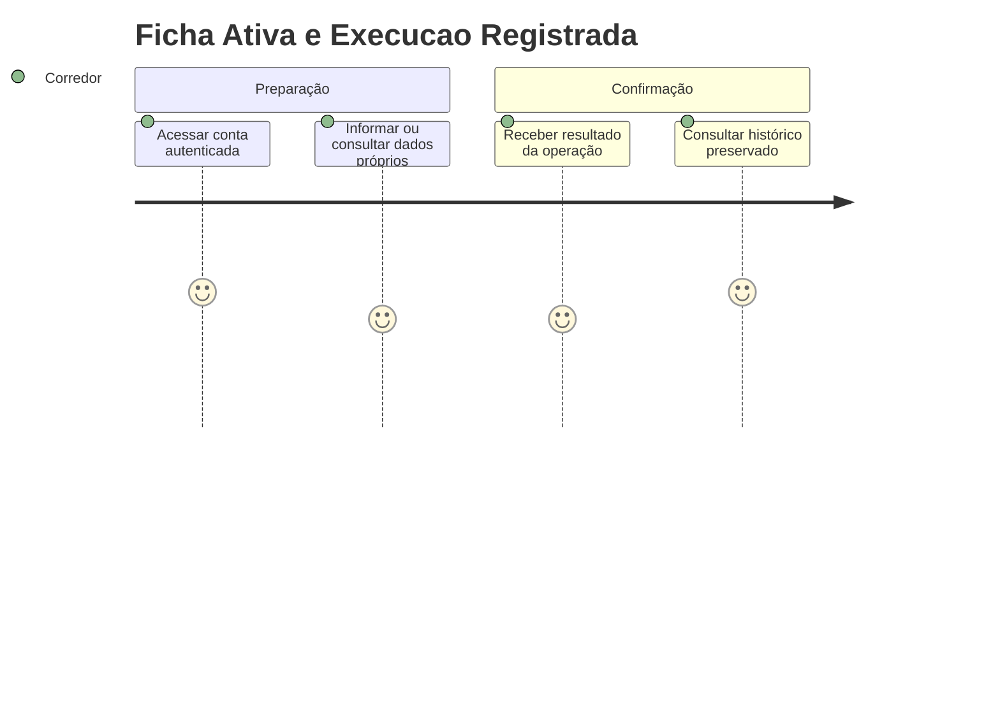
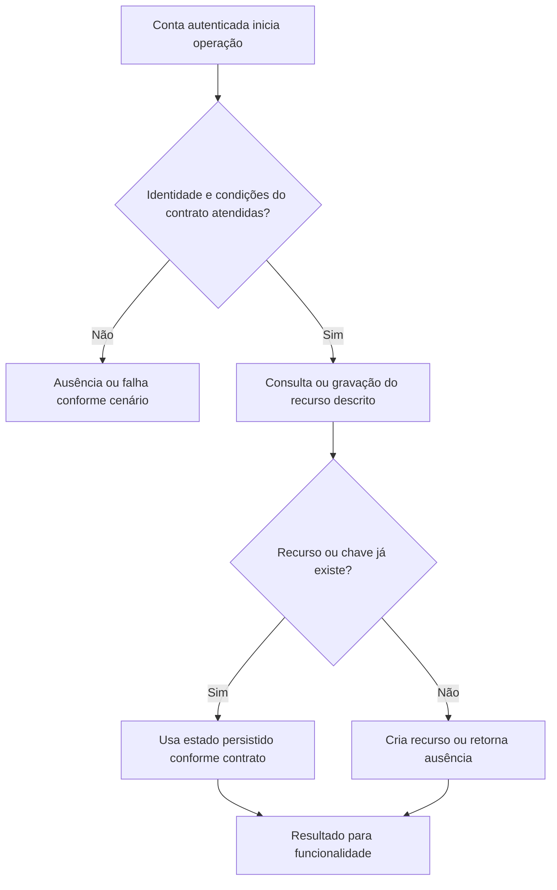

# Ficha Ativa e Execucao Registrada - Persistencia-Coaching - Regras de Negócio

## Índice

- [Resumo](#resumo)
- [Jornada](#jornada)
- [Regras e restrições](#regras)
- [Fluxo](#fluxo)
- [Cenários](#cenarios)

## 1. Resumo da funcionalidade

Publicar ficha com vínculo ativo e registrar exercícios/corrida de modo atômico. Usuários: corredor e, nos recursos de coaching, personal autorizado por vínculo. A operação acontece nos registros/consultas do aplicativo ou no processamento de revisão. O valor é conservar histórico confiável e restringir acesso aos participantes autorizados.

## 2. Jornada do usuário

Pontos de contato: conta autenticada, funcionalidade de treino/planejamento/coaching e histórico ou revisão. Os repositórios não exibem telas; preservam os dados usados por esses pontos de contato.

## 3. Regras de negócio e restrições

- **PublishAsync**: HasActiveAsync exige vínculo; ausência lança UnauthorizedAccessException. Transação desativa fichas do corredor, adiciona nova DefinitionJson e confirma SaveChanges/Commit.
- **GetActiveAsync**: Busca CorredorId/IsActive; ausente null. Desserializa ficha; execuções da mesma ficha/corredor por CreatedAt desc; TryAdd por ExerciseId mantém primeira sugestão e skipped gera null.
- **GetByIdForRunnerAsync**: Busca sheetId e corredorId sem exigir ficha ativa.
- **AddExecutionAsync**: Idempotência por corredor/chave; novo grava detalhes, outbox Strength e dor opcional com SaveChanges único.
- **AddCombinedExecutionAsync**: Consulta ambas as execuções pela chave; ambas existentes retornam Created=false, somente uma existente lança InvalidOperationException. Novas linhas strength/running, outbox Combined e dor são gravadas e confirmadas em transação.
- **GetHistoryAsync**: Sem vínculo ativo retorna []; autorizado lista corredor por Date desc e CreatedAt desc.
- **GetExecutionsForRunnerAsync**: Mesma lista isolada por corredor, sem verificar papel pessoal.
- **AddReviewOutbox**: Cria Pending com Ids, tipo, data, chave, dor e CreatedAt.
- **AddCompletionPain**: Só se booleano true cria região "Informada no encerramento".
- **Serialize**: Overloads de ficha e execução preservam Id, ExerciseKey, duração, observação ou nota e campos numéricos opcionais das corridas.
- **DeserializeSheet**: Recria Push/Pull/Lower/Run por fábricas do domínio.
- **FromDocument**: Prioriza prescrição numérica nova, depois descrição diária legada, descrição única legada, por fim string vazia. Não inventa faixas.
- **ToDocument**: Preserva faixas Min/Max ou null.
- **DeserializeExecution**: Skipped usa SkippedExercise; execução normal exige LoadKg, ou lança InvalidOperationException. ExerciseKey ausente recebe compatibilidade das fábricas do domínio.

A conta recebida vem da autenticação na API. Onde há personal, papel e vínculo têm funções diferentes: ter o papel não concede acesso a todo corredor. A regra específica de autorização está descrita acima e na documentação técnica. Inputs do domínio são validados antes da persistência; não há diagnóstico médico nesta camada.

## 4. Fluxos de processo

Integrações: autenticação fornece identidade; domínio valida prescrições/registros; persistência conserva estado; API traduz resultado para resposta.

## 5. Casos de uso e cenários

| Entrada | Pré-condição/ação | Resultado esperado |
|---|---|---|
| P publica ficha F para A sem vínculo | PublishAsync | UnauthorizedAccessException; nada gravado |
| A encerra combinado K com dor=true | Novo registro | Força + corrida + uma outbox Combined + dor; Created=true |
| Documento legado com RunDescription="Leve" | Desserializar | Três dias Leve e faixas null |

A e B representam contas diferentes; K uma chave de idempotência; P um personal; R/L/F identificadores de revisão, vínculo ou ficha. Cada cenário parte do estado indicado, executa o método citado e verifica tanto o retorno quanto a ausência de mudança em dados alheios.

Referências normativas e técnicas:

- [docs/adr/ADR-002-autenticacao-e-isolamento-de-dados.md](../../../docs/adr/ADR-002-autenticacao-e-isolamento-de-dados.md)
- [docs/adr/ADR-009-ficha-ativa-e-execucao-imutavel.md](../../../docs/adr/ADR-009-ficha-ativa-e-execucao-imutavel.md)
- [docs/adr/ADR-010-ficha-com-prescricoes-de-corrida-por-dia.md](../../../docs/adr/ADR-010-ficha-com-prescricoes-de-corrida-por-dia.md)
- [docs/adr/ADR-011-registro-combinado-de-musculacao-e-corrida.md](../../../docs/adr/ADR-011-registro-combinado-de-musculacao-e-corrida.md)
- [docs/adr/ADR-012-prescricao-de-corrida-estruturada.md](../../../docs/adr/ADR-012-prescricao-de-corrida-estruturada.md)
- [docs/adr/ADR-018-outbox-transacional-da-revisao.md](../../../docs/adr/ADR-018-outbox-transacional-da-revisao.md)
- [docs/adr/ADR-019-identidade-historica-do-exercicio.md](../../../docs/adr/ADR-019-identidade-historica-do-exercicio.md)
- [tests/Steady.Api.Tests/TrainingSheetDocumentsTests.cs](../../../tests/Steady.Api.Tests/TrainingSheetDocumentsTests.cs)
- [src/Steady.Infrastructure/Persistence/SteadyDbContext.cs](../../../src/Steady.Infrastructure/Persistence/SteadyDbContext.cs)
- [Detalhamento técnico](../DevDocs/TrainingSheetRepository-Persistencia-Coaching-DevDocs.md)

Especificações de comportamento relacionadas:

- [STORY-013](../../../specs/STORY-013/spec.bdd.md)
- [STORY-015](../../../specs/STORY-015/spec.bdd.md)
- [STORY-017](../../../specs/STORY-017/spec.bdd.md)
- [STORY-014](../../../specs/STORY-014/spec.bdd.md)
