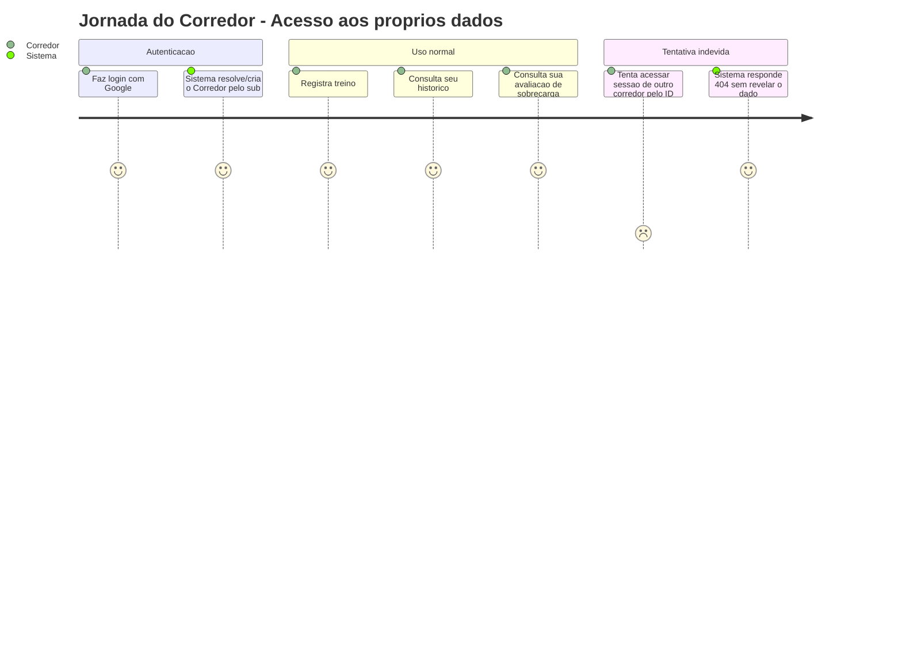
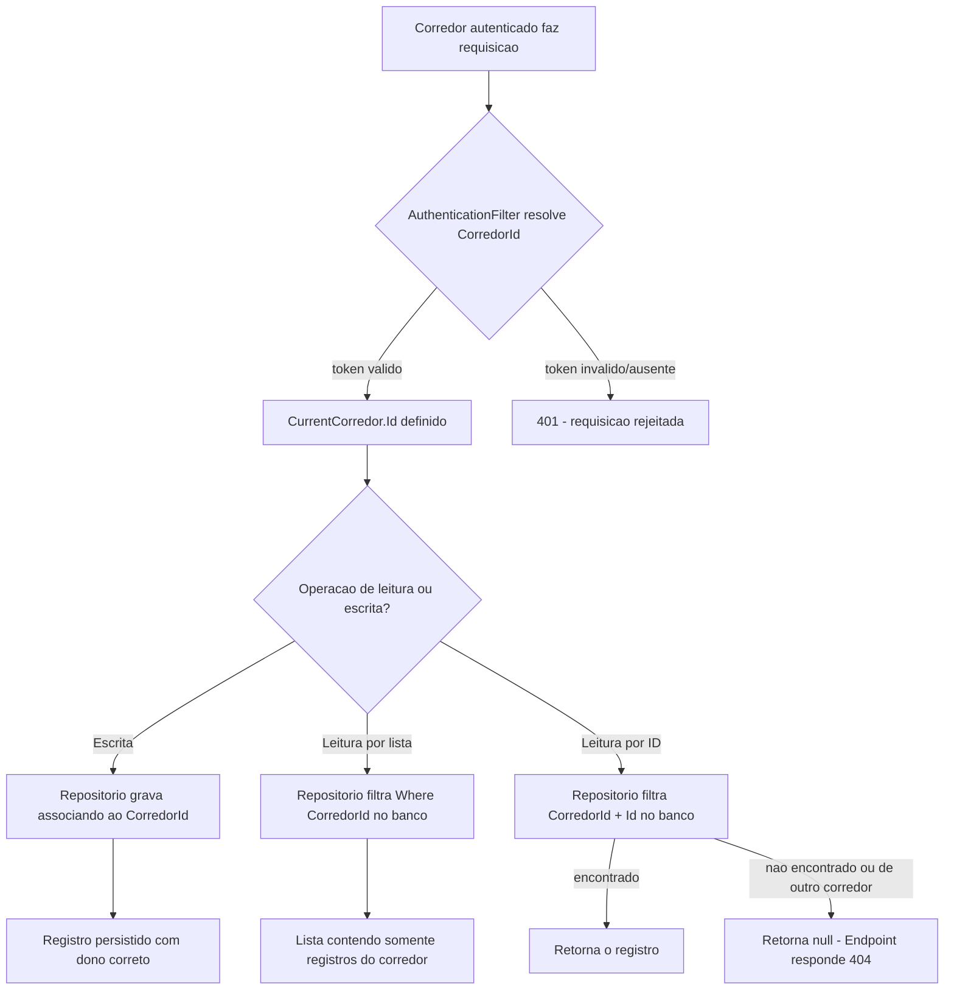
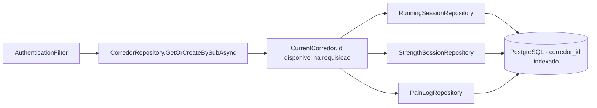

# Isolamento de Dados por Corredor - Persistencia-Autenticacao - Regras de Negocio

## Indice
- [1. Resumo da Funcionalidade](#1-resumo-da-funcionalidade)
- [2. Jornada do Usuario](#2-jornada-do-usuario)
- [3. Regras de Negocio por Funcionalidade](#3-regras-de-negocio-por-funcionalidade)
- [4. Validacoes e Restricoes](#4-validacoes-e-restricoes)
- [5. Fluxos de Processo](#5-fluxos-de-processo)
- [6. Casos de Uso e Cenarios](#6-casos-de-uso-e-cenarios)

## 1. Resumo da Funcionalidade

**Proposito**: garantir que cada corredor (usuario do Steady) veja e altere apenas os proprios dados de treino e de dor -- nunca dados de outro corredor. Esta e a regra de negocio mais critica de toda a camada de persistencia, pois o Steady lida com dados de saude e localizacao de treino.

**Usuarios**: todos os corredores autenticados via Google Sign-In.

**Valor de Negocio**: sem isolamento garantido, um vazamento de dados entre usuarios (ex.: corredor A ve o historico de dor de corredor B) seria uma falha de privacidade grave, quebrando a confianca no produto e violando o mandato invioravel da `PROJECT-CONSTITUTION.md`.

**Frequencia de Uso**: aplicada em 100% das operacoes de leitura e escrita que envolvem dados de treino -- nao e uma funcionalidade opcional, e uma invariante do sistema.

**Impacto Operacional**: cada nova consulta ou repositorio criado no futuro deve seguir o mesmo padrao (filtrar por `corredor_id` na query do banco), sob risco de reintroduzir a falha.

## 2. Jornada do Usuario

### Visao Geral da Jornada

### Pontos de Contato

- **Login (Google Sign-In)**: o `sub` do token do Google e a chave estavel que identifica o corredor em toda a aplicacao -- ver `CorredorRepository-Persistencia-Autenticacao-DevDocs.md`.
- **Registro de treino/dor**: toda escrita associa o registro ao `corredor_id` do usuario autenticado, nunca a um valor informado pelo cliente.
- **Consulta de historico/avaliacao**: toda leitura filtra por `corredor_id` diretamente na query SQL.

## 3. Regras de Negocio por Funcionalidade

### 3.1. Identificacao do Corredor

**O que faz**: transforma o `sub` do Google (um identificador tecnico) no `CorredorId` interno usado em todo o sistema.

**Regras Aplicadas**:
- **Identidade estavel**: o `sub` do Google e unico e nao muda entre logins -- e a chave de correlacao (`CorredorRepository.GetOrCreateBySubAsync`).
  - *Exemplo*: o mesmo corredor logando em dias diferentes sempre recebe o mesmo `CorredorId`.
- **Provisionamento automatico**: se o `sub` e novo, um Corredor e criado na hora, sem tela de cadastro (ver [ADR-002](../../../docs/adr/ADR-002-autenticacao-e-isolamento-de-dados.md)).
  - *Exemplo*: primeiro login de um novo usuario ja permite registrar treino imediatamente.

**Cenarios de Uso**:
- **Login recorrente**: Corredor ja existe, e reaproveitado.
- **Primeiro login**: Corredor e criado automaticamente.
- **Dois primeiros logins simultaneos (mesmo sub)**: apenas um Corredor e criado, a segunda requisicao reaproveita o primeiro (tratamento de corrida em `CorredorRepository`).

**Resultado Esperado**: cada corredor tem exatamente um `CorredorId` estavel, independentemente de quantas vezes fizer login.

### 3.2. Isolamento de Dados nas Consultas

**O que faz**: garante que toda consulta de treino ou dor devolva apenas os registros do corredor autenticado.

**Regras Aplicadas**:
- **Filtro no banco, nunca em memoria**: toda query usa `WHERE corredor_id = @corredorId` diretamente na consulta SQL (via `Where(s => s.CorredorId == corredorId)` no LINQ do EF Core), nunca busca "todos os registros" e filtra depois no codigo.
  - *Exemplo correto*: `RunningSessionRepository.GetByCorredorIdAsync` -- a query enviada ao PostgreSQL ja contem a condicao `corredor_id = @corredorId`.
  - *Exemplo incorreto (nao existe no codigo atual, mas seria a violacao)*: buscar todas as `running_sessions` da tabela e filtrar em memoria com LINQ-to-Objects -- isso traria dados de todos os corredores para dentro do processo da aplicacao antes de descartar o que nao pertence ao usuario, criando uma janela de exposicao (ex.: em caso de bug no filtro em memoria, log acidental, ou dump de memoria).
- **Acesso direto por ID tambem e escopado**: `GetByIdAsync(corredorId, sessionId, ...)` recebe o `corredorId` como parametro obrigatorio e o inclui na condicao `WHERE`, mesmo quando o cliente ja informa o `sessionId` especifico.
  - *Exemplo*: tentar buscar a sessao de outro corredor pelo ID retorna `null` do repositorio (nao lanca excecao, nao retorna o dado) -- o Endpoint traduz isso em HTTP 404.
- **404, nunca 403, para recurso de outro corredor**: a API nao revela que o recurso existe (Playbook A01 - Broken Access Control). Essa decisao e do Endpoint (`Steady.Api`), mas so e possivel porque o repositorio ja devolve `null` em vez de um resultado com dado de outro usuario.

**Cenarios de Uso**:
- **Consulta normal**: corredor consulta seu proprio historico, recebe apenas seus registros.
- **Consulta vazia**: corredor sem historico recebe lista vazia, nao erro (ver STORY-002, cenario "Corredor sem historico consulta seu historico de treinos").
- **Tentativa de acesso cruzado**: corredor tenta acessar ID de sessao de outro corredor, recebe "nao encontrado".

**Resultado Esperado**: nenhum corredor consegue, por nenhuma via da API, observar dado de treino ou de dor de outro corredor.

## 4. Validacoes e Restricoes

### Controle de Acesso
- **Permissoes**: qualquer corredor autenticado pode ler/escrever seus proprios dados; nenhum corredor pode ler/escrever dados de outro, sem excecao e sem papel de administrador nesta camada.
- **Hierarquia**: nao ha hierarquia de acesso no MVP -- todos os corredores tem o mesmo nivel de permissao sobre os proprios dados.

### Dados e Entrada
- **Dados Obrigatorios**: todo registro de treino (`RunningSessionEntity`, `StrengthSessionEntity`) e de dor (`PainLogEntity`) exige `CorredorId` preenchido -- nao ha registro "orfao" sem dono.
- **Origem do CorredorId**: sempre derivado do token validado pelo `AuthenticationFilter` (`CurrentCorredor.Id`), nunca aceito como campo de entrada do cliente na requisicao de escrita -- isso impediria um corredor de "escrever em nome" de outro.

### Restricoes do Sistema
- **Dependencias**: o isolamento depende do indice `corredor_id` existir e ser usado em toda query nova -- e uma disciplina de codigo, nao uma constraint de banco que impeca a violacao automaticamente (ver TechnicalDebtsDocs de cada repositorio).
- **Limitacoes Tecnicas**: o EF Core nao aplica filtro global automatico (`HasQueryFilter`) nesta base -- cada metodo de repositorio e responsavel por incluir a condicao manualmente (ver observacao em `SteadyDbContext-ServiceCollectionExtensions-Persistencia-Configuracao-Debts.md`).

## 5. Fluxos de Processo

### Fluxo Principal

### Integracoes com Outros Processos

## 6. Casos de Uso e Cenarios

### Caso de Uso 1: Corredor consulta o proprio historico de treinos
**Ator Principal**: Corredor autenticado.
**Objetivo**: ver todas as suas sessoes de corrida e musculacao.
**Pre-condicoes**: token do Google valido, `CorredorId` resolvido.

**Fluxo Principal**:
1. Corredor chama `GET /api/training-sessions`.
2. `TrainingHistoryEndpoints` chama `GetByCorredorIdAsync(currentCorredor.Id, ct)` em `RunningSessionRepository` e `StrengthSessionRepository`.
3. Cada repositorio devolve apenas as linhas com `corredor_id` igual ao do corredor autenticado.

**Pos-condicoes**: lista devolvida contem exclusivamente sessoes do proprio corredor, ordenadas por data.

### Caso de Uso 2: Corredor tenta acessar sessao de outro corredor pelo ID
**Ator Principal**: Corredor autenticado (mal-intencionado ou por engano, ex.: ID copiado de um link compartilhado).
**Objetivo (indevido)**: ver detalhes de uma sessao que nao lhe pertence.
**Pre-condicoes**: conhece (ou adivinha) o `Guid` de uma sessao de outro corredor.

**Fluxo Principal**:
1. Corredor chama `GET /api/training-sessions/{id}` com o ID de outro corredor.
2. `RunningSessionRepository.GetByIdAsync(currentCorredor.Id, id, ct)` executa `WHERE corredor_id = @meuId AND Id = @id`.
3. Nenhuma linha satisfaz as duas condicoes simultaneamente -> repositorio devolve `null`.
4. Endpoint traduz `null` em HTTP 404.

**Pos-condicoes**: nenhum dado de outro corredor e exposto; a resposta nao diferencia "nao existe" de "existe mas nao e seu".

### Matriz de Cenarios
| Cenario | Entrada | Acao do Sistema | Resultado Esperado |
|---------|---------|-----------------|-------------------|
| Consulta do proprio historico | CorredorId do usuario logado | Filtra `WHERE corredor_id = @meuId` | Lista somente com registros proprios |
| Consulta sem historico | CorredorId sem nenhum registro | Filtra `WHERE corredor_id = @meuId` | Lista vazia, sem erro |
| Acesso a ID de outro corredor | Id de sessao alheia + meu CorredorId | Filtra `WHERE corredor_id = @meuId AND Id = @id` | Nenhuma linha -> null -> 404 |
| Primeiro login (sub novo) | sub inedito | `GetOrCreateBySubAsync` cria Corredor | Novo Corredor com Id proprio |
| Dois primeiros logins simultaneos | mesmo sub em requisicoes concorrentes | Indice unico + retry de leitura | Um unico Corredor, sem duplicidade |
