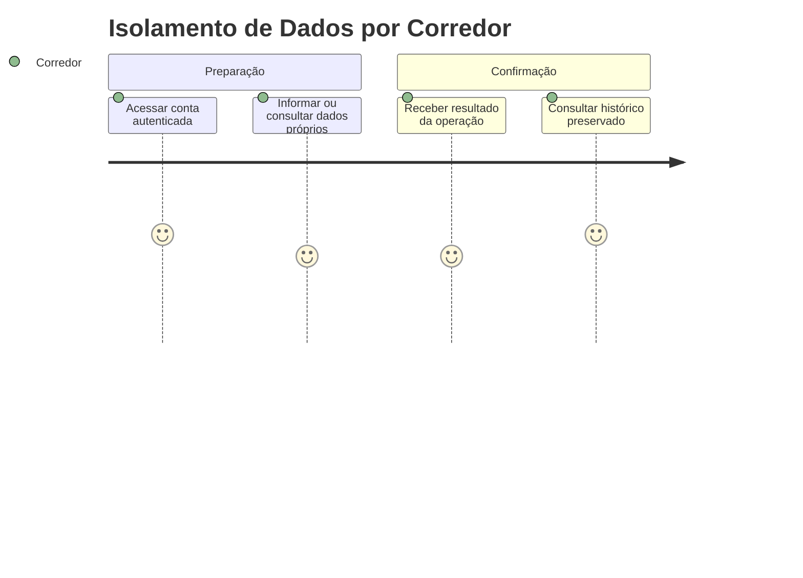
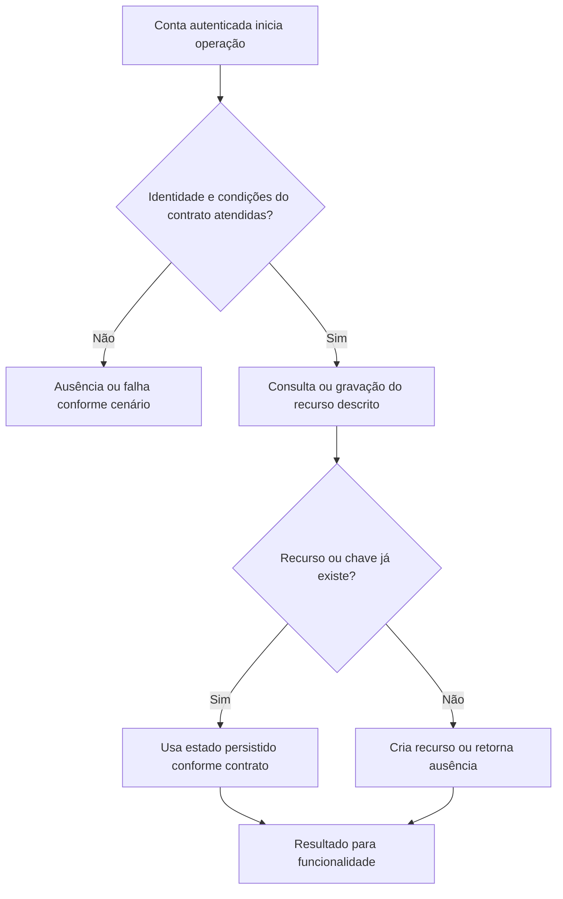

# Isolamento de Dados por Corredor - Persistencia-Autenticacao - Regras de Negócio

## Índice

- [Resumo](#resumo)
- [Jornada](#jornada)
- [Regras e restrições](#regras)
- [Fluxo](#fluxo)
- [Cenários](#cenarios)

## 1. Resumo da funcionalidade

Provisionar identidade e sincronizar perfil sem trocar a versão de plano. Usuários: corredor e, nos recursos de coaching, personal autorizado por vínculo. A operação acontece nos registros/consultas do aplicativo ou no processamento de revisão. O valor é conservar histórico confiável e restringir acesso aos participantes autorizados.

## 2. Jornada do usuário

Pontos de contato: conta autenticada, funcionalidade de treino/planejamento/coaching e histórico ou revisão. Os repositórios não exibem telas; preservam os dados usados por esses pontos de contato.

## 3. Regras de negócio e restrições

- **GetOrCreateBySubAsync**: Busca google_sub; existente segue SincronizarPerfilAsync; novo consulta GetCurrentVersionAsync, gera Id, papel Corredor e fixa TrainingPlanVersionId. SaveChangesAsync; DbUpdateException desanexa o candidato, relê vencedor por sub e sincroniza perfil.
- **FindRunnerByEmailAsync**: Filtra email no banco, materializa candidatos e retorna o primeiro com Roles.Contains("Corredor"); e-mail não é identidade e pode repetir.
- **GetByIdAsync**: Busca Id e retorna conta ou null; chamador deve autorizar esse acesso.
- **SincronizarPerfilAsync**: Claim email/name nulo não apaga valor salvo; valores iguais não escrevem; diferenças não nulas alteram perfil e salvam.

A conta recebida vem da autenticação na API. Onde há personal, papel e vínculo têm funções diferentes: ter o papel não concede acesso a todo corredor. A regra específica de autorização está descrita acima e na documentação técnica. Inputs do domínio são validados antes da persistência; não há diagnóstico médico nesta camada.

## 4. Fluxos de processo

Integrações: autenticação fornece identidade; domínio valida prescrições/registros; persistência conserva estado; API traduz resultado para resposta.

## 5. Casos de uso e cenários

| Entrada | Pré-condição/ação | Resultado esperado |
|---|---|---|
| GetOrCreateBySubAsync(sub="g-a", email="a@exemplo.com", name="Ana") | Conta inexistente | Conta nova, Roles=[Corredor], versão vigente fixada |
| Mesmo sub; email/name=null | Conta Ana já existe | Mesmo Id e perfil Ana preservado |
| FindRunnerByEmailAsync("p@exemplo.com") | Só conta Personal | null |

A e B representam contas diferentes; K uma chave de idempotência; P um personal; R/L/F identificadores de revisão, vínculo ou ficha. Cada cenário parte do estado indicado, executa o método citado e verifica tanto o retorno quanto a ausência de mudança em dados alheios.

Referências normativas e técnicas:

- [docs/adr/ADR-002-autenticacao-e-isolamento-de-dados.md](../../../docs/adr/ADR-002-autenticacao-e-isolamento-de-dados.md)
- [docs/adr/ADR-008-roles-vinculo-e-autorizacao-do-personal.md](../../../docs/adr/ADR-008-roles-vinculo-e-autorizacao-do-personal.md)
- [docs/adr/ADR-013-plano-do-steady-como-fonte-de-prescricao.md](../../../docs/adr/ADR-013-plano-do-steady-como-fonte-de-prescricao.md)
- [tests/Steady.Api.Tests/AuthenticationTests.cs](../../../tests/Steady.Api.Tests/AuthenticationTests.cs)
- [src/Steady.Infrastructure/Persistence/SteadyDbContext.cs](../../../src/Steady.Infrastructure/Persistence/SteadyDbContext.cs)
- [Detalhamento técnico](../DevDocs/CorredorRepository-Persistencia-Autenticacao-DevDocs.md)

Especificações de comportamento relacionadas:

- [STORY-002](../../../specs/STORY-002/spec.bdd.md)
- [STORY-009](../../../specs/STORY-009/spec.bdd.md)
- [STORY-016](../../../specs/STORY-016/spec.bdd.md)
- [STORY-019](../../../specs/STORY-019/spec.bdd.md)
