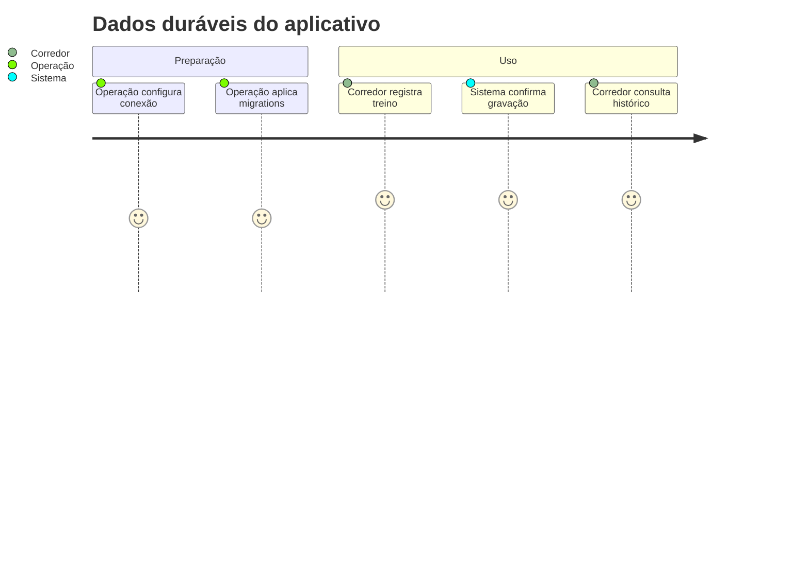
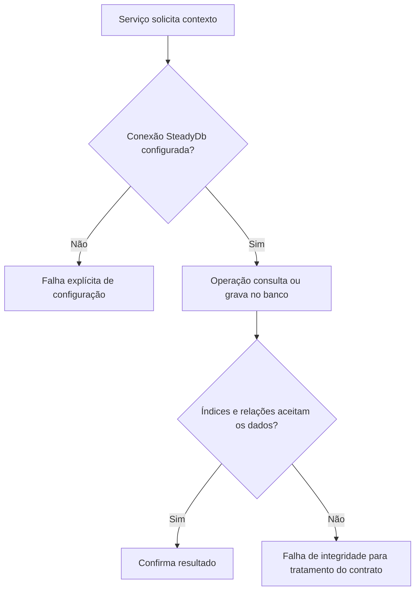

# Modelagem e conexão com o banco de dados - Persistencia-Configuracao - Regras de Negócio

## Índice

- [Resumo](#resumo)
- [Jornada](#jornada)
- [Restrições e fluxo](#fluxo)
- [Cenários](#cenarios)

## 1. Resumo

Conservar contas, treinos, pedidos, vínculos, fichas e revisões com restrições no banco. Usuários: corredor/personal pelas funções do aplicativo; operação prepara banco/configuração. Valor: impedir duplicatas e relações inválidas, preservando histórico.

## 2. Jornada

Pontos de contato: configuração de ambiente, confirmação de registro e consultas do aplicativo. O banco não autentica o usuário do aplicativo: a API valida identidade e os repositórios restringem consultas.

## 3. Regras, restrições e processo

- GoogleSub identifica conta de modo único; email é opcional e pode repetir.
- Chave de registro pertence ao corredor; mesma chave de outra conta não colide nos índices compostos.
- Um corredor tem no máximo um vínculo Active e uma ficha IsActive; Pending é único por par personal/corredor.
- Versão de plano é fixa na conta e não pode ser removida enquanto referenciada (Restrict).
- Versão e vigência de plano/política possuem índices únicos; ausência de vigente continua possível e os serviços falham explicitamente.
- Treinos resumidos/pedidos/dor/revisões/outbox referenciam corredor com Cascade; vínculo/ficha e execução de ficha usam Restrict conforme relações documentadas.
- Coluna em texto ISO é decisão da ADR-007 e exige validação anterior; jsonb guarda documentos versionados, não gera prescrição.

## 4. Casos de uso e cenários

| Entrada | Ação | Resultado esperado |
|---|---|---|
| Resolver contexto sem ConnectionStrings:SteadyDb | Fábrica de configuração | InvalidOperationException antes da consulta |
| Duas linhas running_sessions de A com mesma chave K | Confirmar segunda inserção | Índice único rejeita duplicata; a conta B pode usar K |
| Duas fichas IsActive=true para A | Confirmar gravação | Índice parcial permite somente uma ativa |

Pré-condições: banco com migrations aplicadas e identidade validada pela API. A confirmação bem-sucedida conserva dados; falhas não devem ser apresentadas como sucesso ao corredor.

Referências: [contratos e tabelas completos](../DevDocs/SteadyDbContext-ServiceCollectionExtensions-Persistencia-Configuracao-DevDocs.md), [ADR-002](../../../docs/adr/ADR-002-autenticacao-e-isolamento-de-dados.md), [ADR-007](../../../docs/adr/ADR-007-persistencia-do-pedido-de-plano-de-treino.md), [ADR-018](../../../docs/adr/ADR-018-outbox-transacional-da-revisao.md).

Especificações de comportamento relacionadas:

- [STORY-010](../../../specs/STORY-010/spec.bdd.md)
- [STORY-013](../../../specs/STORY-013/spec.bdd.md)
- [STORY-014](../../../specs/STORY-014/spec.bdd.md)
- [STORY-016](../../../specs/STORY-016/spec.bdd.md)
