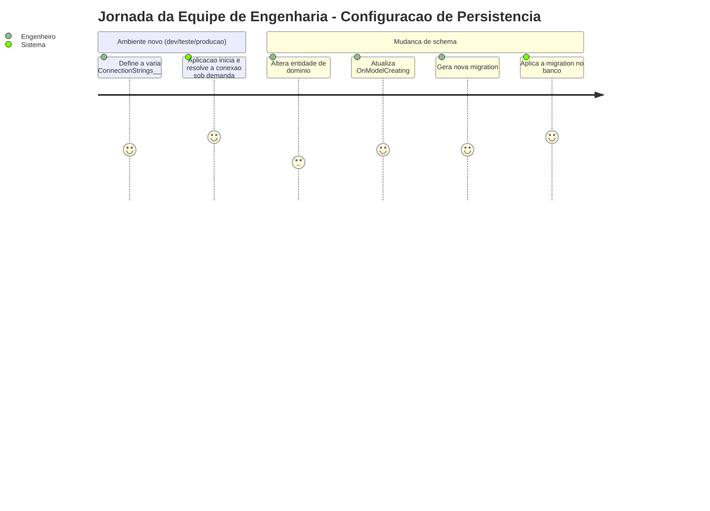
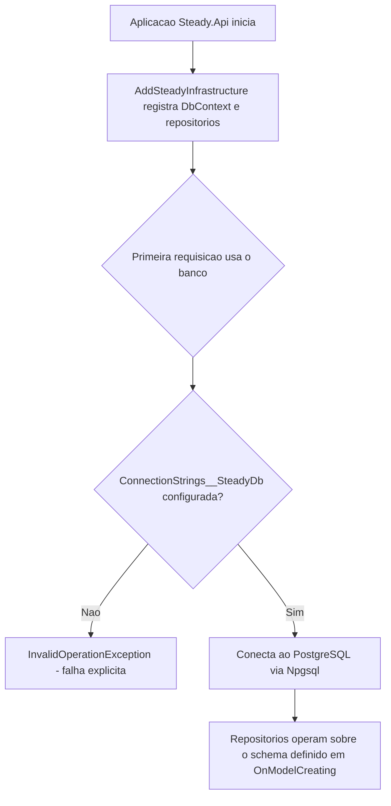
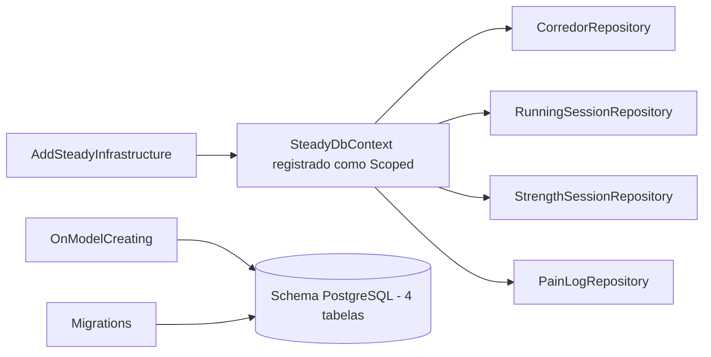

# Modelagem e Conexao com o Banco de Dados - Persistencia-Configuracao - Regras de Negocio

## Indice
- [1. Resumo da Funcionalidade](#1-resumo-da-funcionalidade)
- [2. Jornada do Usuario](#2-jornada-do-usuario)
- [3. Regras de Negocio por Funcionalidade](#3-regras-de-negocio-por-funcionalidade)
- [4. Validacoes e Restricoes](#4-validacoes-e-restricoes)
- [5. Fluxos de Processo](#5-fluxos-de-processo)
- [6. Casos de Uso e Cenarios](#6-casos-de-uso-e-cenarios)

## 1. Resumo da Funcionalidade

**Proposito**: esta nao e uma funcionalidade voltada ao corredor final, mas a base estrutural que torna possivel persistir e recuperar dados de forma confiavel -- como os dados de treino sao guardados no banco e como a aplicacao se conecta a ele em cada ambiente (desenvolvimento, teste, producao).

**Usuarios**: nao ha usuario final direto; os "usuarios" desta funcionalidade sao os proprios repositorios da aplicacao e a equipe de engenharia que precisa alterar o schema de dados.

**Valor de Negocio**: um schema bem definido e uma conexao configuravel por ambiente sao pre-requisitos para qualquer outra funcionalidade do produto funcionar de forma confiavel e testavel.

**Frequencia de Uso**: a configuracao de conexao roda uma vez por inicializacao da aplicacao (ou por criacao de escopo, no caso do `DbContext`); o mapeamento de schema e consultado implicitamente em toda operacao de banco.

**Impacto Operacional**: uma mudanca aqui (ex.: renomear uma coluna, mudar um tipo) exige uma migration e afeta potencialmente todos os repositorios.

## 2. Jornada do Usuario

### Visao Geral da Jornada

### Pontos de Contato
- **Variavel de ambiente `ConnectionStrings__SteadyDb`**: unico ponto de configuracao externa da conexao com o banco.
- **`AddSteadyInfrastructure()`**: chamado uma vez no bootstrap de `Steady.Api`.
- **Migrations**: aplicadas para sincronizar o schema do banco com o modelo definido em `OnModelCreating`.

## 3. Regras de Negocio por Funcionalidade

### 3.1. Configuracao da Conexao com o Banco

**O que faz**: resolve, a partir de configuracao externa, como a aplicacao se conecta ao PostgreSQL -- de forma diferente para desenvolvimento, teste automatizado e producao, sem alterar codigo.

**Regras Aplicadas**:
- **Connection string obrigatoria**: se a variavel `ConnectionStrings__SteadyDb` nao estiver definida, a aplicacao falha explicitamente ao tentar usar o banco, com uma mensagem que diz exatamente o que configurar -- nao falha silenciosamente nem com uma mensagem generica do EF Core.
  - *Exemplo*: subir a aplicacao sem configurar a variavel resulta em `InvalidOperationException` com a mensagem "Connection string 'SteadyDb' nao configurada. Defina ConnectionStrings__SteadyDb como variavel de ambiente."
- **Resolucao tardia (nao no boot sincrono)**: a leitura da connection string acontece apenas quando o banco e efetivamente usado pela primeira vez em uma requisicao, nao no momento em que a aplicacao inicializa os servicos. Isso permite que testes automatizados (`WebApplicationFactory`) troquem a connection string por um banco de teste (Testcontainers) antes de qualquer conexao real acontecer.
  - *Exemplo*: a suite de testes de `Steady.Api.Tests` sobe um PostgreSQL real em container e substitui a connection string, sem precisar de nenhuma mudanca no codigo de producao.

**Cenarios de Uso**:
- **Producao/desenvolvimento**: variavel de ambiente aponta para o banco real.
- **Teste automatizado**: `WebApplicationFactory` sobrescreve a connection string para o container de teste.
- **Configuracao ausente**: aplicacao falha rapido, com mensagem clara, ao tentar usar o banco.

**Resultado Esperado**: a mesma base de codigo funciona em qualquer ambiente, apenas trocando a variavel de configuracao.

### 3.2. Modelagem do Schema de Dados

**O que faz**: define como cada entidade de dominio persistida (Corredor, Sessao de Corrida, Sessao de Musculacao, Registro de Dor) e representada como tabela, coluna, chave e indice no PostgreSQL.

**Regras Aplicadas**:
- **Nomes de tabela e coluna em snake_case**: diferente dos nomes de propriedade C# (PascalCase), as tabelas e a maioria das colunas usam snake_case (`corredores`, `google_sub`, `corredor_id`) -- convencao comum em bancos PostgreSQL.
- **Todo dado de treino/dor tem coluna `corredor_id` indexada**: garante que toda tabela dependente de um corredor possa ser filtrada eficientemente por ele -- suporte estrutural para a regra de isolamento de dados (ver `Isolamento-de-Dados-por-Corredor-Persistencia-Autenticacao-Rules.md`).
- **Enums de dominio persistidos como texto legivel**: `MuscleGroup` e `Intensity` sao gravados como texto (`"PernaFrontal"`, `"Pesado"`), nao como numeros, priorizando legibilidade dos dados brutos no banco.
- **Um unico identificador natural com indice unico**: o `sub` do Google (`google_sub`) e o unico campo com restricao de unicidade no banco -- reflete que cada corredor e unico por sua identidade Google.

**Cenarios de Uso**:
- **Adicionar um novo campo a uma entidade existente**: exige atualizar `OnModelCreating` e gerar uma nova migration.
- **Adicionar uma nova entidade de treino**: exige um novo `DbSet<>`, um novo bloco de configuracao em `OnModelCreating` e uma nova migration.

**Resultado Esperado**: o schema do banco reflete fielmente e de forma rastreavel (via migrations versionadas) o modelo de dados da aplicacao.

## 4. Validacoes e Restricoes

### Controle de Acesso
- Nao aplicavel diretamente aqui -- controle de acesso a dados e tratado pelos repositorios individuais (ver `Isolamento-de-Dados-por-Corredor-Persistencia-Autenticacao-Rules.md`).

### Dados e Entrada
- **Dados Obrigatorios**: `ConnectionStrings__SteadyDb` deve estar presente no ambiente de execucao (exceto quando sobrescrita em teste).

### Restricoes do Sistema
- **Dependencias**: toda a aplicacao depende de um PostgreSQL acessivel via Npgsql; nao ha suporte a outro banco relacional nesta configuracao.
- **Limitacoes Tecnicas**: mudancas de schema exigem migration -- nao ha atualizacao automatica de schema em produção (por design do EF Core Migrations).

## 5. Fluxos de Processo

### Fluxo Principal

### Integracoes com Outros Processos

## 6. Casos de Uso e Cenarios

### Caso de Uso 1: Equipe sobe o ambiente de teste automatizado
**Ator Principal**: pipeline de CI / desenvolvedor local.
**Objetivo**: rodar a suite de testes de integracao contra um banco real, isolado.
**Pre-condicoes**: Testcontainers disponivel no ambiente de execucao dos testes.

**Fluxo Principal**:
1. `WebApplicationFactory` customizado sobrescreve a connection string antes do host ser construido.
2. Aplicacao resolve a connection string sobrescrita na primeira uso do `DbContext` (nao antes).
3. Testes rodam contra o PostgreSQL do container, nao contra o banco de producao/dev.

**Pos-condicoes**: testes de integracao validam comportamento real do EF Core + PostgreSQL, sem tocar em dados reais.

### Matriz de Cenarios
| Cenario | Entrada | Acao do Sistema | Resultado Esperado |
|---------|---------|-----------------|-------------------|
| Producao com connection string configurada | variavel de ambiente presente | Conecta normalmente | Aplicacao opera normalmente |
| Producao sem connection string | variavel ausente | Lanca excecao explicita na primeira uso do banco | Falha rapida com mensagem acionavel |
| Teste automatizado | WebApplicationFactory sobrescreve a string | Usa o banco de teste (Testcontainers) | Testes isolados do banco real |
