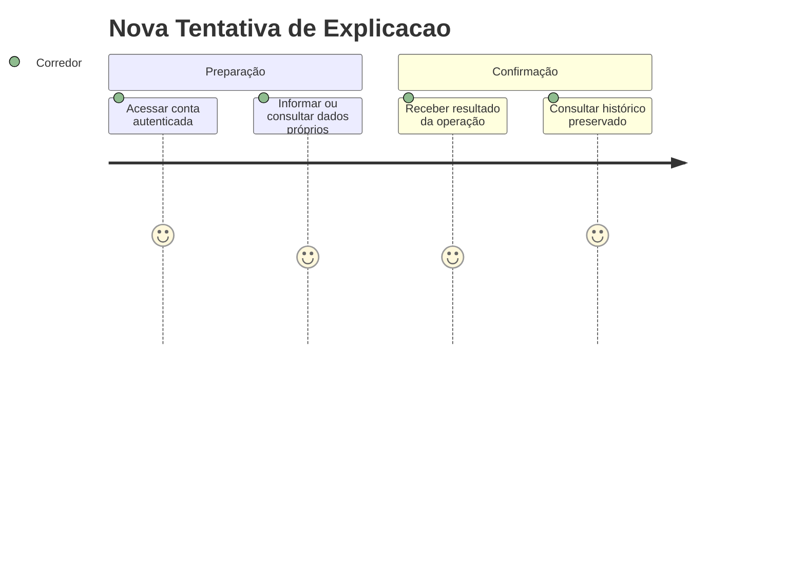
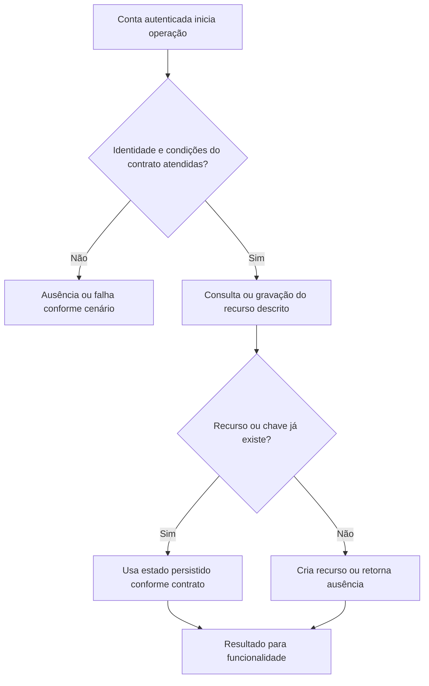

# Nova Tentativa de Explicacao - Persistencia-Revisao - Regras de Negócio

## Índice

- [Resumo](#resumo)
- [Jornada](#jornada)
- [Regras e restrições](#regras)
- [Fluxo](#fluxo)
- [Cenários](#cenarios)

## 1. Resumo da funcionalidade

Repetir somente explicação usando fatos e ação já congelados. Usuários: corredor e, nos recursos de coaching, personal autorizado por vínculo. A operação acontece nos registros/consultas do aplicativo ou no processamento de revisão. O valor é conservar histórico confiável e restringir acesso aos participantes autorizados.

## 2. Jornada do usuário

Pontos de contato: conta autenticada, funcionalidade de treino/planejamento/coaching e histórico ou revisão. Os repositórios não exibem telas; preservam os dados usados por esses pontos de contato.

## 3. Regras de negócio e restrições

- **RetryAsync**: Busca reviewId/corredor; ausente false; Action null retorna true sem chamar provedor. Desserializa ComparisonJson em ReviewSnapshot antes do try. Timeout vinculado de 15s; ExplainAsync usa modality/facts/action congelados e flag action==PrioritizeRecovery. Null marca Unavailable e salva; resposta passa TrySetExplanation com números permitidos dos fatos. Aceita serializa e marca Available; rejeita limpa ExplanationJson, marca Unavailable e loga motivo. Timeout ou erro do provedor marca Unavailable e loga erro quando aplicável; salva e retorna true. Não recalcula status nem ação.
- **ExplainAsync**: UnavailableExplanationProvider retorna Task com null, independente do contexto, sem chamada externa.

A conta recebida vem da autenticação na API. Onde há personal, papel e vínculo têm funções diferentes: ter o papel não concede acesso a todo corredor. A regra específica de autorização está descrita acima e na documentação técnica. Inputs do domínio são validados antes da persistência; não há diagnóstico médico nesta camada.

## 4. Fluxos de processo

Integrações: autenticação fornece identidade; domínio valida prescrições/registros; persistência conserva estado; API traduz resultado para resposta.

## 5. Casos de uso e cenários

| Entrada | Pré-condição/ação | Resultado esperado |
|---|---|---|
| B solicita retry de R pertencente a A | RetryAsync(B,R) | false; provedor não chamado |
| A solicita retry de R sem Action | Revisão conflitante | true; sem chamada ao provedor |
| A tenta e recebe explicação com número não permitido | TrySetExplanation rejeita | true, ExplanationJson=null, Unavailable; ação preservada |

A e B representam contas diferentes; K uma chave de idempotência; P um personal; R/L/F identificadores de revisão, vínculo ou ficha. Cada cenário parte do estado indicado, executa o método citado e verifica tanto o retorno quanto a ausência de mudança em dados alheios.

Referências normativas e técnicas:

- [docs/adr/ADR-002-autenticacao-e-isolamento-de-dados.md](../../../docs/adr/ADR-002-autenticacao-e-isolamento-de-dados.md)
- [docs/adr/ADR-014-fronteira-deterministica-da-revisao.md](../../../docs/adr/ADR-014-fronteira-deterministica-da-revisao.md)
- [docs/adr/ADR-016-provedor-da-explicacao-da-revisao.md](../../../docs/adr/ADR-016-provedor-da-explicacao-da-revisao.md)
- [tests/Steady.Api.Tests/WorkoutReviewEndpointTests.cs](../../../tests/Steady.Api.Tests/WorkoutReviewEndpointTests.cs)
- [src/Steady.Infrastructure/Persistence/SteadyDbContext.cs](../../../src/Steady.Infrastructure/Persistence/SteadyDbContext.cs)
- [Detalhamento técnico](../DevDocs/ReviewExplanationRetryService-Persistencia-Revisao-DevDocs.md)

Especificações de comportamento relacionadas:

- [STORY-014](../../../specs/STORY-014/spec.bdd.md)
