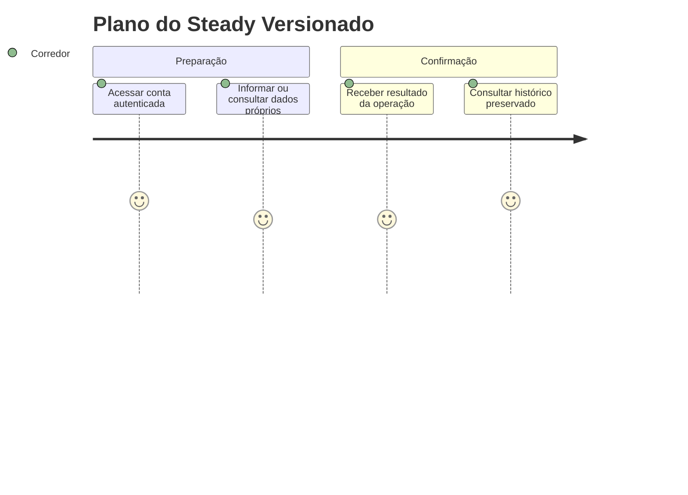
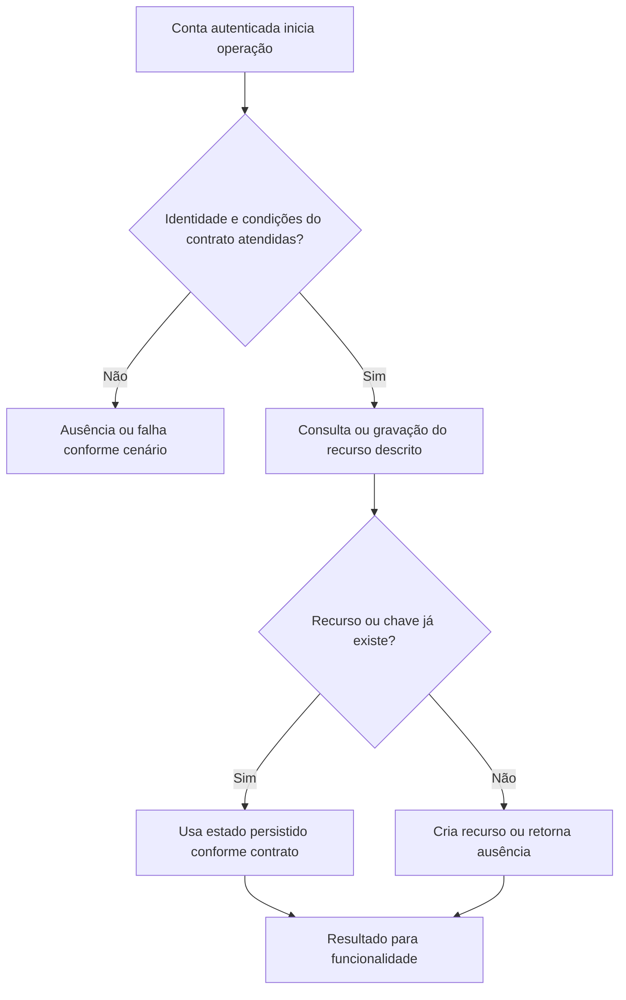

# Plano do Steady Versionado - Persistencia-Planejamento - Regras de Negócio

## Índice

- [Resumo](#resumo)
- [Jornada](#jornada)
- [Regras e restrições](#regras)
- [Fluxo](#fluxo)
- [Cenários](#cenarios)

## 1. Resumo da funcionalidade

Ler a prescrição fixa atribuída ao provisionamento, sem recalcular progressão. Usuários: corredor e, nos recursos de coaching, personal autorizado por vínculo. A operação acontece nos registros/consultas do aplicativo ou no processamento de revisão. O valor é conservar histórico confiável e restringir acesso aos participantes autorizados.

## 2. Jornada do usuário

Pontos de contato: conta autenticada, funcionalidade de treino/planejamento/coaching e histórico ou revisão. Os repositórios não exibem telas; preservam os dados usados por esses pontos de contato.

## 3. Regras de negócio e restrições

- **GetCurrentVersionAsync**: FirstOrDefaultAsync(IsCurrent); ausência lança InvalidOperationException e impede provisionamento.
- **GetForRunnerAsync**: Busca conta por Id e TrainingPlanVersionId; conta/versão ausente retorna null; desserializa a versão atribuída, nunca troca para vigente.
- **Serialize**: Converte conteúdo, sete dias, exercícios, faixas opcionais, fases, mobilidade, polimento e regras em PlanDocument com JSON Web.
- **Deserialize**: Desserializa PlanDocument ou falha; reconstrói PlanStaticContent e WeekPlan e chama SteadyTrainingPlan.Create(version,...).
- **ToDocument**: Converte dia/exercício/RunPrescription/NumericRange em documentos preservando Min/Max e null.
- **FromDocument**: Reconstrói dia, exercício e RunPrescription por fábricas do domínio.
- **Version1**: Cria versão 1 a partir de WeekPlan e conteúdo estático literal. Métodos privados Principle, Phases, WeekOverview, WeekPlan, TaperAdjustment, LongRunProgression, Mobility e GoldenRules fornecem as respectivas seções. Corridas de terça/quinta/sábado têm descrição, sem faixas numéricas por dia.

A conta recebida vem da autenticação na API. Onde há personal, papel e vínculo têm funções diferentes: ter o papel não concede acesso a todo corredor. A regra específica de autorização está descrita acima e na documentação técnica. Inputs do domínio são validados antes da persistência; não há diagnóstico médico nesta camada.

## 4. Fluxos de processo

Integrações: autenticação fornece identidade; domínio valida prescrições/registros; persistência conserva estado; API traduz resultado para resposta.

## 5. Casos de uso e cenários

| Entrada | Pré-condição/ação | Resultado esperado |
|---|---|---|
| A associado à v1; v2 vigente | GetForRunnerAsync(A) | Plano v1 |
| Nenhuma versão IsCurrent | GetCurrentVersionAsync | InvalidOperationException |
| Serializar v1 e restaurar | Prescrição de terça só descritiva | DistanceKm/DurationMinutes/PerceivedEffort continuam null |

A e B representam contas diferentes; K uma chave de idempotência; P um personal; R/L/F identificadores de revisão, vínculo ou ficha. Cada cenário parte do estado indicado, executa o método citado e verifica tanto o retorno quanto a ausência de mudança em dados alheios.

Referências normativas e técnicas:

- [docs/adr/ADR-002-autenticacao-e-isolamento-de-dados.md](../../../docs/adr/ADR-002-autenticacao-e-isolamento-de-dados.md)
- [docs/adr/ADR-013-plano-do-steady-como-fonte-de-prescricao.md](../../../docs/adr/ADR-013-plano-do-steady-como-fonte-de-prescricao.md)
- [tests/Steady.Api.Tests/SteadyTrainingPlanDocumentsTests.cs](../../../tests/Steady.Api.Tests/SteadyTrainingPlanDocumentsTests.cs)
- [src/Steady.Infrastructure/Persistence/SteadyDbContext.cs](../../../src/Steady.Infrastructure/Persistence/SteadyDbContext.cs)
- [Detalhamento técnico](../DevDocs/TrainingPlanRepository-Persistencia-Planejamento-DevDocs.md)

Especificações de comportamento relacionadas:

- [STORY-016](../../../specs/STORY-016/spec.bdd.md)
