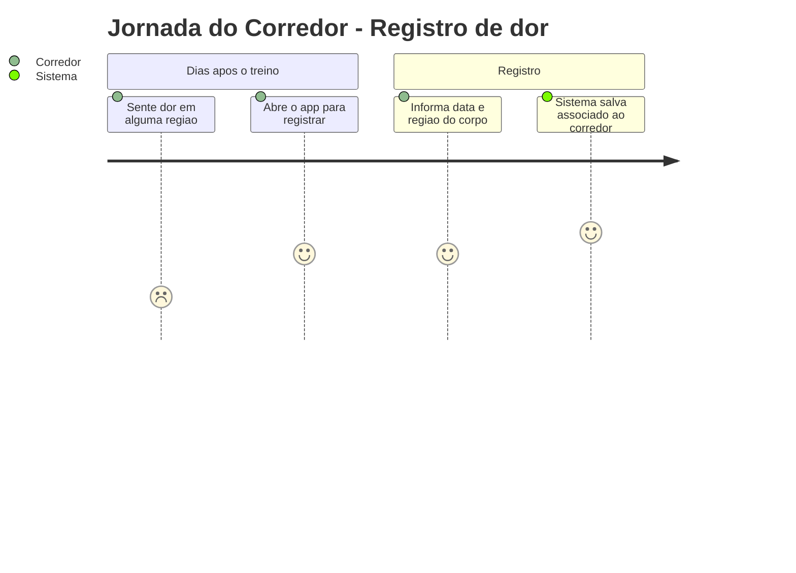
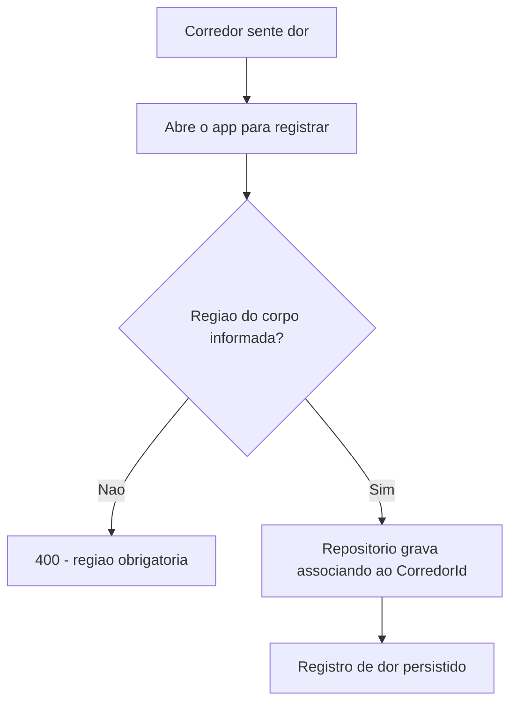
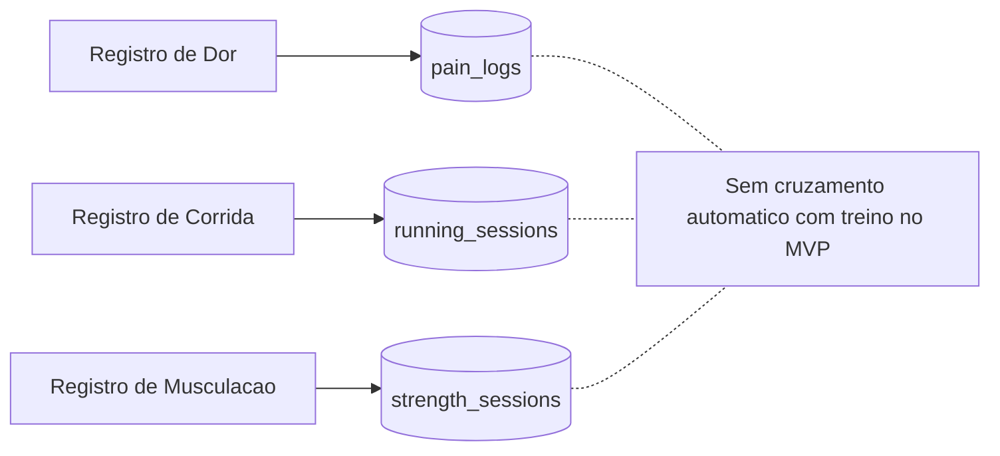

# Registro de Dor Pos-Treino - Persistencia-Treino - Regras de Negocio

## Indice
- [1. Resumo da Funcionalidade](#1-resumo-da-funcionalidade)
- [2. Jornada do Usuario](#2-jornada-do-usuario)
- [3. Regras de Negocio por Funcionalidade](#3-regras-de-negocio-por-funcionalidade)
- [4. Validacoes e Restricoes](#4-validacoes-e-restricoes)
- [5. Fluxos de Processo](#5-fluxos-de-processo)
- [6. Casos de Uso e Cenarios](#6-casos-de-uso-e-cenarios)

## 1. Resumo da Funcionalidade

**Proposito**: permitir que o corredor registre quando sentiu dor apos o treino, associando data e regiao do corpo, sem exigir vinculo com uma sessao de treino especifica.

**Usuarios**: corredores autenticados.

**Valor de Negocio**: dor e um sinal de alerta relevante no contexto de sobrecarga (o produto existe para prevenir lesao por sobrecarga combinada de corrida + musculacao) -- registrar dor cria um historico que, no futuro, pode ser cruzado com os padroes de treino que a precederam.

**Frequencia de Uso**: esporadica -- apenas quando o corredor sente dor, podendo ser dias depois do treino.

**Impacto Operacional**: hoje e um registro de mao unica (so escrita); nao ha consulta de historico de dor implementada no MVP.

## 2. Jornada do Usuario

### Visao Geral da Jornada

### Pontos de Contato
- **Registro (POST /api/pain-logs)**: unico ponto de contato hoje -- nao ha tela de consulta de historico de dor no MVP.

## 3. Regras de Negocio por Funcionalidade

### 3.1. Registro de Dor

**O que faz**: recebe um registro de dor ja validado pelo dominio (data + regiao do corpo) e o associa ao corredor autenticado.

**Regras Aplicadas**:
- **Independente de sessao de treino**: o registro de dor nao referencia uma sessao de corrida ou musculacao especifica -- e um evento proprio, com sua propria data (ver `specs/STORY-001/spec.bdd.md`, regra de negocio 7).
  - *Exemplo*: corredor treinou na segunda-feira, sente dor na quarta-feira, e registra a dor na quarta com a data de quarta -- sem precisar apontar qual sessao "causou" a dor.
- **Regiao do corpo obrigatoria**: `PainLog.Create` rejeita um registro sem regiao informada (texto vazio ou apenas espacos) antes de chegar ao repositorio.
  - *Exemplo*: tentar registrar dor sem informar a regiao resulta em rejeicao pelo dominio, nada e persistido.
- **Binario, sem escala de intensidade**: o registro representa "doeu" (a existencia do registro) -- o MVP nao inclui uma escala de intensidade de dor (decisao de escopo documentada em `specs/STORY-001/spec.bdd.md`, "Fora do escopo desta story").
- **Dono sempre do contexto de autenticacao**: mesmo padrao dos demais repositorios -- `CorredorId` vem do corredor autenticado.

**Cenarios de Uso**:
- **Registro no mesmo dia do treino**: corredor sente dor logo apos treinar.
- **Registro dias depois**: corredor sente dor alguns dias apos o treino, ainda assim consegue registrar.

**Resultado Esperado**: registro de dor persistido, associado ao corredor e a data em que a dor foi sentida (nao necessariamente a data do treino).

## 4. Validacoes e Restricoes

### Controle de Acesso
- **Permissoes**: apenas o proprio corredor cria seus registros de dor.

### Dados e Entrada
- **Dados Obrigatorios**: data e regiao do corpo.
- **Formatos Aceitos**: regiao do corpo e texto livre (nao uma lista fechada de opcoes) -- validado apenas quanto a nao estar vazio.

### Restricoes do Sistema
- **Limitacoes Tecnicas**: nao ha, hoje, nenhuma forma de consultar os registros de dor ja feitos (nem pela API, nem pelo repositorio) -- e uma limitacao atual do escopo implementado, nao necessariamente do escopo de produto (ver TechnicalDebtsDocs para detalhamento tecnico).

## 5. Fluxos de Processo

### Fluxo Principal

### Integracoes com Outros Processos

## 6. Casos de Uso e Cenarios

### Caso de Uso 1: Corredor registra dor sentida dias apos o treino
**Ator Principal**: Corredor autenticado.
**Objetivo**: deixar registrado que sentiu dor em determinada regiao do corpo.
**Pre-condicoes**: token valido; sabe a regiao onde sentiu a dor.

**Fluxo Principal**:
1. Corredor envia `POST /api/pain-logs` com a data e a regiao da dor.
2. Dominio valida que a regiao nao esta vazia.
3. Repositorio persiste o registro associado ao `CorredorId`.
4. API responde 201 com os dados do registro criado.

**Pos-condicoes**: registro de dor salvo, disponivel no banco de dados (ainda que sem consulta implementada no MVP).

### Matriz de Cenarios
| Cenario | Entrada | Acao do Sistema | Resultado Esperado |
|---------|---------|-----------------|-------------------|
| Registro valido | Data de hoje, regiao "joelho direito" | Persiste associado ao corredor | Registro criado, 201 |
| Registro sem regiao | Regiao vazia | Dominio rejeita antes da persistencia | 400, nada gravado |
| Registro dias depois do treino | Data anterior a hoje | Persiste normalmente | Registro criado, 201 |
