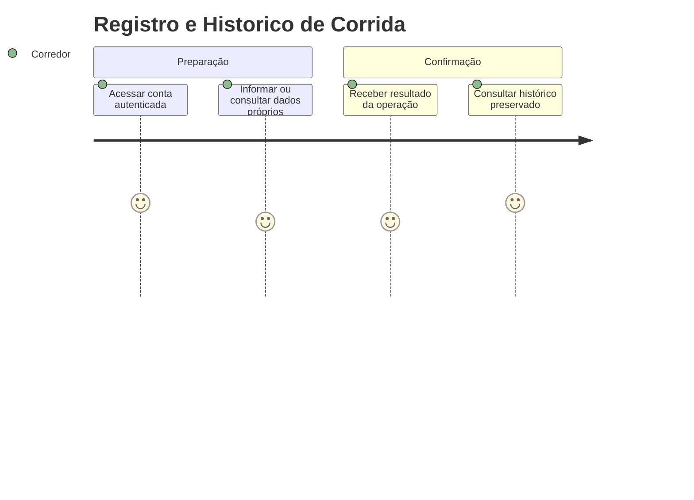
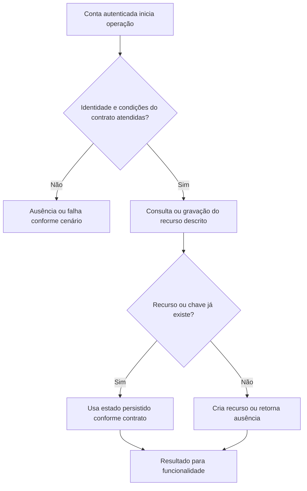

# Registro e Historico de Corrida - Persistencia-Treino - Regras de Negócio

## Índice

- [Resumo](#resumo)
- [Jornada](#jornada)
- [Regras e restrições](#regras)
- [Fluxo](#fluxo)
- [Cenários](#cenarios)

## 1. Resumo da funcionalidade

Persistir corrida, intenção de revisão e dor de encerramento na mesma confirmação. Usuários: corredor e, nos recursos de coaching, personal autorizado por vínculo. A operação acontece nos registros/consultas do aplicativo ou no processamento de revisão. O valor é conservar histórico confiável e restringir acesso aos participantes autorizados.

## 2. Jornada do usuário

Pontos de contato: conta autenticada, funcionalidade de treino/planejamento/coaching e histórico ou revisão. Os repositórios não exibem telas; preservam os dados usados por esses pontos de contato.

## 3. Regras de negócio e restrições

- **AddAsync**: Busca (corredorId,idempotencyKey). Existente retorna Created=false. Novo copia Date, DistanceKm, DurationMinutes, AveragePaceMinPerKm, PerceivedEffort; captura Id da ficha ativa via SingleOrDefaultAsync; adiciona outbox Pending de Running e dor opcional "Informada no encerramento"; uma SaveChangesAsync confirma todas as linhas.
- **GetByCorredorIdAsync**: Where(CorredorId) e ToListAsync, sem ordenação ou paginação.
- **GetByIdAsync**: FirstOrDefaultAsync por CorredorId e sessionId; retorna null se ausente ou de outra conta.

A conta recebida vem da autenticação na API. Onde há personal, papel e vínculo têm funções diferentes: ter o papel não concede acesso a todo corredor. A regra específica de autorização está descrita acima e na documentação técnica. Inputs do domínio são validados antes da persistência; não há diagnóstico médico nesta camada.

## 4. Fluxos de processo

Integrações: autenticação fornece identidade; domínio valida prescrições/registros; persistência conserva estado; API traduz resultado para resposta.

## 5. Casos de uso e cenários

| Entrada | Pré-condição/ação | Resultado esperado |
|---|---|---|
| A, chave K, 2026-08-30, 5km, 30min, esforço 5, dor=true | Nova corrida | Created=true, corrida + outbox Pending + dor |
| A, chave K, mesmo treino | Reenvio | Mesmo Id, Created=false; nenhuma nova outbox |
| B, sessionId de A | Consulta por Id | null |

A e B representam contas diferentes; K uma chave de idempotência; P um personal; R/L/F identificadores de revisão, vínculo ou ficha. Cada cenário parte do estado indicado, executa o método citado e verifica tanto o retorno quanto a ausência de mudança em dados alheios.

Referências normativas e técnicas:

- [docs/adr/ADR-002-autenticacao-e-isolamento-de-dados.md](../../../docs/adr/ADR-002-autenticacao-e-isolamento-de-dados.md)
- [docs/adr/ADR-003-chave-de-idempotencia-para-sincronizacao-offline.md](../../../docs/adr/ADR-003-chave-de-idempotencia-para-sincronizacao-offline.md)
- [docs/adr/ADR-018-outbox-transacional-da-revisao.md](../../../docs/adr/ADR-018-outbox-transacional-da-revisao.md)
- [tests/Steady.Api.Tests/RunningSessionEndpointTests.cs](../../../tests/Steady.Api.Tests/RunningSessionEndpointTests.cs)
- [src/Steady.Infrastructure/Persistence/SteadyDbContext.cs](../../../src/Steady.Infrastructure/Persistence/SteadyDbContext.cs)
- [Detalhamento técnico](../DevDocs/RunningSessionRepository-Persistencia-Treino-DevDocs.md)

Especificações de comportamento relacionadas:

- [STORY-003](../../../specs/STORY-003/spec.bdd.md)
- [STORY-014](../../../specs/STORY-014/spec.bdd.md)
