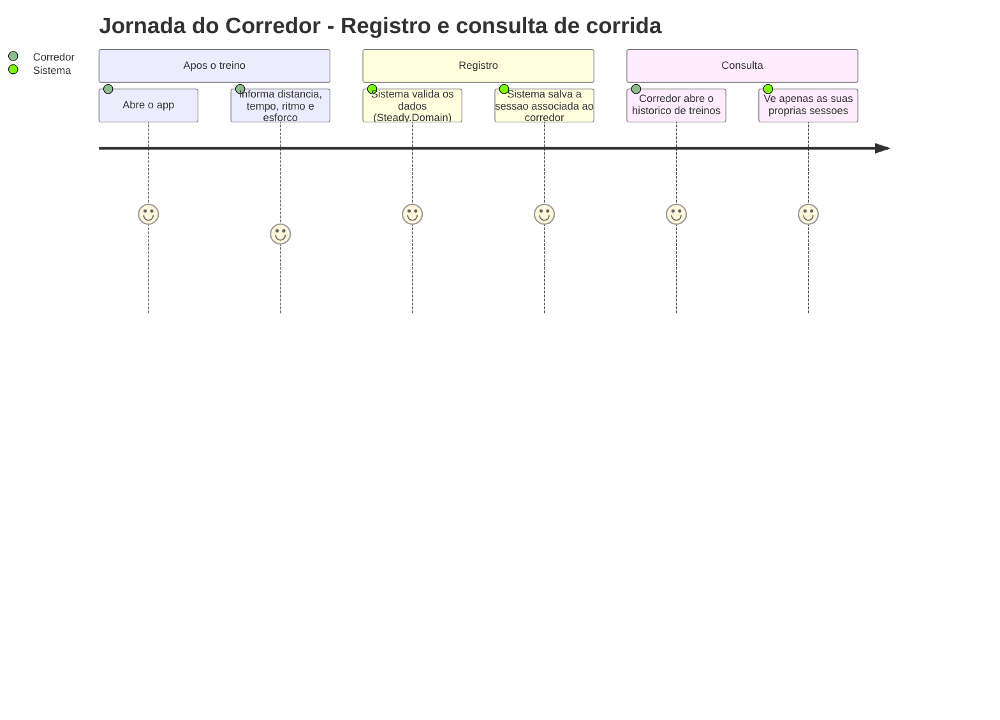
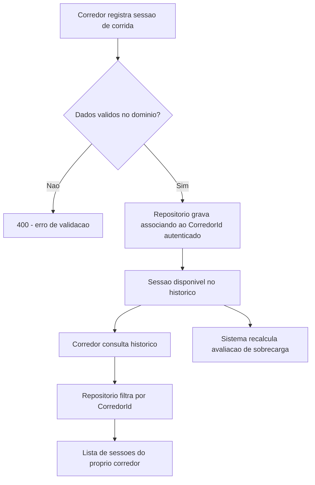
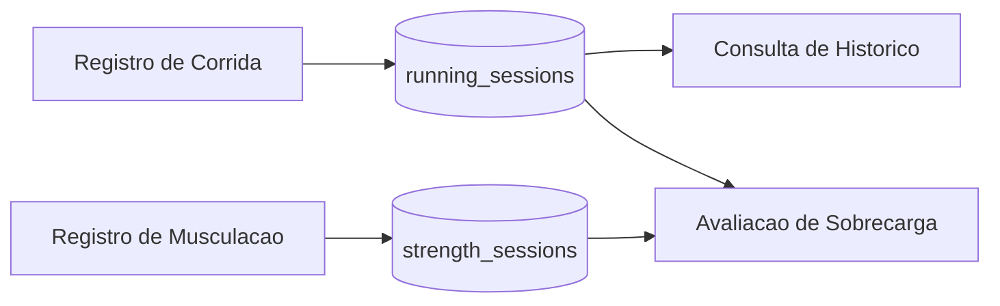

# Registro e Historico de Corrida - Persistencia-Treino - Regras de Negocio

## Indice
- [1. Resumo da Funcionalidade](#1-resumo-da-funcionalidade)
- [2. Jornada do Usuario](#2-jornada-do-usuario)
- [3. Regras de Negocio por Funcionalidade](#3-regras-de-negocio-por-funcionalidade)
- [4. Validacoes e Restricoes](#4-validacoes-e-restricoes)
- [5. Fluxos de Processo](#5-fluxos-de-processo)
- [6. Casos de Uso e Cenarios](#6-casos-de-uso-e-cenarios)

## 1. Resumo da Funcionalidade

**Proposito**: guardar de forma durauvel cada sessao de corrida que o corredor registra, e permitir consultar esse historico depois -- base de dados para o historico de treinos e para a deteccao de sobrecarga.

**Usuarios**: corredores autenticados.

**Valor de Negocio**: sem persistencia, nenhuma regra de sobrecarga (ver STORY-001, [ADR-001](../../../docs/adr/ADR-001-regra-sobrecarga-combinada.md)) poderia olhar 7 ou 14 dias de historico -- a persistencia e o que transforma um calculo pontual em uma analise real ao longo do tempo.

**Frequencia de Uso**: a cada sessao de corrida registrada pelo corredor (potencialmente diaria) e a cada consulta de historico ou de avaliacao de sobrecarga.

**Impacto Operacional**: e a fonte de verdade para a regra de negocio central do produto (deteccao de sobrecarga combinada corrida + musculacao).

## 2. Jornada do Usuario

### Visao Geral da Jornada

### Pontos de Contato
- **Registro (POST /api/running-sessions)**: corredor informa os dados da corrida logo apos o treino.
- **Historico (GET /api/training-sessions)**: corredor revisita o que ja treinou.
- **Avaliacao de sobrecarga (GET /api/overload-assessment)**: usa o mesmo historico para calcular risco.

## 3. Regras de Negocio por Funcionalidade

### 3.1. Registro de Sessao de Corrida

**O que faz**: recebe uma sessao de corrida ja validada pelo dominio (distancia, duracao, ritmo medio, percepcao de esforco) e a associa permanentemente ao corredor que a registrou.

**Regras Aplicadas**:
- **Dono sempre do contexto de autenticacao**: o `CorredorId` gravado nunca vem do corpo da requisicao -- vem do corredor autenticado (`CurrentCorredor.Id`), impedindo que alguem registre uma sessao "em nome" de outro.
  - *Exemplo*: mesmo que o cliente tente enviar um `corredorId` diferente no payload, o campo e ignorado -- o Endpoint so passa `currentCorredor.Id` para o repositorio.
- **Validacao de dominio antes da persistencia**: distancia > 0, duracao > 0 e percepcao de esforco entre 1 e 10 sao verificadas em `Steady.Domain` (`RunningSession.Create`) antes de qualquer chamada ao repositorio -- a camada de persistencia nunca recebe uma sessao invalida (ver `specs/STORY-001/spec.bdd.md`).
  - *Exemplo*: uma tentativa de registrar distancia zero e rejeitada com 400 antes mesmo de chegar ao repositorio.
- **Identificador gerado na persistencia**: o `Id` da sessao e gerado pelo repositorio (`Guid.NewGuid()`), nao pelo cliente nem pelo banco.

**Cenarios de Uso**:
- **Registro valido**: corredor informa dados dentro das regras, sessao e salva e aparece no historico.
- **Registro invalido**: rejeitado antes da persistencia (responsabilidade do dominio, nao deste repositorio).

**Resultado Esperado**: a sessao fica disponivel para consulta de historico e para o calculo de sobrecarga imediatamente apos o registro.

### 3.2. Consulta de Historico de Corrida

**O que faz**: devolve todas as sessoes de corrida do corredor autenticado.

**Regras Aplicadas**:
- **Isolamento por corredor**: apenas sessoes do proprio corredor sao retornadas -- ver a regra central em `Isolamento-de-Dados-por-Corredor-Persistencia-Autenticacao-Rules.md`.
- **Sem historico nao e erro**: um corredor recem-cadastrado, sem nenhuma sessao, recebe uma lista vazia -- nao uma falha (ver `specs/STORY-002/spec.bdd.md`, cenario "Corredor sem historico consulta seu historico de treinos").
- **Reuso para avaliacao de sobrecarga**: o mesmo metodo de listagem alimenta tanto a tela de historico quanto o calculo de sobrecarga -- a fonte de dados e sempre a mesma, evitando divergencia entre "o que o corredor ve" e "o que o sistema usa para calcular risco".

**Cenarios de Uso**:
- **Corredor com historico**: recebe a lista completa de suas sessoes.
- **Corredor sem historico**: recebe lista vazia.
- **Consulta para avaliacao de sobrecarga**: o sistema usa a mesma lista para aplicar a janela de 7/14 dias da regra de sobrecarga.

**Resultado Esperado**: o corredor sempre ve um retrato fiel e exclusivo de seu proprio historico de corrida.

## 4. Validacoes e Restricoes

### Controle de Acesso
- **Permissoes**: apenas o proprio corredor acessa suas sessoes de corrida.
- **Hierarquia**: nao ha acesso privilegiado (ex.: um "coach" vendo dados de atletas) no MVP.

### Dados e Entrada
- **Dados Obrigatorios**: distancia, duracao, ritmo medio e percepcao de esforco -- todos validados em `Steady.Domain` antes de chegar aqui.
- **Formatos Aceitos**: distancia e ritmo como numeros de ponto flutuante (km e min/km); duracao e esforco como numeros inteiros.
- **Limitacoes de Volume**: nenhum limite de quantidade de sessoes por corredor imposto pela persistencia.

### Restricoes do Sistema
- **Dependencias**: a consulta de historico depende do indice `corredor_id` para permanecer rapida a medida que o volume de dados cresce.

## 5. Fluxos de Processo

### Fluxo Principal

### Integracoes com Outros Processos

## 6. Casos de Uso e Cenarios

### Caso de Uso 1: Corredor registra uma corrida logo apos o treino
**Ator Principal**: Corredor autenticado.
**Objetivo**: guardar os dados da corrida para acompanhar evolucao e alimentar a deteccao de sobrecarga.
**Pre-condicoes**: token do Google valido; dados da corrida em maos (distancia, tempo, ritmo, esforco percebido).

**Fluxo Principal**:
1. Corredor envia `POST /api/running-sessions` com os dados da corrida.
2. Dominio valida (distancia > 0, duracao > 0, esforco entre 1-10).
3. Repositorio persiste a sessao associada ao `CorredorId`.
4. API responde 201 com os dados da sessao criada.

**Pos-condicoes**: sessao aparece no historico e passa a contar para a proxima avaliacao de sobrecarga.

### Caso de Uso 2: Corredor revisita seu historico de treinos
**Ator Principal**: Corredor autenticado.
**Objetivo**: relembrar o que treinou.
**Pre-condicoes**: token valido.

**Fluxo Principal**:
1. Corredor chama `GET /api/training-sessions`.
2. Repositorio devolve todas as sessoes de corrida e musculacao do corredor.
3. API combina, ordena por data e responde.

**Pos-condicoes**: corredor ve exclusivamente suas proprias sessoes.

### Matriz de Cenarios
| Cenario | Entrada | Acao do Sistema | Resultado Esperado |
|---------|---------|-----------------|-------------------|
| Registro valido | Distancia 5km, 30min, RPE 6 | Persiste associada ao corredor | Sessao criada, 201 |
| Registro com distancia invalida | Distancia 0 | Dominio rejeita antes da persistencia | 400, sessao nao criada |
| Consulta com historico | Corredor com 10 sessoes | Filtra por corredor_id | Lista com 10 sessoes |
| Consulta sem historico | Corredor sem sessoes | Filtra por corredor_id | Lista vazia |
| Avaliacao de sobrecarga | Historico com padrao de risco | Repositorio fornece dados para OverloadDetectionService | Alerta com sugestao |
