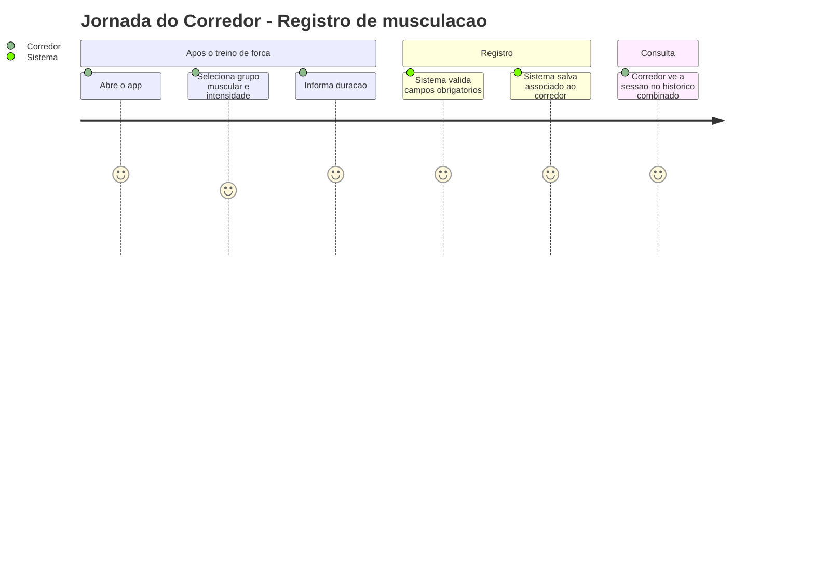
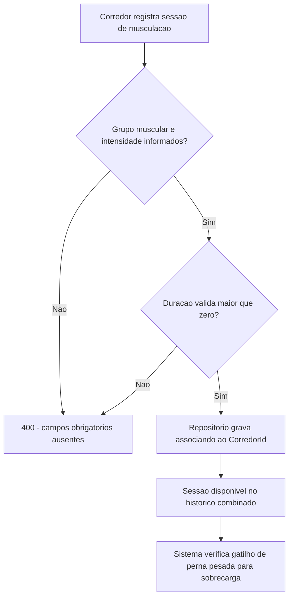
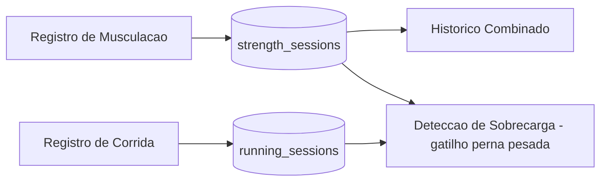

# Registro e Historico de Musculacao - Persistencia-Treino - Regras de Negocio

## Indice
- [1. Resumo da Funcionalidade](#1-resumo-da-funcionalidade)
- [2. Jornada do Usuario](#2-jornada-do-usuario)
- [3. Regras de Negocio por Funcionalidade](#3-regras-de-negocio-por-funcionalidade)
- [4. Validacoes e Restricoes](#4-validacoes-e-restricoes)
- [5. Fluxos de Processo](#5-fluxos-de-processo)
- [6. Casos de Uso e Cenarios](#6-casos-de-uso-e-cenarios)

## 1. Resumo da Funcionalidade

**Proposito**: guardar cada sessao de musculacao registrada pelo corredor, com grupo muscular e intensidade, para compor o historico e alimentar a deteccao de sobrecarga combinada.

**Usuarios**: corredores autenticados.

**Valor de Negocio**: a regra de negocio central do Steady (ver [ADR-001](../../../docs/adr/ADR-001-regra-sobrecarga-combinada.md)) depende especificamente de saber quando o corredor fez musculacao de **perna com intensidade pesada** -- sem essa persistencia detalhada (grupo muscular + intensidade), a deteccao de sobrecarga simplesmente nao existiria.

**Frequencia de Uso**: a cada sessao de musculacao registrada.

**Impacto Operacional**: alimenta, junto com o historico de corrida, o alerta de sobrecarga que e o principal diferencial do produto.

## 2. Jornada do Usuario

### Visao Geral da Jornada

### Pontos de Contato
- **Registro (POST /api/strength-sessions)**: corredor informa grupo muscular, intensidade e duracao.
- **Historico combinado (GET /api/training-sessions)**: musculacao aparece junto com corrida, ordenada por data.
- **Avaliacao de sobrecarga**: musculacao de perna pesada e um dos dois gatilhos da regra combinada.

## 3. Regras de Negocio por Funcionalidade

### 3.1. Registro de Sessao de Musculacao

**O que faz**: recebe uma sessao de musculacao ja validada pelo dominio e a associa ao corredor autenticado.

**Regras Aplicadas**:
- **Grupo muscular e intensidade obrigatorios**: `StrengthSession.Create` rejeita sessoes sem esses campos antes de chegar ao repositorio (ver `specs/STORY-001/spec.bdd.md`, cenario "Tentativa de registrar sessao de musculacao sem grupo muscular ou intensidade").
  - *Exemplo*: tentar registrar sem informar intensidade resulta em 400, sem gravar nada no banco.
- **Cinco grupos musculares possiveis**: Peito+Triceps, Ombro, Perna Frontal, Perna Posterior, Biceps+Costas -- definidos como enum `MuscleGroup` em `Steady.Domain`.
- **Tres niveis de intensidade**: Leve, Moderado, Pesado -- definidos como enum `Intensity`. A combinacao "Perna Frontal ou Posterior" + "Pesado" e o gatilho especifico de musculacao para a regra de sobrecarga.
- **Persistido de forma legivel**: grupo muscular e intensidade sao gravados como texto no banco (nao como numero), facilitando auditoria direta dos dados sem precisar decodificar um enum.
- **Dono sempre do contexto de autenticacao**: mesmo padrao de `RunningSessionRepository` -- o `CorredorId` vem do corredor autenticado, nunca do payload do cliente.

**Cenarios de Uso**:
- **Registro valido**: grupo muscular, intensidade e duracao informados corretamente.
- **Registro invalido**: campo obrigatorio ausente, rejeitado no dominio antes da persistencia.

**Resultado Esperado**: sessao disponivel no historico combinado e considerada na proxima avaliacao de sobrecarga.

### 3.2. Consulta de Historico de Musculacao

**O que faz**: devolve todas as sessoes de musculacao do corredor autenticado.

**Regras Aplicadas**:
- **Isolamento por corredor**: ver a regra central em `Isolamento-de-Dados-por-Corredor-Persistencia-Autenticacao-Rules.md`.
- **Combinado com corrida no historico**: `TrainingHistoryEndpoints` junta o resultado deste repositorio com o de `RunningSessionRepository` para formar um unico historico ordenado por data (fora do escopo deste repositorio, mas relevante para entender o consumo).
- **Base para deteccao de sobrecarga**: `OverloadAssessmentEndpoints` usa este historico para identificar musculacao de perna pesada nos ultimos 7 dias.

**Cenarios de Uso**:
- **Corredor com historico de musculacao**: lista completa retornada.
- **Corredor sem musculacao registrada**: lista vazia, sem erro.

**Resultado Esperado**: historico fiel e exclusivo do corredor, pronto para exibicao e para calculo de sobrecarga.

## 4. Validacoes e Restricoes

### Controle de Acesso
- **Permissoes**: apenas o proprio corredor acessa suas sessoes de musculacao.

### Dados e Entrada
- **Dados Obrigatorios**: grupo muscular, intensidade e duracao (> 0) -- validados em `Steady.Domain` antes da persistencia.
- **Formatos Aceitos**: grupo muscular e intensidade sao valores fechados (enum), nao texto livre -- previne inconsistencia de dados (ex.: "perna", "Perna", "PERNA" como valores diferentes).

### Restricoes do Sistema
- **Dependencias**: a consulta por corredor depende do indice `corredor_id` (`IX_strength_sessions_corredor_id`).

## 5. Fluxos de Processo

### Fluxo Principal

### Integracoes com Outros Processos

## 6. Casos de Uso e Cenarios

### Caso de Uso 1: Corredor registra musculacao de perna pesada
**Ator Principal**: Corredor autenticado.
**Objetivo**: registrar o treino de forca do dia.
**Pre-condicoes**: token valido; grupo muscular, intensidade e duracao em maos.

**Fluxo Principal**:
1. Corredor envia `POST /api/strength-sessions` com `MuscleGroup = PernaFrontal`, `Intensity = Pesado`, duracao valida.
2. Dominio valida os campos obrigatorios.
3. Repositorio persiste associando ao `CorredorId`.
4. API responde 201.

**Pos-condicoes**: sessao passa a contar como possivel gatilho de musculacao para a regra de sobrecarga nos proximos 7 dias.

### Matriz de Cenarios
| Cenario | Entrada | Acao do Sistema | Resultado Esperado |
|---------|---------|-----------------|-------------------|
| Registro valido | PernaFrontal, Pesado, 40min | Persiste associada ao corredor | Sessao criada, 201 |
| Sem grupo muscular | grupo muscular ausente | Dominio rejeita antes da persistencia | 400, nada gravado |
| Sem intensidade | intensidade ausente | Dominio rejeita antes da persistencia | 400, nada gravado |
| Consulta com historico | Corredor com sessoes registradas | Filtra por corredor_id | Lista com as sessoes do corredor |
| Consulta sem historico | Corredor sem sessoes | Filtra por corredor_id | Lista vazia |
