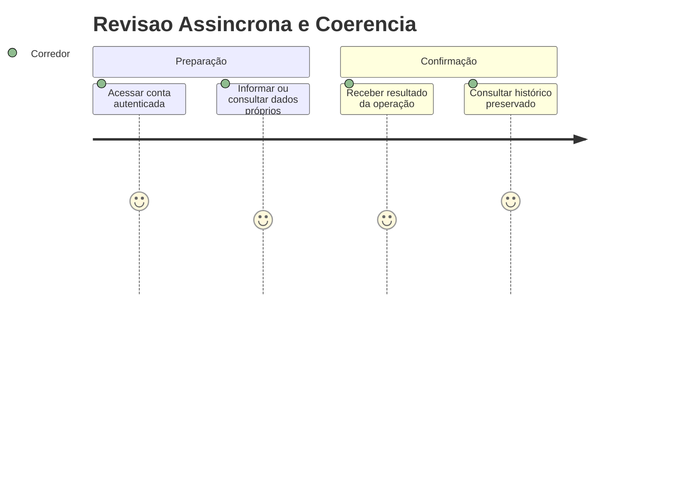
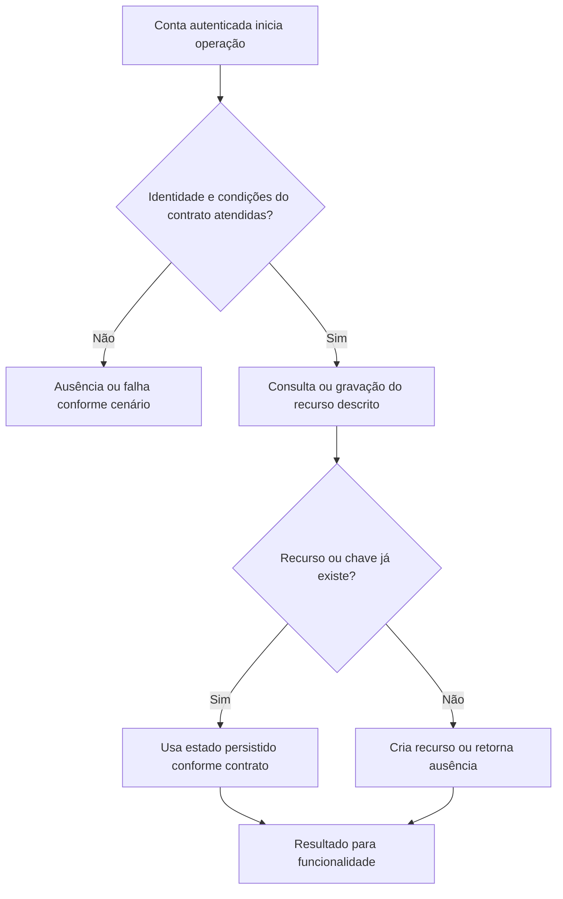

# Revisao Assincrona e Coerencia - Persistencia-Revisao - Regras de Negócio

## Índice

- [Resumo](#resumo)
- [Jornada](#jornada)
- [Regras e restrições](#regras)
- [Fluxo](#fluxo)
- [Cenários](#cenarios)

## 1. Resumo da funcionalidade

Processar intenção durável, comparar treino e acompanhar coerência da ação. Usuários: corredor e, nos recursos de coaching, personal autorizado por vínculo. A operação acontece nos registros/consultas do aplicativo ou no processamento de revisão. O valor é conservar histórico confiável e restringir acesso aos participantes autorizados.

## 2. Jornada do usuário

Pontos de contato: conta autenticada, funcionalidade de treino/planejamento/coaching e histórico ou revisão. Os repositórios não exibem telas; preservam os dados usados por esses pontos de contato.

## 3. Regras de negócio e restrições

- **ProcessNextAsync**: AcquireAsync ausente retorna false; processa, salva revisão, recalcula coerência, marca Completed e limpa lease. Erro volta Pending, agenda min(60,2^Attempts) segundos, salva e relança.
- **AcquireAsync**: Transação SELECT Pending vencido ou Processing com lease expirado, ORDER BY created_at, FOR UPDATE SKIP LOCKED LIMIT 1; incrementa Attempts, Processing e lease de 2min, salva e commit.
- **ProcessAsync**: Se revisão por ExecutionKind/ExecutionId existe, sai. Carrega política vigente ou falha. Switch Running/Strength/Combined chama comparação; Adherent não gera revisão. SafetyPolicy.Authorize recebe fatos comparáveis, dor congelada e cargas, overloadAlreadyDetected=false. Provedor tem timeout de 15s; TrySetExplanation valida números/ação; falha/null/rejeição vira Unavailable. Adiciona revisão com versões e snapshot.
- **CompareRunningAsync**: Busca corrida por execução/corredor, resolve fontes; conflito produz PrescriptionConflict; sem conflito CompareRunning preserva campos não prescritos e calcula carga por duração*esforço quando ambos prescritos.
- **CompareStrengthAsync**: Busca execução por Id/corredor e delega CompareStrengthEntityAsync.
- **CompareCombinedAsync**: Força por Id/corredor e corrida pela chave/corredor; compara ambas. Prioridade PrescriptionConflict, depois Divergent, depois Adherent; concatena fatos e soma cargas.
- **CompareStrengthEntityAsync**: Busca ficha histórica por Id/corredor; materializa histórico anterior por CreatedAt do corredor; pareia por ExerciseKey; carga de referência é mediana das execuções anteriores não puladas, sem filtro por ficha. Compara conclusão/séries/repetições/carga; soma medianas e cargas informadas.
- **ResolveRunningSourcesAsync**: Plano da conta, dia da semana e ficha congelada na outbox. Ficha tem terça/quinta/sábado; quando há duas fontes usa ResolveRunningPrescription; conflito explícito, não seleciona silenciosamente uma fonte.
- **FromRun**: Transforma faixas opcionais em RunningAdherencePrescription; null continua null.
- **WeekIndex**: ((int)day+6)%7 coloca segunda em índice zero.
- **RunningFacts**: Cria completion,distanceKm,durationMinutes,perceivedEffort.
- **StrengthFacts**: Cria fatos por índice do exercício para completion,sets,repetitions,loadKg.
- **Fact**: Copia limites, executado, diferença e status da comparação.
- **Median**: Lista vazia null; ímpar central; par média dos dois centrais.
- **Sum**: Ambos null retorna null; soma demais usando zero para ausente.
- **RecalculateCoherenceAsync**: Política vigente e revisões com Action; carrega corridas e força do corredor, ordena data/Id. Próxima execução precisa data maior, não mesmo dia. Sem próxima deixa Unknown e limpa metadados. Maintain é coerente se próxima não tem revisão Divergent; ReduceLoad/PrioritizeRecovery exigem carga seguinte menor. Registra próxima execução, versão e instante.
- **ExecutionLoadAsync**: Corrida usa duração*esforço; força soma cargas não skipped; combinado soma corrida pela chave da outbox. As consultas por Id pressupõem revisão/outbox internas já associadas ao corredor.
- **Create**: ComparisonEnvelope serializa modality,status,facts como snapshot.
- **Conflict**: Cria envelope PrescriptionConflict sem fatos/cargas.

A conta recebida vem da autenticação na API. Onde há personal, papel e vínculo têm funções diferentes: ter o papel não concede acesso a todo corredor. A regra específica de autorização está descrita acima e na documentação técnica. Inputs do domínio são validados antes da persistência; não há diagnóstico médico nesta camada.

## 4. Fluxos de processo

Integrações: autenticação fornece identidade; domínio valida prescrições/registros; persistência conserva estado; API traduz resultado para resposta.

## 5. Casos de uso e cenários

| Entrada | Pré-condição/ação | Resultado esperado |
|---|---|---|
| Fila sem evento elegível | ProcessNextAsync | false |
| Running divergente, provedor indisponível | Processar | Revisão Divergent com versões, ExplanationStatus=Unavailable; outbox Completed |
| Evento Processing com lease expirado e revisão existente | Retomar | Não duplica revisão; outbox Completed |

A e B representam contas diferentes; K uma chave de idempotência; P um personal; R/L/F identificadores de revisão, vínculo ou ficha. Cada cenário parte do estado indicado, executa o método citado e verifica tanto o retorno quanto a ausência de mudança em dados alheios.

Referências normativas e técnicas:

- [docs/adr/ADR-013-plano-do-steady-como-fonte-de-prescricao.md](../../../docs/adr/ADR-013-plano-do-steady-como-fonte-de-prescricao.md)
- [docs/adr/ADR-014-fronteira-deterministica-da-revisao.md](../../../docs/adr/ADR-014-fronteira-deterministica-da-revisao.md)
- [docs/adr/ADR-015-tolerancias-e-politicas-versionadas.md](../../../docs/adr/ADR-015-tolerancias-e-politicas-versionadas.md)
- [docs/adr/ADR-016-provedor-da-explicacao-da-revisao.md](../../../docs/adr/ADR-016-provedor-da-explicacao-da-revisao.md)
- [docs/adr/ADR-018-outbox-transacional-da-revisao.md](../../../docs/adr/ADR-018-outbox-transacional-da-revisao.md)
- [docs/adr/ADR-019-identidade-historica-do-exercicio.md](../../../docs/adr/ADR-019-identidade-historica-do-exercicio.md)
- [tests/Steady.Api.Tests/AdherencePersistenceTests.cs](../../../tests/Steady.Api.Tests/AdherencePersistenceTests.cs)
- [src/Steady.Infrastructure/Persistence/SteadyDbContext.cs](../../../src/Steady.Infrastructure/Persistence/SteadyDbContext.cs)
- [Detalhamento técnico](../DevDocs/ReviewOutboxProcessor-Persistencia-Revisao-DevDocs.md)

Especificações de comportamento relacionadas:

- [STORY-014](../../../specs/STORY-014/spec.bdd.md)
