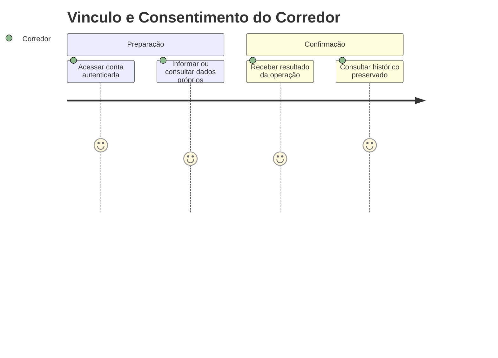
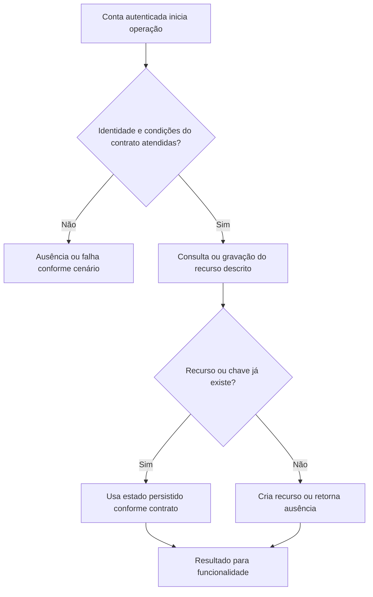

# Vinculo e Consentimento do Corredor - Persistencia-Coaching - Regras de Negócio

## Índice

- [Resumo](#resumo)
- [Jornada](#jornada)
- [Regras e restrições](#regras)
- [Fluxo](#fluxo)
- [Cenários](#cenarios)

## 1. Resumo da funcionalidade

Manter consentimento e um único personal ativo por corredor. Usuários: corredor e, nos recursos de coaching, personal autorizado por vínculo. A operação acontece nos registros/consultas do aplicativo ou no processamento de revisão. O valor é conservar histórico confiável e restringir acesso aos participantes autorizados.

## 2. Jornada do usuário

Pontos de contato: conta autenticada, funcionalidade de treino/planejamento/coaching e histórico ou revisão. Os repositórios não exibem telas; preservam os dados usados por esses pontos de contato.

## 3. Regras de negócio e restrições

- **RequestAsync**: Busca Pending pelo par personal/corredor; reaproveita ou cria via CoachingLink.Request. Conflito desanexa candidato e relê Pending vencedor; se não existir, relança.
- **GetPendingAsync**: Filtra corredor e Pending, ordena RequestedAt decrescente.
- **AcceptAsync**: Abre transação; busca Id/corredor/Pending. Ausente retorna NotFound; RunnerHasActiveAsync retorna AlreadyLinked; ativa escolhido, registra AcceptedAt e expira outras Pending com EndedAt. Salva e confirma; conflito faz rollback e verifica Active sem rastreamento antes de retornar AlreadyLinked ou relançar.
- **EndAsync**: Busca Id onde actorId é personal ou corredor e status Pending/Active; ausência false; grava Ended e EndedAt, retorna true.
- **HasActiveAsync**: AnyAsync pelo par e Active.
- **RunnerHasActiveAsync**: AnyAsync pelo corredor e Active.
- **GetActiveForRunnerAsync**: FirstOrDefaultAsync por corredor e Active.
- **GetLinkedRunnersAsync**: Join com Corredores, filtra PersonalId/Active, ordena Name ?? Email e projeta LinkedRunner(LinkId,CorredorId,Email,Name).

A conta recebida vem da autenticação na API. Onde há personal, papel e vínculo têm funções diferentes: ter o papel não concede acesso a todo corredor. A regra específica de autorização está descrita acima e na documentação técnica. Inputs do domínio são validados antes da persistência; não há diagnóstico médico nesta camada.

## 4. Fluxos de processo

Integrações: autenticação fornece identidade; domínio valida prescrições/registros; persistência conserva estado; API traduz resultado para resposta.

## 5. Casos de uso e cenários

| Entrada | Pré-condição/ação | Resultado esperado |
|---|---|---|
| Personal P solicita vínculo para A | Não há Pending do par | Created=true, Pending |
| A aceita L1 entre duas pendências | Nenhum Active | Accepted; L1 Active, L2 Expired |
| Terceiro B encerra L1 de P/A | B não participa | false; vínculo intacto |

A e B representam contas diferentes; K uma chave de idempotência; P um personal; R/L/F identificadores de revisão, vínculo ou ficha. Cada cenário parte do estado indicado, executa o método citado e verifica tanto o retorno quanto a ausência de mudança em dados alheios.

Referências normativas e técnicas:

- [docs/adr/ADR-002-autenticacao-e-isolamento-de-dados.md](../../../docs/adr/ADR-002-autenticacao-e-isolamento-de-dados.md)
- [docs/adr/ADR-008-roles-vinculo-e-autorizacao-do-personal.md](../../../docs/adr/ADR-008-roles-vinculo-e-autorizacao-do-personal.md)
- [docs/adr/ADR-009-ficha-ativa-e-execucao-imutavel.md](../../../docs/adr/ADR-009-ficha-ativa-e-execucao-imutavel.md)
- [tests/Steady.Api.Tests/CoachingCardinalityEndpointTests.cs](../../../tests/Steady.Api.Tests/CoachingCardinalityEndpointTests.cs)
- [src/Steady.Infrastructure/Persistence/SteadyDbContext.cs](../../../src/Steady.Infrastructure/Persistence/SteadyDbContext.cs)
- [Detalhamento técnico](../DevDocs/CoachingLinkRepository-Persistencia-Coaching-DevDocs.md)

Especificações de comportamento relacionadas:

- [STORY-013](../../../specs/STORY-013/spec.bdd.md)
- [STORY-019](../../../specs/STORY-019/spec.bdd.md)
