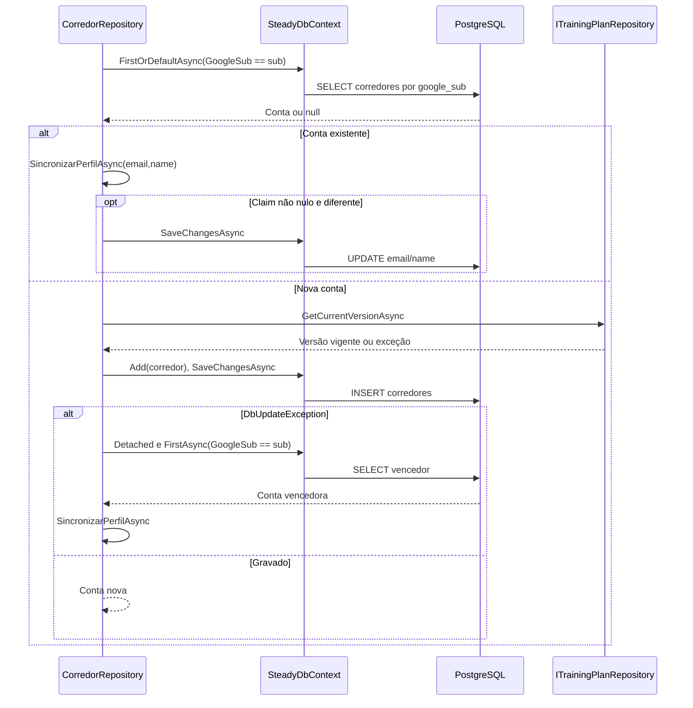

# CorredorRepository - Persistencia-Autenticacao - Especificação Técnica

Atualizado em 2026-09-27.

## Índice

- [Visão geral](#visao)
- [Métodos e contratos](#metodos)
- [Mapeamentos](#ctx)
- [Observações](#observacoes)
- [Fontes](#fontes)

<a id="visao"></a>
## 1. Visão geral técnica

Provisionar identidade e sincronizar perfil sem trocar a versão de plano.

Chamada pela camada Steady.Api; ver [índice da API](../../Steady.Api/DevDocs/README.md). Sem rotas próprias: entradas são parâmetros C#, saídas são entidades/objetos ou resultados assíncronos. O token e os papéis são validados na API; parâmetros de identidade precisam vir do contexto autenticado. PostgreSQL é acessado pelo SteadyDbContext com EF Core e Npgsql.


<a id="metodos"></a>
## 2. R. Métodos e contratos

- [GetOrCreateBySubAsync](#r-1)
- [FindRunnerByEmailAsync](#r-2)
- [GetByIdAsync](#r-3)
- [SincronizarPerfilAsync](#r-4)

<a id="r-1"></a>
### R. GetOrCreateBySubAsync

`public async Task<CorredorEntity> GetOrCreateBySubAsync( string googleSub, string? email, string? name, CancellationToken cancellationToken)`

Busca google_sub; existente segue SincronizarPerfilAsync; novo consulta GetCurrentVersionAsync, gera Id, papel Corredor e fixa TrainingPlanVersionId. SaveChangesAsync; DbUpdateException desanexa o candidato, relê vencedor por sub e sincroniza perfil.

Entrada: os parâmetros da assinatura, incluindo `CancellationToken` nas operações assíncronas. Saída: o tipo retornado na assinatura; `Task` transporta conclusão, resultado ou falha. Objetos de domínio chegam validados por suas fábricas; o repositório não substitui essa validação.

<a id="r-2"></a>
### R. FindRunnerByEmailAsync

`public async Task<CorredorEntity?> FindRunnerByEmailAsync( string email, CancellationToken cancellationToken)`

Filtra email no banco, materializa candidatos e retorna o primeiro com Roles.Contains("Corredor"); e-mail não é identidade e pode repetir.

Entrada: os parâmetros da assinatura, incluindo `CancellationToken` nas operações assíncronas. Saída: o tipo retornado na assinatura; `Task` transporta conclusão, resultado ou falha. Objetos de domínio chegam validados por suas fábricas; o repositório não substitui essa validação.

<a id="r-3"></a>
### R. GetByIdAsync

`public Task<CorredorEntity?> GetByIdAsync(Guid id, CancellationToken cancellationToken)`

Busca Id e retorna conta ou null; chamador deve autorizar esse acesso.

Entrada: os parâmetros da assinatura, incluindo `CancellationToken` nas operações assíncronas. Saída: o tipo retornado na assinatura; `Task` transporta conclusão, resultado ou falha. Objetos de domínio chegam validados por suas fábricas; o repositório não substitui essa validação.

<a id="r-4"></a>
### R. SincronizarPerfilAsync

`private async Task<CorredorEntity> SincronizarPerfilAsync( CorredorEntity corredor, string? email, string? name, CancellationToken cancellationToken)`

Claim email/name nulo não apaga valor salvo; valores iguais não escrevem; diferenças não nulas alteram perfil e salvam.

Entrada: os parâmetros da assinatura, incluindo `CancellationToken` nas operações assíncronas. Saída: o tipo retornado na assinatura; `Task` transporta conclusão, resultado ou falha. Objetos de domínio chegam validados por suas fábricas; o repositório não substitui essa validação.

#### Fluxo de execução



<a id="ctx"></a>
## 3. CTX. Mapeamento e integridade

### CTX. corredores

Chave primária: `Id` (sem HasColumnName, nome por convenção do modelo).

| Propriedade | Coluna | Configuração explícita |
|---|---|---|
| `GoogleSub` | `google_sub` | `IsRequired()` |
| `Email` | `email` | `Tipo por convenção do provider` |
| `Name` | `name` | `Tipo por convenção do provider` |
| `Roles` | `roles` | `HasColumnType("text[]"); HasDefaultValue(new[] { "Corredor" })` |
| `TrainingPlanVersionId` | `training_plan_version_id` | `Tipo por convenção do provider` |
| `CreatedAt` | `created_at` | `Tipo por convenção do provider` |

Índices e relações (expressões reais do modelo):

```csharp
HasIndex(c => c.GoogleSub).IsUnique();
HasOne<TrainingPlanVersionEntity>()
                .WithMany()
                .HasForeignKey(c => c.TrainingPlanVersionId)
                .OnDelete(DeleteBehavior.Restrict);
```

Coleções usam conversão para `text[]` e ValueComparer com SequenceEqual, hash agregado e cópia ToList, detectando mudança em conteúdo.

<a id="observacoes"></a>
## 4. Observações técnicas

Consultas usam rastreamento padrão salvo AsNoTracking explicitamente indicado. Falhas de persistência e cancelamento propagam quando não houver captura documentada. Cada chave idempotente pertence à conta, não é uma chave global entre corredores. Entidades retornadas incluem os campos persistidos listados em CTX; resultados SaveResult contêm Entity e Created.

<a id="fontes"></a>
## 5. Fontes e verificação

- [docs/adr/ADR-002-autenticacao-e-isolamento-de-dados.md](../../../docs/adr/ADR-002-autenticacao-e-isolamento-de-dados.md)
- [docs/adr/ADR-008-roles-vinculo-e-autorizacao-do-personal.md](../../../docs/adr/ADR-008-roles-vinculo-e-autorizacao-do-personal.md)
- [docs/adr/ADR-013-plano-do-steady-como-fonte-de-prescricao.md](../../../docs/adr/ADR-013-plano-do-steady-como-fonte-de-prescricao.md)
- [tests/Steady.Api.Tests/AuthenticationTests.cs](../../../tests/Steady.Api.Tests/AuthenticationTests.cs)
- [src/Steady.Infrastructure/Persistence/SteadyDbContext.cs](../../../src/Steady.Infrastructure/Persistence/SteadyDbContext.cs)
- [src/Steady.Infrastructure/Repositories/CorredorRepository.cs](../../../src/Steady.Infrastructure/Repositories/CorredorRepository.cs)

Os testes citados foram inspecionados como evidência de comportamento; não foram executados nesta rodada de documentação.

Especificações de comportamento relacionadas:

- [STORY-002](../../../specs/STORY-002/spec.bdd.md)
- [STORY-009](../../../specs/STORY-009/spec.bdd.md)
- [STORY-016](../../../specs/STORY-016/spec.bdd.md)
- [STORY-019](../../../specs/STORY-019/spec.bdd.md)
