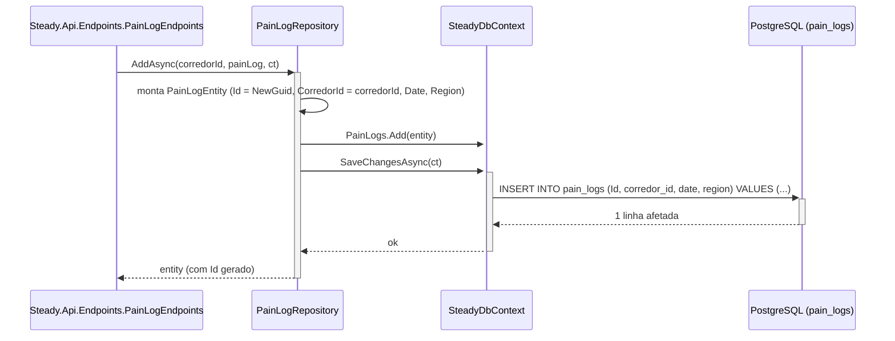

# PainLogRepository - Persistencia-Treino - Especificacao Tecnica

## Indice
- [1. Visao Geral Tecnica](#1-visao-geral-tecnica)
- [2. Configuracao e Dependencias](#2-configuracao-e-dependencias)
- [3. Detalhamento por Metodo](#3-detalhamento-por-metodo)
  - [3.1. AddAsync - Persiste um novo registro de dor](#31-addasync---persiste-um-novo-registro-de-dor)
- [4. Observacoes Tecnicas](#4-observacoes-tecnicas)

## 1. Visao Geral Tecnica

**Proposito**: `PainLogRepository` persiste registros de dor pos-treino (`PainLogEntity`), sempre associados ao `CorredorId` do corredor autenticado.

**Responsabilidades**:
- Converter um objeto de dominio `Steady.Domain.Training.PainLog` (ja validado por `PainLog.Create`) em `PainLogEntity` e persisti-lo associado a um `CorredorId`.

**Integracoes**: chamado por `Steady.Api.Endpoints.PainLogEndpoints` (POST `/api/pain-logs`) -- ver `DocumentAIReadme/Steady.Api/DevDocs/PainLogEndpoints-Treino-Dor-DevDocs.md`. Regras fundamentadas em `specs/STORY-001/spec.bdd.md` (regra de negocio 7: "o registro de dor e independente de sessao especifica: data + regiao do corpo + doeu/nao doeu") e `specs/STORY-002/spec.bdd.md` (persistencia e isolamento).

**Nota de escopo**: diferente de `RunningSessionRepository` e `StrengthSessionRepository`, este repositorio expoe **apenas escrita** (`AddAsync`) -- nao ha metodo de leitura (`GetByCorredorIdAsync` ou `GetByIdAsync`) nem endpoint de consulta de dor em `Steady.Api`. Isso e coerente com o escopo atual do MVP (a STORY-001 define o registro de dor, sem mencionar uma tela de consulta de historico de dor), mas e uma assimetria real em relacao aos outros dois repositorios de treino -- sinalizada em TechnicalDebtsDocs.

## 2. Configuracao e Dependencias

**Dependencias Injetadas**:
- `SteadyDbContext dbContext`: contexto EF Core injetado via construtor primario, ciclo de vida `Scoped`.

**Interface implementada**: `IPainLogRepository` (`Repositories/IPainLogRepository.cs`).

**Metodos Publicos**:
- `Task<PainLogEntity> AddAsync(Guid corredorId, PainLog painLog, CancellationToken cancellationToken)` -- unico metodo da interface.

## 3. Detalhamento por Metodo

### 3.1. AddAsync - Persiste um novo registro de dor

**Entrada**:
```json
{
  "corredorId": "Guid - dono do registro, resolvido pelo AuthenticationFilter",
  "painLog": {
    "Date": "DateOnly - data em que a dor foi sentida, pode ser dias apos o treino",
    "Region": "string (obrigatoria, validada em PainLog.Create) - regiao do corpo onde doeu"
  }
}
```

**Saida**:
```json
{
  "PainLogEntity": {
    "Id": "Guid - gerado pelo repositorio (Guid.NewGuid())",
    "CorredorId": "Guid",
    "Date": "DateOnly",
    "Region": "string"
  }
}
```

#### Fluxo de Execucao



#### Detalhamento do Fluxo

**R. Repository (PainLogRepository)**

R.1. AddAsync()
- Recebe o objeto de dominio `PainLog` ja validado (regiao do corpo obrigatoria, nao vazia -- ver `PainLog.Create` e `specs/STORY-001/spec.bdd.md`) e o `corredorId` do contexto de autenticacao.
- **Mapeamento Dominio -> Persistencia (U1)**: monta um novo `PainLogEntity` copiando `Date` e `Region` de `PainLog`, atribuindo `Id = Guid.NewGuid()` e `CorredorId = corredorId`.
- Adiciona ao `DbSet<PainLogEntity>` e persiste via `SaveChangesAsync` -> [CTX.1](#ctx1-painlogs-dbset)
- Retorna a entidade persistida para o Endpoint montar a resposta HTTP 201.
- Nota de dominio: o registro de dor **nao referencia** uma `RunningSessionEntity` ou `StrengthSessionEntity` especifica -- e independente de sessao, podendo ser registrado dias depois do treino que (supostamente) o causou, conforme regra de negocio 7 da `specs/STORY-001/spec.bdd.md`.

**CTX. SteadyDbContext**

<a id="ctx1-painlogs-dbset"></a>
CTX.1. PainLogs (DbSet&lt;PainLogEntity&gt;)
- Mapeado para a tabela `pain_logs`: `Id` como chave primaria; `CorredorId` -> `corredor_id` (indexada via `IX_pain_logs_corredor_id`, ainda que hoje nenhuma query de leitura use esse indice, ja que nao ha metodo de consulta); `Date` -> `date`; `Region` -> `region` (obrigatoria, `IsRequired()`).
- `Region` e persistida como `text` livre (nao um enum fechado como `MuscleGroup`) -- o dominio (`PainLog.Create`) so garante que nao e vazia/nula, sem uma lista fechada de regioes validas.

## 4. Observacoes Tecnicas

- **Performance**: unico repositorio de treino sem nenhuma operacao de leitura -- nao ha custo de consulta a considerar hoje.
- **Tratamento de Erros**: nenhum tratamento de excecao de infraestrutura explicito, mesmo padrao dos demais repositorios.
- **Integracoes Criticas**: apesar de o indice `IX_pain_logs_corredor_id` existir (criado no `OnModelCreating`/migration, coerente com o padrao de isolamento por `corredor_id` de toda a base), ele nao e usado hoje por nenhuma query, pois nao ha metodo de leitura implementado -- e um indice "pronto para o futuro", nao um desperdicio, mas vale registrar a assimetria (ver TechnicalDebtsDocs).
