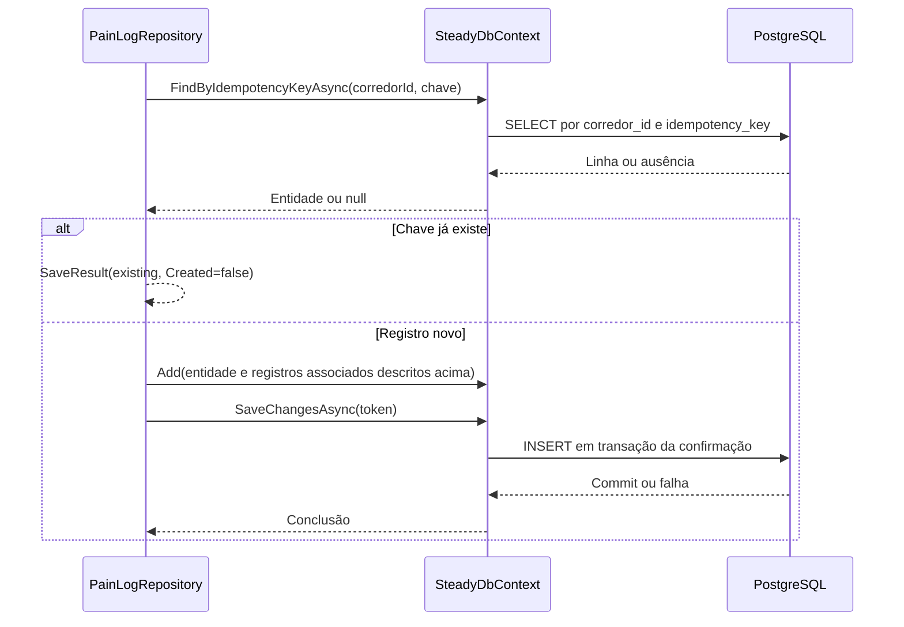

# PainLogRepository - Persistencia-Treino - Especificação Técnica

Atualizado em 2026-09-27.

## Índice

- [Visão geral](#visao)
- [Métodos e contratos](#metodos)
- [Mapeamentos](#ctx)
- [Observações](#observacoes)
- [Fontes](#fontes)

<a id="visao"></a>
## 1. Visão geral técnica

Guardar indicação de dor uma vez por chave e corredor.

Chamada pela camada Steady.Api; ver [índice da API](../../Steady.Api/DevDocs/README.md). Sem rotas próprias: entradas são parâmetros C#, saídas são entidades/objetos ou resultados assíncronos. O token e os papéis são validados na API; parâmetros de identidade precisam vir do contexto autenticado. PostgreSQL é acessado pelo SteadyDbContext com EF Core e Npgsql.


<a id="metodos"></a>
## 2. R. Métodos e contratos

- [AddAsync](#r-1)

<a id="r-1"></a>
### R. AddAsync

`public async Task<SaveResult<PainLogEntity>> AddAsync( Guid corredorId, PainLog painLog, Guid idempotencyKey, CancellationToken cancellationToken)`

FindByIdempotencyKeyAsync(corredorId,chave); existente retorna SaveResult com Created=false. Novo copia Date e Region do PainLog validado, gera Id e salva. Não possui consulta pública nem atualização. Dor automática de encerramento é gravada por outros repositórios; ReviewOutboxProcessor utiliza o booleano congelado na outbox, não uma busca neste repositório.

Entrada: os parâmetros da assinatura, incluindo `CancellationToken` nas operações assíncronas. Saída: o tipo retornado na assinatura; `Task` transporta conclusão, resultado ou falha. Objetos de domínio chegam validados por suas fábricas; o repositório não substitui essa validação.

#### Fluxo de execução



<a id="ctx"></a>
## 3. CTX. Mapeamento e integridade

### CTX. pain_logs

Chave primária: `Id` (sem HasColumnName, nome por convenção do modelo).

| Propriedade | Coluna | Configuração explícita |
|---|---|---|
| `CorredorId` | `corredor_id` | `Tipo por convenção do provider` |
| `Date` | `date` | `Tipo por convenção do provider` |
| `Region` | `region` | `IsRequired()` |
| `IdempotencyKey` | `idempotency_key` | `Tipo por convenção do provider` |

Índices e relações (expressões reais do modelo):

```csharp
HasIndex(p => p.CorredorId);
HasIndex(p => new { p.CorredorId, p.IdempotencyKey }).IsUnique();
HasOne<CorredorEntity>()
                .WithMany()
                .HasForeignKey(p => p.CorredorId)
                .OnDelete(DeleteBehavior.Cascade);
```

<a id="observacoes"></a>
## 4. Observações técnicas

Consultas usam rastreamento padrão salvo AsNoTracking explicitamente indicado. Falhas de persistência e cancelamento propagam quando não houver captura documentada. Cada chave idempotente pertence à conta, não é uma chave global entre corredores. Entidades retornadas incluem os campos persistidos listados em CTX; resultados SaveResult contêm Entity e Created.

<a id="fontes"></a>
## 5. Fontes e verificação

- [docs/adr/ADR-002-autenticacao-e-isolamento-de-dados.md](../../../docs/adr/ADR-002-autenticacao-e-isolamento-de-dados.md)
- [docs/adr/ADR-003-chave-de-idempotencia-para-sincronizacao-offline.md](../../../docs/adr/ADR-003-chave-de-idempotencia-para-sincronizacao-offline.md)
- [docs/adr/ADR-018-outbox-transacional-da-revisao.md](../../../docs/adr/ADR-018-outbox-transacional-da-revisao.md)
- [tests/Steady.Api.Tests/PainLogEndpointTests.cs](../../../tests/Steady.Api.Tests/PainLogEndpointTests.cs)
- [src/Steady.Infrastructure/Persistence/SteadyDbContext.cs](../../../src/Steady.Infrastructure/Persistence/SteadyDbContext.cs)
- [src/Steady.Infrastructure/Repositories/PainLogRepository.cs](../../../src/Steady.Infrastructure/Repositories/PainLogRepository.cs)

Os testes citados foram inspecionados como evidência de comportamento; não foram executados nesta rodada de documentação.

Especificações de comportamento relacionadas:

- [STORY-003](../../../specs/STORY-003/spec.bdd.md)
- [STORY-014](../../../specs/STORY-014/spec.bdd.md)
