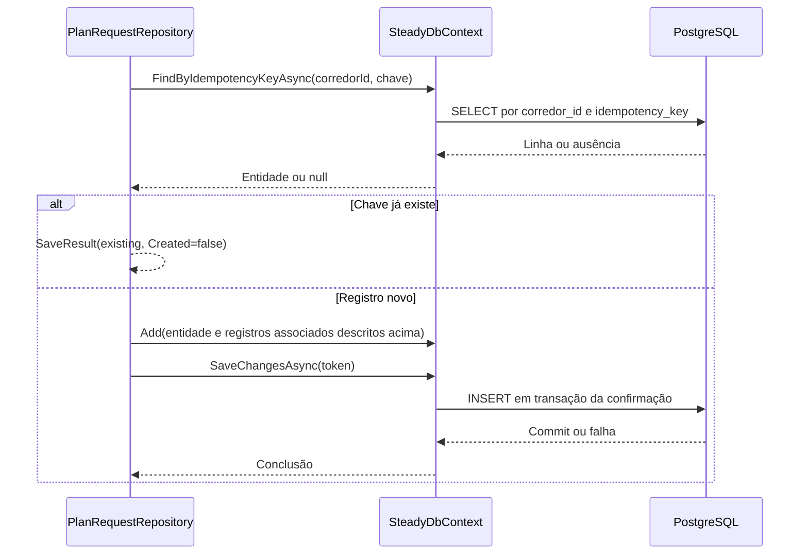

# PlanRequestRepository - Persistencia-Planejamento - Especificação Técnica

Atualizado em 2026-09-27.

## Índice

- [Visão geral](#visao)
- [Métodos e contratos](#metodos)
- [Mapeamentos](#ctx)
- [Observações](#observacoes)
- [Fontes](#fontes)

<a id="visao"></a>
## 1. Visão geral técnica

Guardar formulário completo e imutável do pedido.

Chamada pela camada Steady.Api; ver [índice da API](../../Steady.Api/DevDocs/README.md). Sem rotas próprias: entradas são parâmetros C#, saídas são entidades/objetos ou resultados assíncronos. O token e os papéis são validados na API; parâmetros de identidade precisam vir do contexto autenticado. PostgreSQL é acessado pelo SteadyDbContext com EF Core e Npgsql.


<a id="metodos"></a>
## 2. R. Métodos e contratos

- [AddAsync](#r-1)
- [GetByCorredorIdAsync](#r-2)
- [GetByIdempotencyKeyAsync](#r-3)

<a id="r-1"></a>
### R. AddAsync

`public async Task<SaveResult<PlanRequestEntity>> AddAsync( Guid corredorId, PlanRequest request, Guid idempotencyKey, CancellationToken cancellationToken)`

Reaproveita (corredor,chave) ou copia RaceDistance, RaceDate yyyy-MM-dd, RaceIsFirstTime, LongestRecentRunKm, TrainingDaysPerWeek, CurrentWeeklyRunningDays, ReferenceDistanceKm, ReferenceDuration, StrengthSessionMinutes, EquipmentAccess, RecurringPainAreas e PriorInjuries; gera Id/CreatedAt UTC e salva.

Entrada: os parâmetros da assinatura, incluindo `CancellationToken` nas operações assíncronas. Saída: o tipo retornado na assinatura; `Task` transporta conclusão, resultado ou falha. Objetos de domínio chegam validados por suas fábricas; o repositório não substitui essa validação.

<a id="r-2"></a>
### R. GetByCorredorIdAsync

`public async Task<IReadOnlyList<PlanRequestEntity>> GetByCorredorIdAsync( Guid corredorId, CancellationToken cancellationToken)`

Filtra corredor, ordena CreatedAt desc e materializa sem paginação.

Entrada: os parâmetros da assinatura, incluindo `CancellationToken` nas operações assíncronas. Saída: o tipo retornado na assinatura; `Task` transporta conclusão, resultado ou falha. Objetos de domínio chegam validados por suas fábricas; o repositório não substitui essa validação.

<a id="r-3"></a>
### R. GetByIdempotencyKeyAsync

`public Task<PlanRequestEntity?> GetByIdempotencyKeyAsync( Guid corredorId, Guid idempotencyKey, CancellationToken cancellationToken)`

Reusa filtro composto IdempotentRecordQueries; retorna linha ou null. Não há update/delete nem geração de plano.

Entrada: os parâmetros da assinatura, incluindo `CancellationToken` nas operações assíncronas. Saída: o tipo retornado na assinatura; `Task` transporta conclusão, resultado ou falha. Objetos de domínio chegam validados por suas fábricas; o repositório não substitui essa validação.

#### Fluxo de execução



<a id="ctx"></a>
## 3. CTX. Mapeamento e integridade

### CTX. plan_requests

Chave primária: `Id` (sem HasColumnName, nome por convenção do modelo).

| Propriedade | Coluna | Configuração explícita |
|---|---|---|
| `CorredorId` | `corredor_id` | `Tipo por convenção do provider` |
| `IdempotencyKey` | `idempotency_key` | `Tipo por convenção do provider` |
| `CreatedAt` | `created_at` | `Tipo por convenção do provider` |
| `RaceDistance` | `race_distance` | `HasConversion<string>(); IsRequired()` |
| `RaceDate` | `race_date` | `IsRequired()` |
| `RaceIsFirstTime` | `race_is_first_time` | `Tipo por convenção do provider` |
| `LongestRecentRunKm` | `longest_recent_run_km` | `Tipo por convenção do provider` |
| `TrainingDaysPerWeek` | `training_days_per_week` | `Tipo por convenção do provider` |
| `CurrentWeeklyRunningDays` | `current_weekly_running_days` | `Tipo por convenção do provider` |
| `ReferenceDistanceKm` | `reference_distance_km` | `Tipo por convenção do provider` |
| `ReferenceDuration` | `reference_duration` | `Tipo por convenção do provider` |
| `StrengthSessionMinutes` | `strength_session_minutes` | `Tipo por convenção do provider` |
| `EquipmentAccess` | `equipment_access` | `HasConversion<string>()` |
| `RecurringPainAreas` | `recurring_pain_areas` | `HasColumnType("text[]")` |
| `PriorInjuries` | `prior_injuries` | `Tipo por convenção do provider` |

Índices e relações (expressões reais do modelo):

```csharp
HasIndex(p => p.CorredorId);
HasIndex(p => new { p.CorredorId, p.IdempotencyKey }).IsUnique();
HasOne<CorredorEntity>()
                .WithMany()
                .HasForeignKey(p => p.CorredorId)
                .OnDelete(DeleteBehavior.Cascade);
```

Coleções usam conversão para `text[]` e ValueComparer com SequenceEqual, hash agregado e cópia ToList, detectando mudança em conteúdo.

<a id="observacoes"></a>
## 4. Observações técnicas

Consultas usam rastreamento padrão salvo AsNoTracking explicitamente indicado. Falhas de persistência e cancelamento propagam quando não houver captura documentada. Cada chave idempotente pertence à conta, não é uma chave global entre corredores. Entidades retornadas incluem os campos persistidos listados em CTX; resultados SaveResult contêm Entity e Created.

<a id="fontes"></a>
## 5. Fontes e verificação

- [docs/adr/ADR-002-autenticacao-e-isolamento-de-dados.md](../../../docs/adr/ADR-002-autenticacao-e-isolamento-de-dados.md)
- [docs/adr/ADR-003-chave-de-idempotencia-para-sincronizacao-offline.md](../../../docs/adr/ADR-003-chave-de-idempotencia-para-sincronizacao-offline.md)
- [docs/adr/ADR-007-persistencia-do-pedido-de-plano-de-treino.md](../../../docs/adr/ADR-007-persistencia-do-pedido-de-plano-de-treino.md)
- [tests/Steady.Api.Tests/PlanRequestEndpointTests.cs](../../../tests/Steady.Api.Tests/PlanRequestEndpointTests.cs)
- [src/Steady.Infrastructure/Persistence/SteadyDbContext.cs](../../../src/Steady.Infrastructure/Persistence/SteadyDbContext.cs)
- [src/Steady.Infrastructure/Repositories/PlanRequestRepository.cs](../../../src/Steady.Infrastructure/Repositories/PlanRequestRepository.cs)

Os testes citados foram inspecionados como evidência de comportamento; não foram executados nesta rodada de documentação.

Especificações de comportamento relacionadas:

- [STORY-010](../../../specs/STORY-010/spec.bdd.md)
