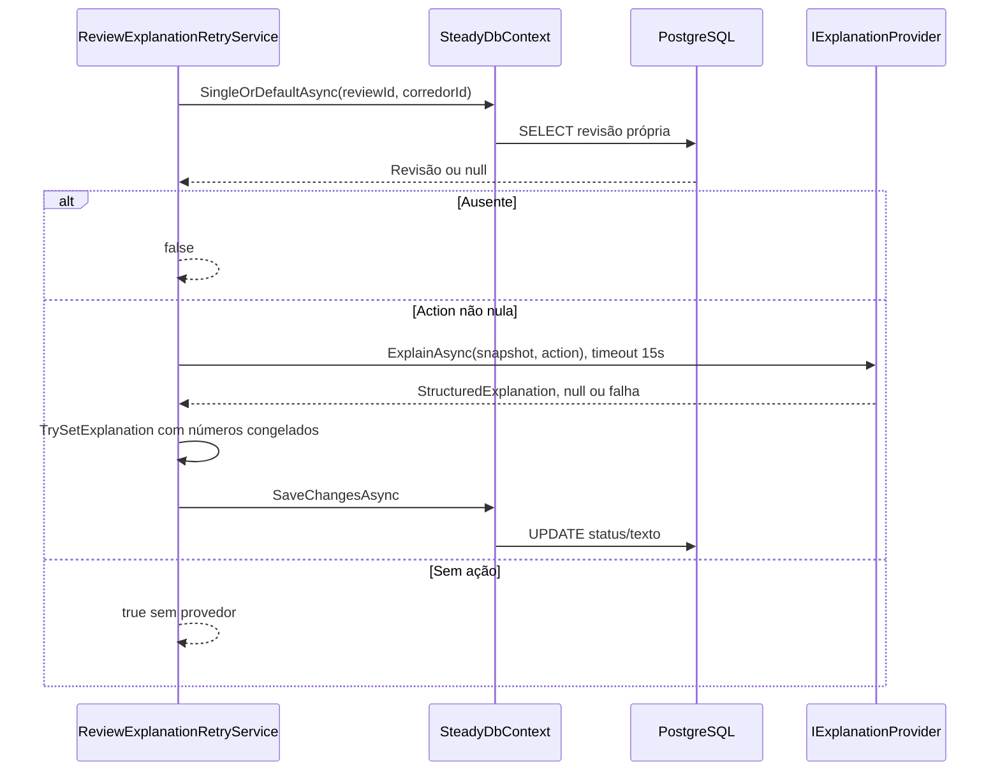

# ReviewExplanationRetryService - Persistencia-Revisao - Especificação Técnica

Atualizado em 2026-09-27.

## Índice

- [Visão geral](#visao)
- [Métodos e contratos](#metodos)
- [Mapeamentos](#ctx)
- [Observações](#observacoes)
- [Fontes](#fontes)

<a id="visao"></a>
## 1. Visão geral técnica

Repetir somente explicação usando fatos e ação já congelados.

Chamada pela camada Steady.Api; ver [índice da API](../../Steady.Api/DevDocs/README.md). Sem rotas próprias: entradas são parâmetros C#, saídas são entidades/objetos ou resultados assíncronos. O token e os papéis são validados na API; parâmetros de identidade precisam vir do contexto autenticado. PostgreSQL é acessado pelo SteadyDbContext com EF Core e Npgsql.


<a id="metodos"></a>
## 2. R. Métodos e contratos

- [RetryAsync](#r-1)
- [ExplainAsync](#r-2)

<a id="r-1"></a>
### R. RetryAsync

`public async Task<bool> RetryAsync(Guid corredorId, Guid reviewId, CancellationToken cancellationToken)`

Busca reviewId/corredor; ausente false; Action null retorna true sem chamar provedor. Desserializa ComparisonJson em ReviewSnapshot antes do try. Timeout vinculado de 15s; ExplainAsync usa modality/facts/action congelados e flag action==PrioritizeRecovery. Null marca Unavailable e salva; resposta passa TrySetExplanation com números permitidos dos fatos. Aceita serializa e marca Available; rejeita limpa ExplanationJson, marca Unavailable e loga motivo. Timeout ou erro do provedor marca Unavailable e loga erro quando aplicável; salva e retorna true. Não recalcula status nem ação.

Entrada: os parâmetros da assinatura, incluindo `CancellationToken` nas operações assíncronas. Saída: o tipo retornado na assinatura; `Task` transporta conclusão, resultado ou falha. Objetos de domínio chegam validados por suas fábricas; o repositório não substitui essa validação.

<a id="r-2"></a>
### R. ExplainAsync

`public Task<StructuredExplanation?> ExplainAsync( ExplanationContext context, CancellationToken cancellationToken)`

UnavailableExplanationProvider retorna Task com null, independente do contexto, sem chamada externa.

Entrada: os parâmetros da assinatura, incluindo `CancellationToken` nas operações assíncronas. Saída: o tipo retornado na assinatura; `Task` transporta conclusão, resultado ou falha. Objetos de domínio chegam validados por suas fábricas; o repositório não substitui essa validação.

#### Fluxo de execução



<a id="ctx"></a>
## 3. CTX. Mapeamento e integridade

### CTX. workout_reviews

Chave primária: `Id` (sem HasColumnName, nome por convenção do modelo).

| Propriedade | Coluna | Configuração explícita |
|---|---|---|
| `CorredorId` | `corredor_id` | `Tipo por convenção do provider` |
| `ExecutionId` | `execution_id` | `Tipo por convenção do provider` |
| `ExecutionKind` | `execution_kind` | `HasConversion<string>()` |
| `ExecutionDate` | `execution_date` | `Tipo por convenção do provider` |
| `Status` | `status` | `HasConversion<string>()` |
| `Action` | `action` | `HasConversion<string>()` |
| `PolicyVersion` | `policy_version` | `Tipo por convenção do provider` |
| `PlanVersion` | `plan_version` | `Tipo por convenção do provider` |
| `TrainingSheetId` | `training_sheet_id` | `Tipo por convenção do provider` |
| `ComparisonJson` | `comparison` | `HasColumnType("jsonb")` |
| `ExplanationStatus` | `explanation_status` | `HasConversion<string>()` |
| `ExplanationJson` | `explanation` | `HasColumnType("jsonb")` |
| `UnderstoodAt` | `understood_at` | `Tipo por convenção do provider` |
| `Contested` | `contested` | `Tipo por convenção do provider` |
| `CoherenceStatus` | `coherence_status` | `HasConversion<string>()` |
| `NextExecutionId` | `next_execution_id` | `Tipo por convenção do provider` |
| `CoherencePolicyVersion` | `coherence_policy_version` | `Tipo por convenção do provider` |
| `CoherenceEvaluatedAt` | `coherence_evaluated_at` | `Tipo por convenção do provider` |
| `CreatedAt` | `created_at` | `Tipo por convenção do provider` |

Índices e relações (expressões reais do modelo):

```csharp
HasIndex(review => new { review.ExecutionKind, review.ExecutionId }).IsUnique();
HasIndex(review => new { review.CorredorId, review.ExecutionDate });
HasOne<CorredorEntity>().WithMany().HasForeignKey(review => review.CorredorId)
                .OnDelete(DeleteBehavior.Cascade);
```

<a id="observacoes"></a>
## 4. Observações técnicas

Consultas usam rastreamento padrão salvo AsNoTracking explicitamente indicado. Falhas de persistência e cancelamento propagam quando não houver captura documentada. Cada chave idempotente pertence à conta, não é uma chave global entre corredores. Entidades retornadas incluem os campos persistidos listados em CTX; resultados SaveResult contêm Entity e Created.

A API registra IExplanationProvider em Program.cs: sem Anthropic:ApiKey usa UnavailableExplanationProvider, com chave usa ClaudeExplanationProvider. ReviewOutboxWorker cria escopo e executa ProcessNextAsync. Esses componentes pertencem à API; o banco não chama Claude diretamente.

<a id="fontes"></a>
## 5. Fontes e verificação

- [docs/adr/ADR-002-autenticacao-e-isolamento-de-dados.md](../../../docs/adr/ADR-002-autenticacao-e-isolamento-de-dados.md)
- [docs/adr/ADR-014-fronteira-deterministica-da-revisao.md](../../../docs/adr/ADR-014-fronteira-deterministica-da-revisao.md)
- [docs/adr/ADR-016-provedor-da-explicacao-da-revisao.md](../../../docs/adr/ADR-016-provedor-da-explicacao-da-revisao.md)
- [tests/Steady.Api.Tests/WorkoutReviewEndpointTests.cs](../../../tests/Steady.Api.Tests/WorkoutReviewEndpointTests.cs)
- [src/Steady.Infrastructure/Persistence/SteadyDbContext.cs](../../../src/Steady.Infrastructure/Persistence/SteadyDbContext.cs)
- [src/Steady.Infrastructure/Repositories/ReviewExplanationRetryService.cs](../../../src/Steady.Infrastructure/Repositories/ReviewExplanationRetryService.cs)
- [src/Steady.Infrastructure/Repositories/UnavailableExplanationProvider.cs](../../../src/Steady.Infrastructure/Repositories/UnavailableExplanationProvider.cs)

Os testes citados foram inspecionados como evidência de comportamento; não foram executados nesta rodada de documentação.

Especificações de comportamento relacionadas:

- [STORY-014](../../../specs/STORY-014/spec.bdd.md)
