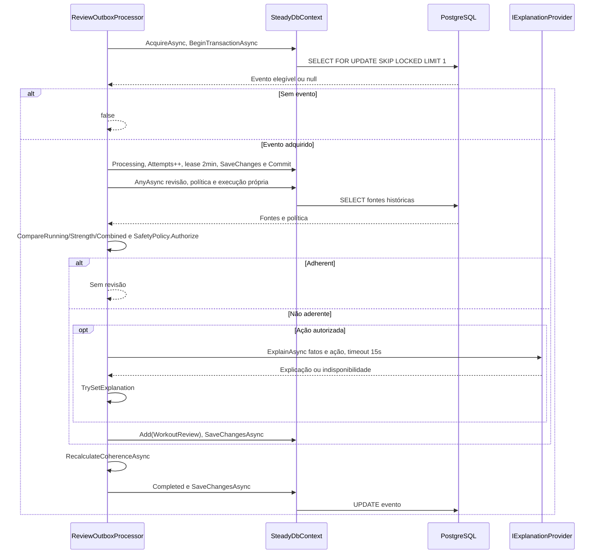

# ReviewOutboxProcessor - Persistencia-Revisao - Especificação Técnica

Atualizado em 2026-09-27.

## Índice

- [Visão geral](#visao)
- [Métodos e contratos](#metodos)
- [Mapeamentos](#ctx)
- [Observações](#observacoes)
- [Fontes](#fontes)

<a id="visao"></a>
## 1. Visão geral técnica

Processar intenção durável, comparar treino e acompanhar coerência da ação.

Chamada pela camada Steady.Api; ver [índice da API](../../Steady.Api/DevDocs/README.md). Sem rotas próprias: entradas são parâmetros C#, saídas são entidades/objetos ou resultados assíncronos. O token e os papéis são validados na API; parâmetros de identidade precisam vir do contexto autenticado. PostgreSQL é acessado pelo SteadyDbContext com EF Core e Npgsql.


<a id="metodos"></a>
## 2. R. Métodos e contratos

- [ProcessNextAsync](#r-1)
- [AcquireAsync](#r-2)
- [ProcessAsync](#r-3)
- [CompareRunningAsync](#r-4)
- [CompareStrengthAsync](#r-5)
- [CompareCombinedAsync](#r-6)
- [CompareStrengthEntityAsync](#r-7)
- [ResolveRunningSourcesAsync](#r-8)
- [FromRun](#r-9)
- [WeekIndex](#r-10)
- [RunningFacts](#r-11)
- [StrengthFacts](#r-12)
- [Fact](#r-13)
- [Median](#r-14)
- [Sum](#r-15)
- [RecalculateCoherenceAsync](#r-16)
- [ExecutionLoadAsync](#r-17)
- [Create](#r-18)
- [Conflict](#r-19)

<a id="r-1"></a>
### R. ProcessNextAsync

`public async Task<bool> ProcessNextAsync(CancellationToken cancellationToken)`

AcquireAsync ausente retorna false; processa, salva revisão, recalcula coerência, marca Completed e limpa lease. Erro volta Pending, agenda min(60,2^Attempts) segundos, salva e relança.

Entrada: os parâmetros da assinatura, incluindo `CancellationToken` nas operações assíncronas. Saída: o tipo retornado na assinatura; `Task` transporta conclusão, resultado ou falha. Objetos de domínio chegam validados por suas fábricas; o repositório não substitui essa validação.

<a id="r-2"></a>
### R. AcquireAsync

`private async Task<ReviewOutboxEntity?> AcquireAsync(CancellationToken cancellationToken)`

Transação SELECT Pending vencido ou Processing com lease expirado, ORDER BY created_at, FOR UPDATE SKIP LOCKED LIMIT 1; incrementa Attempts, Processing e lease de 2min, salva e commit.

Entrada: os parâmetros da assinatura, incluindo `CancellationToken` nas operações assíncronas. Saída: o tipo retornado na assinatura; `Task` transporta conclusão, resultado ou falha. Objetos de domínio chegam validados por suas fábricas; o repositório não substitui essa validação.

<a id="r-3"></a>
### R. ProcessAsync

`private async Task ProcessAsync(ReviewOutboxEntity item, CancellationToken cancellationToken)`

Se revisão por ExecutionKind/ExecutionId existe, sai. Carrega política vigente ou falha. Switch Running/Strength/Combined chama comparação; Adherent não gera revisão. SafetyPolicy.Authorize recebe fatos comparáveis, dor congelada e cargas, overloadAlreadyDetected=false. Provedor tem timeout de 15s; TrySetExplanation valida números/ação; falha/null/rejeição vira Unavailable. Adiciona revisão com versões e snapshot.

Entrada: os parâmetros da assinatura, incluindo `CancellationToken` nas operações assíncronas. Saída: o tipo retornado na assinatura; `Task` transporta conclusão, resultado ou falha. Objetos de domínio chegam validados por suas fábricas; o repositório não substitui essa validação.

<a id="r-4"></a>
### R. CompareRunningAsync

`private async Task<ComparisonEnvelope> CompareRunningAsync( ReviewOutboxEntity item, AdherencePolicyVersion policy, CancellationToken cancellationToken)`

Busca corrida por execução/corredor, resolve fontes; conflito produz PrescriptionConflict; sem conflito CompareRunning preserva campos não prescritos e calcula carga por duração*esforço quando ambos prescritos.

Entrada: os parâmetros da assinatura, incluindo `CancellationToken` nas operações assíncronas. Saída: o tipo retornado na assinatura; `Task` transporta conclusão, resultado ou falha. Objetos de domínio chegam validados por suas fábricas; o repositório não substitui essa validação.

<a id="r-5"></a>
### R. CompareStrengthAsync

`private async Task<ComparisonEnvelope> CompareStrengthAsync( ReviewOutboxEntity item, AdherencePolicyVersion policy, CancellationToken cancellationToken)`

Busca execução por Id/corredor e delega CompareStrengthEntityAsync.

Entrada: os parâmetros da assinatura, incluindo `CancellationToken` nas operações assíncronas. Saída: o tipo retornado na assinatura; `Task` transporta conclusão, resultado ou falha. Objetos de domínio chegam validados por suas fábricas; o repositório não substitui essa validação.

<a id="r-6"></a>
### R. CompareCombinedAsync

`private async Task<ComparisonEnvelope> CompareCombinedAsync( ReviewOutboxEntity item, AdherencePolicyVersion policy, CancellationToken cancellationToken)`

Força por Id/corredor e corrida pela chave/corredor; compara ambas. Prioridade PrescriptionConflict, depois Divergent, depois Adherent; concatena fatos e soma cargas.

Entrada: os parâmetros da assinatura, incluindo `CancellationToken` nas operações assíncronas. Saída: o tipo retornado na assinatura; `Task` transporta conclusão, resultado ou falha. Objetos de domínio chegam validados por suas fábricas; o repositório não substitui essa validação.

<a id="r-7"></a>
### R. CompareStrengthEntityAsync

`private async Task<ComparisonEnvelope> CompareStrengthEntityAsync( StrengthWorkoutExecutionEntity entity, AdherencePolicyVersion policy, CancellationToken cancellationToken)`

Busca ficha histórica por Id/corredor; materializa histórico anterior por CreatedAt do corredor; pareia por ExerciseKey; carga de referência é mediana das execuções anteriores não puladas, sem filtro por ficha. Compara conclusão/séries/repetições/carga; soma medianas e cargas informadas.

Entrada: os parâmetros da assinatura, incluindo `CancellationToken` nas operações assíncronas. Saída: o tipo retornado na assinatura; `Task` transporta conclusão, resultado ou falha. Objetos de domínio chegam validados por suas fábricas; o repositório não substitui essa validação.

<a id="r-8"></a>
### R. ResolveRunningSourcesAsync

`private async Task<RunningSources> ResolveRunningSourcesAsync( ReviewOutboxEntity item, CancellationToken cancellationToken)`

Plano da conta, dia da semana e ficha congelada na outbox. Ficha tem terça/quinta/sábado; quando há duas fontes usa ResolveRunningPrescription; conflito explícito, não seleciona silenciosamente uma fonte.

Entrada: os parâmetros da assinatura, incluindo `CancellationToken` nas operações assíncronas. Saída: o tipo retornado na assinatura; `Task` transporta conclusão, resultado ou falha. Objetos de domínio chegam validados por suas fábricas; o repositório não substitui essa validação.

<a id="r-9"></a>
### R. FromRun

`private static RunningAdherencePrescription? FromRun(RunPrescription? run)`

Transforma faixas opcionais em RunningAdherencePrescription; null continua null.

Entrada: os parâmetros da assinatura, incluindo `CancellationToken` nas operações assíncronas. Saída: o tipo retornado na assinatura; `Task` transporta conclusão, resultado ou falha. Objetos de domínio chegam validados por suas fábricas; o repositório não substitui essa validação.

<a id="r-10"></a>
### R. WeekIndex

`private static int WeekIndex(DayOfWeek day)`

((int)day+6)%7 coloca segunda em índice zero.

Entrada: os parâmetros da assinatura, incluindo `CancellationToken` nas operações assíncronas. Saída: o tipo retornado na assinatura; `Task` transporta conclusão, resultado ou falha. Objetos de domínio chegam validados por suas fábricas; o repositório não substitui essa validação.

<a id="r-11"></a>
### R. RunningFacts

`private static IReadOnlyList<ExplanationFact> RunningFacts(RunningAdherenceResult result)`

Cria completion,distanceKm,durationMinutes,perceivedEffort.

Entrada: os parâmetros da assinatura, incluindo `CancellationToken` nas operações assíncronas. Saída: o tipo retornado na assinatura; `Task` transporta conclusão, resultado ou falha. Objetos de domínio chegam validados por suas fábricas; o repositório não substitui essa validação.

<a id="r-12"></a>
### R. StrengthFacts

`private static IEnumerable<ExplanationFact> StrengthFacts( int exerciseIndex, StrengthExerciseAdherenceResult result)`

Cria fatos por índice do exercício para completion,sets,repetitions,loadKg.

Entrada: os parâmetros da assinatura, incluindo `CancellationToken` nas operações assíncronas. Saída: o tipo retornado na assinatura; `Task` transporta conclusão, resultado ou falha. Objetos de domínio chegam validados por suas fábricas; o repositório não substitui essa validação.

<a id="r-13"></a>
### R. Fact

`private static ExplanationFact Fact(string name, FieldComparison comparison)`

Copia limites, executado, diferença e status da comparação.

Entrada: os parâmetros da assinatura, incluindo `CancellationToken` nas operações assíncronas. Saída: o tipo retornado na assinatura; `Task` transporta conclusão, resultado ou falha. Objetos de domínio chegam validados por suas fábricas; o repositório não substitui essa validação.

<a id="r-14"></a>
### R. Median

`private static decimal? Median(IReadOnlyList<decimal> values)`

Lista vazia null; ímpar central; par média dos dois centrais.

Entrada: os parâmetros da assinatura, incluindo `CancellationToken` nas operações assíncronas. Saída: o tipo retornado na assinatura; `Task` transporta conclusão, resultado ou falha. Objetos de domínio chegam validados por suas fábricas; o repositório não substitui essa validação.

<a id="r-15"></a>
### R. Sum

`private static double? Sum(double? left, double? right)`

Ambos null retorna null; soma demais usando zero para ausente.

Entrada: os parâmetros da assinatura, incluindo `CancellationToken` nas operações assíncronas. Saída: o tipo retornado na assinatura; `Task` transporta conclusão, resultado ou falha. Objetos de domínio chegam validados por suas fábricas; o repositório não substitui essa validação.

<a id="r-16"></a>
### R. RecalculateCoherenceAsync

`private async Task RecalculateCoherenceAsync(Guid corredorId, CancellationToken cancellationToken)`

Política vigente e revisões com Action; carrega corridas e força do corredor, ordena data/Id. Próxima execução precisa data maior, não mesmo dia. Sem próxima deixa Unknown e limpa metadados. Maintain é coerente se próxima não tem revisão Divergent; ReduceLoad/PrioritizeRecovery exigem carga seguinte menor. Registra próxima execução, versão e instante.

Entrada: os parâmetros da assinatura, incluindo `CancellationToken` nas operações assíncronas. Saída: o tipo retornado na assinatura; `Task` transporta conclusão, resultado ou falha. Objetos de domínio chegam validados por suas fábricas; o repositório não substitui essa validação.

<a id="r-17"></a>
### R. ExecutionLoadAsync

`private async Task<double> ExecutionLoadAsync( WorkoutReviewEntity review, CancellationToken cancellationToken)`

Corrida usa duração*esforço; força soma cargas não skipped; combinado soma corrida pela chave da outbox. As consultas por Id pressupõem revisão/outbox internas já associadas ao corredor.

Entrada: os parâmetros da assinatura, incluindo `CancellationToken` nas operações assíncronas. Saída: o tipo retornado na assinatura; `Task` transporta conclusão, resultado ou falha. Objetos de domínio chegam validados por suas fábricas; o repositório não substitui essa validação.

<a id="r-18"></a>
### R. Create

ComparisonEnvelope serializa modality,status,facts como snapshot.

Entrada: os parâmetros da assinatura, incluindo `CancellationToken` nas operações assíncronas. Saída: o tipo retornado na assinatura; `Task` transporta conclusão, resultado ou falha. Objetos de domínio chegam validados por suas fábricas; o repositório não substitui essa validação.

<a id="r-19"></a>
### R. Conflict

Cria envelope PrescriptionConflict sem fatos/cargas.

Entrada: os parâmetros da assinatura, incluindo `CancellationToken` nas operações assíncronas. Saída: o tipo retornado na assinatura; `Task` transporta conclusão, resultado ou falha. Objetos de domínio chegam validados por suas fábricas; o repositório não substitui essa validação.

#### Fluxo de execução



<a id="ctx"></a>
## 3. CTX. Mapeamento e integridade

### CTX. review_outbox

Chave primária: `Id` (sem HasColumnName, nome por convenção do modelo).

| Propriedade | Coluna | Configuração explícita |
|---|---|---|
| `CorredorId` | `corredor_id` | `Tipo por convenção do provider` |
| `ExecutionId` | `execution_id` | `Tipo por convenção do provider` |
| `TrainingSheetId` | `training_sheet_id` | `Tipo por convenção do provider` |
| `ExecutionKind` | `execution_kind` | `HasConversion<string>()` |
| `IdempotencyKey` | `idempotency_key` | `Tipo por convenção do provider` |
| `ExecutionDate` | `execution_date` | `Tipo por convenção do provider` |
| `PainReportedAtCompletion` | `pain_reported_at_completion` | `Tipo por convenção do provider` |
| `Status` | `status` | `HasConversion<string>()` |
| `Attempts` | `attempts` | `Tipo por convenção do provider` |
| `LeaseUntil` | `lease_until` | `Tipo por convenção do provider` |
| `NextAttemptAt` | `next_attempt_at` | `Tipo por convenção do provider` |
| `CreatedAt` | `created_at` | `Tipo por convenção do provider` |
| `CompletedAt` | `completed_at` | `Tipo por convenção do provider` |

Índices e relações (expressões reais do modelo):

```csharp
HasIndex(item => new { item.ExecutionKind, item.ExecutionId }).IsUnique();
HasIndex(item => new { item.CorredorId, item.IdempotencyKey }).IsUnique();
HasIndex(item => new { item.Status, item.NextAttemptAt });
HasOne<CorredorEntity>().WithMany().HasForeignKey(item => item.CorredorId)
                .OnDelete(DeleteBehavior.Cascade);
```

### CTX. workout_reviews

Chave primária: `Id` (sem HasColumnName, nome por convenção do modelo).

| Propriedade | Coluna | Configuração explícita |
|---|---|---|
| `CorredorId` | `corredor_id` | `Tipo por convenção do provider` |
| `ExecutionId` | `execution_id` | `Tipo por convenção do provider` |
| `ExecutionKind` | `execution_kind` | `HasConversion<string>()` |
| `ExecutionDate` | `execution_date` | `Tipo por convenção do provider` |
| `Status` | `status` | `HasConversion<string>()` |
| `Action` | `action` | `HasConversion<string>()` |
| `PolicyVersion` | `policy_version` | `Tipo por convenção do provider` |
| `PlanVersion` | `plan_version` | `Tipo por convenção do provider` |
| `TrainingSheetId` | `training_sheet_id` | `Tipo por convenção do provider` |
| `ComparisonJson` | `comparison` | `HasColumnType("jsonb")` |
| `ExplanationStatus` | `explanation_status` | `HasConversion<string>()` |
| `ExplanationJson` | `explanation` | `HasColumnType("jsonb")` |
| `UnderstoodAt` | `understood_at` | `Tipo por convenção do provider` |
| `Contested` | `contested` | `Tipo por convenção do provider` |
| `CoherenceStatus` | `coherence_status` | `HasConversion<string>()` |
| `NextExecutionId` | `next_execution_id` | `Tipo por convenção do provider` |
| `CoherencePolicyVersion` | `coherence_policy_version` | `Tipo por convenção do provider` |
| `CoherenceEvaluatedAt` | `coherence_evaluated_at` | `Tipo por convenção do provider` |
| `CreatedAt` | `created_at` | `Tipo por convenção do provider` |

Índices e relações (expressões reais do modelo):

```csharp
HasIndex(review => new { review.ExecutionKind, review.ExecutionId }).IsUnique();
HasIndex(review => new { review.CorredorId, review.ExecutionDate });
HasOne<CorredorEntity>().WithMany().HasForeignKey(review => review.CorredorId)
                .OnDelete(DeleteBehavior.Cascade);
```

### CTX. adherence_policy_versions

Chave primária: `Id` (sem HasColumnName, nome por convenção do modelo).

| Propriedade | Coluna | Configuração explícita |
|---|---|---|
| `Version` | `version` | `Tipo por convenção do provider` |
| `RunningDistancePercent` | `running_distance_percent` | `Tipo por convenção do provider` |
| `RunningDurationPercent` | `running_duration_percent` | `Tipo por convenção do provider` |
| `PerceivedEffortPoints` | `perceived_effort_points` | `Tipo por convenção do provider` |
| `SetsAbsolute` | `sets_absolute` | `Tipo por convenção do provider` |
| `RepetitionsPercent` | `repetitions_percent` | `Tipo por convenção do provider` |
| `LoadPercent` | `load_percent` | `Tipo por convenção do provider` |
| `IsCurrent` | `is_current` | `Tipo por convenção do provider` |
| `CreatedAt` | `created_at` | `Tipo por convenção do provider` |

Índices e relações (expressões reais do modelo):

```csharp
HasIndex(policy => policy.Version).IsUnique();
HasIndex(policy => policy.IsCurrent).IsUnique().HasFilter("is_current = TRUE");

```

### CTX. running_sessions

Chave primária: `Id` (sem HasColumnName, nome por convenção do modelo).

| Propriedade | Coluna | Configuração explícita |
|---|---|---|
| `CorredorId` | `corredor_id` | `Tipo por convenção do provider` |
| `Date` | `date` | `Tipo por convenção do provider` |
| `DistanceKm` | `distance_km` | `Tipo por convenção do provider` |
| `DurationMinutes` | `duration_minutes` | `Tipo por convenção do provider` |
| `AveragePaceMinPerKm` | `average_pace_min_per_km` | `Tipo por convenção do provider` |
| `PerceivedEffort` | `perceived_effort` | `Tipo por convenção do provider` |
| `IdempotencyKey` | `idempotency_key` | `Tipo por convenção do provider` |

Índices e relações (expressões reais do modelo):

```csharp
HasIndex(s => s.CorredorId);
HasIndex(s => new { s.CorredorId, s.IdempotencyKey }).IsUnique();
HasOne<CorredorEntity>()
                .WithMany()
                .HasForeignKey(s => s.CorredorId)
                .OnDelete(DeleteBehavior.Cascade);
```

### CTX. strength_workout_executions

Chave primária: `Id` (sem HasColumnName, nome por convenção do modelo).

| Propriedade | Coluna | Configuração explícita |
|---|---|---|
| `CorredorId` | `corredor_id` | `Tipo por convenção do provider` |
| `TrainingSheetId` | `training_sheet_id` | `Tipo por convenção do provider` |
| `WorkoutType` | `workout_type` | `HasConversion<string>()` |
| `Date` | `date` | `Tipo por convenção do provider` |
| `DetailsJson` | `details` | `HasColumnType("jsonb")` |
| `IdempotencyKey` | `idempotency_key` | `Tipo por convenção do provider` |
| `CreatedAt` | `created_at` | `Tipo por convenção do provider` |

Índices e relações (expressões reais do modelo):

```csharp
HasIndex(execution => new { execution.CorredorId, execution.IdempotencyKey }).IsUnique();
HasIndex(execution => new { execution.CorredorId, execution.TrainingSheetId });
HasOne<CorredorEntity>()
                .WithMany()
                .HasForeignKey(execution => execution.CorredorId)
                .OnDelete(DeleteBehavior.Restrict);
HasOne<TrainingSheetEntity>()
                .WithMany()
                .HasForeignKey(execution => execution.TrainingSheetId)
                .OnDelete(DeleteBehavior.Restrict);
```

### CTX. training_sheets

Chave primária: `Id` (sem HasColumnName, nome por convenção do modelo).

| Propriedade | Coluna | Configuração explícita |
|---|---|---|
| `PersonalId` | `personal_id` | `Tipo por convenção do provider` |
| `CorredorId` | `corredor_id` | `Tipo por convenção do provider` |
| `DefinitionJson` | `definition` | `HasColumnType("jsonb")` |
| `IsActive` | `is_active` | `Tipo por convenção do provider` |
| `CreatedAt` | `created_at` | `Tipo por convenção do provider` |

Índices e relações (expressões reais do modelo):

```csharp
HasIndex(sheet => sheet.CorredorId)
                .IsUnique()
                .HasFilter("is_active = TRUE");
HasOne<CorredorEntity>()
                .WithMany()
                .HasForeignKey(sheet => sheet.PersonalId)
                .OnDelete(DeleteBehavior.Restrict);
HasOne<CorredorEntity>()
                .WithMany()
                .HasForeignKey(sheet => sheet.CorredorId)
                .OnDelete(DeleteBehavior.Restrict);
```

### CTX. training_plan_versions

Chave primária: `Id` (sem HasColumnName, nome por convenção do modelo).

| Propriedade | Coluna | Configuração explícita |
|---|---|---|
| `Version` | `version` | `Tipo por convenção do provider` |
| `DefinitionJson` | `definition` | `HasColumnType("jsonb")` |
| `IsCurrent` | `is_current` | `Tipo por convenção do provider` |
| `CreatedAt` | `created_at` | `Tipo por convenção do provider` |

Índices e relações (expressões reais do modelo):

```csharp
HasIndex(v => v.Version).IsUnique();
HasIndex(v => v.IsCurrent).IsUnique().HasFilter("is_current = TRUE");

```

### CTX. corredores

Chave primária: `Id` (sem HasColumnName, nome por convenção do modelo).

| Propriedade | Coluna | Configuração explícita |
|---|---|---|
| `GoogleSub` | `google_sub` | `IsRequired()` |
| `Email` | `email` | `Tipo por convenção do provider` |
| `Name` | `name` | `Tipo por convenção do provider` |
| `Roles` | `roles` | `HasColumnType("text[]"); HasDefaultValue(new[] { "Corredor" })` |
| `TrainingPlanVersionId` | `training_plan_version_id` | `Tipo por convenção do provider` |
| `CreatedAt` | `created_at` | `Tipo por convenção do provider` |

Índices e relações (expressões reais do modelo):

```csharp
HasIndex(c => c.GoogleSub).IsUnique();
HasOne<TrainingPlanVersionEntity>()
                .WithMany()
                .HasForeignKey(c => c.TrainingPlanVersionId)
                .OnDelete(DeleteBehavior.Restrict);
```

Coleções usam conversão para `text[]` e ValueComparer com SequenceEqual, hash agregado e cópia ToList, detectando mudança em conteúdo.

<a id="observacoes"></a>
## 4. Observações técnicas

Consultas usam rastreamento padrão salvo AsNoTracking explicitamente indicado. Falhas de persistência e cancelamento propagam quando não houver captura documentada. Cada chave idempotente pertence à conta, não é uma chave global entre corredores. Entidades retornadas incluem os campos persistidos listados em CTX; resultados SaveResult contêm Entity e Created.

A API registra IExplanationProvider em Program.cs: sem Anthropic:ApiKey usa UnavailableExplanationProvider, com chave usa ClaudeExplanationProvider. ReviewOutboxWorker cria escopo e executa ProcessNextAsync. Esses componentes pertencem à API; o banco não chama Claude diretamente.

<a id="fontes"></a>
## 5. Fontes e verificação

- [docs/adr/ADR-013-plano-do-steady-como-fonte-de-prescricao.md](../../../docs/adr/ADR-013-plano-do-steady-como-fonte-de-prescricao.md)
- [docs/adr/ADR-014-fronteira-deterministica-da-revisao.md](../../../docs/adr/ADR-014-fronteira-deterministica-da-revisao.md)
- [docs/adr/ADR-015-tolerancias-e-politicas-versionadas.md](../../../docs/adr/ADR-015-tolerancias-e-politicas-versionadas.md)
- [docs/adr/ADR-016-provedor-da-explicacao-da-revisao.md](../../../docs/adr/ADR-016-provedor-da-explicacao-da-revisao.md)
- [docs/adr/ADR-018-outbox-transacional-da-revisao.md](../../../docs/adr/ADR-018-outbox-transacional-da-revisao.md)
- [docs/adr/ADR-019-identidade-historica-do-exercicio.md](../../../docs/adr/ADR-019-identidade-historica-do-exercicio.md)
- [tests/Steady.Api.Tests/AdherencePersistenceTests.cs](../../../tests/Steady.Api.Tests/AdherencePersistenceTests.cs)
- [src/Steady.Infrastructure/Persistence/SteadyDbContext.cs](../../../src/Steady.Infrastructure/Persistence/SteadyDbContext.cs)
- [src/Steady.Infrastructure/Repositories/ReviewOutboxProcessor.cs](../../../src/Steady.Infrastructure/Repositories/ReviewOutboxProcessor.cs)

Os testes citados foram inspecionados como evidência de comportamento; não foram executados nesta rodada de documentação.

Especificações de comportamento relacionadas:

- [STORY-014](../../../specs/STORY-014/spec.bdd.md)
