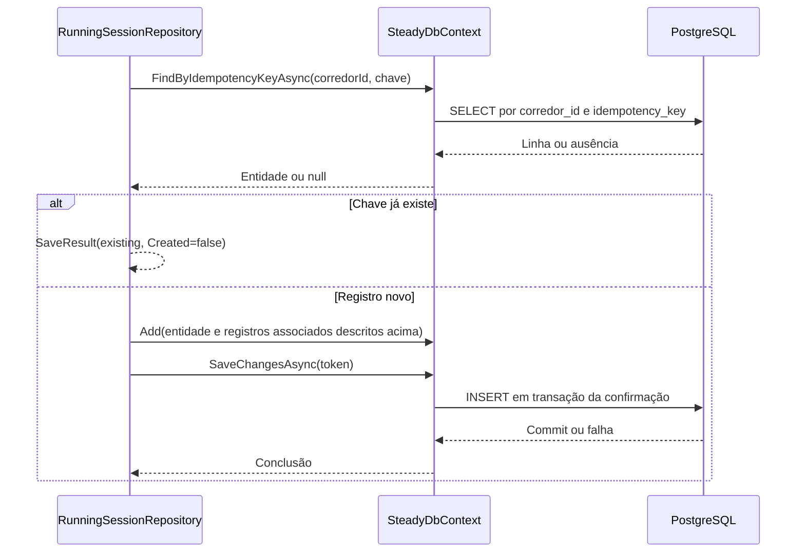

# RunningSessionRepository - Persistencia-Treino - Especificação Técnica

Atualizado em 2026-09-27.

## Índice

- [Visão geral](#visao)
- [Métodos e contratos](#metodos)
- [Mapeamentos](#ctx)
- [Observações](#observacoes)
- [Fontes](#fontes)

<a id="visao"></a>
## 1. Visão geral técnica

Persistir corrida, intenção de revisão e dor de encerramento na mesma confirmação.

Chamada pela camada Steady.Api; ver [índice da API](../../Steady.Api/DevDocs/README.md). Sem rotas próprias: entradas são parâmetros C#, saídas são entidades/objetos ou resultados assíncronos. O token e os papéis são validados na API; parâmetros de identidade precisam vir do contexto autenticado. PostgreSQL é acessado pelo SteadyDbContext com EF Core e Npgsql.


<a id="metodos"></a>
## 2. R. Métodos e contratos

- [AddAsync](#r-1)
- [GetByCorredorIdAsync](#r-2)
- [GetByIdAsync](#r-3)

<a id="r-1"></a>
### R. AddAsync

`public async Task<SaveResult<RunningSessionEntity>> AddAsync( Guid corredorId, RunningSession session, Guid idempotencyKey, bool painReportedAtCompletion, CancellationToken cancellationToken)`

Busca (corredorId,idempotencyKey). Existente retorna Created=false. Novo copia Date, DistanceKm, DurationMinutes, AveragePaceMinPerKm, PerceivedEffort; captura Id da ficha ativa via SingleOrDefaultAsync; adiciona outbox Pending de Running e dor opcional "Informada no encerramento"; uma SaveChangesAsync confirma todas as linhas.

Entrada: os parâmetros da assinatura, incluindo `CancellationToken` nas operações assíncronas. Saída: o tipo retornado na assinatura; `Task` transporta conclusão, resultado ou falha. Objetos de domínio chegam validados por suas fábricas; o repositório não substitui essa validação.

<a id="r-2"></a>
### R. GetByCorredorIdAsync

`public async Task<IReadOnlyList<RunningSessionEntity>> GetByCorredorIdAsync(Guid corredorId, CancellationToken cancellationToken)`

Where(CorredorId) e ToListAsync, sem ordenação ou paginação.

Entrada: os parâmetros da assinatura, incluindo `CancellationToken` nas operações assíncronas. Saída: o tipo retornado na assinatura; `Task` transporta conclusão, resultado ou falha. Objetos de domínio chegam validados por suas fábricas; o repositório não substitui essa validação.

<a id="r-3"></a>
### R. GetByIdAsync

`public async Task<RunningSessionEntity?> GetByIdAsync(Guid corredorId, Guid sessionId, CancellationToken cancellationToken)`

FirstOrDefaultAsync por CorredorId e sessionId; retorna null se ausente ou de outra conta.

Entrada: os parâmetros da assinatura, incluindo `CancellationToken` nas operações assíncronas. Saída: o tipo retornado na assinatura; `Task` transporta conclusão, resultado ou falha. Objetos de domínio chegam validados por suas fábricas; o repositório não substitui essa validação.

#### Fluxo de execução



<a id="ctx"></a>
## 3. CTX. Mapeamento e integridade

### CTX. running_sessions

Chave primária: `Id` (sem HasColumnName, nome por convenção do modelo).

| Propriedade | Coluna | Configuração explícita |
|---|---|---|
| `CorredorId` | `corredor_id` | `Tipo por convenção do provider` |
| `Date` | `date` | `Tipo por convenção do provider` |
| `DistanceKm` | `distance_km` | `Tipo por convenção do provider` |
| `DurationMinutes` | `duration_minutes` | `Tipo por convenção do provider` |
| `AveragePaceMinPerKm` | `average_pace_min_per_km` | `Tipo por convenção do provider` |
| `PerceivedEffort` | `perceived_effort` | `Tipo por convenção do provider` |
| `IdempotencyKey` | `idempotency_key` | `Tipo por convenção do provider` |

Índices e relações (expressões reais do modelo):

```csharp
HasIndex(s => s.CorredorId);
HasIndex(s => new { s.CorredorId, s.IdempotencyKey }).IsUnique();
HasOne<CorredorEntity>()
                .WithMany()
                .HasForeignKey(s => s.CorredorId)
                .OnDelete(DeleteBehavior.Cascade);
```

### CTX. review_outbox

Chave primária: `Id` (sem HasColumnName, nome por convenção do modelo).

| Propriedade | Coluna | Configuração explícita |
|---|---|---|
| `CorredorId` | `corredor_id` | `Tipo por convenção do provider` |
| `ExecutionId` | `execution_id` | `Tipo por convenção do provider` |
| `TrainingSheetId` | `training_sheet_id` | `Tipo por convenção do provider` |
| `ExecutionKind` | `execution_kind` | `HasConversion<string>()` |
| `IdempotencyKey` | `idempotency_key` | `Tipo por convenção do provider` |
| `ExecutionDate` | `execution_date` | `Tipo por convenção do provider` |
| `PainReportedAtCompletion` | `pain_reported_at_completion` | `Tipo por convenção do provider` |
| `Status` | `status` | `HasConversion<string>()` |
| `Attempts` | `attempts` | `Tipo por convenção do provider` |
| `LeaseUntil` | `lease_until` | `Tipo por convenção do provider` |
| `NextAttemptAt` | `next_attempt_at` | `Tipo por convenção do provider` |
| `CreatedAt` | `created_at` | `Tipo por convenção do provider` |
| `CompletedAt` | `completed_at` | `Tipo por convenção do provider` |

Índices e relações (expressões reais do modelo):

```csharp
HasIndex(item => new { item.ExecutionKind, item.ExecutionId }).IsUnique();
HasIndex(item => new { item.CorredorId, item.IdempotencyKey }).IsUnique();
HasIndex(item => new { item.Status, item.NextAttemptAt });
HasOne<CorredorEntity>().WithMany().HasForeignKey(item => item.CorredorId)
                .OnDelete(DeleteBehavior.Cascade);
```

### CTX. pain_logs

Chave primária: `Id` (sem HasColumnName, nome por convenção do modelo).

| Propriedade | Coluna | Configuração explícita |
|---|---|---|
| `CorredorId` | `corredor_id` | `Tipo por convenção do provider` |
| `Date` | `date` | `Tipo por convenção do provider` |
| `Region` | `region` | `IsRequired()` |
| `IdempotencyKey` | `idempotency_key` | `Tipo por convenção do provider` |

Índices e relações (expressões reais do modelo):

```csharp
HasIndex(p => p.CorredorId);
HasIndex(p => new { p.CorredorId, p.IdempotencyKey }).IsUnique();
HasOne<CorredorEntity>()
                .WithMany()
                .HasForeignKey(p => p.CorredorId)
                .OnDelete(DeleteBehavior.Cascade);
```

### CTX. training_sheets

Chave primária: `Id` (sem HasColumnName, nome por convenção do modelo).

| Propriedade | Coluna | Configuração explícita |
|---|---|---|
| `PersonalId` | `personal_id` | `Tipo por convenção do provider` |
| `CorredorId` | `corredor_id` | `Tipo por convenção do provider` |
| `DefinitionJson` | `definition` | `HasColumnType("jsonb")` |
| `IsActive` | `is_active` | `Tipo por convenção do provider` |
| `CreatedAt` | `created_at` | `Tipo por convenção do provider` |

Índices e relações (expressões reais do modelo):

```csharp
HasIndex(sheet => sheet.CorredorId)
                .IsUnique()
                .HasFilter("is_active = TRUE");
HasOne<CorredorEntity>()
                .WithMany()
                .HasForeignKey(sheet => sheet.PersonalId)
                .OnDelete(DeleteBehavior.Restrict);
HasOne<CorredorEntity>()
                .WithMany()
                .HasForeignKey(sheet => sheet.CorredorId)
                .OnDelete(DeleteBehavior.Restrict);
```

<a id="observacoes"></a>
## 4. Observações técnicas

Consultas usam rastreamento padrão salvo AsNoTracking explicitamente indicado. Falhas de persistência e cancelamento propagam quando não houver captura documentada. Cada chave idempotente pertence à conta, não é uma chave global entre corredores. Entidades retornadas incluem os campos persistidos listados em CTX; resultados SaveResult contêm Entity e Created.

<a id="fontes"></a>
## 5. Fontes e verificação

- [docs/adr/ADR-002-autenticacao-e-isolamento-de-dados.md](../../../docs/adr/ADR-002-autenticacao-e-isolamento-de-dados.md)
- [docs/adr/ADR-003-chave-de-idempotencia-para-sincronizacao-offline.md](../../../docs/adr/ADR-003-chave-de-idempotencia-para-sincronizacao-offline.md)
- [docs/adr/ADR-018-outbox-transacional-da-revisao.md](../../../docs/adr/ADR-018-outbox-transacional-da-revisao.md)
- [tests/Steady.Api.Tests/RunningSessionEndpointTests.cs](../../../tests/Steady.Api.Tests/RunningSessionEndpointTests.cs)
- [src/Steady.Infrastructure/Persistence/SteadyDbContext.cs](../../../src/Steady.Infrastructure/Persistence/SteadyDbContext.cs)
- [src/Steady.Infrastructure/Repositories/RunningSessionRepository.cs](../../../src/Steady.Infrastructure/Repositories/RunningSessionRepository.cs)

Os testes citados foram inspecionados como evidência de comportamento; não foram executados nesta rodada de documentação.

Especificações de comportamento relacionadas:

- [STORY-003](../../../specs/STORY-003/spec.bdd.md)
- [STORY-014](../../../specs/STORY-014/spec.bdd.md)
