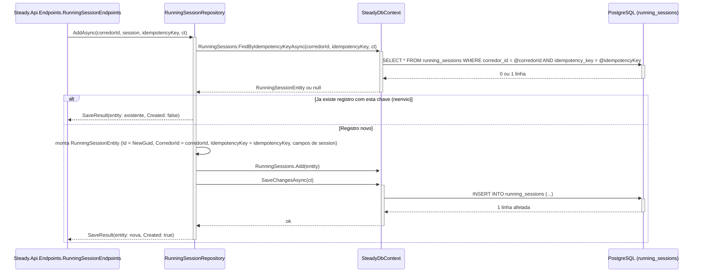
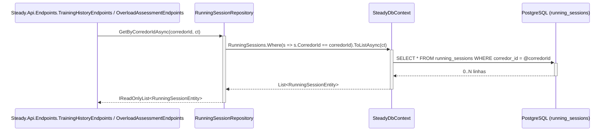
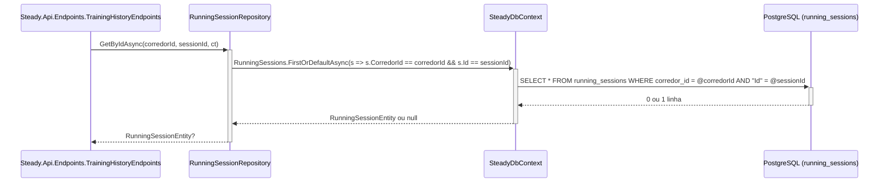

# RunningSessionRepository - Persistencia-Treino - Especificacao Tecnica

## Indice
- [1. Visao Geral Tecnica](#1-visao-geral-tecnica)
- [2. Configuracao e Dependencias](#2-configuracao-e-dependencias)
- [3. Detalhamento por Metodo](#3-detalhamento-por-metodo)
  - [3.1. AddAsync - Persiste uma nova sessao de corrida](#31-addasync---persiste-uma-nova-sessao-de-corrida)
  - [3.2. GetByCorredorIdAsync - Lista o historico de corrida do corredor](#32-getbycorredoridasync---lista-o-historico-de-corrida-do-corredor)
  - [3.3. GetByIdAsync - Busca uma sessao especifica, escopada ao corredor](#33-getbyidasync---busca-uma-sessao-especifica-escopada-ao-corredor)
- [4. Observacoes Tecnicas](#4-observacoes-tecnicas)

## 1. Visao Geral Tecnica

**Proposito**: `RunningSessionRepository` persiste e recupera sessoes de treino de corrida (`RunningSessionEntity`), sempre escopadas ao `CorredorId` do corredor autenticado.

**Responsabilidades**:
- Converter um objeto de dominio `Steady.Domain.Training.RunningSession` (ja validado pelas guard clauses de `RunningSession.Create`) em `RunningSessionEntity` e persisti-lo associado a um `CorredorId`.
- Aplicar a chave de idempotencia recebida do cliente antes de gravar, devolvendo o registro ja existente em vez de duplicar em caso de reenvio -- [ADR-003](../../../docs/adr/ADR-003-chave-de-idempotencia-para-sincronizacao-offline.md).
- Listar todas as sessoes de corrida de um corredor.
- Buscar uma sessao especifica por ID, escopada ao corredor (isolamento -- ver [ADR-002](../../../docs/adr/ADR-002-autenticacao-e-isolamento-de-dados.md)).

**Integracoes**: chamado por `Steady.Api.Endpoints.RunningSessionEndpoints` (POST `/api/running-sessions`), `Steady.Api.Endpoints.TrainingHistoryEndpoints` (GET `/api/training-sessions` e GET `/api/training-sessions/{id}`) e `Steady.Api.Endpoints.OverloadAssessmentEndpoints` (GET `/api/overload-assessment`, que reconstroi objetos de dominio a partir das entidades persistidas para avaliar sobrecarga) -- ver `DocumentAIReadme/Steady.Api/DevDocs/RunningSessionEndpoints-Treino-Corrida-DevDocs.md`, `DocumentAIReadme/Steady.Api/DevDocs/TrainingHistoryEndpoints-Historico-DevDocs.md` e `DocumentAIReadme/Steady.Api/DevDocs/OverloadAssessmentEndpoints-Sobrecarga-DevDocs.md`. Regras fundamentadas em `specs/STORY-001/spec.bdd.md` (validacao de dominio), `specs/STORY-002/spec.bdd.md` (persistencia e isolamento) e `specs/STORY-003/spec.bdd.md` (idempotencia, [ADR-003](../../../docs/adr/ADR-003-chave-de-idempotencia-para-sincronizacao-offline.md)). O utilitario `IIdempotentRecord`/`SaveResult<TEntity>` usado por `AddAsync` esta documentado em `SteadyDbContext-ServiceCollectionExtensions-Persistencia-Configuracao-DevDocs.md#33-iidempotentrecord-e-saveresult---utilitario-de-idempotencia-adr-003`.

## 2. Configuracao e Dependencias

**Dependencias Injetadas**:
- `SteadyDbContext dbContext`: contexto EF Core injetado via construtor primario, ciclo de vida `Scoped`.

**Interface implementada**: `IRunningSessionRepository` (`Repositories/IRunningSessionRepository.cs`).

**Metodos Publicos**:
- `Task<SaveResult<RunningSessionEntity>> AddAsync(Guid corredorId, RunningSession session, Guid idempotencyKey, CancellationToken cancellationToken)` -- assinatura alterada pelo [ADR-003](../../../docs/adr/ADR-003-chave-de-idempotencia-para-sincronizacao-offline.md); antes retornava `RunningSessionEntity` direto e nao recebia `idempotencyKey`.
- `Task<IReadOnlyList<RunningSessionEntity>> GetByCorredorIdAsync(Guid corredorId, CancellationToken cancellationToken)`
- `Task<RunningSessionEntity?> GetByIdAsync(Guid corredorId, Guid sessionId, CancellationToken cancellationToken)`

## 3. Detalhamento por Metodo

### 3.1. AddAsync - Persiste uma nova sessao de corrida

**Entrada**:
```json
{
  "corredorId": "Guid - dono do registro, resolvido pelo AuthenticationFilter",
  "session": {
    "Date": "DateOnly",
    "DistanceKm": "double (> 0, validado em RunningSession.Create)",
    "DurationMinutes": "int (> 0, validado em RunningSession.Create)",
    "AveragePaceMinPerKm": "double",
    "PerceivedEffort": "int (1 a 10, validado em RunningSession.Create)"
  },
  "idempotencyKey": "Guid - lido do header 'Idempotency-Key' pelo Endpoint (ADR-003); gerado pelo cliente no momento em que o item entra na fila local, nao a cada tentativa de envio"
}
```

**Saida**:
```json
{
  "SaveResult<RunningSessionEntity>": {
    "Entity": {
      "Id": "Guid - gerado pelo repositorio (Guid.NewGuid()) se novo, ou o Id ja existente se reenvio",
      "CorredorId": "Guid",
      "Date": "DateOnly",
      "DistanceKm": "double",
      "DurationMinutes": "int",
      "AveragePaceMinPerKm": "double",
      "PerceivedEffort": "int",
      "IdempotencyKey": "Guid"
    },
    "Created": "bool - true se gravou uma linha nova (Endpoint responde 201); false se devolveu um registro ja existente por reenvio da mesma chave (Endpoint responde 200)"
  }
}
```

#### Fluxo de Execucao



#### Detalhamento do Fluxo

**R. Repository (RunningSessionRepository)**

R.1. AddAsync()
- Recebe o objeto de dominio `RunningSession` ja validado (guard clauses em `RunningSession.Create`, ver `specs/STORY-001/spec.bdd.md`), o `corredorId` resolvido pelo `AuthenticationFilter` e a `idempotencyKey` do header `Idempotency-Key` ([ADR-003](../../../docs/adr/ADR-003-chave-de-idempotencia-para-sincronizacao-offline.md)).
- **Passo 1 -- busca por chave existente**: chama `dbContext.RunningSessions.FindByIdempotencyKeyAsync(corredorId, idempotencyKey, ct)` -- documentado em `SteadyDbContext-ServiceCollectionExtensions-Persistencia-Configuracao-DevDocs.md#u1-iidempotentrecord-e-saveresult` (U1.1) -> [CTX.1](#ctx1-runningsessions-dbset)
- **Se ja existe** (`existing is not null`): retorna imediatamente `new SaveResult<RunningSessionEntity>(existing, Created: false)` -- **nao grava nada novo**. Este e o caminho de reenvio da fila offline apos uma resposta perdida.
- **Se nao existe -- Mapeamento Dominio -> Persistencia (U1)**: monta um novo `RunningSessionEntity` copiando campo a campo de `RunningSession` (`Date`, `DistanceKm`, `DurationMinutes`, `AveragePaceMinPerKm`, `PerceivedEffort`) e atribuindo `Id = Guid.NewGuid()`, `CorredorId = corredorId` (nunca vem do cliente, sempre do contexto de autenticacao) e `IdempotencyKey = idempotencyKey`.
- Adiciona a entidade ao `DbSet<RunningSessionEntity>` e persiste via `SaveChangesAsync` -> [CTX.1](#ctx1-runningsessions-dbset)
- Retorna `new SaveResult<RunningSessionEntity>(entity, Created: true)`. O Endpoint usa `Created` para decidir entre HTTP 201 (novo) e HTTP 200 (reenvio) -- ver `RunningSessionEndpoints-Treino-Corrida-DevDocs.md`.

**CTX. SteadyDbContext**

<a id="ctx1-runningsessions-dbset"></a>
CTX.1. RunningSessions (DbSet&lt;RunningSessionEntity&gt;) + SaveChangesAsync
- Mapeado para a tabela `running_sessions`: `Id` como chave primaria; `CorredorId` -> coluna `corredor_id` (indexada via `IX_running_sessions_corredor_id`); `Date` -> `date`; `DistanceKm` -> `distance_km`; `DurationMinutes` -> `duration_minutes`; `AveragePaceMinPerKm` -> `average_pace_min_per_km`; `PerceivedEffort` -> `perceived_effort`; `IdempotencyKey` -> `idempotency_key` (indice UNICO composto `IX_running_sessions_corredor_id_idempotency_key` em `(corredor_id, idempotency_key)`, [ADR-003](../../../docs/adr/ADR-003-chave-de-idempotencia-para-sincronizacao-offline.md)).
- `SaveChangesAsync` persiste o INSERT em uma transacao implicita de uma unica operacao. O indice unico composto e a garantia final contra duplicata mesmo sob corrida entre dois envios simultaneos da mesma chave, conforme previsto no [ADR-003](../../../docs/adr/ADR-003-chave-de-idempotencia-para-sincronizacao-offline.md) ("mesmo com uma corrida entre dois envios simultaneos, o banco recusa a segunda insercao") -- diferente de `CorredorRepository.GetOrCreateBySubAsync`, este metodo nao captura `DbUpdateException` para esse cenario (ver secao 4, Observacoes Tecnicas).

### 3.2. GetByCorredorIdAsync - Lista o historico de corrida do corredor

**Entrada**:
```json
{
  "corredorId": "Guid - do corredor autenticado",
  "cancellationToken": "CancellationToken"
}
```

**Saida**:
```json
{
  "IReadOnlyList<RunningSessionEntity>": "todas as sessoes de corrida cujo CorredorId == corredorId, sem paginacao, sem ordenacao no repositorio (ordenacao por data e feita no Endpoint TrainingHistoryEndpoints)"
}
```

#### Fluxo de Execucao



#### Detalhamento do Fluxo

**R. Repository (RunningSessionRepository)**

R.2. GetByCorredorIdAsync()
- Aplica `Where(s => s.CorredorId == corredorId)` -- o filtro de isolamento e traduzido pelo EF Core para a clausula `WHERE` da query SQL, nao filtrado em memoria (regra central de isolamento, ver `Isolamento-de-Dados-por-Corredor-Persistencia-Autenticacao-Rules.md`) -> [CTX.2](#ctx2-query-filtrada-por-corredorid)
- Materializa o resultado com `ToListAsync`. Sem historico, devolve lista vazia (nao lanca excecao) -- comportamento coberto pelo cenario "Corredor sem historico consulta seu historico de treinos" em `specs/STORY-002/spec.bdd.md`.
- Usado tambem por `OverloadAssessmentEndpoints`, que reconstroi objetos `RunningSession` de dominio a partir das entidades para reavaliar a regra de sobrecarga (ver [ADR-001](../../../docs/adr/ADR-001-regra-sobrecarga-combinada.md)).

**CTX. SteadyDbContext**

<a id="ctx2-query-filtrada-por-corredorid"></a>
CTX.2. Query LINQ traduzida para SQL com filtro indexado
- O indice `IX_running_sessions_corredor_id` (nao unico, coluna simples `corredor_id`) suporta esta consulta com plano de execucao por indice, evitando full table scan a medida que a tabela cresce.

### 3.3. GetByIdAsync - Busca uma sessao especifica, escopada ao corredor

**Entrada**:
```json
{
  "corredorId": "Guid - do corredor autenticado, usado como parte do filtro",
  "sessionId": "Guid - identificador da sessao solicitada",
  "cancellationToken": "CancellationToken"
}
```

**Saida**:
```json
{
  "RunningSessionEntity?": "a sessao, se pertencer ao corredorId informado; null caso contrario ou se o Id nao existir"
}
```

#### Fluxo de Execucao



#### Detalhamento do Fluxo

**R. Repository (RunningSessionRepository)**

R.3. GetByIdAsync()
- Filtra simultaneamente por `CorredorId == corredorId` E `Id == sessionId` na mesma clausula `WHERE` -- e o ponto que impede um corredor de acessar a sessao de outro mesmo conhecendo o `Guid` exato (ver cenario "Corredor tenta acessar sessao de treino de outro corredor" em `specs/STORY-002/spec.bdd.md`).
- Se a sessao existe mas pertence a outro corredor, o resultado e `null` -- identico ao caso "Id nao existe" -- garantindo que o Endpoint responda 404 sem distincao (Playbook A01, nao revela existencia do recurso) -> [CTX.2](#ctx2-query-filtrada-por-corredorid)

## 4. Observacoes Tecnicas

- **Performance**: `GetByCorredorIdAsync` nao pagina -- para um corredor com historico muito extenso, a query retorna todas as linhas de uma vez (ver TechnicalDebtsDocs). O indice `corredor_id` garante que a busca em si seja eficiente mesmo com a tabela cheia de dados de outros corredores. `AddAsync` agora faz 1 SELECT (busca por chave de idempotencia) antes do INSERT no caminho de registro novo -- custo adicional pequeno e justificado pela protecao contra duplicata do [ADR-003](../../../docs/adr/ADR-003-chave-de-idempotencia-para-sincronizacao-offline.md).
- **Tratamento de Erros**: nenhum dos tres metodos trata excecoes de banco explicitamente -- falhas de infraestrutura propagam para o Endpoint chamador sem tratamento especifico nesta camada. Isso inclui o cenario (raro, de corrida) em que dois envios simultaneos com a mesma `idempotencyKey` passam ambos pela verificacao de existencia antes que o primeiro `SaveChangesAsync` termine: o indice unico composto garante que apenas um INSERT seja aceito pelo banco, mas o segundo propagaria uma `DbUpdateException` nao capturada, diferente do tratamento de corrida ja existente em `CorredorRepository.GetOrCreateBySubAsync`.
- **Integracoes Criticas**: `GetByCorredorIdAsync` e reutilizado tanto para exibir historico (`TrainingHistoryEndpoints`) quanto para recalcular a regra de sobrecarga (`OverloadAssessmentEndpoints`) -- qualquer mudanca de comportamento aqui (ex.: adicionar paginacao) precisa considerar ambos os consumidores. `AddAsync` agora depende do utilitario `IIdempotentRecord`/`SaveResult<TEntity>` compartilhado com `StrengthSessionRepository` e `PainLogRepository` -- documentado uma unica vez em `SteadyDbContext-ServiceCollectionExtensions-Persistencia-Configuracao-DevDocs.md`.
