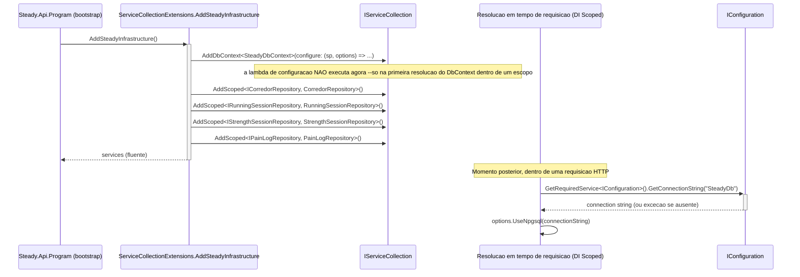

# SteadyDbContext e ServiceCollectionExtensions - Persistencia-Configuracao - Especificacao Tecnica

## Indice
- [1. Visao Geral Tecnica](#1-visao-geral-tecnica)
- [2. Configuracao e Dependencias](#2-configuracao-e-dependencias)
- [3. Detalhamento por Componente](#3-detalhamento-por-componente)
  - [3.1. AddSteadyInfrastructure - Registro de servicos de infraestrutura](#31-addsteadyinfrastructure---registro-de-servicos-de-infraestrutura)
  - [3.2. OnModelCreating - Mapeamento objeto-relacional completo](#32-onmodelcreating---mapeamento-objeto-relacional-completo)
- [4. Observacoes Tecnicas](#4-observacoes-tecnicas)

## 1. Visao Geral Tecnica

**Proposito**: esta unidade cobre os dois componentes que nao pertencem a nenhum repositorio individual, mas sustentam todos eles: `SteadyDbContext` (o `DbContext` do EF Core, com todo o mapeamento objeto-relacional) e `ServiceCollectionExtensions.AddSteadyInfrastructure()` (o ponto unico de registro de DI de toda a camada `Steady.Infrastructure`).

**Responsabilidades**:
- `SteadyDbContext`: expor os quatro `DbSet<>` da aplicacao (`Corredores`, `RunningSessions`, `StrengthSessions`, `PainLogs`) e definir, em `OnModelCreating`, como cada entidade de persistencia mapeia para tabela, colunas, chaves, indices e conversoes de tipo no PostgreSQL.
- `ServiceCollectionExtensions`: registrar o `SteadyDbContext` (com a connection string resolvida em tempo de DI) e os quatro repositorios (`ICorredorRepository`, `IRunningSessionRepository`, `IStrengthSessionRepository`, `IPainLogRepository`) como servicos `Scoped` no container de Injecao de Dependencia do ASP.NET Core.

**Integracoes**: `AddSteadyInfrastructure()` e chamado a partir do `Program.cs` de `Steady.Api` durante o bootstrap da aplicacao -- o bootstrap em si (`Program.cs`) nao e uma unidade coberta em `DocumentAIReadme/Steady.Api/DevDocs/` (ver `DocumentAIReadme/Steady.Api/DevDocs/README.md` para a lista de unidades documentadas la, todas Endpoints). `SteadyDbContext` e consumido por todos os repositorios documentados nesta camada (`CorredorRepository`, `RunningSessionRepository`, `StrengthSessionRepository`, `PainLogRepository`).

## 2. Configuracao e Dependencias

**Dependencias Injetadas em SteadyDbContext**:
- `DbContextOptions<SteadyDbContext> options`: opcoes de configuracao do EF Core (incluindo o provider Npgsql e a connection string), injetadas pelo container de DI via `AddDbContext`.

**Dependencias resolvidas dentro de AddSteadyInfrastructure**:
- `IConfiguration`: resolvido em tempo de execucao (nao capturado no momento do `AddSteadyInfrastructure()`) para ler a connection string `SteadyDb`.

**Pacotes NuGet relevantes** (`Steady.Infrastructure.csproj`):
- `Microsoft.EntityFrameworkCore` 9.0.4
- `Microsoft.EntityFrameworkCore.Design` 9.0.4 (necessario para `dotnet ef migrations`)
- `Npgsql.EntityFrameworkCore.PostgreSQL` 9.0.4 (provider PostgreSQL)

**Metodos Publicos**:
- `IServiceCollection AddSteadyInfrastructure(this IServiceCollection services)` -- unico metodo de extensao exposto.

## 3. Detalhamento por Componente

### 3.1. AddSteadyInfrastructure - Registro de servicos de infraestrutura

**Entrada**:
```json
{
  "services": "IServiceCollection - o container de DI da aplicacao Steady.Api, recebido via extension method"
}
```

**Saida**:
```json
{
  "IServiceCollection": "o mesmo container recebido, com SteadyDbContext e os 4 repositorios registrados (permite encadeamento fluente)"
}
```

#### Fluxo de Execucao



#### Detalhamento do Fluxo

**R. Componente (ServiceCollectionExtensions)**

R.1. AddSteadyInfrastructure()
- Chama `services.AddDbContext<SteadyDbContext>((serviceProvider, options) => ...)` usando a sobrecarga que recebe o `IServiceProvider` -- **decisao deliberada**: a lambda de configuracao so e executada quando o `SteadyDbContext` e efetivamente resolvido dentro de um escopo de DI, nao no momento do `AddSteadyInfrastructure()`. Isso significa que a connection string e lida de `IConfiguration` **em tempo de DI**, nao no startup sincrono do processo.
- Dentro da lambda: resolve `IConfiguration` via `serviceProvider.GetRequiredService<IConfiguration>()`, le `GetConnectionString("SteadyDb")` e lanca `InvalidOperationException` com mensagem explicativa ("Defina ConnectionStrings__SteadyDb como variavel de ambiente") se a connection string nao estiver configurada. Chama `options.UseNpgsql(connectionString)` para configurar o provider PostgreSQL.
- Registra os quatro repositorios como `Scoped` -> [CTX.1](#ctx1-ciclo-de-vida-scoped): `AddScoped<ICorredorRepository, CorredorRepository>()`, `AddScoped<IRunningSessionRepository, RunningSessionRepository>()`, `AddScoped<IStrengthSessionRepository, StrengthSessionRepository>()`, `AddScoped<IPainLogRepository, PainLogRepository>()`.
- Retorna `services` para permitir encadeamento fluente (`services.AddSteadyInfrastructure().AddOutraCoisa()`).

**CTX. Motivacao de design (comentario XML no codigo)**

<a id="ctx1-ciclo-de-vida-scoped"></a>
CTX.1. Resolucao tardia da connection string + ciclo de vida Scoped
- O proprio codigo documenta a decisao via comentario XML: "A connection string e resolvida em tempo de DI (nao no startup sincrono) para que overrides de configuracao -- como os aplicados por `WebApplicationFactory` em teste -- sejam respeitados." Isso e confirmado em `specs/STORY-002/spec.bdd.md`, secao "Notas de Especificacao": "Resolvido no `/implement`: a connection string e resolvida via DI no momento da criacao do `DbContext` (nao lida eagerly no `Program.cs`) -- necessario para que `WebApplicationFactory` consiga sobrescreve-la em teste antes do host ser efetivamente construido."
- Todos os repositorios sao `Scoped` (uma instancia por requisicao HTTP), alinhado ao ciclo de vida padrao do `DbContext` em aplicacoes ASP.NET Core -- evita compartilhar o mesmo `DbContext`/`ChangeTracker` entre requisicoes concorrentes (o que causaria condicoes de corrida e vazamento de estado entre corredores diferentes).

### 3.2. OnModelCreating - Mapeamento objeto-relacional completo

**Entrada**: `ModelBuilder modelBuilder`, fornecido pelo EF Core na inicializacao do modelo (uma vez por `DbContext` de aplicacao, cacheado internamente pelo EF Core).

**Saida**: o modelo do EF Core totalmente configurado, usado para gerar migrations e para traduzir LINQ em SQL.

#### Mapeamento completo por tabela

| Entidade | Tabela | Coluna (C# -> banco) | Observacao |
|---|---|---|---|
| `CorredorEntity` | `corredores` | `Id` (PK) | `Guid`, chave primaria |
| | | `GoogleSub` -> `google_sub` | `IsRequired()`; indice UNICO `IX_corredores_google_sub` |
| | | `CreatedAt` -> `created_at` | `timestamp with time zone` |
| `RunningSessionEntity` | `running_sessions` | `Id` (PK) | `Guid`, chave primaria |
| | | `CorredorId` -> `corredor_id` | indice `IX_running_sessions_corredor_id` (nao unico) |
| | | `Date` -> `date` | `date` (sem hora) |
| | | `DistanceKm` -> `distance_km` | `double precision` |
| | | `DurationMinutes` -> `duration_minutes` | `integer` |
| | | `AveragePaceMinPerKm` -> `average_pace_min_per_km` | `double precision` |
| | | `PerceivedEffort` -> `perceived_effort` | `integer` |
| `StrengthSessionEntity` | `strength_sessions` | `Id` (PK) | `Guid`, chave primaria |
| | | `CorredorId` -> `corredor_id` | indice `IX_strength_sessions_corredor_id` (nao unico) |
| | | `Date` -> `date` | `date` |
| | | `MuscleGroup` -> `muscle_group` | `.HasConversion<string>()` -> `text` |
| | | `Intensity` -> `intensity` | `.HasConversion<string>()` -> `text` |
| | | `DurationMinutes` -> `duration_minutes` | `integer` |
| `PainLogEntity` | `pain_logs` | `Id` (PK) | `Guid`, chave primaria |
| | | `CorredorId` -> `corredor_id` | indice `IX_pain_logs_corredor_id` (nao unico, sem consumidor de leitura hoje) |
| | | `Date` -> `date` | `date` |
| | | `Region` -> `region` | `IsRequired()`; `text` livre |

#### Detalhamento do Fluxo

**CTX. SteadyDbContext.OnModelCreating**

CTX.2. Configuracao de CorredorEntity
- `entity.ToTable("corredores")`, `HasKey(c => c.Id)`, `Property(c => c.GoogleSub).HasColumnName("google_sub").IsRequired()`, `HasIndex(c => c.GoogleSub).IsUnique()`, `Property(c => c.CreatedAt).HasColumnName("created_at")`.
- O indice unico em `google_sub` e o unico indice UNICO de toda a base -- e a garantia de banco que sustenta `CorredorRepository.GetOrCreateBySubAsync` (ver `CorredorRepository-Persistencia-Autenticacao-DevDocs.md`).

CTX.3. Configuracao de RunningSessionEntity, StrengthSessionEntity e PainLogEntity
- Padrao identico nas tres: `ToTable(...)`, `HasKey(s => s.Id)`, `Property(s => s.CorredorId).HasColumnName("corredor_id")`, `HasIndex(s => s.CorredorId)` (nao unico -- multiplos registros por corredor sao esperados).
- `StrengthSessionEntity` e a unica com conversao de tipo explicita (`HasConversion<string>()` para os dois enums) -- ver `StrengthSessionRepository-Persistencia-Treino-DevDocs.md` para o detalhamento do impacto dessa escolha.

## 4. Observacoes Tecnicas

- **Performance**: nenhum indice composto existe hoje (ex.: `(corredor_id, date)`) -- todas as consultas por periodo filtram por `corredor_id` no banco e por data em memoria (ver TechnicalDebtsDocs dos repositorios individuais de treino).
- **Tratamento de Erros**: `AddSteadyInfrastructure()` lanca `InvalidOperationException` de forma proposital e explicita quando a connection string `SteadyDb` nao esta configurada -- falha rapido e com mensagem acionavel, em vez de deixar o EF Core falhar de forma mais obscura na primeira query.
- **Integracoes Criticas**: este e o unico ponto de verdade para o schema relacional de toda a aplicacao -- qualquer mudanca em uma entidade de dominio que precise refletir no banco passa necessariamente por `OnModelCreating` + uma nova migration em `Migrations/`. A migration `20260809210535_InitialCreate` e, no momento desta documentacao, a unica migration existente (schema inicial completo, gerado a partir deste `OnModelCreating`).
