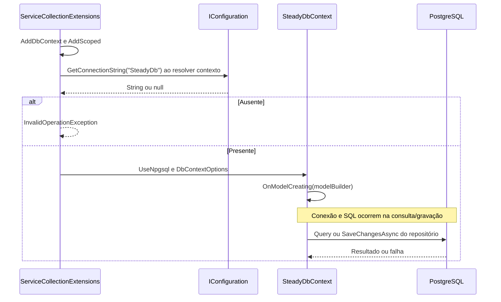

# SteadyDbContext e ServiceCollectionExtensions - Persistencia-Configuracao - Especificação Técnica

Atualizado em 2026-09-27.

## Índice

- [Visão e dependências](#visao)
- [Contratos de configuração](#contratos)
- [Mapeamentos completos](#ctx)
- [Histórico de migrations](#migrations)

<a id="visao"></a>
## 1. Visão geral e dependências

SteadyDbContext recebe DbContextOptions<SteadyDbContext> e expõe 12 conjuntos persistidos. Não contém regras de autorização globais: os filtros de corredor pertencem aos repositórios. Npgsql executa os comandos PostgreSQL; configuração e ciclo de vida são resolvidos pelo contêiner de dependências da API. Sem chamada externa nesta unidade.

<a id="contratos"></a>
## 2. Contratos e fluxo

<a id="di"></a>
### R. AddSteadyInfrastructure(IServiceCollection services) -> IServiceCollection

Entrada: coleção de serviços. Saída: mesma coleção com DbContext e componentes Scoped registrados. AddDbContext usa fábrica (serviceProvider, options), resolve IConfiguration e GetConnectionString("SteadyDb") quando o contexto é criado, respeitando substituições de teste. Ausência lança InvalidOperationException com orientação ConnectionStrings__SteadyDb; presença chama UseNpgsql(connectionString). Registrar serviços não abre conexão nem aplica migrations.

Registra nove interfaces/repositórios: ITrainingPlanRepository, ICorredorRepository, IRunningSessionRepository, IStrengthSessionRepository, IPainLogRepository, IPlanRequestRepository, ICoachingLinkRepository, ITrainingSheetRepository e IWorkoutReviewRepository. Registra concretos ReviewOutboxProcessor, ReviewExplanationRetryService e UnavailableExplanationProvider. Não registra IExplanationProvider: a escolha da implementação ocorre em Steady.Api/Program.cs.

<a id="model"></a>
### CTX. OnModelCreating(ModelBuilder modelBuilder) -> void

Entrada: construtor do modelo. Saída: metadados de tabelas, propriedades, conversões, índices, relações e seed de política v1. A tabela abaixo reproduz as declarações do modelo; Id é chave primária por HasKey, sem HasColumnName explícito. DbSet usa Set<TEntity>() para cada entidade correspondente. SaveChangesAsync é herdado de DbContext: recebe CancellationToken e retorna Task<int> com entradas gravadas; a unidade não sobrescreve o método.



<a id="ctx"></a>
## 3. CTX. Mapeamentos completos

### CTX. corredores

Chave primária: `Id` (sem HasColumnName, nome por convenção do modelo).

| Propriedade | Coluna | Configuração explícita |
|---|---|---|
| `GoogleSub` | `google_sub` | `IsRequired()` |
| `Email` | `email` | `Tipo por convenção do provider` |
| `Name` | `name` | `Tipo por convenção do provider` |
| `Roles` | `roles` | `HasColumnType("text[]"); HasDefaultValue(new[] { "Corredor" })` |
| `TrainingPlanVersionId` | `training_plan_version_id` | `Tipo por convenção do provider` |
| `CreatedAt` | `created_at` | `Tipo por convenção do provider` |

Índices e relações (expressões reais do modelo):

```csharp
HasIndex(c => c.GoogleSub).IsUnique();
HasOne<TrainingPlanVersionEntity>()
                .WithMany()
                .HasForeignKey(c => c.TrainingPlanVersionId)
                .OnDelete(DeleteBehavior.Restrict);
```

Coleções usam conversão para `text[]` e ValueComparer com SequenceEqual, hash agregado e cópia ToList, detectando mudança em conteúdo.

### CTX. training_plan_versions

Chave primária: `Id` (sem HasColumnName, nome por convenção do modelo).

| Propriedade | Coluna | Configuração explícita |
|---|---|---|
| `Version` | `version` | `Tipo por convenção do provider` |
| `DefinitionJson` | `definition` | `HasColumnType("jsonb")` |
| `IsCurrent` | `is_current` | `Tipo por convenção do provider` |
| `CreatedAt` | `created_at` | `Tipo por convenção do provider` |

Índices e relações (expressões reais do modelo):

```csharp
HasIndex(v => v.Version).IsUnique();
HasIndex(v => v.IsCurrent).IsUnique().HasFilter("is_current = TRUE");

```

### CTX. adherence_policy_versions

Chave primária: `Id` (sem HasColumnName, nome por convenção do modelo).

| Propriedade | Coluna | Configuração explícita |
|---|---|---|
| `Version` | `version` | `Tipo por convenção do provider` |
| `RunningDistancePercent` | `running_distance_percent` | `Tipo por convenção do provider` |
| `RunningDurationPercent` | `running_duration_percent` | `Tipo por convenção do provider` |
| `PerceivedEffortPoints` | `perceived_effort_points` | `Tipo por convenção do provider` |
| `SetsAbsolute` | `sets_absolute` | `Tipo por convenção do provider` |
| `RepetitionsPercent` | `repetitions_percent` | `Tipo por convenção do provider` |
| `LoadPercent` | `load_percent` | `Tipo por convenção do provider` |
| `IsCurrent` | `is_current` | `Tipo por convenção do provider` |
| `CreatedAt` | `created_at` | `Tipo por convenção do provider` |

Índices e relações (expressões reais do modelo):

```csharp
HasIndex(policy => policy.Version).IsUnique();
HasIndex(policy => policy.IsCurrent).IsUnique().HasFilter("is_current = TRUE");

```

### CTX. review_outbox

Chave primária: `Id` (sem HasColumnName, nome por convenção do modelo).

| Propriedade | Coluna | Configuração explícita |
|---|---|---|
| `CorredorId` | `corredor_id` | `Tipo por convenção do provider` |
| `ExecutionId` | `execution_id` | `Tipo por convenção do provider` |
| `TrainingSheetId` | `training_sheet_id` | `Tipo por convenção do provider` |
| `ExecutionKind` | `execution_kind` | `HasConversion<string>()` |
| `IdempotencyKey` | `idempotency_key` | `Tipo por convenção do provider` |
| `ExecutionDate` | `execution_date` | `Tipo por convenção do provider` |
| `PainReportedAtCompletion` | `pain_reported_at_completion` | `Tipo por convenção do provider` |
| `Status` | `status` | `HasConversion<string>()` |
| `Attempts` | `attempts` | `Tipo por convenção do provider` |
| `LeaseUntil` | `lease_until` | `Tipo por convenção do provider` |
| `NextAttemptAt` | `next_attempt_at` | `Tipo por convenção do provider` |
| `CreatedAt` | `created_at` | `Tipo por convenção do provider` |
| `CompletedAt` | `completed_at` | `Tipo por convenção do provider` |

Índices e relações (expressões reais do modelo):

```csharp
HasIndex(item => new { item.ExecutionKind, item.ExecutionId }).IsUnique();
HasIndex(item => new { item.CorredorId, item.IdempotencyKey }).IsUnique();
HasIndex(item => new { item.Status, item.NextAttemptAt });
HasOne<CorredorEntity>().WithMany().HasForeignKey(item => item.CorredorId)
                .OnDelete(DeleteBehavior.Cascade);
```

### CTX. workout_reviews

Chave primária: `Id` (sem HasColumnName, nome por convenção do modelo).

| Propriedade | Coluna | Configuração explícita |
|---|---|---|
| `CorredorId` | `corredor_id` | `Tipo por convenção do provider` |
| `ExecutionId` | `execution_id` | `Tipo por convenção do provider` |
| `ExecutionKind` | `execution_kind` | `HasConversion<string>()` |
| `ExecutionDate` | `execution_date` | `Tipo por convenção do provider` |
| `Status` | `status` | `HasConversion<string>()` |
| `Action` | `action` | `HasConversion<string>()` |
| `PolicyVersion` | `policy_version` | `Tipo por convenção do provider` |
| `PlanVersion` | `plan_version` | `Tipo por convenção do provider` |
| `TrainingSheetId` | `training_sheet_id` | `Tipo por convenção do provider` |
| `ComparisonJson` | `comparison` | `HasColumnType("jsonb")` |
| `ExplanationStatus` | `explanation_status` | `HasConversion<string>()` |
| `ExplanationJson` | `explanation` | `HasColumnType("jsonb")` |
| `UnderstoodAt` | `understood_at` | `Tipo por convenção do provider` |
| `Contested` | `contested` | `Tipo por convenção do provider` |
| `CoherenceStatus` | `coherence_status` | `HasConversion<string>()` |
| `NextExecutionId` | `next_execution_id` | `Tipo por convenção do provider` |
| `CoherencePolicyVersion` | `coherence_policy_version` | `Tipo por convenção do provider` |
| `CoherenceEvaluatedAt` | `coherence_evaluated_at` | `Tipo por convenção do provider` |
| `CreatedAt` | `created_at` | `Tipo por convenção do provider` |

Índices e relações (expressões reais do modelo):

```csharp
HasIndex(review => new { review.ExecutionKind, review.ExecutionId }).IsUnique();
HasIndex(review => new { review.CorredorId, review.ExecutionDate });
HasOne<CorredorEntity>().WithMany().HasForeignKey(review => review.CorredorId)
                .OnDelete(DeleteBehavior.Cascade);
```

### CTX. running_sessions

Chave primária: `Id` (sem HasColumnName, nome por convenção do modelo).

| Propriedade | Coluna | Configuração explícita |
|---|---|---|
| `CorredorId` | `corredor_id` | `Tipo por convenção do provider` |
| `Date` | `date` | `Tipo por convenção do provider` |
| `DistanceKm` | `distance_km` | `Tipo por convenção do provider` |
| `DurationMinutes` | `duration_minutes` | `Tipo por convenção do provider` |
| `AveragePaceMinPerKm` | `average_pace_min_per_km` | `Tipo por convenção do provider` |
| `PerceivedEffort` | `perceived_effort` | `Tipo por convenção do provider` |
| `IdempotencyKey` | `idempotency_key` | `Tipo por convenção do provider` |

Índices e relações (expressões reais do modelo):

```csharp
HasIndex(s => s.CorredorId);
HasIndex(s => new { s.CorredorId, s.IdempotencyKey }).IsUnique();
HasOne<CorredorEntity>()
                .WithMany()
                .HasForeignKey(s => s.CorredorId)
                .OnDelete(DeleteBehavior.Cascade);
```

### CTX. strength_sessions

Chave primária: `Id` (sem HasColumnName, nome por convenção do modelo).

| Propriedade | Coluna | Configuração explícita |
|---|---|---|
| `CorredorId` | `corredor_id` | `Tipo por convenção do provider` |
| `Date` | `date` | `Tipo por convenção do provider` |
| `MuscleGroup` | `muscle_group` | `HasConversion<string>()` |
| `Intensity` | `intensity` | `HasConversion<string>()` |
| `DurationMinutes` | `duration_minutes` | `Tipo por convenção do provider` |
| `IdempotencyKey` | `idempotency_key` | `Tipo por convenção do provider` |

Índices e relações (expressões reais do modelo):

```csharp
HasIndex(s => s.CorredorId);
HasIndex(s => new { s.CorredorId, s.IdempotencyKey }).IsUnique();
HasOne<CorredorEntity>()
                .WithMany()
                .HasForeignKey(s => s.CorredorId)
                .OnDelete(DeleteBehavior.Cascade);
```

### CTX. pain_logs

Chave primária: `Id` (sem HasColumnName, nome por convenção do modelo).

| Propriedade | Coluna | Configuração explícita |
|---|---|---|
| `CorredorId` | `corredor_id` | `Tipo por convenção do provider` |
| `Date` | `date` | `Tipo por convenção do provider` |
| `Region` | `region` | `IsRequired()` |
| `IdempotencyKey` | `idempotency_key` | `Tipo por convenção do provider` |

Índices e relações (expressões reais do modelo):

```csharp
HasIndex(p => p.CorredorId);
HasIndex(p => new { p.CorredorId, p.IdempotencyKey }).IsUnique();
HasOne<CorredorEntity>()
                .WithMany()
                .HasForeignKey(p => p.CorredorId)
                .OnDelete(DeleteBehavior.Cascade);
```

### CTX. plan_requests

Chave primária: `Id` (sem HasColumnName, nome por convenção do modelo).

| Propriedade | Coluna | Configuração explícita |
|---|---|---|
| `CorredorId` | `corredor_id` | `Tipo por convenção do provider` |
| `IdempotencyKey` | `idempotency_key` | `Tipo por convenção do provider` |
| `CreatedAt` | `created_at` | `Tipo por convenção do provider` |
| `RaceDistance` | `race_distance` | `HasConversion<string>(); IsRequired()` |
| `RaceDate` | `race_date` | `IsRequired()` |
| `RaceIsFirstTime` | `race_is_first_time` | `Tipo por convenção do provider` |
| `LongestRecentRunKm` | `longest_recent_run_km` | `Tipo por convenção do provider` |
| `TrainingDaysPerWeek` | `training_days_per_week` | `Tipo por convenção do provider` |
| `CurrentWeeklyRunningDays` | `current_weekly_running_days` | `Tipo por convenção do provider` |
| `ReferenceDistanceKm` | `reference_distance_km` | `Tipo por convenção do provider` |
| `ReferenceDuration` | `reference_duration` | `Tipo por convenção do provider` |
| `StrengthSessionMinutes` | `strength_session_minutes` | `Tipo por convenção do provider` |
| `EquipmentAccess` | `equipment_access` | `HasConversion<string>()` |
| `RecurringPainAreas` | `recurring_pain_areas` | `HasColumnType("text[]")` |
| `PriorInjuries` | `prior_injuries` | `Tipo por convenção do provider` |

Índices e relações (expressões reais do modelo):

```csharp
HasIndex(p => p.CorredorId);
HasIndex(p => new { p.CorredorId, p.IdempotencyKey }).IsUnique();
HasOne<CorredorEntity>()
                .WithMany()
                .HasForeignKey(p => p.CorredorId)
                .OnDelete(DeleteBehavior.Cascade);
```

Coleções usam conversão para `text[]` e ValueComparer com SequenceEqual, hash agregado e cópia ToList, detectando mudança em conteúdo.

### CTX. coaching_links

Chave primária: `Id` (sem HasColumnName, nome por convenção do modelo).

| Propriedade | Coluna | Configuração explícita |
|---|---|---|
| `PersonalId` | `personal_id` | `Tipo por convenção do provider` |
| `CorredorId` | `corredor_id` | `Tipo por convenção do provider` |
| `Status` | `status` | `HasConversion<string>()` |
| `RequestedAt` | `requested_at` | `Tipo por convenção do provider` |
| `AcceptedAt` | `accepted_at` | `Tipo por convenção do provider` |
| `EndedAt` | `ended_at` | `Tipo por convenção do provider` |

Índices e relações (expressões reais do modelo):

```csharp
HasIndex(link => link.PersonalId);
HasIndex(link => link.CorredorId);
HasIndex(link => link.CorredorId)
                .IsUnique()
                .HasFilter("status = 'Active'");
HasIndex(link => new { link.PersonalId, link.CorredorId })
                .IsUnique()
                .HasFilter("status = 'Pending'");
HasOne<CorredorEntity>()
                .WithMany()
                .HasForeignKey(link => link.PersonalId)
                .OnDelete(DeleteBehavior.Restrict);
HasOne<CorredorEntity>()
                .WithMany()
                .HasForeignKey(link => link.CorredorId)
                .OnDelete(DeleteBehavior.Restrict);
```

### CTX. training_sheets

Chave primária: `Id` (sem HasColumnName, nome por convenção do modelo).

| Propriedade | Coluna | Configuração explícita |
|---|---|---|
| `PersonalId` | `personal_id` | `Tipo por convenção do provider` |
| `CorredorId` | `corredor_id` | `Tipo por convenção do provider` |
| `DefinitionJson` | `definition` | `HasColumnType("jsonb")` |
| `IsActive` | `is_active` | `Tipo por convenção do provider` |
| `CreatedAt` | `created_at` | `Tipo por convenção do provider` |

Índices e relações (expressões reais do modelo):

```csharp
HasIndex(sheet => sheet.CorredorId)
                .IsUnique()
                .HasFilter("is_active = TRUE");
HasOne<CorredorEntity>()
                .WithMany()
                .HasForeignKey(sheet => sheet.PersonalId)
                .OnDelete(DeleteBehavior.Restrict);
HasOne<CorredorEntity>()
                .WithMany()
                .HasForeignKey(sheet => sheet.CorredorId)
                .OnDelete(DeleteBehavior.Restrict);
```

### CTX. strength_workout_executions

Chave primária: `Id` (sem HasColumnName, nome por convenção do modelo).

| Propriedade | Coluna | Configuração explícita |
|---|---|---|
| `CorredorId` | `corredor_id` | `Tipo por convenção do provider` |
| `TrainingSheetId` | `training_sheet_id` | `Tipo por convenção do provider` |
| `WorkoutType` | `workout_type` | `HasConversion<string>()` |
| `Date` | `date` | `Tipo por convenção do provider` |
| `DetailsJson` | `details` | `HasColumnType("jsonb")` |
| `IdempotencyKey` | `idempotency_key` | `Tipo por convenção do provider` |
| `CreatedAt` | `created_at` | `Tipo por convenção do provider` |

Índices e relações (expressões reais do modelo):

```csharp
HasIndex(execution => new { execution.CorredorId, execution.IdempotencyKey }).IsUnique();
HasIndex(execution => new { execution.CorredorId, execution.TrainingSheetId });
HasOne<CorredorEntity>()
                .WithMany()
                .HasForeignKey(execution => execution.CorredorId)
                .OnDelete(DeleteBehavior.Restrict);
HasOne<TrainingSheetEntity>()
                .WithMany()
                .HasForeignKey(execution => execution.TrainingSheetId)
                .OnDelete(DeleteBehavior.Restrict);
```

### Seed de política de aderência

AdherencePolicyVersionEntity recebe HasData com Id `14000000-0000-0000-0000-000000000001`, Version=1, RunningDistancePercent=0.10, RunningDurationPercent=0.10, PerceivedEffortPoints=2, SetsAbsolute=1, RepetitionsPercent=0.20, LoadPercent=0.10, IsCurrent=true e CreatedAt=2026-08-30 UTC. O índice parcial assegura no máximo uma política vigente, não garante que exista uma.

### Tipos e rastreamento

DateOnly de corrida/dor/outbox/revisão usa mapeamento de data do provider; PlanRequest.RaceDate e StrengthWorkoutExecution.Date são texto ISO yyyy-MM-dd. DefinitionJson, DetailsJson, ComparisonJson e ExplanationJson usam jsonb nas tabelas indicadas. Enums com HasConversion<string>() persistem nome textual. Roles e RecurringPainAreas usam text[] com conversão e comparador de conteúdo; os demais tipos são por convenção. Não há filtro global por corredor nem concorrência otimista configurada no modelo.

<a id="migrations"></a>
## 4. Histórico de migrations e verificação

- [src/Steady.Infrastructure/Migrations/20260809210535_InitialCreate.cs](../../../src/Steady.Infrastructure/Migrations/20260809210535_InitialCreate.cs)
- [src/Steady.Infrastructure/Migrations/20260816021123_AddIdempotencyKey.cs](../../../src/Steady.Infrastructure/Migrations/20260816021123_AddIdempotencyKey.cs)
- [src/Steady.Infrastructure/Migrations/20260822162744_AddCorredorEmail.cs](../../../src/Steady.Infrastructure/Migrations/20260822162744_AddCorredorEmail.cs)
- [src/Steady.Infrastructure/Migrations/20260822180302_AddPlanRequests.cs](../../../src/Steady.Infrastructure/Migrations/20260822180302_AddPlanRequests.cs)
- [src/Steady.Infrastructure/Migrations/20260825004707_AddCoaching.cs](../../../src/Steady.Infrastructure/Migrations/20260825004707_AddCoaching.cs)
- [src/Steady.Infrastructure/Migrations/20260829014524_AddSteadyTrainingPlan.cs](../../../src/Steady.Infrastructure/Migrations/20260829014524_AddSteadyTrainingPlan.cs)
- [src/Steady.Infrastructure/Migrations/20260829184343_AddCorredorName.cs](../../../src/Steady.Infrastructure/Migrations/20260829184343_AddCorredorName.cs)
- [src/Steady.Infrastructure/Migrations/20260830224933_AddWorkoutReviews.cs](../../../src/Steady.Infrastructure/Migrations/20260830224933_AddWorkoutReviews.cs)
- [src/Steady.Infrastructure/Migrations/SteadyDbContextModelSnapshot.cs](../../../src/Steady.Infrastructure/Migrations/SteadyDbContextModelSnapshot.cs)

O snapshot é apoio ao histórico; OnModelCreating é o modelo atual. Aplicar migrations é operação de implantação, não efeito do registro de dependências. Os Down das migrations devem ser revisados antes de rollback: remoção de tabelas/colunas elimina dados.

Fontes:

[src/Steady.Infrastructure/Persistence/SteadyDbContext.cs](../../../src/Steady.Infrastructure/Persistence/SteadyDbContext.cs)

[src/Steady.Infrastructure/DependencyInjection/ServiceCollectionExtensions.cs](../../../src/Steady.Infrastructure/DependencyInjection/ServiceCollectionExtensions.cs)

[tests/Steady.Api.Tests/AdherencePersistenceTests.cs](../../../tests/Steady.Api.Tests/AdherencePersistenceTests.cs)

Especificações de comportamento relacionadas:

- [STORY-010](../../../specs/STORY-010/spec.bdd.md)
- [STORY-013](../../../specs/STORY-013/spec.bdd.md)
- [STORY-014](../../../specs/STORY-014/spec.bdd.md)
- [STORY-016](../../../specs/STORY-016/spec.bdd.md)
