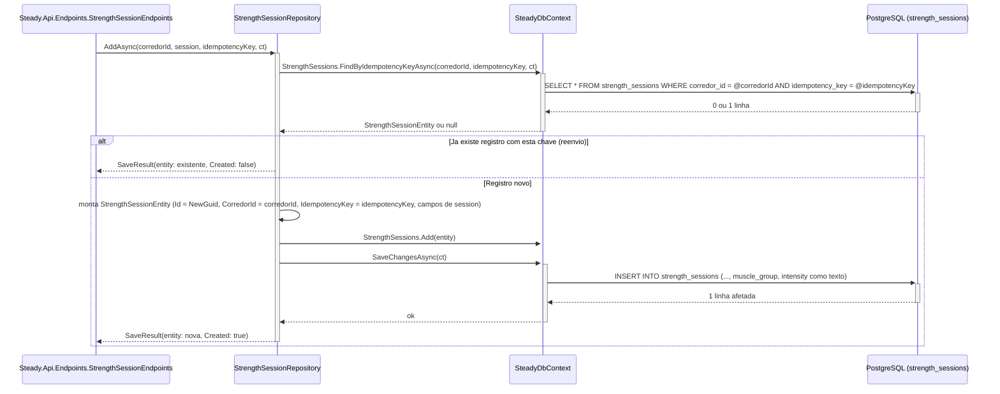
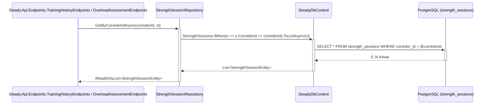
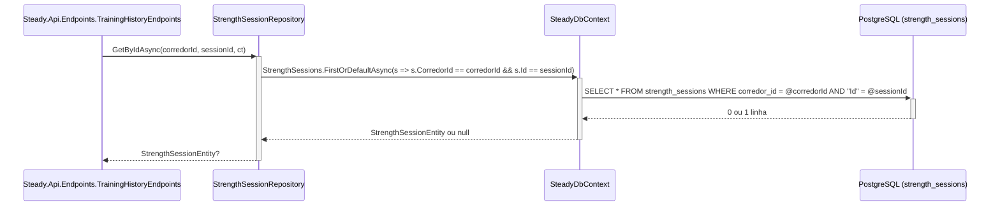

# StrengthSessionRepository - Persistencia-Treino - Especificacao Tecnica

## Indice
- [1. Visao Geral Tecnica](#1-visao-geral-tecnica)
- [2. Configuracao e Dependencias](#2-configuracao-e-dependencias)
- [3. Detalhamento por Metodo](#3-detalhamento-por-metodo)
  - [3.1. AddAsync - Persiste uma nova sessao de musculacao](#31-addasync---persiste-uma-nova-sessao-de-musculacao)
  - [3.2. GetByCorredorIdAsync - Lista o historico de musculacao do corredor](#32-getbycorredoridasync---lista-o-historico-de-musculacao-do-corredor)
  - [3.3. GetByIdAsync - Busca uma sessao especifica, escopada ao corredor](#33-getbyidasync---busca-uma-sessao-especifica-escopada-ao-corredor)
- [4. Observacoes Tecnicas](#4-observacoes-tecnicas)

## 1. Visao Geral Tecnica

**Proposito**: `StrengthSessionRepository` persiste e recupera sessoes de treino de musculacao (`StrengthSessionEntity`), sempre escopadas ao `CorredorId` do corredor autenticado. Estruturalmente identico a `RunningSessionRepository`, mas com os campos e enums proprios de musculacao (`MuscleGroup`, `Intensity`).

**Responsabilidades**:
- Converter um objeto de dominio `Steady.Domain.Training.StrengthSession` (ja validado por `StrengthSession.Create`) em `StrengthSessionEntity` e persisti-lo associado a um `CorredorId`.
- Aplicar a chave de idempotencia recebida do cliente antes de gravar, devolvendo o registro ja existente em vez de duplicar em caso de reenvio -- [ADR-003](../../../docs/adr/ADR-003-chave-de-idempotencia-para-sincronizacao-offline.md).
- Listar todas as sessoes de musculacao de um corredor.
- Buscar uma sessao especifica por ID, escopada ao corredor.

**Integracoes**: chamado por `Steady.Api.Endpoints.StrengthSessionEndpoints` (POST `/api/strength-sessions`), `Steady.Api.Endpoints.TrainingHistoryEndpoints` (GET `/api/training-sessions` e GET `/api/training-sessions/{id}`) e `Steady.Api.Endpoints.OverloadAssessmentEndpoints` (GET `/api/overload-assessment`) -- ver `DocumentAIReadme/Steady.Api/DevDocs/StrengthSessionEndpoints-Treino-Forca-DevDocs.md`, `DocumentAIReadme/Steady.Api/DevDocs/TrainingHistoryEndpoints-Historico-DevDocs.md` e `DocumentAIReadme/Steady.Api/DevDocs/OverloadAssessmentEndpoints-Sobrecarga-DevDocs.md`. Regras fundamentadas em `specs/STORY-001/spec.bdd.md` (validacao de dominio, incluindo o grupo muscular de perna com intensidade pesada -- gatilho da regra de sobrecarga em [ADR-001](../../../docs/adr/ADR-001-regra-sobrecarga-combinada.md)), `specs/STORY-002/spec.bdd.md` (persistencia e isolamento) e `specs/STORY-003/spec.bdd.md` (idempotencia, [ADR-003](../../../docs/adr/ADR-003-chave-de-idempotencia-para-sincronizacao-offline.md)). O utilitario `IIdempotentRecord`/`SaveResult<TEntity>` usado por `AddAsync` esta documentado em `SteadyDbContext-ServiceCollectionExtensions-Persistencia-Configuracao-DevDocs.md#33-iidempotentrecord-e-saveresult---utilitario-de-idempotencia-adr-003`.

## 2. Configuracao e Dependencias

**Dependencias Injetadas**:
- `SteadyDbContext dbContext`: contexto EF Core injetado via construtor primario, ciclo de vida `Scoped`.

**Interface implementada**: `IStrengthSessionRepository` (`Repositories/IStrengthSessionRepository.cs`).

**Metodos Publicos**:
- `Task<SaveResult<StrengthSessionEntity>> AddAsync(Guid corredorId, StrengthSession session, Guid idempotencyKey, CancellationToken cancellationToken)` -- assinatura alterada pelo [ADR-003](../../../docs/adr/ADR-003-chave-de-idempotencia-para-sincronizacao-offline.md); antes retornava `StrengthSessionEntity` direto e nao recebia `idempotencyKey`.
- `Task<IReadOnlyList<StrengthSessionEntity>> GetByCorredorIdAsync(Guid corredorId, CancellationToken cancellationToken)`
- `Task<StrengthSessionEntity?> GetByIdAsync(Guid corredorId, Guid sessionId, CancellationToken cancellationToken)`

## 3. Detalhamento por Metodo

### 3.1. AddAsync - Persiste uma nova sessao de musculacao

**Entrada**:
```json
{
  "corredorId": "Guid - dono do registro, resolvido pelo AuthenticationFilter",
  "session": {
    "Date": "DateOnly",
    "MuscleGroup": "enum MuscleGroup (PeitoTriceps, Ombro, PernaFrontal, PernaPosterior, BicepsCostas)",
    "Intensity": "enum Intensity (Leve, Moderado, Pesado)",
    "DurationMinutes": "int (> 0, validado em StrengthSession.Create)"
  },
  "idempotencyKey": "Guid - lido do header 'Idempotency-Key' pelo Endpoint (ADR-003); gerado pelo cliente no momento em que o item entra na fila local, nao a cada tentativa de envio"
}
```

**Saida**:
```json
{
  "SaveResult<StrengthSessionEntity>": {
    "Entity": {
      "Id": "Guid - gerado pelo repositorio (Guid.NewGuid()) se novo, ou o Id ja existente se reenvio",
      "CorredorId": "Guid",
      "Date": "DateOnly",
      "MuscleGroup": "enum MuscleGroup",
      "Intensity": "enum Intensity",
      "DurationMinutes": "int",
      "IdempotencyKey": "Guid"
    },
    "Created": "bool - true se gravou uma linha nova (Endpoint responde 201); false se devolveu um registro ja existente por reenvio da mesma chave (Endpoint responde 200)"
  }
}
```

#### Fluxo de Execucao



#### Detalhamento do Fluxo

**R. Repository (StrengthSessionRepository)**

R.1. AddAsync()
- Recebe o objeto de dominio `StrengthSession` ja validado (grupo muscular e intensidade obrigatorios, duracao > 0 -- ver `specs/STORY-001/spec.bdd.md`), o `corredorId` do contexto de autenticacao e a `idempotencyKey` do header `Idempotency-Key` ([ADR-003](../../../docs/adr/ADR-003-chave-de-idempotencia-para-sincronizacao-offline.md)).
- **Passo 1 -- busca por chave existente**: chama `dbContext.StrengthSessions.FindByIdempotencyKeyAsync(corredorId, idempotencyKey, ct)` -- documentado em `SteadyDbContext-ServiceCollectionExtensions-Persistencia-Configuracao-DevDocs.md#u1-iidempotentrecord-e-saveresult` (U1.1) -> [CTX.1](#ctx1-strengthsessions-dbset-e-conversao-de-enum)
- **Se ja existe** (`existing is not null`): retorna imediatamente `new SaveResult<StrengthSessionEntity>(existing, Created: false)` -- **nao grava nada novo**. Caminho de reenvio da fila offline.
- **Se nao existe -- Mapeamento Dominio -> Persistencia (U1)**: monta um novo `StrengthSessionEntity` copiando `Date`, `MuscleGroup`, `Intensity`, `DurationMinutes` de `StrengthSession`, atribuindo `Id = Guid.NewGuid()`, `CorredorId = corredorId` e `IdempotencyKey = idempotencyKey`.
- Adiciona ao `DbSet<StrengthSessionEntity>` e persiste via `SaveChangesAsync` -> [CTX.1](#ctx1-strengthsessions-dbset-e-conversao-de-enum)
- Retorna `new SaveResult<StrengthSessionEntity>(entity, Created: true)`. O Endpoint usa `Created` para decidir entre HTTP 201 (novo) e HTTP 200 (reenvio).

**CTX. SteadyDbContext**

<a id="ctx1-strengthsessions-dbset-e-conversao-de-enum"></a>
CTX.1. StrengthSessions (DbSet&lt;StrengthSessionEntity&gt;) + conversao de enum
- Mapeado para a tabela `strength_sessions`: `Id` como chave primaria; `CorredorId` -> `corredor_id` (indexada via `IX_strength_sessions_corredor_id`); `Date` -> `date`; `DurationMinutes` -> `duration_minutes`; `IdempotencyKey` -> `idempotency_key` (indice UNICO composto `IX_strength_sessions_corredor_id_idempotency_key` em `(corredor_id, idempotency_key)`, [ADR-003](../../../docs/adr/ADR-003-chave-de-idempotencia-para-sincronizacao-offline.md)).
- **Conversao de tipo relevante**: `MuscleGroup` e `Intensity` sao enums do dominio (`Steady.Domain.Training`) e sao persistidos como `text` no banco via `.HasConversion<string>()` (nao como inteiro) -- ou seja, o banco guarda literalmente `"PernaFrontal"`, `"Pesado"`, etc. Isso torna os dados legiveis diretamente no banco e resistentes a reordenacao futura dos valores do enum no codigo (um risco classico de persistir enum como inteiro).

### 3.2. GetByCorredorIdAsync - Lista o historico de musculacao do corredor

**Entrada**:
```json
{
  "corredorId": "Guid - do corredor autenticado",
  "cancellationToken": "CancellationToken"
}
```

**Saida**:
```json
{
  "IReadOnlyList<StrengthSessionEntity>": "todas as sessoes de musculacao cujo CorredorId == corredorId, sem paginacao"
}
```

#### Fluxo de Execucao



#### Detalhamento do Fluxo

**R. Repository (StrengthSessionRepository)**

R.2. GetByCorredorIdAsync()
- Aplica `Where(s => s.CorredorId == corredorId)` -- filtro de isolamento traduzido para SQL pelo EF Core, nao em memoria -> [CTX.2](#ctx2-query-filtrada-por-corredorid-1)
- Usado por `OverloadAssessmentEndpoints` para reconstruir `StrengthSession` de dominio e avaliar a regra de sobrecarga combinada, que depende especificamente de identificar musculacao de **perna (frontal ou posterior) com intensidade pesada** (ver `specs/STORY-001/spec.bdd.md`, regra de negocio 4).

**CTX. SteadyDbContext**

<a id="ctx2-query-filtrada-por-corredorid-1"></a>
CTX.2. Query LINQ traduzida para SQL com filtro indexado
- Suportada pelo indice `IX_strength_sessions_corredor_id`.

### 3.3. GetByIdAsync - Busca uma sessao especifica, escopada ao corredor

**Entrada**:
```json
{
  "corredorId": "Guid - do corredor autenticado",
  "sessionId": "Guid - identificador da sessao solicitada",
  "cancellationToken": "CancellationToken"
}
```

**Saida**:
```json
{
  "StrengthSessionEntity?": "a sessao, se pertencer ao corredorId informado; null caso contrario"
}
```

#### Fluxo de Execucao



#### Detalhamento do Fluxo

**R. Repository (StrengthSessionRepository)**

R.3. GetByIdAsync()
- Filtra por `CorredorId == corredorId` E `Id == sessionId` simultaneamente -- mesmo padrao de isolamento do `RunningSessionRepository.GetByIdAsync` -> [CTX.2](#ctx2-query-filtrada-por-corredorid-1)
- `TrainingHistoryEndpoints` tenta primeiro `RunningSessionRepository.GetByIdAsync` e, se `null`, tenta este metodo -- ou seja, o Endpoint nao sabe de antemao se o `id` e de uma corrida ou de uma musculacao.

## 4. Observacoes Tecnicas

- **Performance**: mesma observacao de `RunningSessionRepository` -- `GetByCorredorIdAsync` nao pagina. `AddAsync` faz 1 SELECT adicional (busca por chave de idempotencia) antes do INSERT no caminho de registro novo, mesmo padrao de `RunningSessionRepository`.
- **Tratamento de Erros**: nenhum tratamento de excecao de infraestrutura explicito nos tres metodos, incluindo o cenario raro de corrida entre dois envios simultaneos com a mesma `idempotencyKey` -- o indice unico composto `(corredor_id, idempotency_key)` protege a integridade do dado, mas uma eventual `DbUpdateException` do segundo INSERT concorrente nao e capturada explicitamente aqui (mesma observacao feita em `RunningSessionRepository-Persistencia-Treino-DevDocs.md`).
- **Integracoes Criticas**: a conversao de `MuscleGroup`/`Intensity` para `string` (`HasConversion<string>()`) e critica para a regra de sobrecarga -- se um novo valor de enum for adicionado no dominio sem migration correspondente, a leitura de dados antigos continua funcionando (strings existentes permanecem validas), mas e importante manter os nomes dos valores do enum estaveis, pois uma renomeacao quebraria a correspondencia com o texto ja gravado no banco (ver TechnicalDebtsDocs). `AddAsync` depende do utilitario `IIdempotentRecord`/`SaveResult<TEntity>` compartilhado com `RunningSessionRepository` e `PainLogRepository`, documentado uma unica vez em `SteadyDbContext-ServiceCollectionExtensions-Persistencia-Configuracao-DevDocs.md`.
