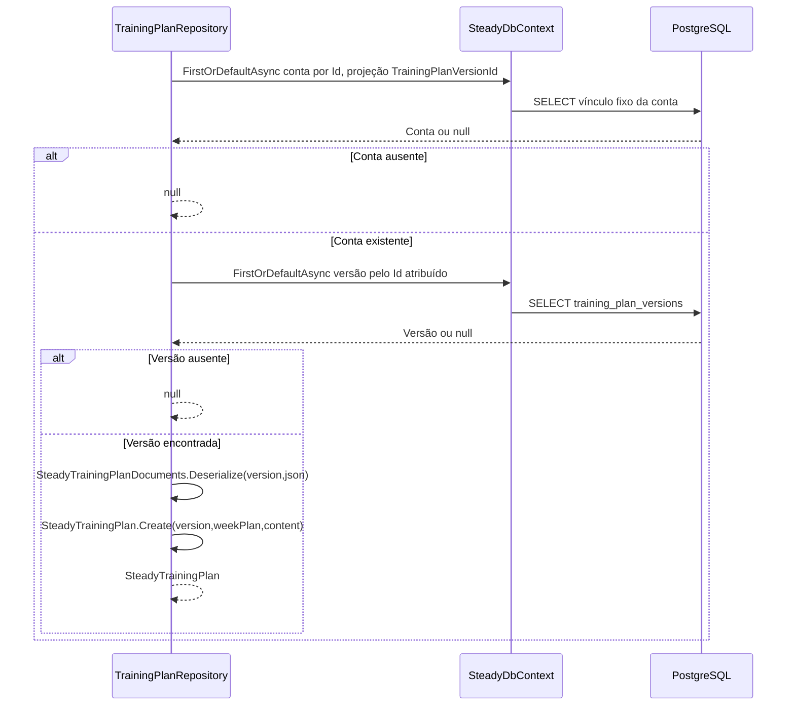

# TrainingPlanRepository - Persistencia-Planejamento - Especificação Técnica

Atualizado em 2026-09-27.

## Índice

- [Visão geral](#visao)
- [Métodos e contratos](#metodos)
- [Mapeamentos](#ctx)
- [Observações](#observacoes)
- [Fontes](#fontes)

<a id="visao"></a>
## 1. Visão geral técnica

Ler a prescrição fixa atribuída ao provisionamento, sem recalcular progressão.

Chamada pela camada Steady.Api; ver [índice da API](../../Steady.Api/DevDocs/README.md). Sem rotas próprias: entradas são parâmetros C#, saídas são entidades/objetos ou resultados assíncronos. O token e os papéis são validados na API; parâmetros de identidade precisam vir do contexto autenticado. PostgreSQL é acessado pelo SteadyDbContext com EF Core e Npgsql.


<a id="metodos"></a>
## 2. R. Métodos e contratos

- [GetCurrentVersionAsync](#r-1)
- [GetForRunnerAsync](#r-2)
- [Serialize](#r-3)
- [Deserialize](#r-4)
- [ToDocument](#r-5)
- [FromDocument](#r-6)
- [Version1](#r-7)

<a id="r-1"></a>
### R. GetCurrentVersionAsync

`public async Task<TrainingPlanVersionEntity> GetCurrentVersionAsync(CancellationToken cancellationToken)`

FirstOrDefaultAsync(IsCurrent); ausência lança InvalidOperationException e impede provisionamento.

Entrada: os parâmetros da assinatura, incluindo `CancellationToken` nas operações assíncronas. Saída: o tipo retornado na assinatura; `Task` transporta conclusão, resultado ou falha. Objetos de domínio chegam validados por suas fábricas; o repositório não substitui essa validação.

<a id="r-2"></a>
### R. GetForRunnerAsync

`public async Task<SteadyTrainingPlan?> GetForRunnerAsync(Guid corredorId, CancellationToken cancellationToken)`

Busca conta por Id e TrainingPlanVersionId; conta/versão ausente retorna null; desserializa a versão atribuída, nunca troca para vigente.

Entrada: os parâmetros da assinatura, incluindo `CancellationToken` nas operações assíncronas. Saída: o tipo retornado na assinatura; `Task` transporta conclusão, resultado ou falha. Objetos de domínio chegam validados por suas fábricas; o repositório não substitui essa validação.

<a id="r-3"></a>
### R. Serialize

`public static string Serialize(SteadyTrainingPlan plan)`

Converte conteúdo, sete dias, exercícios, faixas opcionais, fases, mobilidade, polimento e regras em PlanDocument com JSON Web.

Entrada: os parâmetros da assinatura, incluindo `CancellationToken` nas operações assíncronas. Saída: o tipo retornado na assinatura; `Task` transporta conclusão, resultado ou falha. Objetos de domínio chegam validados por suas fábricas; o repositório não substitui essa validação.

<a id="r-4"></a>
### R. Deserialize

`public static SteadyTrainingPlan Deserialize(int version, string json)`

Desserializa PlanDocument ou falha; reconstrói PlanStaticContent e WeekPlan e chama SteadyTrainingPlan.Create(version,...).

Entrada: os parâmetros da assinatura, incluindo `CancellationToken` nas operações assíncronas. Saída: o tipo retornado na assinatura; `Task` transporta conclusão, resultado ou falha. Objetos de domínio chegam validados por suas fábricas; o repositório não substitui essa validação.

<a id="r-5"></a>
### R. ToDocument

`private static WeekDayDocument ToDocument(PlanWeekDay day)`
`private static ExerciseDocument ToDocument(PlanExercise exercise)`
`private static RunPrescriptionDocument ToDocument(RunPrescription prescription)`

Converte dia/exercício/RunPrescription/NumericRange em documentos preservando Min/Max e null.

Entrada: os parâmetros da assinatura, incluindo `CancellationToken` nas operações assíncronas. Saída: o tipo retornado na assinatura; `Task` transporta conclusão, resultado ou falha. Objetos de domínio chegam validados por suas fábricas; o repositório não substitui essa validação.

<a id="r-6"></a>
### R. FromDocument

`private static PlanWeekDay FromDocument(WeekDayDocument document)`
`private static PlanExercise FromDocument(ExerciseDocument document)`
`private static RunPrescription FromDocument(RunPrescriptionDocument document)`

Reconstrói dia, exercício e RunPrescription por fábricas do domínio.

Entrada: os parâmetros da assinatura, incluindo `CancellationToken` nas operações assíncronas. Saída: o tipo retornado na assinatura; `Task` transporta conclusão, resultado ou falha. Objetos de domínio chegam validados por suas fábricas; o repositório não substitui essa validação.

<a id="r-7"></a>
### R. Version1

`public static SteadyTrainingPlan Version1()`

Cria versão 1 a partir de WeekPlan e conteúdo estático literal. Métodos privados Principle, Phases, WeekOverview, WeekPlan, TaperAdjustment, LongRunProgression, Mobility e GoldenRules fornecem as respectivas seções. Corridas de terça/quinta/sábado têm descrição, sem faixas numéricas por dia.

Entrada: os parâmetros da assinatura, incluindo `CancellationToken` nas operações assíncronas. Saída: o tipo retornado na assinatura; `Task` transporta conclusão, resultado ou falha. Objetos de domínio chegam validados por suas fábricas; o repositório não substitui essa validação.

#### Fluxo de execução



<a id="ctx"></a>
## 3. CTX. Mapeamento e integridade

### CTX. training_plan_versions

Chave primária: `Id` (sem HasColumnName, nome por convenção do modelo).

| Propriedade | Coluna | Configuração explícita |
|---|---|---|
| `Version` | `version` | `Tipo por convenção do provider` |
| `DefinitionJson` | `definition` | `HasColumnType("jsonb")` |
| `IsCurrent` | `is_current` | `Tipo por convenção do provider` |
| `CreatedAt` | `created_at` | `Tipo por convenção do provider` |

Índices e relações (expressões reais do modelo):

```csharp
HasIndex(v => v.Version).IsUnique();
HasIndex(v => v.IsCurrent).IsUnique().HasFilter("is_current = TRUE");

```

### CTX. corredores

Chave primária: `Id` (sem HasColumnName, nome por convenção do modelo).

| Propriedade | Coluna | Configuração explícita |
|---|---|---|
| `GoogleSub` | `google_sub` | `IsRequired()` |
| `Email` | `email` | `Tipo por convenção do provider` |
| `Name` | `name` | `Tipo por convenção do provider` |
| `Roles` | `roles` | `HasColumnType("text[]"); HasDefaultValue(new[] { "Corredor" })` |
| `TrainingPlanVersionId` | `training_plan_version_id` | `Tipo por convenção do provider` |
| `CreatedAt` | `created_at` | `Tipo por convenção do provider` |

Índices e relações (expressões reais do modelo):

```csharp
HasIndex(c => c.GoogleSub).IsUnique();
HasOne<TrainingPlanVersionEntity>()
                .WithMany()
                .HasForeignKey(c => c.TrainingPlanVersionId)
                .OnDelete(DeleteBehavior.Restrict);
```

Coleções usam conversão para `text[]` e ValueComparer com SequenceEqual, hash agregado e cópia ToList, detectando mudança em conteúdo.

<a id="observacoes"></a>
## 4. Observações técnicas

Consultas usam rastreamento padrão salvo AsNoTracking explicitamente indicado. Falhas de persistência e cancelamento propagam quando não houver captura documentada. Cada chave idempotente pertence à conta, não é uma chave global entre corredores. Entidades retornadas incluem os campos persistidos listados em CTX; resultados SaveResult contêm Entity e Created.

U1. Mapeamento Domínio/Persistência usa System.Text.Json com JsonSerializerDefaults.Web. Strings JSON inválidas e documentos incompatíveis podem lançar JsonException ou exceção das fábricas de domínio; não há recuperação silenciosa. Não confundir versão de plano com versão de formato JSON.

<a id="fontes"></a>
## 5. Fontes e verificação

- [docs/adr/ADR-002-autenticacao-e-isolamento-de-dados.md](../../../docs/adr/ADR-002-autenticacao-e-isolamento-de-dados.md)
- [docs/adr/ADR-013-plano-do-steady-como-fonte-de-prescricao.md](../../../docs/adr/ADR-013-plano-do-steady-como-fonte-de-prescricao.md)
- [tests/Steady.Api.Tests/SteadyTrainingPlanDocumentsTests.cs](../../../tests/Steady.Api.Tests/SteadyTrainingPlanDocumentsTests.cs)
- [src/Steady.Infrastructure/Persistence/SteadyDbContext.cs](../../../src/Steady.Infrastructure/Persistence/SteadyDbContext.cs)
- [src/Steady.Infrastructure/Repositories/TrainingPlanRepository.cs](../../../src/Steady.Infrastructure/Repositories/TrainingPlanRepository.cs)
- [src/Steady.Infrastructure/Repositories/SteadyTrainingPlanDocuments.cs](../../../src/Steady.Infrastructure/Repositories/SteadyTrainingPlanDocuments.cs)
- [src/Steady.Infrastructure/Repositories/SteadyTrainingPlanSeed.cs](../../../src/Steady.Infrastructure/Repositories/SteadyTrainingPlanSeed.cs)

Os testes citados foram inspecionados como evidência de comportamento; não foram executados nesta rodada de documentação.

Especificações de comportamento relacionadas:

- [STORY-016](../../../specs/STORY-016/spec.bdd.md)
