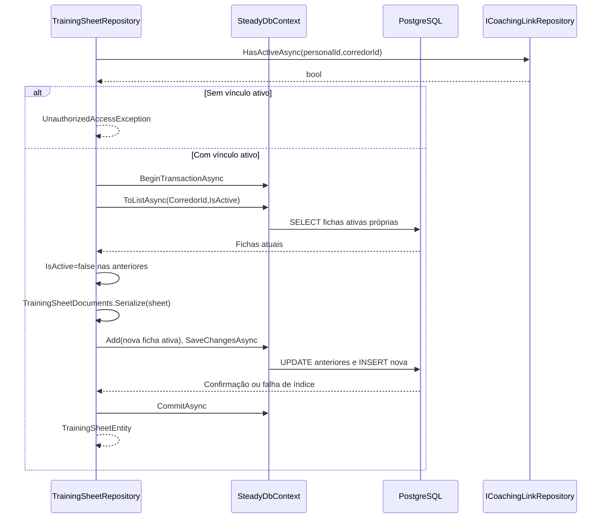
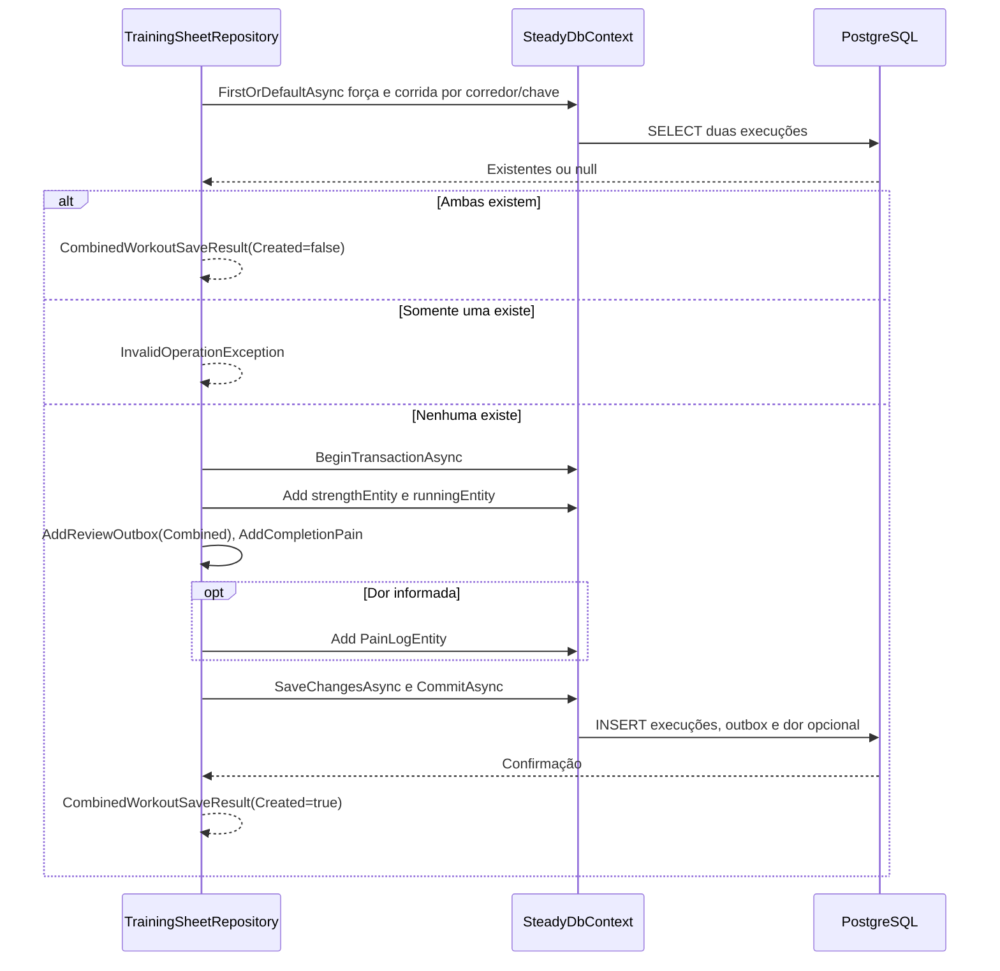

# TrainingSheetRepository - Persistencia-Coaching - Especificação Técnica

Atualizado em 2026-09-27.

## Índice

- [Visão geral](#visao)
- [Métodos e contratos](#metodos)
- [Mapeamentos](#ctx)
- [Observações](#observacoes)
- [Fontes](#fontes)

<a id="visao"></a>
## 1. Visão geral técnica

Publicar ficha com vínculo ativo e registrar exercícios/corrida de modo atômico.

Chamada pela camada Steady.Api; ver [índice da API](../../Steady.Api/DevDocs/README.md). Sem rotas próprias: entradas são parâmetros C#, saídas são entidades/objetos ou resultados assíncronos. O token e os papéis são validados na API; parâmetros de identidade precisam vir do contexto autenticado. PostgreSQL é acessado pelo SteadyDbContext com EF Core e Npgsql.


<a id="metodos"></a>
## 2. R. Métodos e contratos

- [PublishAsync](#r-1)
- [GetActiveAsync](#r-2)
- [GetByIdForRunnerAsync](#r-3)
- [AddExecutionAsync](#r-4)
- [AddCombinedExecutionAsync](#r-5)
- [GetHistoryAsync](#r-6)
- [GetExecutionsForRunnerAsync](#r-7)
- [AddReviewOutbox](#r-8)
- [AddCompletionPain](#r-9)
- [Serialize](#r-10)
- [DeserializeSheet](#r-11)
- [FromDocument](#r-12)
- [ToDocument](#r-13)
- [DeserializeExecution](#r-14)

<a id="r-1"></a>
### R. PublishAsync

`public async Task<TrainingSheetEntity> PublishAsync( Guid personalId, Guid corredorId, TrainingSheet sheet, CancellationToken cancellationToken)`

HasActiveAsync exige vínculo; ausência lança UnauthorizedAccessException. Transação desativa fichas do corredor, adiciona nova DefinitionJson e confirma SaveChanges/Commit.

Entrada: os parâmetros da assinatura, incluindo `CancellationToken` nas operações assíncronas. Saída: o tipo retornado na assinatura; `Task` transporta conclusão, resultado ou falha. Objetos de domínio chegam validados por suas fábricas; o repositório não substitui essa validação.

<a id="r-2"></a>
### R. GetActiveAsync

`public async Task<ActiveTrainingSheet?> GetActiveAsync( Guid corredorId, CancellationToken cancellationToken)`

Busca CorredorId/IsActive; ausente null. Desserializa ficha; execuções da mesma ficha/corredor por CreatedAt desc; TryAdd por ExerciseId mantém primeira sugestão e skipped gera null.

Entrada: os parâmetros da assinatura, incluindo `CancellationToken` nas operações assíncronas. Saída: o tipo retornado na assinatura; `Task` transporta conclusão, resultado ou falha. Objetos de domínio chegam validados por suas fábricas; o repositório não substitui essa validação.

<a id="r-3"></a>
### R. GetByIdForRunnerAsync

`public Task<TrainingSheetEntity?> GetByIdForRunnerAsync( Guid sheetId, Guid corredorId, CancellationToken cancellationToken)`

Busca sheetId e corredorId sem exigir ficha ativa.

Entrada: os parâmetros da assinatura, incluindo `CancellationToken` nas operações assíncronas. Saída: o tipo retornado na assinatura; `Task` transporta conclusão, resultado ou falha. Objetos de domínio chegam validados por suas fábricas; o repositório não substitui essa validação.

<a id="r-4"></a>
### R. AddExecutionAsync

`public async Task<SaveResult<StrengthWorkoutExecutionEntity>> AddExecutionAsync( Guid corredorId, StrengthWorkoutExecution execution, Guid idempotencyKey, bool painReportedAtCompletion, CancellationToken cancellationToken)`

Idempotência por corredor/chave; novo grava detalhes, outbox Strength e dor opcional com SaveChanges único.

Entrada: os parâmetros da assinatura, incluindo `CancellationToken` nas operações assíncronas. Saída: o tipo retornado na assinatura; `Task` transporta conclusão, resultado ou falha. Objetos de domínio chegam validados por suas fábricas; o repositório não substitui essa validação.

<a id="r-5"></a>
### R. AddCombinedExecutionAsync

`public async Task<CombinedWorkoutSaveResult> AddCombinedExecutionAsync( Guid corredorId, StrengthWorkoutExecution strength, RunningSession running, Guid idempotencyKey, bool painReportedAtCompletion, CancellationToken cancellationToken)`

Consulta ambas as execuções pela chave; ambas existentes retornam Created=false, somente uma existente lança InvalidOperationException. Novas linhas strength/running, outbox Combined e dor são gravadas e confirmadas em transação.

Entrada: os parâmetros da assinatura, incluindo `CancellationToken` nas operações assíncronas. Saída: o tipo retornado na assinatura; `Task` transporta conclusão, resultado ou falha. Objetos de domínio chegam validados por suas fábricas; o repositório não substitui essa validação.

<a id="r-6"></a>
### R. GetHistoryAsync

`public async Task<IReadOnlyList<StrengthWorkoutExecutionEntity>> GetHistoryAsync( Guid personalId, Guid corredorId, CancellationToken cancellationToken)`

Sem vínculo ativo retorna []; autorizado lista corredor por Date desc e CreatedAt desc.

Entrada: os parâmetros da assinatura, incluindo `CancellationToken` nas operações assíncronas. Saída: o tipo retornado na assinatura; `Task` transporta conclusão, resultado ou falha. Objetos de domínio chegam validados por suas fábricas; o repositório não substitui essa validação.

<a id="r-7"></a>
### R. GetExecutionsForRunnerAsync

`public async Task<IReadOnlyList<StrengthWorkoutExecutionEntity>> GetExecutionsForRunnerAsync( Guid corredorId, CancellationToken cancellationToken)`

Mesma lista isolada por corredor, sem verificar papel pessoal.

Entrada: os parâmetros da assinatura, incluindo `CancellationToken` nas operações assíncronas. Saída: o tipo retornado na assinatura; `Task` transporta conclusão, resultado ou falha. Objetos de domínio chegam validados por suas fábricas; o repositório não substitui essa validação.

<a id="r-8"></a>
### R. AddReviewOutbox

`private void AddReviewOutbox( Guid corredorId, Guid executionId, WorkoutExecutionKind kind, Guid idempotencyKey, DateOnly executionDate, bool painReportedAtCompletion, Guid trainingSheetId)`

Cria Pending com Ids, tipo, data, chave, dor e CreatedAt.

Entrada: os parâmetros da assinatura, incluindo `CancellationToken` nas operações assíncronas. Saída: o tipo retornado na assinatura; `Task` transporta conclusão, resultado ou falha. Objetos de domínio chegam validados por suas fábricas; o repositório não substitui essa validação.

<a id="r-9"></a>
### R. AddCompletionPain

`private void AddCompletionPain( Guid corredorId, DateOnly date, Guid idempotencyKey, bool painReportedAtCompletion)`

Só se booleano true cria região "Informada no encerramento".

Entrada: os parâmetros da assinatura, incluindo `CancellationToken` nas operações assíncronas. Saída: o tipo retornado na assinatura; `Task` transporta conclusão, resultado ou falha. Objetos de domínio chegam validados por suas fábricas; o repositório não substitui essa validação.

<a id="r-10"></a>
### R. Serialize

`public static string Serialize(TrainingSheet sheet)`
`public static string Serialize(StrengthWorkoutExecution execution)`

Overloads de ficha e execução preservam Id, ExerciseKey, duração, observação ou nota e campos numéricos opcionais das corridas.

Entrada: os parâmetros da assinatura, incluindo `CancellationToken` nas operações assíncronas. Saída: o tipo retornado na assinatura; `Task` transporta conclusão, resultado ou falha. Objetos de domínio chegam validados por suas fábricas; o repositório não substitui essa validação.

<a id="r-11"></a>
### R. DeserializeSheet

`public static TrainingSheet DeserializeSheet(Guid id, string json)`

Recria Push/Pull/Lower/Run por fábricas do domínio.

Entrada: os parâmetros da assinatura, incluindo `CancellationToken` nas operações assíncronas. Saída: o tipo retornado na assinatura; `Task` transporta conclusão, resultado ou falha. Objetos de domínio chegam validados por suas fábricas; o repositório não substitui essa validação.

<a id="r-12"></a>
### R. FromDocument

`private static RunPrescription FromDocument( RunPrescriptionDocument? current, string? legacyDayDescription, string? legacySingleDescription)`

Prioriza prescrição numérica nova, depois descrição diária legada, descrição única legada, por fim string vazia. Não inventa faixas.

Entrada: os parâmetros da assinatura, incluindo `CancellationToken` nas operações assíncronas. Saída: o tipo retornado na assinatura; `Task` transporta conclusão, resultado ou falha. Objetos de domínio chegam validados por suas fábricas; o repositório não substitui essa validação.

<a id="r-13"></a>
### R. ToDocument

`private static RunPrescriptionDocument ToDocument(RunPrescription prescription)`

Preserva faixas Min/Max ou null.

Entrada: os parâmetros da assinatura, incluindo `CancellationToken` nas operações assíncronas. Saída: o tipo retornado na assinatura; `Task` transporta conclusão, resultado ou falha. Objetos de domínio chegam validados por suas fábricas; o repositório não substitui essa validação.

<a id="r-14"></a>
### R. DeserializeExecution

`public static IReadOnlyList<ExerciseExecution> DeserializeExecution(string json)`

Skipped usa SkippedExercise; execução normal exige LoadKg, ou lança InvalidOperationException. ExerciseKey ausente recebe compatibilidade das fábricas do domínio.

Entrada: os parâmetros da assinatura, incluindo `CancellationToken` nas operações assíncronas. Saída: o tipo retornado na assinatura; `Task` transporta conclusão, resultado ou falha. Objetos de domínio chegam validados por suas fábricas; o repositório não substitui essa validação.

#### Fluxo de execução



### Fluxo de execução combinada



<a id="ctx"></a>
## 3. CTX. Mapeamento e integridade

### CTX. training_sheets

Chave primária: `Id` (sem HasColumnName, nome por convenção do modelo).

| Propriedade | Coluna | Configuração explícita |
|---|---|---|
| `PersonalId` | `personal_id` | `Tipo por convenção do provider` |
| `CorredorId` | `corredor_id` | `Tipo por convenção do provider` |
| `DefinitionJson` | `definition` | `HasColumnType("jsonb")` |
| `IsActive` | `is_active` | `Tipo por convenção do provider` |
| `CreatedAt` | `created_at` | `Tipo por convenção do provider` |

Índices e relações (expressões reais do modelo):

```csharp
HasIndex(sheet => sheet.CorredorId)
                .IsUnique()
                .HasFilter("is_active = TRUE");
HasOne<CorredorEntity>()
                .WithMany()
                .HasForeignKey(sheet => sheet.PersonalId)
                .OnDelete(DeleteBehavior.Restrict);
HasOne<CorredorEntity>()
                .WithMany()
                .HasForeignKey(sheet => sheet.CorredorId)
                .OnDelete(DeleteBehavior.Restrict);
```

### CTX. strength_workout_executions

Chave primária: `Id` (sem HasColumnName, nome por convenção do modelo).

| Propriedade | Coluna | Configuração explícita |
|---|---|---|
| `CorredorId` | `corredor_id` | `Tipo por convenção do provider` |
| `TrainingSheetId` | `training_sheet_id` | `Tipo por convenção do provider` |
| `WorkoutType` | `workout_type` | `HasConversion<string>()` |
| `Date` | `date` | `Tipo por convenção do provider` |
| `DetailsJson` | `details` | `HasColumnType("jsonb")` |
| `IdempotencyKey` | `idempotency_key` | `Tipo por convenção do provider` |
| `CreatedAt` | `created_at` | `Tipo por convenção do provider` |

Índices e relações (expressões reais do modelo):

```csharp
HasIndex(execution => new { execution.CorredorId, execution.IdempotencyKey }).IsUnique();
HasIndex(execution => new { execution.CorredorId, execution.TrainingSheetId });
HasOne<CorredorEntity>()
                .WithMany()
                .HasForeignKey(execution => execution.CorredorId)
                .OnDelete(DeleteBehavior.Restrict);
HasOne<TrainingSheetEntity>()
                .WithMany()
                .HasForeignKey(execution => execution.TrainingSheetId)
                .OnDelete(DeleteBehavior.Restrict);
```

### CTX. running_sessions

Chave primária: `Id` (sem HasColumnName, nome por convenção do modelo).

| Propriedade | Coluna | Configuração explícita |
|---|---|---|
| `CorredorId` | `corredor_id` | `Tipo por convenção do provider` |
| `Date` | `date` | `Tipo por convenção do provider` |
| `DistanceKm` | `distance_km` | `Tipo por convenção do provider` |
| `DurationMinutes` | `duration_minutes` | `Tipo por convenção do provider` |
| `AveragePaceMinPerKm` | `average_pace_min_per_km` | `Tipo por convenção do provider` |
| `PerceivedEffort` | `perceived_effort` | `Tipo por convenção do provider` |
| `IdempotencyKey` | `idempotency_key` | `Tipo por convenção do provider` |

Índices e relações (expressões reais do modelo):

```csharp
HasIndex(s => s.CorredorId);
HasIndex(s => new { s.CorredorId, s.IdempotencyKey }).IsUnique();
HasOne<CorredorEntity>()
                .WithMany()
                .HasForeignKey(s => s.CorredorId)
                .OnDelete(DeleteBehavior.Cascade);
```

### CTX. review_outbox

Chave primária: `Id` (sem HasColumnName, nome por convenção do modelo).

| Propriedade | Coluna | Configuração explícita |
|---|---|---|
| `CorredorId` | `corredor_id` | `Tipo por convenção do provider` |
| `ExecutionId` | `execution_id` | `Tipo por convenção do provider` |
| `TrainingSheetId` | `training_sheet_id` | `Tipo por convenção do provider` |
| `ExecutionKind` | `execution_kind` | `HasConversion<string>()` |
| `IdempotencyKey` | `idempotency_key` | `Tipo por convenção do provider` |
| `ExecutionDate` | `execution_date` | `Tipo por convenção do provider` |
| `PainReportedAtCompletion` | `pain_reported_at_completion` | `Tipo por convenção do provider` |
| `Status` | `status` | `HasConversion<string>()` |
| `Attempts` | `attempts` | `Tipo por convenção do provider` |
| `LeaseUntil` | `lease_until` | `Tipo por convenção do provider` |
| `NextAttemptAt` | `next_attempt_at` | `Tipo por convenção do provider` |
| `CreatedAt` | `created_at` | `Tipo por convenção do provider` |
| `CompletedAt` | `completed_at` | `Tipo por convenção do provider` |

Índices e relações (expressões reais do modelo):

```csharp
HasIndex(item => new { item.ExecutionKind, item.ExecutionId }).IsUnique();
HasIndex(item => new { item.CorredorId, item.IdempotencyKey }).IsUnique();
HasIndex(item => new { item.Status, item.NextAttemptAt });
HasOne<CorredorEntity>().WithMany().HasForeignKey(item => item.CorredorId)
                .OnDelete(DeleteBehavior.Cascade);
```

### CTX. pain_logs

Chave primária: `Id` (sem HasColumnName, nome por convenção do modelo).

| Propriedade | Coluna | Configuração explícita |
|---|---|---|
| `CorredorId` | `corredor_id` | `Tipo por convenção do provider` |
| `Date` | `date` | `Tipo por convenção do provider` |
| `Region` | `region` | `IsRequired()` |
| `IdempotencyKey` | `idempotency_key` | `Tipo por convenção do provider` |

Índices e relações (expressões reais do modelo):

```csharp
HasIndex(p => p.CorredorId);
HasIndex(p => new { p.CorredorId, p.IdempotencyKey }).IsUnique();
HasOne<CorredorEntity>()
                .WithMany()
                .HasForeignKey(p => p.CorredorId)
                .OnDelete(DeleteBehavior.Cascade);
```

<a id="observacoes"></a>
## 4. Observações técnicas

Consultas usam rastreamento padrão salvo AsNoTracking explicitamente indicado. Falhas de persistência e cancelamento propagam quando não houver captura documentada. Cada chave idempotente pertence à conta, não é uma chave global entre corredores. Entidades retornadas incluem os campos persistidos listados em CTX; resultados SaveResult contêm Entity e Created.

U1. Mapeamento Domínio/Persistência usa System.Text.Json com JsonSerializerDefaults.Web. Strings JSON inválidas e documentos incompatíveis podem lançar JsonException ou exceção das fábricas de domínio; não há recuperação silenciosa. Não confundir versão de plano com versão de formato JSON.

<a id="fontes"></a>
## 5. Fontes e verificação

- [docs/adr/ADR-002-autenticacao-e-isolamento-de-dados.md](../../../docs/adr/ADR-002-autenticacao-e-isolamento-de-dados.md)
- [docs/adr/ADR-009-ficha-ativa-e-execucao-imutavel.md](../../../docs/adr/ADR-009-ficha-ativa-e-execucao-imutavel.md)
- [docs/adr/ADR-010-ficha-com-prescricoes-de-corrida-por-dia.md](../../../docs/adr/ADR-010-ficha-com-prescricoes-de-corrida-por-dia.md)
- [docs/adr/ADR-011-registro-combinado-de-musculacao-e-corrida.md](../../../docs/adr/ADR-011-registro-combinado-de-musculacao-e-corrida.md)
- [docs/adr/ADR-012-prescricao-de-corrida-estruturada.md](../../../docs/adr/ADR-012-prescricao-de-corrida-estruturada.md)
- [docs/adr/ADR-018-outbox-transacional-da-revisao.md](../../../docs/adr/ADR-018-outbox-transacional-da-revisao.md)
- [docs/adr/ADR-019-identidade-historica-do-exercicio.md](../../../docs/adr/ADR-019-identidade-historica-do-exercicio.md)
- [tests/Steady.Api.Tests/TrainingSheetDocumentsTests.cs](../../../tests/Steady.Api.Tests/TrainingSheetDocumentsTests.cs)
- [src/Steady.Infrastructure/Persistence/SteadyDbContext.cs](../../../src/Steady.Infrastructure/Persistence/SteadyDbContext.cs)
- [src/Steady.Infrastructure/Repositories/TrainingSheetRepository.cs](../../../src/Steady.Infrastructure/Repositories/TrainingSheetRepository.cs)
- [src/Steady.Infrastructure/Repositories/TrainingSheetDocuments.cs](../../../src/Steady.Infrastructure/Repositories/TrainingSheetDocuments.cs)

Os testes citados foram inspecionados como evidência de comportamento; não foram executados nesta rodada de documentação.

Especificações de comportamento relacionadas:

- [STORY-013](../../../specs/STORY-013/spec.bdd.md)
- [STORY-015](../../../specs/STORY-015/spec.bdd.md)
- [STORY-017](../../../specs/STORY-017/spec.bdd.md)
- [STORY-014](../../../specs/STORY-014/spec.bdd.md)
