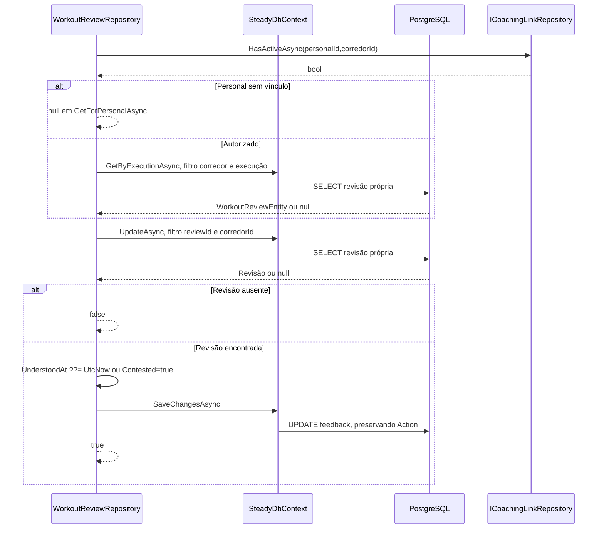

# WorkoutReviewRepository - Persistencia-Revisao - Especificação Técnica

Atualizado em 2026-09-27.

## Índice

- [Visão geral](#visao)
- [Métodos e contratos](#metodos)
- [Mapeamentos](#ctx)
- [Observações](#observacoes)
- [Fontes](#fontes)

<a id="visao"></a>
## 1. Visão geral técnica

Consultar revisão do próprio treino e registrar entendimento/contestação.

Chamada pela camada Steady.Api; ver [índice da API](../../Steady.Api/DevDocs/README.md). Sem rotas próprias: entradas são parâmetros C#, saídas são entidades/objetos ou resultados assíncronos. O token e os papéis são validados na API; parâmetros de identidade precisam vir do contexto autenticado. PostgreSQL é acessado pelo SteadyDbContext com EF Core e Npgsql.


<a id="metodos"></a>
## 2. R. Métodos e contratos

- [GetLatestAsync](#r-1)
- [GetByExecutionAsync](#r-2)
- [GetForPersonalAsync](#r-3)
- [GetByCorredorAsync](#r-4)
- [MarkUnderstoodAsync](#r-5)
- [MarkContestedAsync](#r-6)
- [UpdateAsync](#r-7)

<a id="r-1"></a>
### R. GetLatestAsync

`public Task<WorkoutReviewEntity?> GetLatestAsync(Guid corredorId, CancellationToken cancellationToken)`

Filtra corredor e ordena ExecutionDate/CreatedAt desc; FirstOrDefaultAsync retorna null se vazio.

Entrada: os parâmetros da assinatura, incluindo `CancellationToken` nas operações assíncronas. Saída: o tipo retornado na assinatura; `Task` transporta conclusão, resultado ou falha. Objetos de domínio chegam validados por suas fábricas; o repositório não substitui essa validação.

<a id="r-2"></a>
### R. GetByExecutionAsync

`public Task<WorkoutReviewEntity?> GetByExecutionAsync( Guid corredorId, Guid executionId, CancellationToken cancellationToken)`

Filtra corredor e executionId.

Entrada: os parâmetros da assinatura, incluindo `CancellationToken` nas operações assíncronas. Saída: o tipo retornado na assinatura; `Task` transporta conclusão, resultado ou falha. Objetos de domínio chegam validados por suas fábricas; o repositório não substitui essa validação.

<a id="r-3"></a>
### R. GetForPersonalAsync

`public async Task<WorkoutReviewEntity?> GetForPersonalAsync( Guid personalId, Guid corredorId, Guid executionId, CancellationToken cancellationToken)`

HasActiveAsync do par; sem vínculo null; autorizado delega GetByExecutionAsync.

Entrada: os parâmetros da assinatura, incluindo `CancellationToken` nas operações assíncronas. Saída: o tipo retornado na assinatura; `Task` transporta conclusão, resultado ou falha. Objetos de domínio chegam validados por suas fábricas; o repositório não substitui essa validação.

<a id="r-4"></a>
### R. GetByCorredorAsync

`public async Task<IReadOnlyList<WorkoutReviewEntity>> GetByCorredorAsync( Guid corredorId, CancellationToken cancellationToken)`

Lista isolada, ordenação ExecutionDate/CreatedAt desc.

Entrada: os parâmetros da assinatura, incluindo `CancellationToken` nas operações assíncronas. Saída: o tipo retornado na assinatura; `Task` transporta conclusão, resultado ou falha. Objetos de domínio chegam validados por suas fábricas; o repositório não substitui essa validação.

<a id="r-5"></a>
### R. MarkUnderstoodAsync

`public Task<bool> MarkUnderstoodAsync( Guid corredorId, Guid reviewId, CancellationToken cancellationToken)`

UpdateAsync define UnderstoodAt apenas se nulo, preservando primeira confirmação.

Entrada: os parâmetros da assinatura, incluindo `CancellationToken` nas operações assíncronas. Saída: o tipo retornado na assinatura; `Task` transporta conclusão, resultado ou falha. Objetos de domínio chegam validados por suas fábricas; o repositório não substitui essa validação.

<a id="r-6"></a>
### R. MarkContestedAsync

`public Task<bool> MarkContestedAsync( Guid corredorId, Guid reviewId, CancellationToken cancellationToken)`

UpdateAsync define Contested=true sem mudar Action.

Entrada: os parâmetros da assinatura, incluindo `CancellationToken` nas operações assíncronas. Saída: o tipo retornado na assinatura; `Task` transporta conclusão, resultado ou falha. Objetos de domínio chegam validados por suas fábricas; o repositório não substitui essa validação.

<a id="r-7"></a>
### R. UpdateAsync

`private async Task<bool> UpdateAsync( Guid corredorId, Guid reviewId, Action<WorkoutReviewEntity> update, CancellationToken cancellationToken)`

Busca reviewId/corredor; ausente false; aplica delegado, SaveChangesAsync, true.

Entrada: os parâmetros da assinatura, incluindo `CancellationToken` nas operações assíncronas. Saída: o tipo retornado na assinatura; `Task` transporta conclusão, resultado ou falha. Objetos de domínio chegam validados por suas fábricas; o repositório não substitui essa validação.

#### Fluxo de execução



<a id="ctx"></a>
## 3. CTX. Mapeamento e integridade

### CTX. workout_reviews

Chave primária: `Id` (sem HasColumnName, nome por convenção do modelo).

| Propriedade | Coluna | Configuração explícita |
|---|---|---|
| `CorredorId` | `corredor_id` | `Tipo por convenção do provider` |
| `ExecutionId` | `execution_id` | `Tipo por convenção do provider` |
| `ExecutionKind` | `execution_kind` | `HasConversion<string>()` |
| `ExecutionDate` | `execution_date` | `Tipo por convenção do provider` |
| `Status` | `status` | `HasConversion<string>()` |
| `Action` | `action` | `HasConversion<string>()` |
| `PolicyVersion` | `policy_version` | `Tipo por convenção do provider` |
| `PlanVersion` | `plan_version` | `Tipo por convenção do provider` |
| `TrainingSheetId` | `training_sheet_id` | `Tipo por convenção do provider` |
| `ComparisonJson` | `comparison` | `HasColumnType("jsonb")` |
| `ExplanationStatus` | `explanation_status` | `HasConversion<string>()` |
| `ExplanationJson` | `explanation` | `HasColumnType("jsonb")` |
| `UnderstoodAt` | `understood_at` | `Tipo por convenção do provider` |
| `Contested` | `contested` | `Tipo por convenção do provider` |
| `CoherenceStatus` | `coherence_status` | `HasConversion<string>()` |
| `NextExecutionId` | `next_execution_id` | `Tipo por convenção do provider` |
| `CoherencePolicyVersion` | `coherence_policy_version` | `Tipo por convenção do provider` |
| `CoherenceEvaluatedAt` | `coherence_evaluated_at` | `Tipo por convenção do provider` |
| `CreatedAt` | `created_at` | `Tipo por convenção do provider` |

Índices e relações (expressões reais do modelo):

```csharp
HasIndex(review => new { review.ExecutionKind, review.ExecutionId }).IsUnique();
HasIndex(review => new { review.CorredorId, review.ExecutionDate });
HasOne<CorredorEntity>().WithMany().HasForeignKey(review => review.CorredorId)
                .OnDelete(DeleteBehavior.Cascade);
```

<a id="observacoes"></a>
## 4. Observações técnicas

Consultas usam rastreamento padrão salvo AsNoTracking explicitamente indicado. Falhas de persistência e cancelamento propagam quando não houver captura documentada. Cada chave idempotente pertence à conta, não é uma chave global entre corredores. Entidades retornadas incluem os campos persistidos listados em CTX; resultados SaveResult contêm Entity e Created.

<a id="fontes"></a>
## 5. Fontes e verificação

- [docs/adr/ADR-002-autenticacao-e-isolamento-de-dados.md](../../../docs/adr/ADR-002-autenticacao-e-isolamento-de-dados.md)
- [docs/adr/ADR-008-roles-vinculo-e-autorizacao-do-personal.md](../../../docs/adr/ADR-008-roles-vinculo-e-autorizacao-do-personal.md)
- [docs/adr/ADR-014-fronteira-deterministica-da-revisao.md](../../../docs/adr/ADR-014-fronteira-deterministica-da-revisao.md)
- [tests/Steady.Api.Tests/WorkoutReviewEndpointTests.cs](../../../tests/Steady.Api.Tests/WorkoutReviewEndpointTests.cs)
- [src/Steady.Infrastructure/Persistence/SteadyDbContext.cs](../../../src/Steady.Infrastructure/Persistence/SteadyDbContext.cs)
- [src/Steady.Infrastructure/Repositories/WorkoutReviewRepository.cs](../../../src/Steady.Infrastructure/Repositories/WorkoutReviewRepository.cs)

Os testes citados foram inspecionados como evidência de comportamento; não foram executados nesta rodada de documentação.

Especificações de comportamento relacionadas:

- [STORY-014](../../../specs/STORY-014/spec.bdd.md)
