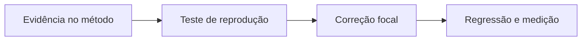

# CorredorRepository - Persistencia-Autenticacao - Débitos Técnicos

## Índice

- [Resumo executivo](#resumo)
- [Criticidade e evidência](#problemas)
- [Plano de ação](#plano)
- [Story e roteiro de teste](#story)

## 1. Resumo executivo

O comportamento atual está descrito na [documentação técnica](../DevDocs/CorredorRepository-Persistencia-Autenticacao-DevDocs.md). Esta análise registra uma limitação observada, não uma falha confirmada em produção. O catch de GetOrCreateBySubAsync trata qualquer DbUpdateException como disputa de google_sub. Falha de conexão ou integridade sem vencedor passa a FirstAsync e pode ocultar a causa original.

## 2. Problemas por criticidade

**Críticos**: nenhum adicional comprovado nesta leitura.

**Importante - Robustez do contrato persistido**: O catch de GetOrCreateBySubAsync trata qualquer DbUpdateException como disputa de google_sub. Falha de conexão ou integridade sem vencedor passa a FirstAsync e pode ocultar a causa original.

Evidência: [src/Steady.Infrastructure/Repositories/CorredorRepository.cs](../../../src/Steady.Infrastructure/Repositories/CorredorRepository.cs). Os métodos descritos em DevDocs permitem localizar a expressão/ramo; o problema é inferido da implementação, sem medição de produção.

**Ação recomendada**: Distinguir violação de unicidade de google_sub antes da releitura; demais falhas devem preservar causa.

**Menores**: nenhum item independente levantado; decisões deliberadas de versão, texto de data e imutabilidade não são automaticamente débitos.

## 3. Plano de ação

1. Reproduzir a limitação em teste com PostgreSQL e contratos atuais.
2. Confirmar comportamento desejado com a spec correspondente antes de alterar contrato.
3. Implementar a correção focal e executar regressão de isolamento, idempotência e resultado.

## 4. Story: tornar a operação previsível sob a condição observada

**Contexto atual**: O catch de GetOrCreateBySubAsync trata qualquer DbUpdateException como disputa de google_sub. Falha de conexão ou integridade sem vencedor passa a FirstAsync e pode ocultar a causa original.

**Objetivo e especificação técnica**: Distinguir violação de unicidade de google_sub antes da releitura; demais falhas devem preservar causa.

**Regras preservadas**: identidade do corredor, autorização por vínculo quando aplicável, fatos e prescrições imutáveis, retorno compatível ou mudança explícita de contrato.

**Critérios de aceite**:

- [ ] A reprodução deixa de produzir a limitação descrita.
- [ ] Resultado e efeitos de registros existentes permanecem compatíveis.
- [ ] O cenário de conta B nunca lê ou altera o recurso da conta A.

**Roteiro de teste concreto**:

1. Duas solicitações de mesmo googleSub em escopos independentes: esperado uma conta e ambos retornam o Id vencedor.
2. Simular DbUpdateException não causada por google_sub e sem vencedor; esperado após correção: causa original preservada, sem substituição por erro de FirstAsync.

Fontes de decisão e testes existentes:

- [docs/adr/ADR-002-autenticacao-e-isolamento-de-dados.md](../../../docs/adr/ADR-002-autenticacao-e-isolamento-de-dados.md)
- [docs/adr/ADR-008-roles-vinculo-e-autorizacao-do-personal.md](../../../docs/adr/ADR-008-roles-vinculo-e-autorizacao-do-personal.md)
- [docs/adr/ADR-013-plano-do-steady-como-fonte-de-prescricao.md](../../../docs/adr/ADR-013-plano-do-steady-como-fonte-de-prescricao.md)
- [tests/Steady.Api.Tests/AuthenticationTests.cs](../../../tests/Steady.Api.Tests/AuthenticationTests.cs)
- [src/Steady.Infrastructure/Persistence/SteadyDbContext.cs](../../../src/Steady.Infrastructure/Persistence/SteadyDbContext.cs)

O roteiro acima é uma proposta de verificação da melhoria, não declaração de teste executado.

Especificações de comportamento relacionadas:

- [STORY-002](../../../specs/STORY-002/spec.bdd.md)
- [STORY-009](../../../specs/STORY-009/spec.bdd.md)
- [STORY-016](../../../specs/STORY-016/spec.bdd.md)
- [STORY-019](../../../specs/STORY-019/spec.bdd.md)
