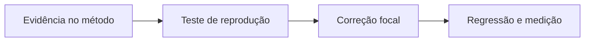

# PainLogRepository - Persistencia-Treino - Débitos Técnicos

## Índice

- [Resumo executivo](#resumo)
- [Criticidade e evidência](#problemas)
- [Plano de ação](#plano)
- [Story e roteiro de teste](#story)

## 1. Resumo executivo

O comportamento atual está descrito na [documentação técnica](../DevDocs/PainLogRepository-Persistencia-Treino-DevDocs.md). Esta análise registra uma limitação observada, não uma falha confirmada em produção. AddAsync faz leitura seguida de inserção sem recuperar conflito concorrente. O índice único impede duplicata, mas o repositório pode propagar DbUpdateException em duas gravações simultâneas.

## 2. Problemas por criticidade

**Críticos**: nenhum adicional comprovado nesta leitura.

**Importante - Robustez do contrato persistido**: AddAsync faz leitura seguida de inserção sem recuperar conflito concorrente. O índice único impede duplicata, mas o repositório pode propagar DbUpdateException em duas gravações simultâneas.

Evidência: [src/Steady.Infrastructure/Repositories/PainLogRepository.cs](../../../src/Steady.Infrastructure/Repositories/PainLogRepository.cs). Os métodos descritos em DevDocs permitem localizar a expressão/ramo; o problema é inferido da implementação, sem medição de produção.

**Ação recomendada**: Confirmar o tratamento do endpoint e cobrir conflito real; se necessário recuperar apenas violação da chave composta.

**Menores**: nenhum item independente levantado; decisões deliberadas de versão, texto de data e imutabilidade não são automaticamente débitos.

## 3. Plano de ação

1. Reproduzir a limitação em teste com PostgreSQL e contratos atuais.
2. Confirmar comportamento desejado com a spec correspondente antes de alterar contrato.
3. Implementar a correção focal e executar regressão de isolamento, idempotência e resultado.

## 4. Story: tornar a operação previsível sob a condição observada

**Contexto atual**: AddAsync faz leitura seguida de inserção sem recuperar conflito concorrente. O índice único impede duplicata, mas o repositório pode propagar DbUpdateException em duas gravações simultâneas.

**Objetivo e especificação técnica**: Confirmar o tratamento do endpoint e cobrir conflito real; se necessário recuperar apenas violação da chave composta.

**Regras preservadas**: identidade do corredor, autorização por vínculo quando aplicável, fatos e prescrições imutáveis, retorno compatível ou mudança explícita de contrato.

**Critérios de aceite**:

- [ ] A reprodução deixa de produzir a limitação descrita.
- [ ] Resultado e efeitos de registros existentes permanecem compatíveis.
- [ ] O cenário de conta B nunca lê ou altera o recurso da conta A.

**Roteiro de teste concreto**:

1. Executar duas AddAsync de A com mesma chave K em escopos independentes e sincronizar após leitura inicial; esperado após correção uma linha e retorno compatível com reenvio.
2. Executar AddAsync de B com a mesma K: esperado nova linha própria de B; resposta nunca inclui registro de A.

Fontes de decisão e testes existentes:

- [docs/adr/ADR-002-autenticacao-e-isolamento-de-dados.md](../../../docs/adr/ADR-002-autenticacao-e-isolamento-de-dados.md)
- [docs/adr/ADR-003-chave-de-idempotencia-para-sincronizacao-offline.md](../../../docs/adr/ADR-003-chave-de-idempotencia-para-sincronizacao-offline.md)
- [docs/adr/ADR-018-outbox-transacional-da-revisao.md](../../../docs/adr/ADR-018-outbox-transacional-da-revisao.md)
- [tests/Steady.Api.Tests/PainLogEndpointTests.cs](../../../tests/Steady.Api.Tests/PainLogEndpointTests.cs)
- [src/Steady.Infrastructure/Persistence/SteadyDbContext.cs](../../../src/Steady.Infrastructure/Persistence/SteadyDbContext.cs)

O roteiro acima é uma proposta de verificação da melhoria, não declaração de teste executado.

Especificações de comportamento relacionadas:

- [STORY-003](../../../specs/STORY-003/spec.bdd.md)
- [STORY-014](../../../specs/STORY-014/spec.bdd.md)
