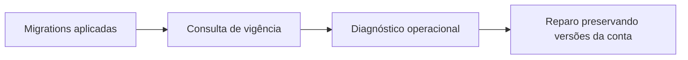

# SteadyDbContext e ServiceCollectionExtensions - Persistencia-Configuracao - Débitos Técnicos

## Índice

- [Resumo e evidência](#resumo)
- [Criticidade](#problemas)
- [Plano e story](#plano)

## 1. Resumo executivo

O modelo declara integridade básica e índices de unicidade. Não há evidência para continuar afirmando que faltam chaves estrangeiras nos treinos: elas foram adicionadas em AddPlanRequests. A limitação observada é que os índices parciais de IsCurrent garantem no máximo um plano/política vigente, mas permitem zero; a resolução falha somente quando uma operação precisa deles.

## 2. Problemas por criticidade

**Críticos**: nenhum adicional comprovado.

**Importante - diagnóstico tardio de ausência de versão vigente**: GetCurrentVersionAsync e ReviewOutboxProcessor detectam ausência de plano/política durante provisionamento/processamento. AddSteadyInfrastructure só configura serviços, não verifica dados. Falha operacional pode bloquear conta nova ou manter evento em retry indefinido.

**Ação recomendada**: adicionar verificação operacional de presença de exatamente uma versão vigente após migrations, sem transformar registro de serviços em acesso síncrono ao banco.

**Menores**: nenhum independente. Datas como texto, jsonb e conversões de enum são escolhas explícitas; não classificadas automaticamente como débito.

Evidência: [modelo](../../../src/Steady.Infrastructure/Persistence/SteadyDbContext.cs), [plano](../../../src/Steady.Infrastructure/Repositories/TrainingPlanRepository.cs), [processamento](../../../src/Steady.Infrastructure/Repositories/ReviewOutboxProcessor.cs).

## 3. Plano de ação e story

**Story: detectar inconsistência de vigência na operação**. Como operador, quero identificar ausência de plano/política vigente antes de usuários dependerem deles.

1. Criar consulta/verificação de vigência com diagnóstico separado por conjunto.
2. Integrar à validação pós-migration ou saúde operacional, preservando resolução tardia da connection string para testes.
3. Documentar reparo sem realocar plano de contas existentes.

**Critérios de aceite**:

- [ ] Seed válido indica uma política e um plano vigentes.
- [ ] Zero vigente reporta conjunto afetado, sem expor credenciais.
- [ ] O reparo não troca TrainingPlanVersionId de contas existentes.

**Roteiro de teste concreto**:

1. Banco migrado com seed v1: verificar contagens IsCurrent=1 para plano e política; diagnóstico saudável.
2. Em banco isolado, atualizar is_current=false da política: diagnóstico aponta política ausente; ProcessNextAsync continua falhando explicitamente conforme contrato atual até reparo.
3. Tornar plano v2 vigente: conta já provisionada com v1 permanece com TrainingPlanVersionId original.

Referências: [documentação técnica](../DevDocs/SteadyDbContext-ServiceCollectionExtensions-Persistencia-Configuracao-DevDocs.md), [teste de seed](../../../tests/Steady.Api.Tests/AdherencePersistenceTests.cs), [ADR-013](../../../docs/adr/ADR-013-plano-do-steady-como-fonte-de-prescricao.md).

Proposta de melhoria e roteiro não foram implementados ou executados nesta rodada.

Especificações de comportamento relacionadas:

- [STORY-010](../../../specs/STORY-010/spec.bdd.md)
- [STORY-013](../../../specs/STORY-013/spec.bdd.md)
- [STORY-014](../../../specs/STORY-014/spec.bdd.md)
- [STORY-016](../../../specs/STORY-016/spec.bdd.md)
