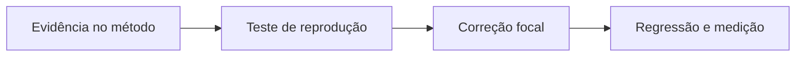

# TrainingPlanRepository - Persistencia-Planejamento - Débitos Técnicos

## Índice

- [Resumo executivo](#resumo)
- [Criticidade e evidência](#problemas)
- [Plano de ação](#plano)
- [Story e roteiro de teste](#story)

## 1. Resumo executivo

O comportamento atual está descrito na [documentação técnica](../DevDocs/TrainingPlanRepository-Persistencia-Planejamento-DevDocs.md). Esta análise registra uma limitação observada, não uma falha confirmada em produção. Deserialize depende da forma do JSON sem migração explícita de formato: versão do plano identifica conteúdo, mas não há discriminador de schema nem recuperação para documento incompleto.

## 2. Problemas por criticidade

**Críticos**: nenhum adicional comprovado nesta leitura.

**Importante - Robustez do contrato persistido**: Deserialize depende da forma do JSON sem migração explícita de formato: versão do plano identifica conteúdo, mas não há discriminador de schema nem recuperação para documento incompleto.

Evidência: [src/Steady.Infrastructure/Repositories/TrainingPlanRepository.cs](../../../src/Steady.Infrastructure/Repositories/TrainingPlanRepository.cs). Os métodos descritos em DevDocs permitem localizar a expressão/ramo; o problema é inferido da implementação, sem medição de produção.

**Ação recomendada**: Cobrir compatibilidade de documentos persistidos antes de alterar estrutura; manter fixtures de versão 1 e erros explícitos.

**Menores**: nenhum item independente levantado; decisões deliberadas de versão, texto de data e imutabilidade não são automaticamente débitos.

## 3. Plano de ação

1. Reproduzir a limitação em teste com PostgreSQL e contratos atuais.
2. Confirmar comportamento desejado com a spec correspondente antes de alterar contrato.
3. Implementar a correção focal e executar regressão de isolamento, idempotência e resultado.

## 4. Story: tornar a operação previsível sob a condição observada

**Contexto atual**: Deserialize depende da forma do JSON sem migração explícita de formato: versão do plano identifica conteúdo, mas não há discriminador de schema nem recuperação para documento incompleto.

**Objetivo e especificação técnica**: Cobrir compatibilidade de documentos persistidos antes de alterar estrutura; manter fixtures de versão 1 e erros explícitos.

**Regras preservadas**: identidade do corredor, autorização por vínculo quando aplicável, fatos e prescrições imutáveis, retorno compatível ou mudança explícita de contrato.

**Critérios de aceite**:

- [ ] A reprodução deixa de produzir a limitação descrita.
- [ ] Resultado e efeitos de registros existentes permanecem compatíveis.
- [ ] O cenário de conta B nunca lê ou altera o recurso da conta A.

**Roteiro de teste concreto**:

1. Desserializar fixture completa de v1 salva antes de mudança de formato: esperado mesmo conteúdo, sete dias e faixas ausentes preservadas.
2. Fixture com campo obrigatório omitido e JSON inválido: esperado erro explícito identificado como documento incompatível, sem plano parcialmente válido.

Fontes de decisão e testes existentes:

- [docs/adr/ADR-002-autenticacao-e-isolamento-de-dados.md](../../../docs/adr/ADR-002-autenticacao-e-isolamento-de-dados.md)
- [docs/adr/ADR-013-plano-do-steady-como-fonte-de-prescricao.md](../../../docs/adr/ADR-013-plano-do-steady-como-fonte-de-prescricao.md)
- [tests/Steady.Api.Tests/SteadyTrainingPlanDocumentsTests.cs](../../../tests/Steady.Api.Tests/SteadyTrainingPlanDocumentsTests.cs)
- [src/Steady.Infrastructure/Persistence/SteadyDbContext.cs](../../../src/Steady.Infrastructure/Persistence/SteadyDbContext.cs)

O roteiro acima é uma proposta de verificação da melhoria, não declaração de teste executado.

Especificações de comportamento relacionadas:

- [STORY-016](../../../specs/STORY-016/spec.bdd.md)
