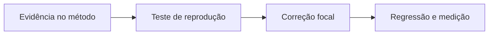

# TrainingSheetRepository - Persistencia-Coaching - Débitos Técnicos

## Índice

- [Resumo executivo](#resumo)
- [Criticidade e evidência](#problemas)
- [Plano de ação](#plano)
- [Story e roteiro de teste](#story)

## 1. Resumo executivo

O comportamento atual está descrito na [documentação técnica](../DevDocs/TrainingSheetRepository-Persistencia-Coaching-DevDocs.md). Esta análise registra uma limitação observada, não uma falha confirmada em produção. PublishAsync usa transação, mas não captura conflito do índice de ficha ativa; duas publicações simultâneas podem deixar uma falha de gravação para o chamador.

## 2. Problemas por criticidade

**Críticos**: nenhum adicional comprovado nesta leitura.

**Importante - Robustez do contrato persistido**: PublishAsync usa transação, mas não captura conflito do índice de ficha ativa; duas publicações simultâneas podem deixar uma falha de gravação para o chamador.

Evidência: [src/Steady.Infrastructure/Repositories/TrainingSheetRepository.cs](../../../src/Steady.Infrastructure/Repositories/TrainingSheetRepository.cs). Os métodos descritos em DevDocs permitem localizar a expressão/ramo; o problema é inferido da implementação, sem medição de produção.

**Ação recomendada**: Definir resposta de conflito e teste com dois escopos/transações independentes; preservar exatamente uma ficha ativa.

**Menores**: nenhum item independente levantado; decisões deliberadas de versão, texto de data e imutabilidade não são automaticamente débitos.

## 3. Plano de ação

1. Reproduzir a limitação em teste com PostgreSQL e contratos atuais.
2. Confirmar comportamento desejado com a spec correspondente antes de alterar contrato.
3. Implementar a correção focal e executar regressão de isolamento, idempotência e resultado.

## 4. Story: tornar a operação previsível sob a condição observada

**Contexto atual**: PublishAsync usa transação, mas não captura conflito do índice de ficha ativa; duas publicações simultâneas podem deixar uma falha de gravação para o chamador.

**Objetivo e especificação técnica**: Definir resposta de conflito e teste com dois escopos/transações independentes; preservar exatamente uma ficha ativa.

**Regras preservadas**: identidade do corredor, autorização por vínculo quando aplicável, fatos e prescrições imutáveis, retorno compatível ou mudança explícita de contrato.

**Critérios de aceite**:

- [ ] A reprodução deixa de produzir a limitação descrita.
- [ ] Resultado e efeitos de registros existentes permanecem compatíveis.
- [ ] O cenário de conta B nunca lê ou altera o recurso da conta A.

**Roteiro de teste concreto**:

1. Publicar duas fichas para A com P vinculado, usando dois escopos sincronizados após leitura da ficha atual: esperado após correção exatamente uma ativa e resposta de conflito definida para perdedora.
2. Publicação para B sem vínculo: esperado UnauthorizedAccessException e nenhuma ficha nova.

Fontes de decisão e testes existentes:

- [docs/adr/ADR-002-autenticacao-e-isolamento-de-dados.md](../../../docs/adr/ADR-002-autenticacao-e-isolamento-de-dados.md)
- [docs/adr/ADR-009-ficha-ativa-e-execucao-imutavel.md](../../../docs/adr/ADR-009-ficha-ativa-e-execucao-imutavel.md)
- [docs/adr/ADR-010-ficha-com-prescricoes-de-corrida-por-dia.md](../../../docs/adr/ADR-010-ficha-com-prescricoes-de-corrida-por-dia.md)
- [docs/adr/ADR-011-registro-combinado-de-musculacao-e-corrida.md](../../../docs/adr/ADR-011-registro-combinado-de-musculacao-e-corrida.md)
- [docs/adr/ADR-012-prescricao-de-corrida-estruturada.md](../../../docs/adr/ADR-012-prescricao-de-corrida-estruturada.md)
- [docs/adr/ADR-018-outbox-transacional-da-revisao.md](../../../docs/adr/ADR-018-outbox-transacional-da-revisao.md)
- [docs/adr/ADR-019-identidade-historica-do-exercicio.md](../../../docs/adr/ADR-019-identidade-historica-do-exercicio.md)
- [tests/Steady.Api.Tests/TrainingSheetDocumentsTests.cs](../../../tests/Steady.Api.Tests/TrainingSheetDocumentsTests.cs)
- [src/Steady.Infrastructure/Persistence/SteadyDbContext.cs](../../../src/Steady.Infrastructure/Persistence/SteadyDbContext.cs)

O roteiro acima é uma proposta de verificação da melhoria, não declaração de teste executado.

Especificações de comportamento relacionadas:

- [STORY-013](../../../specs/STORY-013/spec.bdd.md)
- [STORY-015](../../../specs/STORY-015/spec.bdd.md)
- [STORY-017](../../../specs/STORY-017/spec.bdd.md)
- [STORY-014](../../../specs/STORY-014/spec.bdd.md)
