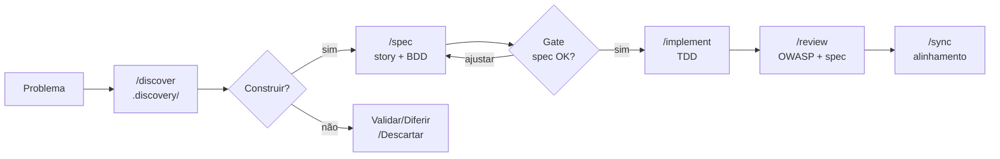

# SDD Kit

> Framework operacional para times de produto. Discovery → Spec → Test → Code.
>
> **[Walkthrough completo com exemplo prático →](docs/WALKTHROUGH.md)**

---

## Quick Start

### Projeto novo

```bash
# Clone o SDD Kit e copie o conteúdo para a raiz do seu projeto
git clone https://github.com/{org}/sdd-kit.git /tmp/sdd-kit
mkdir meu-projeto && cd meu-projeto
cp -r /tmp/sdd-kit/. .

# Produto & Design — Claude Code ou Copilot Chat (/comando):
/init        # entrevista estruturada → gera a Constituição + STACK.md
/discover    # sessão de discovery: problema → hipótese → decisão
/spec        # após decisão "Construir": Three Amigos escreve spec BDD

# Engineer & QA — Claude Code ou Copilot Chat (/comando):
/implement   # TDD a partir da spec aprovada
```

### Projeto existente

```bash
# Clone o SDD Kit e copie tudo para o seu projeto
git clone https://github.com/{org}/sdd-kit.git /tmp/sdd-kit
cp -r /tmp/sdd-kit/. /caminho/do/seu-projeto/

cd /caminho/do/seu-projeto

# Claude Code ou Copilot Chat — detecta conflitos, detecta stack e gera blueprint
/onboard
```

O `/onboard` é **idempotente** — detecta o que já existe e só preenche lacunas. Pergunta seu papel (Dev / PD / Design / Solo) e adapta o que gera.

### Story já refinada no Jira ou Azure

Quando o refinamento aconteceu fora do SDD Kit, o `/spec` é opcional:

```bash
# Engineer & QA — Claude Code ou Copilot Chat (/comando):
/implement

# Obrigatório após /implement sem spec prévia
/sync
```

O `/sync` gera a spec BDD a partir do código e dos ACs. Sem ele, `/review` fica **bloqueado** pelo hook de processo.

---

## Por que SDD Kit?

O modo tradicional de usar IA — mandar uma descrição no chat e copiar o código gerado — é rápido para protótipos, mas cria problemas em projetos reais: sem descoberta do problema real, sem spec, sem testes, sem decisões registradas, contexto perdido a cada sessão.

O SDD Kit estrutura a interação com IA em fases com artefatos persistidos. Cada fase produz um arquivo que a próxima fase consome. Nada existe apenas na conversa.

---

## Dois Papéis

O SDD Kit opera com dois papéis distintos, cada um com comandos e artefatos específicos:

| Papel | Responsabilidade | Comandos |
|-------|-----------------|----------|
| **Produto & Design** | Define o *o quê*: problema, hipótese, spec BDD | `/discover` `/spec` `/plan` `/init` `/onboard` |
| **Engineer & QA** | Garante o *como*, qualidade e segurança | `/implement` `/review` `/sync` `/analyze` |
| **Full pipeline** | Discovery → spec → TDD em um único fluxo | `/feature` |

**Regra de ouro:** o Engineer não escreve BDD — ele o consome. A spec é o contrato de entrada.

---

## Filosofia

**Discovery antes de especificar. Especificação antes de código. Teste antes de implementar. Segurança em todo cenário.**

| Disciplina | Papel |
|-----------|-------|
| **Discovery** | Entender o problema antes de decidir a solução. |
| **SDD** | A spec é o contrato. Código diverge → código errado. |
| **BDD** | Requisitos como Given/When/Then — Three Amigos. |
| **TDD** | RED → GREEN → REFACTOR por cenário. |
| **Segurança** | OWASP Top 10 em cada review. Secrets nunca no código. |

Princípios de código: **KISS** primeiro → **SOLID** no refactor → **DRY** quando padrão estabiliza.

---

## Discovery

Discovery é contínuo — não é uma fase que termina, é uma prática que acompanha o projeto do início ao fim. O `/discover` conduz sessões estruturadas que terminam com uma decisão explícita.

```
/discover → .discovery/{DISC-ID}/
               ├── problem.md      # persona, problema, impacto, evidências
               ├── hypothesis.md   # hipótese + métricas + suposições críticas
               └── decision.md     # Construir / Validar / Diferir / Descartar
```

Apenas quando a decisão é **Construir** o `/spec` é acionado. As outras decisões também têm valor — ficam registradas como memória institucional.

### Árvore de decisão do /discover

| Decisão | Quando | Próximo passo |
|---------|--------|---------------|
| **Construir** | Hipótese clara, prioridade confirmada | `/spec` → story + BDD |
| **Validar primeiro** | Suposição crítica incerta | Experimento / pesquisa antes de construir |
| **Diferir** | Válido, mas não agora | Registra condição de revisão |
| **Descartar** | Problema não confirmado ou fora de escopo | Registra motivo — evita repetir a discussão |

---

## A Constituição do Projeto

O SDD Kit tem duas camadas de lei:

| Camada | Arquivo | O que define |
|--------|---------|--------------|
| **Lei universal** | `.sdd/CONSTITUTION.md` | Princípios invioláveis (Discovery First, Spec First, TDD, Security First, ADR) |
| **Lei do projeto** | `.sdd/PROJECT-CONSTITUTION.md` | Contrato específico *deste* software — gerado pelo `/init` |

```
/init gera:

  PROJECT-CONSTITUTION.md     ← Lei do projeto
  ├── Identidade (problema, usuários, tipo, horizonte)
  ├── Lei do Domínio (princípios específicos e falsificáveis)
  ├── Mandatos de Qualidade (invioláveis / críticos / desejáveis)
  ├── Técnicas Prioritárias (patterns do PLAYBOOK calibrados)
  ├── Fronteiras e Integrações
  ├── Acordos do Time
  └── Emendas (versionadas)

  memory/PROJECT.md           ← Contexto e glossário
  memory/DOMAIN.md            ← Entidades e fronteiras
  docs/adr/ADR-000-foundation.md
```

---

## Fluxo completo

```
Produto & Design:
  /discover → decisão "Construir" → /spec → spec aprovada

Engineer & QA:
  spec aprovada → /implement (TDD) → /review → /sync
```



---

## Segurança

Segurança é responsabilidade do Engineer & QA — não é uma fase separada, é uma dimensão de cada cenário implementado.

### Sensor computacional — pre-commit hook

O hook roda automaticamente em todo commit e **bloqueia** se detectar:

| O que detecta | OWASP | Comportamento |
|--------------|-------|---------------|
| Arquivo `.env` staged | A05 | **Bloqueia** |
| Secrets hardcoded (15 padrões: AWS, OpenAI, GitHub, Slack, JWT, RSA keys…) | A02 | **Bloqueia** |
| Padrões perigosos (`innerHTML`, SQL concatenado, `eval`, `pickle.loads`, `shell=True`) | A03 | Avisa |

### Sensor inferencial — /review (OWASP Top 10)

O `/review` inclui checklist completo por categoria:

| Categoria | O que verifica |
|-----------|---------------|
| A01 Broken Access Control | queries filtram por userId? Sem IDOR? |
| A02 Cryptographic Failures | secrets no código? bcrypt/argon2? httpOnly cookie? |
| A03 Injection | queries parametrizadas? innerHTML com input? |
| A04 Insecure Design | rate limit em login/reset/OTP? mensagens genéricas? |
| A05 Security Misconfiguration | `.env` no gitignore? CORS restrito? headers de segurança? |
| A06 Vulnerable Components | `npm audit` / `pip-audit` limpos? |
| A07 Auth Failures | tokens expiram? logout invalida no servidor? |
| A09 Logging Failures | logs sem dados sensíveis? audit log em ações críticas? |
| A10 SSRF | URLs validadas contra allowlist? redirects por identificador? |

### Drift contínuo — session-healthcheck

Roda após cada resposta do Claude e avisa se:
- `.env` existe sem estar no `.gitignore`
- Dependências com CVEs críticos ou altos
- Secret detectado no último commit

---

## Estrutura

```
.discovery/                    # Discovery contínuo (Produto & Design)
└── {DISC-ID}-{slug}/
    ├── problem.md             # Persona, problema, impacto, evidências
    ├── hypothesis.md          # Hipótese + métricas + suposições críticas
    └── decision.md            # Construir / Validar / Diferir / Descartar

.sdd/                          # Framework core (compartilhado com o time)
├── CONSTITUTION.md            # Regras invioláveis (Discovery/Spec/Security First…)
├── PROJECT-CONSTITUTION.md    # Lei específica do projeto (gerado por /init)
├── PLAYBOOK.md                # Patterns, anti-patterns, OWASP Top 10, harness
├── STACK.md                   # Stack detectada (gerado por /onboard ou /init)
├── DESIGN.md                  # Design system (opcional)
├── config.json                # Convenções e MCPs
├── hooks/                     # Git hooks (pre-commit com security scan, commit-msg)
├── memory/
│   ├── PROJECT.md             # Contexto e glossário (gerado por /init ou /onboard)
│   ├── DOMAIN.md              # Entidades, fluxos, fronteiras
│   └── DECISIONS.md           # Índice de ADRs
└── templates/
    ├── story.md · spec.bdd.md · tasks.md · blueprint.md · adr.md
    └── discovery/             # problem.md · hypothesis.md · decision.md

specs/                         # Artefatos de implementação por história (EQA)
└── {story-id}/
    ├── story.md               # Persona, ação, benefício — referencia .discovery/
    ├── spec.bdd.md            # Cenários BDD (Three Amigos)
    ├── blueprint.mermaid      # Diagrama (se fluxo > 2 passos)
    └── tasks.md               # Breakdown de tasks

docs/
├── adr/                       # Architecture Decision Records
└── blueprints/                # Diagramas globais

.claude/
├── commands/                  # Slash commands: /discover /spec /implement /review…
├── hooks/                     # Claude Code hooks (bootstrap, process-guard, healthcheck)
└── settings.json              # Config de hooks compartilhada (não commitar settings.local.json)

.gitignore                     # .env, .claude/settings.local.json, .sdd/.pending-sync
src/                           # Código
tests/fixtures/                # Dados de teste (JSON com _meta rastreando spec)
```

---

## Comandos

### Produto & Design

| Comando | O que faz | Quando usar |
|---------|-----------|-------------|
| `/init` | Entrevista → Constituição + memórias | Início absoluto — projeto novo |
| `/onboard` | Analisa código + detecta conflitos com frameworks existentes | Projeto existente adotando SDD Kit |
| `/discover` | Sessão de discovery: problema → hipótese → decisão | Antes de qualquer spec — entender o problema |
| `/spec` | Three Amigos: story + cenários BDD | Após decisão "Construir" |
| `/plan` | Planeja sem implementar: story + spec + blueprint + tasks | Planejamento completo sem código agora |

### Engineer & QA

| Comando | O que faz | Quando usar |
|---------|-----------|-------------|
| `/implement` | TDD cenário a cenário a partir da spec aprovada | Spec aprovada pelo produto |
| `/review` | Valida código vs spec + checklist OWASP Top 10 | **Auto-rodado pelo `/implement`**. Manual só em 3 casos: re-validar pós-refactor/merge, pré-release, ou fluxo Jira/Azure depois do `/sync` |
| `/sync` | Sincroniza spec ↔ código (bidirecional) | Pós-refactor, requisito mudou, ou fluxo Jira/Azure |
| `/analyze` | Análise estratégica do código antes de implementar | Feature complexa ou área desconhecida |

### Dois fluxos de implementação

```
Fluxo padrão (PD → EQA):
  /discover → decisão Construir → /spec → spec aprovada → /implement (✱ inclui /review)

Fluxo Jira/Azure (story já refinada externamente):
  story nos ACs → /implement → /sync → /review (manual — caso 3 abaixo)

✱ O /implement dispara /review automaticamente quando todos os cenários da
  spec ficam verdes — review virou a fase de fechamento, não comando manual.
```

**Quando rodar `/review` manualmente** — só nestes 3 casos:

1. **Re-validar pós-refactor ou pós-merge** — código já entregue mudou e você quer revalidar contra spec + OWASP.
2. **Pré-release** — checagem final antes de subir pra prod.
3. **Fluxo Jira/Azure depois do `/sync`** — no fluxo Jira/Azure o `/implement` roda sem spec, então o auto-review é pulado; após o `/sync` gerar a spec BDD, rode `/review` manualmente.

---

## Git Hooks

Os hooks de segurança ficam em `.sdd/hooks/`. Para ativá-los, faça o link simbólico para `.git/hooks/`:

```bash
ln -sf "$(pwd)/.sdd/hooks/pre-commit"  .git/hooks/pre-commit
ln -sf "$(pwd)/.sdd/hooks/commit-msg"  .git/hooks/commit-msg
chmod +x .sdd/hooks/pre-commit .sdd/hooks/commit-msg
```

O `/init` e `/onboard` oferecem rodar esse setup automaticamente.

### `pre-commit` — Security scan + Branch naming

**Security scan** (bloqueia o commit se detectar):
- Arquivo `.env` sendo commitado (A05)
- Secrets hardcoded: senhas, API keys, tokens JWT, chaves AWS/OpenAI/GitHub/Slack, RSA private keys (A02)
- Padrões OWASP perigosos — avisa sem bloquear (A03): `innerHTML`, SQL concatenado, `eval`, `shell=True`, `pickle.loads`

**Branch naming** — avisa quando a branch não segue a convenção:
```
feature/STORY-001-user-login       ✓
fix/STORY-042-null-payment         ✓
docs/update-api-readme             ✓

minha-branch                       ⚠  aviso
```

Se a branch tiver um `STORY-NNN`, também avisa quando a spec BDD está ausente — reforçando o **Spec First**.

### `commit-msg` — Conventional Commits

```
feat(auth): add JWT refresh token rotation       ✓
fix(api): handle null response from gateway      ✓
test(order): add edge case for zero-value cart   ✓

Added login feature                              ✗  rejeitado
WIP: stuff                                       ✗  rejeitado
```

**Tipos válidos:** `feat` · `fix` · `test` · `refactor` · `docs` · `chore` · `perf` · `style` · `ci` · `build` · `revert`

---

## Claude Code Hooks

```
Evento              Hook                    O que faz
──────────────────────────────────────────────────────────────────────────
UserPromptSubmit    session-tracker         Registra início de sessão e turno
UserPromptSubmit    context-bootstrap       Injeta contexto do projeto (.sdd/memory/)
UserPromptSubmit    process-guard           Bloqueia /review se /sync pendente
UserPromptSubmit    model-advisor           Recomenda modelo ideal por comando
Stop                session-healthcheck     Auditoria silenciosa pós-resposta
Stop                retro-logger            Persiste métricas em .sdd/metrics/sessions/
```

### `context-bootstrap` — Memória automática de sessão

Injeta contexto do projeto antes de Claude processar qualquer comando SDD — elimina a necessidade de pedir o carregamento manualmente.

### `process-guard` — Guardião do fluxo

| Situação | Comportamento |
|---|---|
| `/implement` com spec BDD existente | Passa silenciosamente |
| `/implement` sem spec (fluxo Jira/Azure) | Avisa + cria marcador `.sdd/.pending-sync` |
| `/review` com sync pendente | **Bloqueia** com mensagem explicativa |
| `/sync` executado | Remove o marcador e desbloqueia |

### `model-advisor` — Economia de tokens por tarefa

| Comandos | Modelo recomendado |
|---|---|
| `/discover` `/init` `/onboard` `/analyze` `/feature` `/plan` `/spec` | Opus 4.7 + extended thinking |
| `/implement` `/review` `/sync` | Sonnet 4.6 |

### `session-tracker` — Cronômetro de sessão

Roda no evento `UserPromptSubmit`, sempre o primeiro. Gerencia a sessão com timeout de 30 minutos de inatividade. A cada turno registra o epoch de início em `.sdd/.turn-start` e o comando SDD detectado.

### `session-healthcheck` — Auditoria pós-resposta

Roda no evento `Stop`. Silencioso quando tudo está bem. Alerta quando:

| Check | Alerta quando |
|---|---|
| Sync pendente | `.sdd/.pending-sync` existe |
| Discoveries sem decisão | `.discovery/*/decision.md` ausente ou incompleto |
| Stories sem spec | `specs/*/story.md` sem `spec.bdd.md` correspondente |
| ADRs em Proposed | Decisão não finalizada |
| `.env` desprotegido | Existe sem estar no `.gitignore` |
| Dependências vulneráveis | `npm audit` / `pip-audit` com críticos ou altos |
| Secret no último commit | Padrão de secret detectado no HEAD |
| Dead code | `knip` / `ts-prune` / `vulture` detectam símbolos não utilizados |

### `retro-logger` — Métricas e retrospectiva

Roda no evento `Stop`, sempre o último. Persiste um log estruturado em `.sdd/metrics/sessions/YYYY-MM-DD.md`:

| O que registra | Como detecta |
| --- | --- |
| Duração do turno | `date +%s` no início e no fim |
| Tempo total de sessão | Timestamp do `SESSION_ID` vs agora |
| Decisões tomadas | `git status` — ADRs, specs BDD, discovery decisions novos |
| Erros de processo | `.sdd/.pending-sync` — `/implement` sem spec |

**Saída no terminal:** `[SDD] /spec → 1m 45s | sessão: 3m 20s` após cada turno com comando SDD. Box `╔══ SDD Retro ══╗` somente quando há decisões ou erros notáveis.

### Copilot — equivalentes embutidos nos prompts

O VS Code Copilot não expõe eventos `UserPromptSubmit`/`Stop`, então os hooks são traduzidos da seguinte forma nos [prompt files](.github/prompts/):

| Hook Claude Code | Equivalente Copilot |
|-----------------|---------------------|
| `context-bootstrap` | Bloco "Pré-condições" em cada prompt (lê `.sdd/memory/*` explicitamente) |
| `process-guard` | Bloco "Process guard" em `/review`, `/feature` e `/sync` (verifica `.sdd/.pending-sync`) |
| `model-advisor` | Frontmatter `model:` em cada prompt (Opus para decisão, Sonnet para execução) |
| `session-healthcheck` | Comando manual [`/healthcheck`](.github/prompts/healthcheck.prompt.md) |
| `session-tracker` / `retro-logger` | Sem equivalente nativo no Copilot |

---

## Projeto com framework existente

Ao adotar o SDD Kit em um projeto que já tem regras de IA, BDD ou ADRs próprios, o `/onboard` detecta automaticamente os conflitos e propõe equivalência antes de qualquer merge:

| O que pode existir | Equivalência no SDD Kit | Ação |
|-------------------|------------------------|------|
| `.cursorrules`, Cursor MDC | `.cursor/rules/*.mdc` | Merge: SDD Kit como base + regras do time |
| `CLAUDE.md` próprio | `CLAUDE.md` (base SDD Kit) | Merge preservando regras do projeto |
| `copilot-instructions` próprio | `.github/instructions/` | Merge |
| Cucumber / feature files | `specs/{id}/spec.bdd.md` | Mova mantendo conteúdo |
| ADRs em outro formato | `docs/adr/ADR-*.md` | Importe; ADR-000 documenta o estado atual |
| Husky / lint-staged | `.sdd/hooks/` + `.claude/hooks/` | Complemente, não substitua |

**Princípio:** Additive first — nenhum artefato é deletado sem decisão explícita documentada em ADR.

---

## Stack Scanner

A detecção de stack acontece dentro do `/onboard` (projeto existente) ou `/init` (projeto novo, perguntando ao usuário). Não há CLI externa — o agente lê `package.json`, lock files, `pyproject.toml`, `go.mod` etc. e gera `.sdd/STACK.md` com convenções específicas.

Detecta: linguagem, framework, test runner, banco, UI library, ORM, package manager, monorepo.

**Stacks suportadas:** TypeScript/JavaScript, Python, Java/Kotlin, Go, Rust, Ruby, PHP, Dart.

---

## O que commitar

| Commitar | `.gitignore` |
|----------|-------------|
| `.discovery/` — memória institucional de produto | `.env`, `.env.*` |
| `.sdd/` — framework core | `.claude/settings.local.json` |
| `.claude/commands/` + `.claude/hooks/` + `.claude/settings.json` | `.sdd/.pending-sync` |
| `.github/` — instruções Copilot | `node_modules/`, `dist/`, `__pycache__/` |
| `specs/` — stories + BDD | `.DS_Store`, `.idea/` |
| `docs/adr/` — decisões arquiteturais | |
| `CLAUDE.md` | |

---

## Setup de IDEs

| IDE | Pasta | Arquivo global |
|-----|-------|----------------|
| **Cursor** | `.cursor/rules/` | `sdd-kit.mdc` (alwaysApply) |
| **GitHub Copilot** | `.github/instructions/` + `.github/prompts/` | `copilot-instructions.md` + 11 slash commands (`/init` `/discover` … `/healthcheck`) via prompt files |
| **Claude Code** | `.claude/commands/` | `CLAUDE.md` + slash commands + hooks automáticos |

**Documentação completa:** [`docs/IDE-SETUP.md`](docs/IDE-SETUP.md)

---

## MCPs

| MCP | Para quê |
|-----|----------|
| Git | Commits, branches, PRs |
| Context7 | Docs atualizadas da stack |
| Markitdown | Converte docs para .md |
| Playwright | Testes E2E (opcional) |
| Sonar | Qualidade (opcional) |
| Dbhub | Schema do banco (opcional) |

---

## Referências e inspirações

O SDD Kit foi construído a partir das seguintes referências:

| Referência | Contribuição |
|------------|-------------|
| [Harness Engineering — Martin Fowler](https://martinfowler.com/articles/harness-engineering.html) | Conceito de Agent = Model + Harness, Guides (feedforward) e Sensors (feedback) |
| [BMAD Method](https://docs.bmad-method.org/) | Estrutura de papéis, ciclos de discovery e especificação colaborativa |
| [github/spec-kit](https://github.com/github/spec-kit) | Referência para estrutura de specs e BDD em projetos assistidos por IA |
| [spec-driven-ai-coding — andreskull](https://github.com/andreskull/spec-driven-ai-coding) | Prática de spec-driven development com agentes de codificação |
| [CursorRIPER — johnpeterman72](https://github.com/johnpeterman72/CursorRIPER) | Padrões de regras e memória persistente para IDEs com IA |
| [Claude Skills](https://docs.anthropic.com/en/docs/build-with-claude/claude-code/skills) | Comandos slash e capacidades de agente no Claude Code |
| [Claude Hooks](https://docs.anthropic.com/en/docs/build-with-claude/claude-code/hooks) | Sensores computacionais via hooks de ciclo de vida do agente |

---

## Licença

MIT
