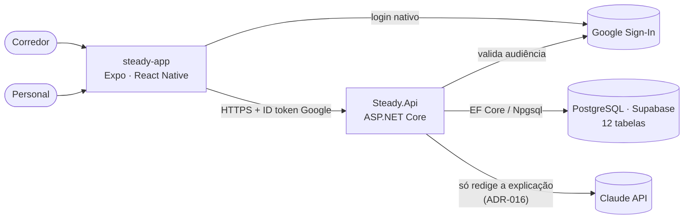
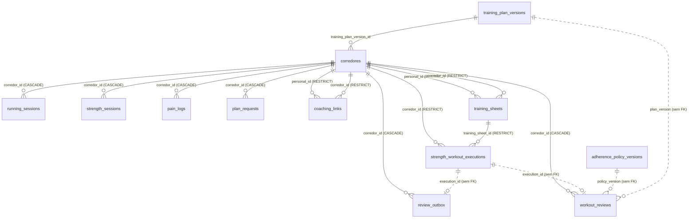
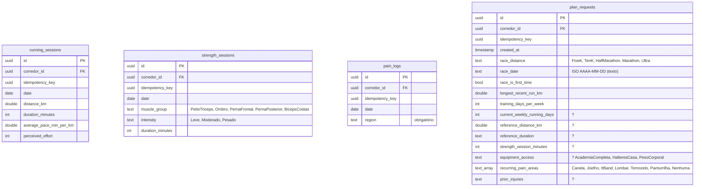
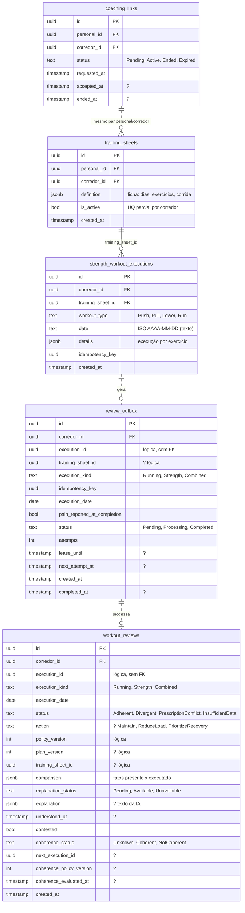
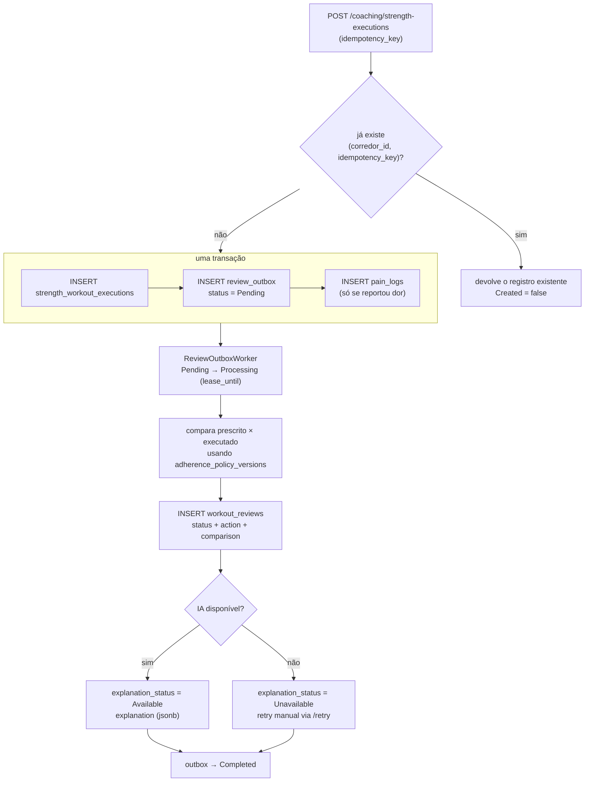
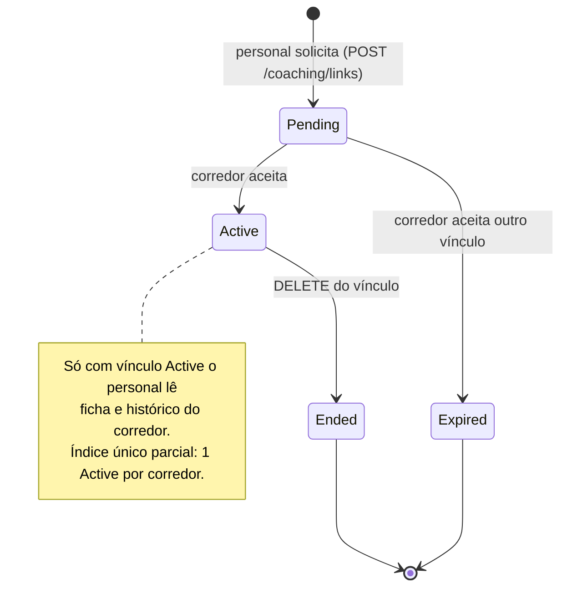
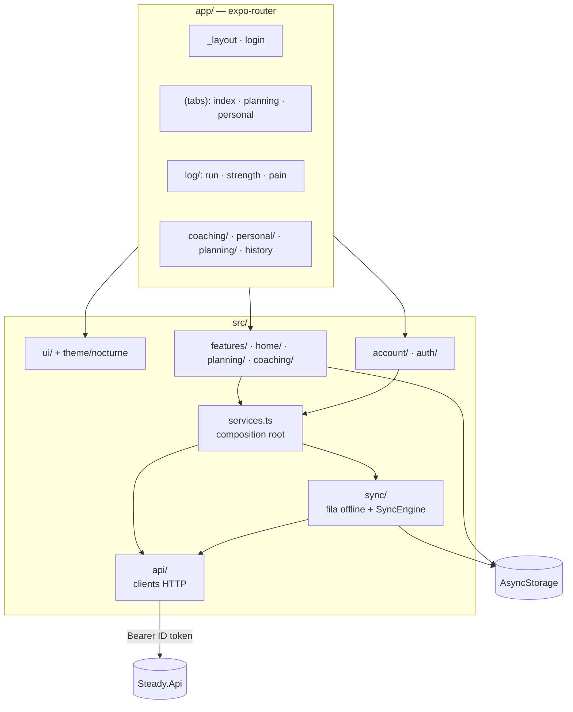
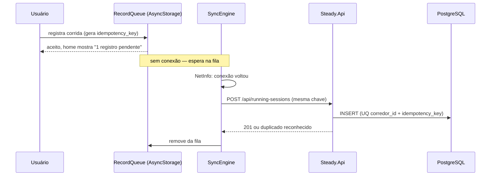
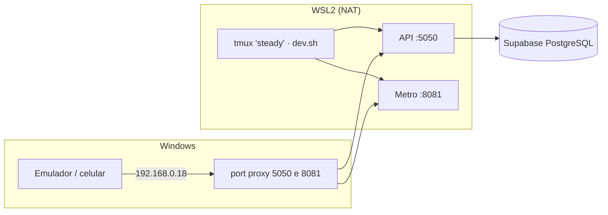

# Arquitetura do Steady

Fonte do esquema: `src/Steady.Infrastructure/Persistence/SteadyDbContext.cs` e as entidades ao lado. Decisões e justificativas vivem nos ADRs (`docs/adr/`).

## 1. Visão de contexto



## 2. Banco de dados — visão geral

12 tabelas em três grupos: **identidade e versões** (corredores, versões de plano e de política), **registros do corredor** (corridas, musculação, dor, pedidos de plano) e **coaching e revisão** (vínculo, ficha, execução, outbox, revisão).



Linha cheia = FK real no banco. Linha pontilhada = ligação lógica sem constraint (ver §4).

> `Corredor` é a conta de qualquer usuário. O personal também é uma linha em `corredores` com `roles` contendo `Personal` — por isso `coaching_links` e `training_sheets` apontam duas vezes para a mesma tabela (ADR-008).

## 3. Tabelas e colunas

Convenção: PK `id uuid`. Todas as colunas em `snake_case`. Enums gravados como texto. `PK` primary key · `FK` chave estrangeira · `UQ` índice único · `?` anulável.

### 3.1 Identidade e versões

```mermaid
erDiagram
    corredores {
        uuid id PK
        text google_sub UQ "identidade (ADR-002)"
        text email "cache, sem UQ"
        text name "cache, só exibição"
        text_array roles "default {Corredor}"
        uuid training_plan_version_id FK
        timestamp created_at
    }
    training_plan_versions {
        uuid id PK
        int version UQ
        jsonb definition "plano completo"
        bool is_current "UQ parcial: só uma TRUE"
        timestamp created_at
    }
    adherence_policy_versions {
        uuid id PK
        int version UQ
        decimal running_distance_percent "seed v1 = 0.10"
        decimal running_duration_percent "0.10"
        int perceived_effort_points "2"
        int sets_absolute "1"
        decimal repetitions_percent "0.20"
        decimal load_percent "0.10"
        bool is_current "UQ parcial: só uma TRUE"
        timestamp created_at
    }
    training_plan_versions ||--o{ corredores : fixa
```

| Tabela | Papel |
|---|---|
| `corredores` | Conta do usuário. A busca é sempre por `google_sub`; `email` e `name` são cache do Google, nunca identidade. `roles` é `text[]` provisionado administrativamente (nunca por endpoint público). `training_plan_version_id` fixa a versão do plano na criação — publicar versão nova não realoca quem já tem uma. |
| `training_plan_versions` | Versões **imutáveis** do plano do Steady (ADR-013). `definition` é o documento jsonb. Índice único parcial garante uma única `is_current`. |
| `adherence_policy_versions` | Tolerâncias usadas para dizer se o treino foi aderente (ADR-015). A v1 é semeada pela migration (`14000000-0000-0000-0000-000000000001`). |

### 3.2 Registros do corredor

Todas carregam `idempotency_key` com **índice único `(corredor_id, idempotency_key)`**: reenviar o mesmo registro offline nunca duplica a linha (ADR-003).



| Tabela | Observações |
|---|---|
| `running_sessions` | Corrida registrada. Imutável após gravada (Lei do Domínio #2). Também é gravada junto da musculação nos registros combinados. |
| `strength_sessions` | Musculação do fluxo livre (sem ficha de personal). |
| `pain_logs` | Dor por região e data. Também recebe linha automática quando uma execução é concluída com dor (`painReportedAtCompletion`). |
| `plan_requests` | Pedido de plano — o **Objetivo de Corrida** (`race_distance` + `race_date`) é obrigatório (Lei do Domínio #3). Data como texto ISO para `order by` honesto (ADR-007). Pedido imutável. |

### 3.3 Coaching, execução e revisão



| Tabela | Observações |
|---|---|
| `coaching_links` | Vínculo personal ↔ corredor. UQ parcial `corredor_id WHERE status='Active'` → no máximo **um vínculo ativo por corredor**. UQ parcial `(personal_id, corredor_id) WHERE status='Pending'` → sem solicitação pendente duplicada. |
| `training_sheets` | Ficha prescrita pelo personal. UQ parcial `corredor_id WHERE is_active` → **uma ficha ativa por corredor**; nova ficha desativa a anterior, nunca apaga (ADR-009). |
| `strength_workout_executions` | Execução da ficha — imutável (ADR-009). `details` guarda o realizado exercício a exercício. Índice `(corredor_id, training_sheet_id)` para o histórico. |
| `review_outbox` | Fila transacional: nasce **na mesma transação** da execução (ADR-018). `lease_until`/`next_attempt_at`/`attempts` controlam reserva e retentativa. UQ `(execution_kind, execution_id)` e `(corredor_id, idempotency_key)`. Índice `(status, next_attempt_at)` para o worker. |
| `workout_reviews` | Resultado da revisão. `status`/`action`/`comparison` são determinísticos; `explanation*` é a parte da IA e pode ficar `Unavailable` sem invalidar o resto (ADR-014). UQ `(execution_kind, execution_id)`; índice `(corredor_id, execution_date)`. |

## 4. Como as tabelas se comunicam

### 4.1 Integridade: o que o banco garante e o que é lógico

| Ligação | Tipo | Comportamento |
|---|---|---|
| `running_sessions`, `strength_sessions`, `pain_logs`, `plan_requests`, `review_outbox`, `workout_reviews` → `corredores` | FK `CASCADE` | Apagar o corredor leva junto os registros dele. |
| `coaching_links`, `training_sheets`, `strength_workout_executions` → `corredores` | FK `RESTRICT` | Não se apaga conta com vínculo, ficha ou execução: o histórico é preservado. |
| `strength_workout_executions` → `training_sheets` | FK `RESTRICT` | A execução sempre aponta para a ficha que a prescreveu. |
| `corredores` → `training_plan_versions` | FK `RESTRICT` | Uma versão de plano em uso não pode ser removida. |
| `review_outbox.execution_id` / `workout_reviews.execution_id` | **lógica** | `execution_kind` diz em qual tabela olhar: `Strength` e `Combined` → `strength_workout_executions.id`; `Running` → `running_sessions.id`. Como o alvo varia, não há FK. |
| `workout_reviews.policy_version` / `plan_version` | **lógica** | Guardam o **número** da versão aplicada na época, não o id — a revisão continua explicável mesmo se a versão corrente mudar (ADR-015). |
| `workout_reviews.training_sheet_id`, `review_outbox.training_sheet_id` | **lógica** | Sem FK; anulável (corrida solta não tem ficha). |

### 4.2 Quem escreve em quê

| Endpoint | Tabelas escritas | Detalhe |
|---|---|---|
| `POST /running-sessions` | `running_sessions`, `review_outbox` | Revisão nasce do registro (`RunningSessionRepository`). |
| `POST /strength-sessions` | `strength_sessions` | Fluxo livre, sem revisão. |
| `POST /pain-logs` | `pain_logs` | |
| `POST /plan-requests` | `plan_requests` | Idempotente por `(corredor_id, idempotency_key)`. |
| `POST /coaching/links` · `…/accept` · `DELETE …/{id}` | `coaching_links` | `Pending → Active → Ended`; também `Expired`. |
| `POST /coaching/runners/{id}/training-sheets` | `training_sheets` | Desativa a ficha ativa anterior e insere a nova. Exige vínculo `Active`. |
| `POST /coaching/strength-executions` | `strength_workout_executions`, `review_outbox`, `pain_logs` (se houve dor) | Uma transação. |
| `POST /coaching/combined-executions` | `strength_workout_executions`, `running_sessions`, `review_outbox`, `pain_logs` (se houve dor) | Uma transação; musculação e corrida compartilham a `idempotency_key`; `execution_kind = Combined`. |
| `POST /workout-reviews/{id}/retry · contest · understood` | `workout_reviews` | Atualiza `explanation_status`, `contested`, `understood_at`. |
| *(worker, a cada 2 s)* | `review_outbox`, `workout_reviews` | Consome a outbox e grava a revisão. |

Leituras: `GET /training-sessions`, `/overload-assessment`, `/coaching/runners/{id}/history` leem `running_sessions` + `strength_sessions` + `strength_workout_executions` + `pain_logs`; `GET /planning/steady-plan` lê `corredores` → `training_plan_versions`.

### 4.3 Isolamento de dados

Toda consulta de dado do corredor filtra por `corredor_id` derivado do `sub` do Google. O personal só alcança dados de um corredor se existir `coaching_links` com `status = 'Active'` entre os dois (ADR-002, ADR-008).

### 4.4 Fluxo de escrita de uma execução da ficha



### 4.5 Ciclo de vida do vínculo



## 5. Frontend (`src/steady-app`)



`services.ts` é o único lugar onde peças de plataforma (AsyncStorage, NetInfo, Google Sign-In) são ligadas; o resto é testável com Jest.

## 6. Registro offline-first



## 7. Ambiente de desenvolvimento



Roteiro completo em `CLAUDE.md` (Ambiente Local) e `docs/SETUP-LOGIN-GOOGLE.md`.

## 8. Mapa de ADRs

| Tema | ADRs |
|---|---|
| Fundação | 000 |
| Autenticação e isolamento | 002, 008 |
| Sincronização offline e idempotência | 003, 005 |
| Regras de domínio (sobrecarga, longão) | 001, 006 |
| Planejamento e versões do plano | 007, 012, 013 |
| Ficha e execução | 009, 010, 011, 019 |
| Revisão com IA, políticas, outbox | 014, 015, 016, 018 |
| Contrato e UI | 004, 017 |
