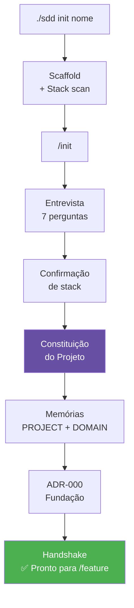

# Atualização da Apresentação — SDD Kit

> Este documento contém o conteúdo para atualizar o `sdd-kit-presentation.pptx`.
> Adicione os novos slides e atualize os existentes conforme indicado.

---

## Slides Novos — Inserir após o slide de "Workflow Completo"

---

### [NOVO SLIDE] — O Problema de Começar Sem Fundação

**Título:** "Todo projeto começa com uma conversa. Mas a conversa some."

**Corpo:**
> Você descreve o projeto para a IA. Ela gera código.  
> Na próxima sessão: contexto perdido. Princípios esquecidos. Decisões refeitas.

**Visual:** Diagrama mostrando o ciclo de perda de contexto (conversa → contexto perdido → retrabalho)

**Mensagem central:** O código pode ser versionado. O entendimento do projeto também pode.

---

### [NOVO SLIDE] — A Constituição do Projeto

**Título:** "Duas camadas de lei. Uma universal, uma específica."

**Corpo:**

| | `.sdd/CONSTITUTION.md` | `.sdd/PROJECT-CONSTITUTION.md` |
|--|--|--|
| **O que é** | Lei universal do SDD Kit | Lei específica deste projeto |
| **Quem cria** | Framework (fixo) | `/init` — gerado na fundação |
| **O que define** | Spec First, TDD, ADR | Domínio, riscos, técnicas, time |
| **Muda?** | Não | Emendas versionadas |

**Mensagem central:** A Constituição do projeto é o que diferencia este software de qualquer outro.

---

### [NOVO SLIDE] — O que a Constituição contém

**Título:** "Um contrato, não um manual."

**Corpo (lista com ícones):**

🎯 **Identidade** — Problema, usuário, tipo de produto, horizonte

⚖️ **Lei do Domínio** — Princípios específicos e falsificáveis
- *"Um pedido nunca é deletado — apenas cancelado com razão registrada"*
- *"Saldo nunca pode ser negativo sem autorização explícita de crédito"*

🛡️ **Mandatos de Qualidade** — Invioláveis / Críticos / Desejáveis

🔧 **Técnicas Prioritárias** — Patterns do PLAYBOOK calibrados para este contexto

🔗 **Integrações** — Fronteiras mapeadas com responsabilidade e risco

👥 **Acordos do Time** — Calibrado pelo perfil e experiência

**Mensagem central:** Específica o suficiente para orientar uma decisão. Curta o suficiente para ser lida em 2 minutos.

---

### [NOVO SLIDE] — O Comando `/init`

**Título:** "`/init` — a fundação antes do primeiro código"

**Corpo:**

```
./sdd init meu-projeto    ←  scaffolda estrutura + detecta stack

/init                     ←  entrevista estruturada (7 perguntas)
```

**O processo:**

1. **Entrevista** — Uma pergunta por vez: identidade, usuários, domínio, tipo, riscos, integrações, time
2. **Confirmação de stack** — Valida o que `./sdd scan` detectou
3. **Geração** — Constituição + PROJECT.md + DOMAIN.md + ADR-000
4. **Calibração** — config.json ajustado para os riscos reais
5. **Handshake** — Resumo e próximos passos

**Output:**
```
✅ .sdd/PROJECT-CONSTITUTION.md
✅ .sdd/memory/PROJECT.md
✅ .sdd/memory/DOMAIN.md
✅ docs/adr/ADR-000-foundation.md
```

---

### [NOVO SLIDE] — `/init` vs `/onboard`

**Título:** "Qual usar? Depende de onde você está."

**Corpo:**

| Situação | Comando | O que faz |
|----------|---------|-----------|
| Projeto novo, sem código ainda | `/init` | Entrevista → gera Constituição + memórias |
| Projeto com código adotando SDD Kit | `/onboard` | Lê código → infere → gera blueprint + domínio |

**Regra simples:**
> Se o código ainda não existe, use `/init`.  
> Se o código já existe, use `/onboard`.

**Ambos produzem:** PROJECT.md, DOMAIN.md, ADR-000 — mas por caminhos diferentes.

---

### [NOVO SLIDE] — A Constituição em Outros IDEs

**Título:** "Um processo, três IDEs."

**Corpo:**

| IDE | Como usar `/init` |
|-----|-----------------|
| **Claude Code** | `/init` — slash command nativo com entrevista interativa |
| **Cursor** | Abra `PROJECT-CONSTITUTION.md` → regra `init.mdc` ativa automaticamente |
| **GitHub Copilot** | Copie `.github/instructions/init.instructions.md` no chat |

**Mensagem central:** A Constituição gerada é a mesma, independentemente do assistente de IA usado.

---

## Slides Existentes — O que Atualizar

### Slide "Quick Start" / "Como Começar"

**Antes:**
```
./sdd init meu-projeto
./sdd new STORY-001
/feature
```

**Depois:**
```
./sdd init meu-projeto   ← scaffolda + detecta stack
/init                    ← entrevista → Constituição
./sdd new STORY-001
/feature
```

---

### Slide "Workflow" / "Pipeline"

Adicione uma fase **0 — Fundação** antes das fases existentes:

```
Fase 0: FUNDAÇÃO          → /init
Fase 1: STORY             → story.md + critérios
Fase 2: ARQUITETURA       → blueprint + ADR
Fase 3: SPEC              → spec.bdd.md + tasks
Fase 4: TDD               → RED → GREEN → REFACTOR
```

---

### Slide "Comandos"

Adicione `/init` à tabela de comandos:

| Comando | Quando usar |
|---------|-------------|
| `/init` | Início absoluto — projeto novo, sem código |
| `/onboard` | Projeto existente adotando SDD Kit |
| ... | ... |

---

### Slide "Estrutura de Arquivos"

Adicione ao `.sdd/`:

```diff
  .sdd/
  ├── CONSTITUTION.md            # Lei universal do framework
+ ├── PROJECT-CONSTITUTION.md    # Lei específica do projeto ← NOVO
  ├── PLAYBOOK.md
  ...
  └── templates/
+     └── project-constitution.md  ← NOVO
```

---

---

### Slide "Claude Code Hooks" — Atualizar tabela

**Antes (4 hooks):**

```
Evento              Hook                    O que faz
──────────────────────────────────────────────────────────────────────────
UserPromptSubmit    context-bootstrap       Injeta contexto do projeto (.sdd/memory/)
UserPromptSubmit    process-guard           Bloqueia /review se /sync pendente
UserPromptSubmit    model-advisor           Recomenda modelo ideal por comando
Stop                session-healthcheck     Auditoria silenciosa pós-resposta
```

**Depois (6 hooks):**

```
Evento              Hook                    O que faz
──────────────────────────────────────────────────────────────────────────
UserPromptSubmit    session-tracker         Registra início de sessão e turno
UserPromptSubmit    context-bootstrap       Injeta contexto do projeto (.sdd/memory/)
UserPromptSubmit    process-guard           Bloqueia /review se /sync pendente
UserPromptSubmit    model-advisor           Recomenda modelo ideal por comando
Stop                session-healthcheck     Auditoria silenciosa pós-resposta
Stop                retro-logger            Persiste métricas em .sdd/metrics/sessions/
```

---

### [NOVO SLIDE] — Métricas de Execução

**Título:** "O harness não só guia — ele observa."

**Corpo:**

O par `session-tracker` + `retro-logger` fecha o ciclo de observabilidade da sessão:

| Hook | Evento | O que captura |
| --- | --- | --- |
| `session-tracker` | `UserPromptSubmit` | Início de sessão (timeout 30 min) + epoch do turno |
| `retro-logger` | `Stop` | Duração, decisões, erros — persiste em `.sdd/metrics/` |

**O que fica registrado automaticamente:**

```md
### Turno 14:32:10
- Comando: `/spec`
- Duração: 2m 15s | Sessão: 2m 15s total
- Decisões:
  - Spec: specs/STORY-001/spec.bdd.md
```

**Mensagem central:** Cada turno com comando SDD responde: quanto tempo rodei? Que decisões tomei? Que erros aconteceram?

---

### [NOVO SLIDE] — Retrospectiva Automática

**Título:** "Erros não somem. Ficam registrados."

**Corpo:**

Quando o agente detecta um desvio de processo, o `retro-logger` persiste o evento antes de encerrar a resposta:

```text
╔══ SDD Retro ══════════════════════════════════════════════════╗
  /implement → 3m 42s | sessão: 3m 42s
  Erros:
  - process-violation: /implement sem spec BDD (STORY-003)
  Log: .sdd/metrics/sessions/2026-05-06.md
╚═══════════════════════════════════════════════════════════════╝
```

**Tipos de evento registrados:**

- Decisões: ADRs criados, specs BDD geradas, discovery decisions
- Erros: `/implement` sem spec BDD

**Mensagem central:** O log de sessão vira um diário de bordo do desenvolvimento — sem esforço manual.

---

## Diagrama sugerido — Fluxo do `/init`

Para criar um novo SVG em `docs/diagrams/init-flow.svg`:


