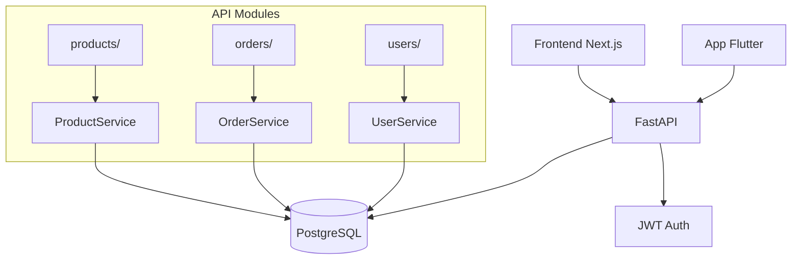
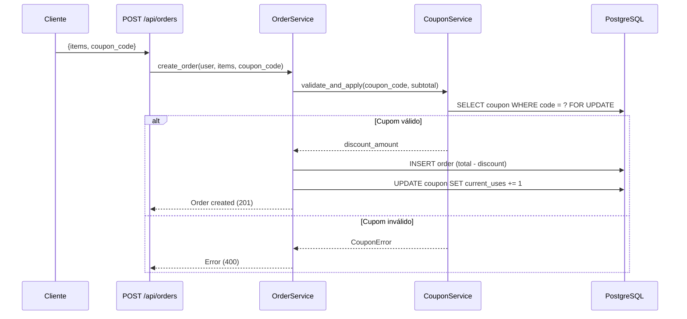

# SDD Kit na prática — Walkthrough completo

> Este documento mostra o workflow SDD Kit de ponta a ponta usando um exemplo real:
> adicionar um sistema de cupons de desconto a uma API de e-commerce existente.

---

## O cenário

Você é um Engineer & QA numa consultoria. O cliente tem uma API de e-commerce em **FastAPI + SQLAlchemy + PostgreSQL** e precisa de um sistema de cupons de desconto. A API já tem endpoints de pedidos, produtos e usuários.

Você acabou de receber acesso ao repositório. Nunca viu o código antes.

---

## Passo 0 — Setup do SDD Kit

```bash
# Copie o SDD Kit para o projeto existente
cp -r sdd-kit-template/.sdd .sdd
cp sdd-kit-template/sdd ./sdd
cp sdd-kit-template/CLAUDE.md .
cp -r sdd-kit-template/.claude .claude
cp -r sdd-kit-template/.cursor .cursor
chmod +x sdd

# Inicialize
./sdd init ecommerce-api
```

O CLI detecta o `requirements.txt` e roda o scan automaticamente:

```
✓ Projeto ecommerce-api inicializado
  Fonte de código detectada — executando scan...

Scanning...

  Stack detectada:

  Linguagem:       python
  Framework:       FastAPI
  Test runner:     pytest
  Banco de dados:  PostgreSQL
  UI Library:      —
  ORM:             SQLAlchemy
  Package manager: poetry
  Monorepo:        Não

✓ .sdd/STACK.md gerado com convenções da stack
✓ .sdd/config.json atualizado

  Código fonte detectado. Para completar o onboarding:
  No Claude Code: /onboard
```

---

## Passo 1 — Onboarding (`/onboard`)

É a primeira vez no projeto. Rodamos `/onboard` para entender o que existe.

### Input

```
/onboard
```

### O que o agente faz

1. Lê a estrutura de pastas e os arquivos principais
2. Identifica models, routers, services
3. Mapeia as dependências e integrações

### Output — PROJECT.md (preenchido)

```markdown
# Memória do Projeto

## Identificação
- **Projeto**: E-commerce API
- **Cliente**: FastShop

## Contexto
API backend de um e-commerce de eletrônicos. Gerencia catálogo,
pedidos e usuários. Serve um frontend Next.js e um app mobile Flutter.

## Glossário
| Termo | Significado |
|-------|-------------|
| Order | Pedido do cliente, com items e total |
| Product | Produto do catálogo |
| OrderItem | Linha do pedido: produto + quantidade + preço unitário |
| User | Cliente autenticado via JWT |
```

### Output — Blueprint (current-architecture.mermaid)



### Output — ADR-000

```markdown
# ADR-000: Estado atual

## Stack
Python 3.12, FastAPI 0.104, SQLAlchemy 2.0, PostgreSQL 16, pytest

## Padrões em uso
- Router → Service → Repository (3 camadas)
- Pydantic models para request/response
- Alembic para migrations
- Dependency injection via Depends()

## Decisões implícitas
- Auth via JWT middleware em todas as rotas protegidas
- Total do pedido é calculado no OrderService, não no banco
- Sem cache — queries diretas ao PostgreSQL
```

### Output — DOMAIN.md

```markdown
# Domínio

## Entidades
| Entidade | Campos principais |
|----------|------------------|
| User | id, email, name, hashed_password |
| Product | id, name, price, stock |
| Order | id, user_id, total, status, created_at |
| OrderItem | id, order_id, product_id, quantity, unit_price |

## Fluxos principais
1. Cadastro → Login → JWT
2. Listagem de produtos → Detalhes
3. Adicionar ao carrinho → Criar pedido → Calcular total

## Fronteiras externas
| Tipo | Nome | Descrição |
|------|------|-----------|
| Consumidor | Frontend Next.js | SPA do e-commerce |
| Consumidor | App Flutter | App mobile |
| Banco | PostgreSQL | Persistência principal |
```

**Gate**: O agente apresenta cada artefato e pede confirmação. Só avança após "OK".

---

## Passo 2 — Análise da feature (`/analyze`)

Antes de planejar o cupom de desconto, analisamos o código existente para entender como o desconto deve se encaixar.

### Input

```
/analyze
"Precisamos de um sistema de cupons de desconto. O cupom tem código,
tipo (percentual ou valor fixo), valor, data de expiração, e limite
de usos. O desconto é aplicado no momento de criar o pedido."
```

### O que o agente faz

1. Identifica as keywords: "cupom", "desconto", "pedido", "criar pedido"
2. Navega até `orders/service.py`, `orders/router.py`, `orders/models.py`
3. Lê como o `OrderService.create_order()` calcula o total
4. Verifica se já existe algum conceito de desconto

### Output — analysis.md

```markdown
# Análise: Sistema de cupons de desconto

## 1. Scan de código relevante

### Módulos afetados
- `orders/service.py` — OrderService.create_order() calcula o total
- `orders/router.py` — POST /api/orders aceita {items: [...]}
- `orders/schemas.py` — CreateOrderRequest não tem campo de cupom
- `orders/models.py` — Order model não tem campo discount

### Padrões em uso na área
- Service layer com injeção via Depends()
- Pydantic schemas para validação
- SQLAlchemy models com Alembic migrations

### Código atual de cálculo de total
```python
# orders/service.py (simplificado)
def create_order(self, user_id: str, items: list[OrderItemInput]):
    total = sum(item.quantity * product.price for item, product in validated_items)
    order = Order(user_id=user_id, total=total, status="pending")
    # ... persiste
```

## 2. Análise de domínio

### Conceitos existentes
- Order tem total calculado na criação
- OrderItem tem unit_price congelado no momento da compra

### Conceitos novos
- **Coupon**: entidade nova (code, type, value, expires_at, max_uses, current_uses)
- **Discount**: valor calculado a partir do cupom, aplicado ao total
- Order precisa de campo `discount_amount` e `coupon_id`

### Regras de negócio
- Cupom percentual: desconto = total * (value / 100)
- Cupom valor fixo: desconto = min(value, total) — não pode ficar negativo
- Cupom expirado não é aceito
- Cupom com max_uses atingido não é aceito
- Um cupom por pedido

## 3. Direção estratégica

### Abordagem
- Novo módulo `coupons/` seguindo o padrão existente (router → service → repository)
- Estender `OrderService.create_order()` para aceitar coupon_code opcional
- Migration para: tabela `coupons` + campos `discount_amount` e `coupon_id` em `orders`

### Padrão
- Strategy não é necessário — dois tipos de cupom resolvem com if/else simples (KISS)
- Se no futuro aparecerem mais tipos, extrair para Strategy (regra de três do DRY)

### Fronteiras
- **Dentro**: CRUD de cupom, validação, aplicação no pedido, cálculo
- **Fora**: campanha de marketing, geração automática de códigos, cupom por produto

## 4. Riscos e edge cases

- **Race condition**: dois pedidos simultâneos usando o último uso do cupom
  → Mitigação: verificação atômica no banco (SELECT FOR UPDATE)
- **Desconto maior que total**: cupom de R$50 em pedido de R$30
  → Regra: desconto limitado ao total (pedido nunca fica negativo)
- **Cupom + frete**: o desconto se aplica ao subtotal, não ao frete
  → Decisão necessária: confirmar com PO
```

**Gate**: "Análise OK? A direção estratégica faz sentido? Posso avançar?"

---

## Passo 3 — Feature completa (`/feature`)

Com a análise aprovada, rodamos o pipeline completo.

### Input

```
/feature
"Sistema de cupons de desconto conforme análise em specs/STORY-015/analysis.md"
```

### Fase 1 — Story (gate 1)

O agente cria `specs/STORY-015/story.md`:

```markdown
# Story: STORY-015 — Sistema de cupons de desconto

Como administrador do e-commerce,
Quero criar cupons de desconto com código, tipo e validade,
Para que clientes apliquem descontos ao finalizar pedidos.

## Critérios de Aceite
- Cupom pode ser percentual ou valor fixo
- Cupom tem data de expiração e limite de usos
- Desconto é aplicado ao criar pedido informando o código
- Cupom expirado ou esgotado retorna erro
- Desconto nunca excede o total do pedido
- Um cupom por pedido
```

> **Gate 1**: "Critérios OK? Posso avançar para instrumentação?"
> **Dev**: "OK, avança."

### Fase 2 — Blueprint + ADR (gate 2)

O agente cria o blueprint:



E um ADR:

```markdown
# ADR-001: Cupons como módulo separado com validação atômica

## Contexto
Precisamos adicionar desconto por cupom ao fluxo de pedidos.

## Decisão
Módulo `coupons/` independente. Validação atômica com SELECT FOR UPDATE
para evitar race condition no limite de usos.

## Consequências
- (+) Isolamento: cupons não poluem o OrderService
- (+) Race condition resolvida no banco
- (-) Lock pessimista pode impactar throughput em alta concorrência
- Mitigação: aceitável para o volume atual (< 100 pedidos/min)
```

> **Gate 2**: "Arquitetura OK? Posso gerar a spec BDD?"
> **Dev**: "OK."

### Fase 3 — Spec BDD (gate 3)

O agente gera `specs/STORY-015/spec.bdd.md`:

```gherkin
Feature: Cupons de desconto

  # ── Happy Path ──

  Scenario: Aplicar cupom percentual válido
    Given um cupom "SAVE10" tipo percentual valor 10%, expira em 2025-12-31, max_uses 100
    And um cliente autenticado com pedido de subtotal R$200,00
    When ele cria o pedido com coupon_code "SAVE10"
    Then o desconto é R$20,00
    And o total do pedido é R$180,00
    And o cupom tem current_uses incrementado em 1

  Scenario: Aplicar cupom valor fixo válido
    Given um cupom "FLAT50" tipo fixo valor R$50,00
    And um cliente com pedido de subtotal R$200,00
    When ele cria o pedido com coupon_code "FLAT50"
    Then o desconto é R$50,00
    And o total é R$150,00

  Scenario: Pedido sem cupom
    Given um cliente com pedido de subtotal R$200,00
    When ele cria o pedido sem coupon_code
    Then o desconto é R$0,00
    And o total é R$200,00

  # ── Edge Cases ──

  Scenario: Cupom fixo maior que o total
    Given um cupom "FLAT50" tipo fixo valor R$50,00
    And um cliente com pedido de subtotal R$30,00
    When ele cria o pedido com coupon_code "FLAT50"
    Then o desconto é R$30,00
    And o total é R$0,00

  # ── Error Cases ──

  Scenario: Cupom expirado
    Given um cupom "OLD" com expires_at no passado
    When o cliente tenta usar o cupom
    Then recebe erro 400 "Cupom expirado"

  Scenario: Cupom com usos esgotados
    Given um cupom "LIMIT" com max_uses 1 e current_uses 1
    When o cliente tenta usar o cupom
    Then recebe erro 400 "Cupom esgotado"

  Scenario: Cupom inexistente
    When o cliente usa coupon_code "FAKE"
    Then recebe erro 400 "Cupom não encontrado"
```

> **Gate 3**: "Spec e tasks OK? Posso implementar?"
> **Dev**: "O cenário de cupom fixo maior que total: o resultado deveria ser R$0 ou devemos barrar? Vou confirmar com PO."
> *(Dev confirma: R$0 está correto, o pedido pode ter total zero)*
> **Dev**: "OK, avança."

### Fase 4 — TDD

O agente implementa cenário por cenário:

#### Cenário 1: Cupom percentual (RED → GREEN → REFACTOR)

**RED** — escreve o teste:

```python
# tests/test_coupon_service.py

def test_apply_percentage_coupon(db_session):
    # Arrange (Given)
    coupon = create_coupon(
        code="SAVE10", type="percentage", value=10,
        expires_at=date(2025, 12, 31), max_uses=100
    )
    subtotal = Decimal("200.00")

    # Act (When)
    result = coupon_service.validate_and_apply("SAVE10", subtotal)

    # Assert (Then)
    assert result.discount == Decimal("20.00")
    assert coupon.current_uses == 1
```

Executa: ❌ **FALHA** — `coupon_service` não existe. Correto.

**GREEN** — implementação mínima (KISS):

```python
# coupons/service.py

class CouponService:
    def __init__(self, session: Session):
        self.session = session

    def validate_and_apply(self, code: str, subtotal: Decimal) -> CouponResult:
        coupon = self.session.query(Coupon).filter_by(code=code).first()
        if not coupon:
            raise CouponNotFoundError(code)
        if coupon.expires_at < date.today():
            raise CouponExpiredError(code)
        if coupon.current_uses >= coupon.max_uses:
            raise CouponExhaustedError(code)

        if coupon.type == "percentage":
            discount = subtotal * (coupon.value / 100)
        else:
            discount = min(coupon.value, subtotal)

        coupon.current_uses += 1
        return CouponResult(discount=discount, coupon_id=coupon.id)
```

Executa: ✅ **PASSA**.

**REFACTOR** — aplica SOLID:

```python
# Extrair validação (SRP)
# CouponValidator separado do CouponService
# Erros tipados já estão bons (CouponNotFoundError, etc.)
# O if/else para tipo é simples — KISS diz: não extrair para Strategy ainda (só 2 tipos)
```

Executa: ✅ Todos os testes passam.

O agente repete RED → GREEN → REFACTOR para cada cenário, atualizando o mapping na spec.

---

## Passo 4 — Review (`/review`)

Após todos os cenários verdes:

```
/review STORY-015
```

O agente gera o relatório:

```
Review — STORY-015

✅ Código
  ✓ KISS — if/else para 2 tipos, sem over-engineering
  ✓ SRP — CouponService valida e aplica, CouponValidator extraído
  ✓ DRY — sem duplicação
  ✓ Nenhum anti-pattern detectado

✅ Testes
  ✓ 7/7 cenários BDD com teste correspondente
  ✓ Testes descrevem comportamento
  ✓ Fixtures com _meta
  ✓ Fronteiras testadas (cupom > total, usos = max)

✅ Error handling
  ✓ Inputs validados via Pydantic
  ✓ Erros tipados (CouponNotFoundError, etc.)
  ✓ Mensagens de erro úteis

✅ Segurança
  ✓ SELECT FOR UPDATE contra race condition
  ✓ Nenhum secret no código
  ✓ Queries via SQLAlchemy (parametrizadas)

✅ Processo
  ✓ ADR-001 criado
  ✓ Blueprint atualizado
  ✓ Conventional commits
```

---

## Passo 5 — Sync (`/sync`)

Uma semana depois, durante o PR review, o time decidiu renomear `CouponResult` para `DiscountResult` e extrair a lógica de cálculo para um módulo `coupons/calculator.py`. O refactor foi feito, os testes passam, mas a spec ainda referencia os nomes antigos.

```
/sync STORY-015
```

```
Sync Report — STORY-015

Direção: Código → Spec

Divergências encontradas:
  [RENAME] CouponResult → DiscountResult (spec referencia nome antigo)
  [MOVE]   Lógica de cálculo movida para coupons/calculator.py
  [OK]     Todos os cenários BDD ainda correspondem ao comportamento
  [OK]     Blueprint sem mudança estrutural

Artefatos a atualizar:
  • specs/STORY-015/spec.bdd.md — atualizar mapping cenário→teste
  • specs/STORY-015/analysis.md — atualizar referência de módulos

Prosseguir com a sincronização?
```

Após confirmação, a spec é atualizada e spec ↔ código voltam a contar a mesma história.

---

## Resumo do workflow

```
./sdd init           Detecta stack, gera STACK.md
         ↓
    /onboard         Entende o projeto: blueprint + domínio + ADR-000
         ↓
    /analyze         Analisa código relevante antes de planejar
         ↓
    /feature         Pipeline: Story → Blueprint → Spec BDD → TDD
         ↓
    /review          Valida: código vs spec, anti-patterns, segurança
         ↓
    /sync            Mantém spec ↔ código sincronizados ao longo do tempo
```

Cada passo produz artefatos em `specs/` que o próximo passo consome. Nenhum planejamento existe apenas na conversa. Tudo é persistido, versionado e rastreável.

---

## Artefatos gerados neste walkthrough

```
specs/STORY-015/
├── analysis.md            ← /analyze
├── story.md               ← /feature (fase 1)
├── blueprint.mermaid      ← /feature (fase 2)
├── spec.bdd.md            ← /feature (fase 3)
└── tasks.md               ← /feature (fase 3)

docs/adr/
├── ADR-000-estado-atual.md  ← /onboard
└── ADR-001-cupons-modulo-separado.md  ← /feature (fase 2)

docs/blueprints/
└── current-architecture.mermaid  ← /onboard

.sdd/memory/
├── PROJECT.md             ← /onboard (preenchido)
├── DOMAIN.md              ← /onboard (preenchido)
└── DECISIONS.md           ← atualizado com ADR-000 e ADR-001

tests/
├── test_coupon_service.py ← /feature (fase 4 — TDD)
└── fixtures/
    └── coupon_fixtures.json

src/coupons/
├── models.py
├── schemas.py
├── service.py
├── calculator.py          ← refactor pós-review
├── validator.py           ← refactor pós-TDD
└── router.py
```
