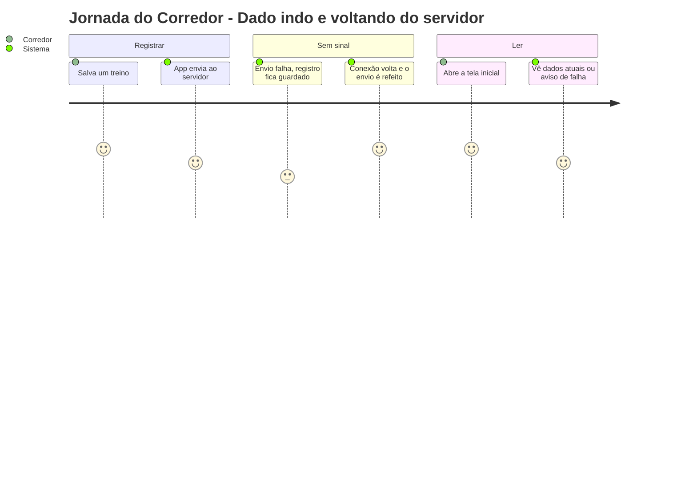
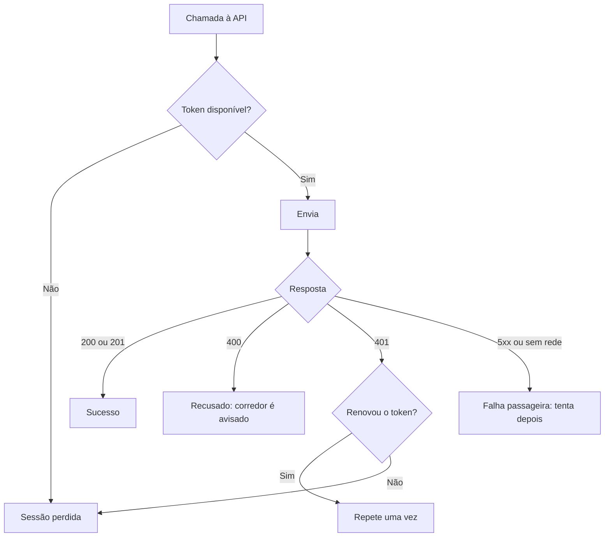

# Comunicação com a API - Integração - Regras de Negócio

## Índice

- [1. Resumo da Funcionalidade](#1-resumo-da-funcionalidade)
- [2. Jornada do Usuário](#2-jornada-do-usuário)
- [3. Regras de Negócio por Funcionalidade](#3-regras-de-negócio-por-funcionalidade)
- [4. Validações e Restrições](#4-validações-e-restrições)
- [5. Fluxos de Processo](#5-fluxos-de-processo)
- [6. Casos de Uso e Cenários](#6-casos-de-uso-e-cenários)

## 1. Resumo da Funcionalidade

**Propósito**: garantir que o que o corredor registra chegue ao servidor sem duplicar, e que o que ele lê seja sempre o dado atual.
**Usuários**: corredores e personais (de forma transparente).
**Valor de Negócio**: confiança no histórico e na avaliação de sobrecarga.
**Frequência de Uso**: a cada registro e a cada abertura de tela com dados.
**Impacto Operacional**: define o que é "guardado", "pendente" e "recusado" para o corredor.

## 2. Jornada do Usuário

### Pontos de Contato

- Nenhuma tela própria; a comunicação aparece como "registro pendente", "não consegui ler" e mensagens de recusa.

## 3. Regras de Negócio por Funcionalidade

### 3.1. Envio de registros

**O que faz**: manda corridas, musculações, dores, execuções de ficha e pedidos de plano ao servidor.

**Regras Aplicadas**:

- **Reenvio não duplica**: cada registro tem uma chave própria, repetida em toda tentativa.
- **Recusa definitiva é diferente de falha passageira**: o servidor recusando o conteúdo (400) retira o item da fila e o corredor é informado; falha de rede ou do servidor mantém o item para nova tentativa.
- **Sessão expirada é renovada sozinha** uma vez; se não resolver, o corredor é levado ao login sem perder a fila.

### 3.2. Leitura de dados

**O que faz**: traz avaliação de sobrecarga, histórico, pedidos de plano, ficha, vínculos e revisões.

**Regras Aplicadas**:

- **Leitura é sempre online**: uma avaliação de sobrecarga antiga seria pior que nenhuma, então ela não é guardada.
- **"Reunindo dados" não é "sem risco"**: histórico insuficiente tem estado próprio (ADR-004).
- **O app só exibe**: quem decide risco é o servidor.
- **Falha de leitura nunca vira lista vazia**: a tela diz que não conseguiu ler.

## 4. Validações e Restrições

### Controle de Acesso

- Toda chamada leva o token do Google; sem token válido nada é lido nem enviado.

### Dados e Entrada

- **Formatos Aceitos**: o corpo de erro da API é `{ "error": "texto" }`; sem ele, o app usa uma mensagem genérica.

### Restrições do Sistema

- **Dependências**: API no ar e alcançável pelo IP configurado em `EXPO_PUBLIC_API_URL`.

## 5. Fluxos de Processo

## 6. Casos de Uso e Cenários

### Caso de Uso 1: Registro com token vencido

**Ator Principal**: corredor
**Objetivo**: salvar um treino
**Pré-condições**: token do Google com mais de 1 h

**Fluxo Principal**:

1. O app envia e recebe 401.
2. Renova o token em silêncio e repete a chamada.
3. O servidor aceita; o item sai da fila.

**Pós-condições**: treino gravado uma única vez.

### Matriz de Cenários

| Cenário | Entrada | Ação do Sistema | Resultado Esperado |
| --- | --- | --- | --- |
| Registro aceito | 201 | Remove da fila | Registro guardado no servidor |
| Reenvio reconhecido | 200 com mesma chave | Trata como sucesso | Sem duplicata |
| Conteúdo recusado | 400 com mensagem | Remove da fila e informa | Corredor vê a mensagem |
| Servidor em falha | 5xx | Mantém na fila | Aparece como pendente |
| Sem rede | exceção de transporte | Mantém na fila | Aparece como pendente |
| Token vencido | 401 e renovação ok | Repete uma vez | Sucesso sem o corredor perceber |
| Sessão perdida | 401 e renovação falha | Para o ciclo, fila intacta | Vai ao login |
| Histórico insuficiente | `hasSufficientHistory` falso | Estado "reunindo dados" | Não afirma "sem risco" |
| Corpo de leitura inesperado | Lista que não é lista | Devolve vazio | Tela não quebra |
