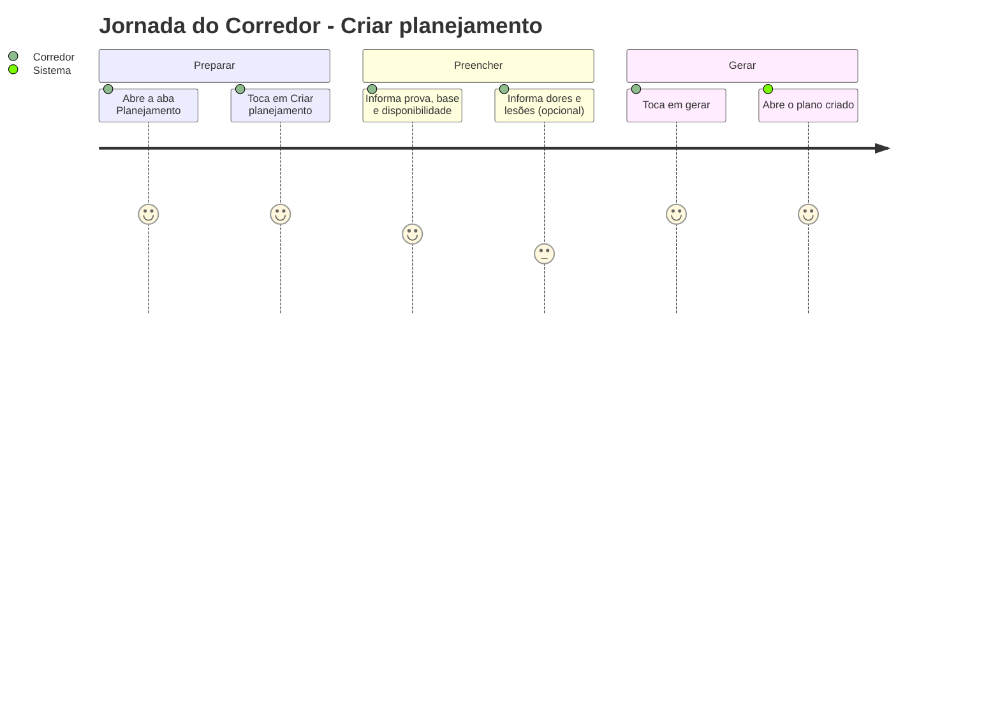
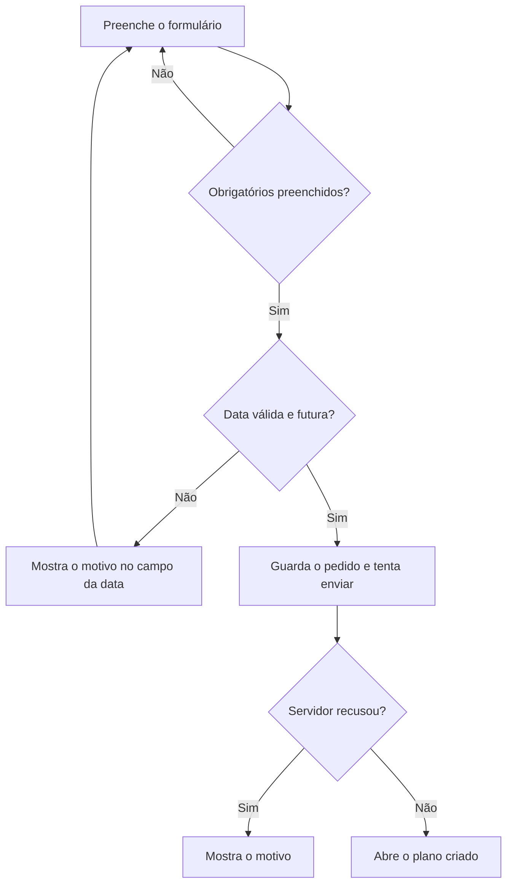

# Criar Planejamento - Planejamento - Regras de Negócio

## Índice

- [1. Resumo da Funcionalidade](#1-resumo-da-funcionalidade)
- [2. Jornada do Usuário](#2-jornada-do-usuário)
- [3. Regras de Negócio por Funcionalidade](#3-regras-de-negócio-por-funcionalidade)
- [4. Validações e Restrições](#4-validações-e-restrições)
- [5. Fluxos de Processo](#5-fluxos-de-processo)
- [6. Casos de Uso e Cenários](#6-casos-de-uso-e-cenários)

## 1. Resumo da Funcionalidade

**Propósito**: o corredor informa a prova que quer correr e seu ponto de partida, e passa a ter um planejamento ligado a essa meta.
**Usuários**: corredores.
**Valor de Negócio**: a meta (distância e data) origina todo plano (Lei do Domínio #3) e define a semana e a fase mostradas ao corredor.
**Frequência de Uso**: ao começar uma preparação e quando muda de meta.
**Impacto Operacional**: cada pedido é guardado e nunca editado; um novo pedido vira o plano ativo.

## 2. Jornada do Usuário

### Pontos de Contato

- Aba **Planejamento**, formulário **Criar planejamento** e o documento do plano.

## 3. Regras de Negócio por Funcionalidade

### 3.1. Informar a prova

**Regras Aplicadas**:

- **Distância e data são obrigatórias**: sem meta não existe plano.
- A data é digitada como dd/mm/aaaa e o app coloca as barras sozinho.
- A data precisa existir no calendário e ser **futura** (hoje não vale).
- É possível marcar que será a primeira prova.

### 3.2. Base atual e disponibilidade

**Regras Aplicadas**:

- **Obrigatórios**: maior corrida recente (km) e dias de treino por semana (3 a 6).
- **Opcional**: corridas por semana hoje. Em branco é ausência, não zero.
- Os campos de tempo de referência, sessão de força, equipamento e dias preferidos **não estão disponíveis no formulário atual**.

### 3.3. Histórico de saúde (opcional)

**Regras Aplicadas**:

- Dores recorrentes (canela, joelho, IT band, lombar, tornozelo, panturrilha ou nenhuma) e lesões anteriores em texto livre.
- São dados de saúde: ficam ligados à conta do corredor e não são vistos por outros.

### 3.4. Depois de gerar

**Regras Aplicadas**:

- O pedido é guardado antes de qualquer rede; o plano abre mesmo sem conexão.
- Cada "gerar" cria um pedido novo; os anteriores continuam na lista como "Anterior".
- O pedido mais recente é o **Ativo** e decide a semana e a fase do cabeçalho.
- O plano mostrado é sempre o mesmo documento do Steady; o formulário não o personaliza nesta versão.

### 3.5. Lista e vínculo com o personal

**Regras Aplicadas**:

- A lista vem do servidor; itens ainda não enviados aparecem como **Pendente**.
- Se a leitura falha, o app avisa e mostra só o que está neste aparelho; nunca diz "nenhum planejamento" por engano.
- Solicitações de vínculo do personal aparecem na aba e só valem se o corredor aceitar.
- O corredor pode encerrar o vínculo ativo a qualquer momento.

## 4. Validações e Restrições

### Controle de Acesso

- O corredor vê e cria só os próprios pedidos.

### Dados e Entrada

- **Dados Obrigatórios**: distância, data da prova, maior corrida recente, dias por semana.
- **Formatos Aceitos**: data dd/mm/aaaa; números com vírgula ou ponto.

### Restrições do Sistema

- **Dependências**: nenhuma conexão para criar; precisa de conexão para ver a versão do servidor.

## 5. Fluxos de Processo

## 6. Casos de Uso e Cenários

### Caso de Uso 1: Criar o primeiro planejamento

**Ator Principal**: corredor
**Objetivo**: ter um plano para a maratona
**Pré-condições**: logado

**Fluxo Principal**:

1. Abre Planejamento e toca em "Criar planejamento".
2. Escolhe 42km, digita a data da prova e a maior corrida recente.
3. Escolhe os dias por semana e gera.
4. O plano abre; a aba lista o pedido como Ativo.

**Pós-condições**: pedido guardado e ligado à conta.

### Matriz de Cenários

| Cenário | Entrada | Ação do Sistema | Resultado Esperado |
| --- | --- | --- | --- |
| Gerar com dados mínimos | Distância, data, maior corrida, dias | Guarda e abre o plano | Plano aberto |
| Data com formato errado | "17/5/27" | Recusa no campo | "Use o formato dd/mm/aaaa." |
| Data que não existe | 31/02/2027 | Recusa no campo | "Essa data não existe no calendário." |
| Data passada ou hoje | Hoje ou antes | Recusa no campo | "A prova precisa ser numa data futura." |
| Gerar sem conexão | Offline | Guarda como pendente e abre o plano | Lista mostra "Pendente" |
| Segundo planejamento | Novo pedido | Vira o Ativo | O anterior fica "Anterior" |
| Falha ao listar | Servidor fora | Aviso e só o local | Não diz "nenhum planejamento" |
| Aceitar vínculo | Toca em Aceitar | Chama o servidor | Mensagem de vínculo aceito |
| Conflito ao aceitar vínculo | Já há vínculo ativo | Mostra a mensagem do servidor | Corredor entende o motivo |
| Campo opcional com texto inválido | "3x" em corridas por semana | Trata como ausente | Ver débitos: o corredor não é avisado |
