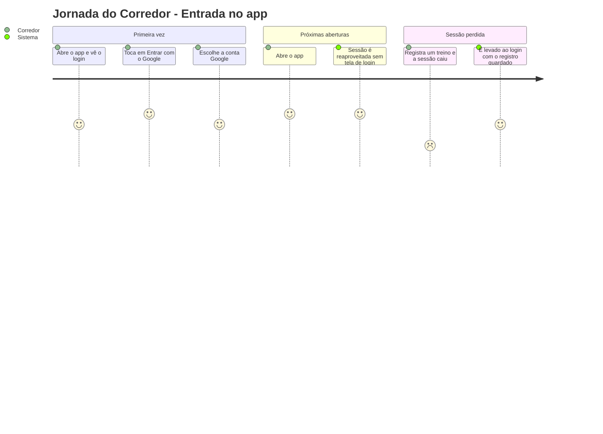
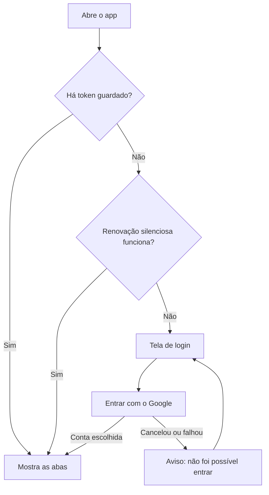

# Entrada e Sessão - Autenticação - Regras de Negócio

## Índice

- [1. Resumo da Funcionalidade](#1-resumo-da-funcionalidade)
- [2. Jornada do Usuário](#2-jornada-do-usuário)
- [3. Regras de Negócio por Funcionalidade](#3-regras-de-negócio-por-funcionalidade)
- [4. Validações e Restrições](#4-validações-e-restrições)
- [5. Fluxos de Processo](#5-fluxos-de-processo)
- [6. Casos de Uso e Cenários](#6-casos-de-uso-e-cenários)

## 1. Resumo da Funcionalidade

**Propósito**: garantir que cada corredor entre no app com a própria conta Google e que seus dados fiquem ligados a ela, sem o app guardar senha.
**Usuários**: corredores e personais (ambos entram pelo mesmo login).
**Valor de Negócio**: isolamento dos dados de saúde por pessoa, que é um mandato inviolável do projeto.
**Frequência de Uso**: uma vez por instalação; depois, a sessão é reaproveitada a cada abertura.
**Impacto Operacional**: sem login válido nenhum dado é lido ou enviado; registros pendentes ficam guardados até a sessão voltar.

## 2. Jornada do Usuário

### Pontos de Contato

- **Tela de login**: texto de apresentação, botão "Entrar com o Google" e avisos de configuração ou falha.
- **Carregamento inicial**: indicador de progresso enquanto o app confere a sessão.

## 3. Regras de Negócio por Funcionalidade

### 3.1. Entrar com o Google

**O que faz**: leva o corredor a escolher uma conta Google e entra no app.

**Regras Aplicadas**:

- **Só Google**: não existe cadastro nem senha própria.
- **Quem já entrou não vê o login de novo**: a abertura tenta reaproveitar a sessão antes de mostrar qualquer tela.
- **Troca de conta**: um login interativo pode ser de outra conta; a ficha em cache da conta anterior é apagada antes do login.
- **Login não configurado**: se o app foi gerado sem o Client ID do Google, a tela avisa e bloqueia o botão em vez de falhar em silêncio.

**Cenários de Uso**:

- **Principal**: toca em Entrar, escolhe a conta e cai na tela inicial.
- **Alternativo**: o corredor cancela a escolha; vê "Não foi possível entrar. Tente novamente."
- **Exceção**: sessão caiu durante um registro; o corredor vai ao login e o registro continua na fila.

**Resultado Esperado**: corredor autenticado na tela inicial, ou aviso claro de que não entrou.

### 3.2. Voltar ao login sem tela autenticada

**O que faz**: quando a sessão se perde ou o corredor sai da conta, esvazia a navegação antes de mostrar o login.

**Regras Aplicadas**:

- O gesto de voltar não pode reexibir uma tela autenticada já sem sessão.

## 4. Validações e Restrições

### Controle de Acesso

- **Permissões**: qualquer conta Google; o papel (corredor ou personal) vem do servidor, não do app.
- **Hierarquia**: não há no app.

### Dados e Entrada

- **Dados Obrigatórios**: nenhum digitado pelo usuário.
- **Dependências**: Client ID configurado e módulo nativo do Google (só *development build*).

### Restrições do Sistema

- **Horários**: o token do Google dura cerca de 1 h; a renovação é silenciosa quando possível.
- **Dependências**: o Client ID do app e o da API precisam ser iguais; se divergirem, todo login é recusado pela API.

## 5. Fluxos de Processo

## 6. Casos de Uso e Cenários

### Caso de Uso 1: Entrar pela primeira vez

**Ator Principal**: corredor
**Objetivo**: acessar o app com a conta Google
**Pré-condições**: app instalado com Client ID configurado

**Fluxo Principal**:

1. Abre o app e vê o login.
2. Toca em "Entrar com o Google" e escolhe a conta.
3. O app limpa a ficha em cache da conta anterior e abre a tela inicial.

**Pós-condições**: sessão ativa no aparelho.

### Matriz de Cenários

| Cenário | Entrada | Ação do Sistema | Resultado Esperado |
| --- | --- | --- | --- |
| Reaproveitar sessão existente | Abre o app com conta já autorizada | Lê o token; se falta, renova em silêncio | Vai direto às abas, sem login |
| Abrir sem sessão | Abre o app sem token e sem renovação | Redireciona ao login | Vê a tela de login |
| Entrar com sucesso | Escolhe a conta Google | Limpa o cache da ficha e faz `signIn` | Cai na tela inicial |
| Cancelar o login | Fecha o seletor de contas | `signIn` devolve nada | Vê "Não foi possível entrar" e pode tentar de novo |
| Login sem Client ID | App sem `EXPO_PUBLIC_GOOGLE_WEB_CLIENT_ID` | Marca login como não configurado | Vê o aviso e o botão fica desabilitado |
| Sessão cai durante registro | Token inválido e renovação falha | Esvazia a pilha e vai ao login | Registro permanece na fila |
| Duas leituras de token ao mesmo tempo | Telas carregam em paralelo | Compartilha a leitura em andamento | Ninguém é mandado ao login com sessão válida |
| Trocar de conta no login | Escolhe outra conta Google | Apaga só a ficha em cache | A revisão e o plano em cache continuam (ver débitos) |
