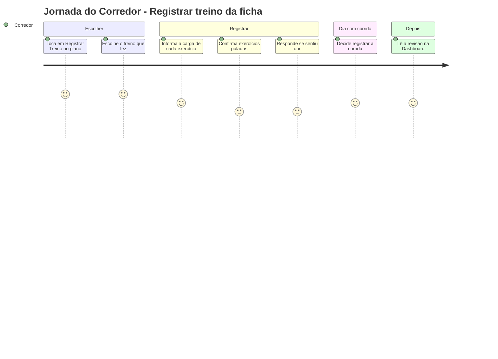
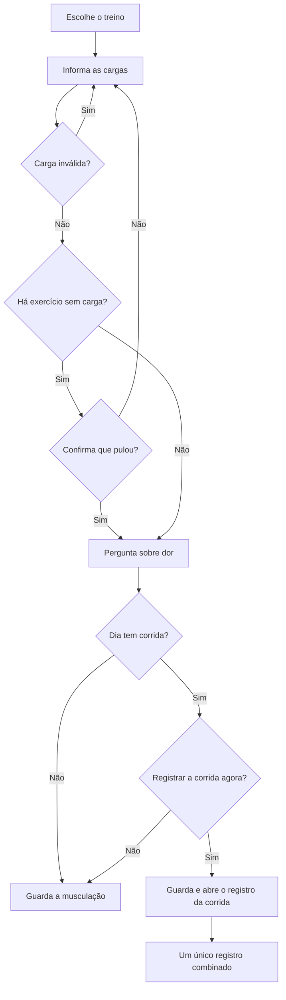

# Ficha e Registro do Corredor - Ficha - Regras de Negócio

## Índice

- [1. Resumo da Funcionalidade](#1-resumo-da-funcionalidade)
- [2. Jornada do Usuário](#2-jornada-do-usuário)
- [3. Regras de Negócio por Funcionalidade](#3-regras-de-negócio-por-funcionalidade)
- [4. Validações e Restrições](#4-validações-e-restrições)
- [5. Fluxos de Processo](#5-fluxos-de-processo)
- [6. Casos de Uso e Cenários](#6-casos-de-uso-e-cenários)

## 1. Resumo da Funcionalidade

**Propósito**: o corredor registra o treino que fez segundo a ficha do personal, informando a carga real de cada exercício, e recebe a revisão do que ficou diferente do prescrito.
**Usuários**: corredores vinculados a um personal.
**Valor de Negócio**: dá ao personal dados fiéis da execução e ao corredor retorno sobre carga e recuperação.
**Frequência de Uso**: a cada treino de ficha.
**Impacto Operacional**: a execução é imutável e alimenta histórico, avanço do plano e revisão.

## 2. Jornada do Usuário

### Pontos de Contato

- Tela "Qual treino você fez?", tela de execução com os exercícios, diálogos de pulados, de dor e de corrida, e o cartão de revisão.

## 3. Regras de Negócio por Funcionalidade

### 3.1. Escolher o treino

**Regras Aplicadas**:

- As opções são Empurrada, Puxada, Inferiores e Corrida, conforme a ficha ativa.
- Nos dias de corrida (terça, quinta e sábado), a descrição prescrita da corrida acompanha o registro.

### 3.2. Informar a carga

**Regras Aplicadas**:

- A carga vem **sugerida** pelo personal, quando existe, e o corredor informa a **carga real**.
- Carga em quilogramas, com no máximo 2 casas decimais, entre 0 e 999,99 kg.
- A observação do corredor é opcional (até 200 caracteres) e vale só para aquela execução; é diferente da observação do personal, que aparece como "Do personal".
- O tempo prescrito, quando existe, aparece junto de séries e repetições.

### 3.3. Exercício pulado

**Regras Aplicadas**:

- **Carga em branco ou zero** significa que o exercício **não foi feito**.
- O app lista os exercícios pulados e exige confirmação antes de salvar.

### 3.4. Dor no encerramento

**Regras Aplicadas**:

- Responder se sentiu dor é obrigatório para concluir. "Sim" faz a revisão priorizar recuperação.

### 3.5. Dia com corrida

**Regras Aplicadas**:

- Se o dia também prevê corrida, o app pergunta se o corredor quer registrá-la agora.
- Registrando musculação e corrida juntas, elas viram **um único registro**.
- Se o corredor desistir da corrida, a musculação é guardada sozinha e nada se perde.

### 3.6. Revisão do treino

**Regras Aplicadas**:

- A recomendação pode ser **Manter**, **Reduzir carga** ou **Priorizar recuperação**, sempre calculada pelo servidor.
- Quando plano e ficha indicam corridas incompatíveis, a revisão informa o **conflito** e não escolhe recomendação.
- Sem explicação, a comparação e a recomendação continuam válidas.
- Mostra se o treino seguinte foi coerente com a recomendação.

### 3.7. Ficha sem conexão

**Regras Aplicadas**:

- Sem rede, o app usa a última ficha salva e avisa.
- Sem ficha salva e sem rede, não há como escolher o treino.

## 4. Validações e Restrições

### Controle de Acesso

- Só o corredor vinculado vê a ficha ativa dele; o registro vai para a conta dele.

### Dados e Entrada

- **Dados Obrigatórios**: resposta de dor; confirmação de pulados se houver.
- **Formatos Aceitos**: carga com vírgula ou ponto.

### Restrições do Sistema

- O registro é sempre da data de hoje.
- Não há edição: erro de registro vira novo registro.

## 5. Fluxos de Processo

## 6. Casos de Uso e Cenários

### Caso de Uso 1: Treino de Puxada com corrida no mesmo dia

**Ator Principal**: corredor
**Objetivo**: registrar a Puxada e a corrida de quinta
**Pré-condições**: ficha ativa

**Fluxo Principal**:

1. Escolhe "Puxada" e informa as cargas.
2. Responde que não sentiu dor.
3. Aceita registrar a corrida e preenche os dados.
4. O app guarda um registro combinado.

**Pós-condições**: revisão gerada pelo servidor, se houve divergência.

### Matriz de Cenários

| Cenário | Entrada | Ação do Sistema | Resultado Esperado |
| --- | --- | --- | --- |
| Registrar com todas as cargas | Cargas válidas | Guarda a execução | Tela fecha |
| Carga inválida | "abc" | Recusa com o nome do exercício | Corredor corrige |
| Carga com 3 casas | "50,125" | Recusa | "Use no máximo 2 casas decimais" |
| Exercício sem carga | Campo vazio ou 0 | Pede confirmação de pulado | Salva como não realizado |
| Observação longa | Mais de 200 caracteres | Recusa | Mensagem com o exercício |
| Dia com corrida, aceita registrar | Responde Sim | Guarda e abre a corrida | Registro combinado |
| Dia com corrida, recusa | Responde Não | Guarda só a musculação | Sem perda |
| Sair da corrida sem registrar | Fecha a tela | Guarda a musculação sozinha | Musculação preservada |
| Ficha só no aparelho | Sem rede | Usa a ficha salva e avisa | Registro possível |
| Conflito de prescrições | Plano e ficha incompatíveis | Revisão com conflito | Nenhuma recomendação escolhida |
| Carga zero em exercício de peso corporal | 0 | Trata como pulado | Ver débitos |
