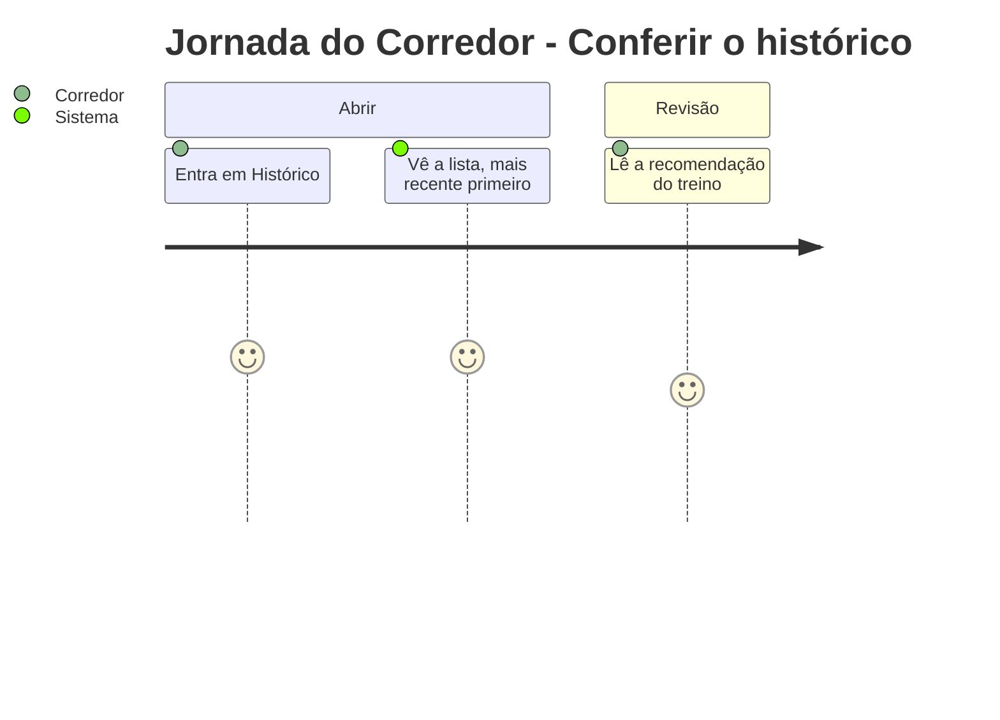
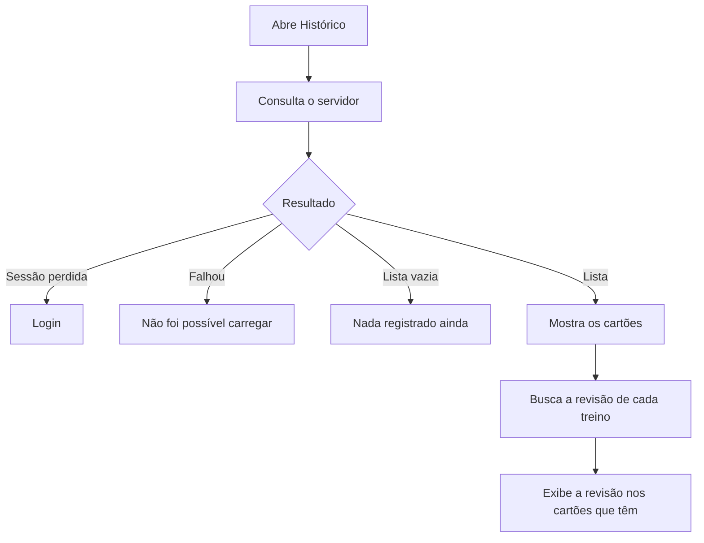

# Histórico no App - Histórico - Regras de Negócio

## Índice

- [1. Resumo da Funcionalidade](#1-resumo-da-funcionalidade)
- [2. Jornada do Usuário](#2-jornada-do-usuário)
- [3. Regras de Negócio por Funcionalidade](#3-regras-de-negócio-por-funcionalidade)
- [4. Validações e Restrições](#4-validações-e-restrições)
- [5. Fluxos de Processo](#5-fluxos-de-processo)
- [6. Casos de Uso e Cenários](#6-casos-de-uso-e-cenários)

## 1. Resumo da Funcionalidade

**Propósito**: mostrar ao corredor o que ele já registrou, com a revisão de aderência de cada treino.
**Usuários**: corredores.
**Valor de Negócio**: confiança de que o registro feito na rua chegou, e base visível da avaliação de sobrecarga.
**Frequência de Uso**: ocasional.
**Impacto Operacional**: leitura apenas.

## 2. Jornada do Usuário

### Pontos de Contato

- Tela **Histórico**, com um cartão por treino.

## 3. Regras de Negócio por Funcionalidade

### 3.1. Lista de treinos

**O que faz**: lista corridas, musculações avulsas e execuções da ficha do personal.

**Regras Aplicadas**:

- A ordem é a da API: mais recente primeiro.
- Corrida mostra distância e duração; musculação, grupo, intensidade e duração.
- A execução da ficha mostra o nome do treino (Empurrada, Puxada, Inferiores) e **não mostra duração**: "0 min" seria mentira.
- A data aparece como "15 de agosto", sem deslocar o dia por fuso.

### 3.2. Estados da tela

**Regras Aplicadas**:

- **Nada registrado ainda**: convite a registrar o primeiro treino.
- **Não foi possível carregar**: diferente de vazio; diz que nenhum registro foi perdido. Dizer "vazio" a quem tem histórico faria o corredor duvidar dos próprios registros.
- **Sessão perdida**: vai ao login.

### 3.3. Revisão no histórico

**Regras Aplicadas**:

- Quando o treino teve revisão, aparecem título, recomendação, explicação e se a leitura foi confirmada.
- Se a explicação não está disponível, o app avisa e preserva a comparação e a recomendação.
- Treino aderente não gera revisão e, portanto, não mostra bloco de revisão.

**Resultado Esperado**: o corredor sabe o que registrou e o que o Steady recomendou a respeito.

## 4. Validações e Restrições

### Controle de Acesso

- O corredor vê somente os próprios treinos.

### Dados e Entrada

- Nenhuma entrada; a tela recarrega ao ganhar foco.

### Restrições do Sistema

- **Dependências**: precisa de conexão; o histórico não é guardado no aparelho.

## 5. Fluxos de Processo

## 6. Casos de Uso e Cenários

### Caso de Uso 1: Conferir um registro feito sem sinal

**Ator Principal**: corredor
**Objetivo**: confirmar que a corrida da rua subiu
**Pré-condições**: conexão restabelecida

**Fluxo Principal**:

1. Abre Histórico.
2. Vê a corrida no topo da lista com distância e duração.

**Pós-condições**: nenhuma.

### Matriz de Cenários

| Cenário | Entrada | Ação do Sistema | Resultado Esperado |
| --- | --- | --- | --- |
| Listar treinos | Histórico com itens | Consulta e formata | Cartões mais recentes primeiro |
| Sem treinos | Lista vazia | Estado vazio | "Nada registrado ainda" |
| Falha de leitura | Servidor ou rede indisponível | Estado de indisponível | "Não foi possível carregar" |
| Sessão perdida | 401 sem renovação | Vai ao login | Tela de login |
| Execução da ficha | Item sem duração | Mostra o nome do treino | Sem "0 min" |
| Corrida sem distância | Distância ausente | Só duração | Linha sem km |
| Treino com revisão | Revisão existente | Mostra o bloco de revisão | Recomendação visível |
| Explicação indisponível | Revisão sem explicação | Aviso de indisponibilidade | Comparação e recomendação preservadas |
| Data de ontem à noite | ISO local | Formata sem Date | Dia correto |
