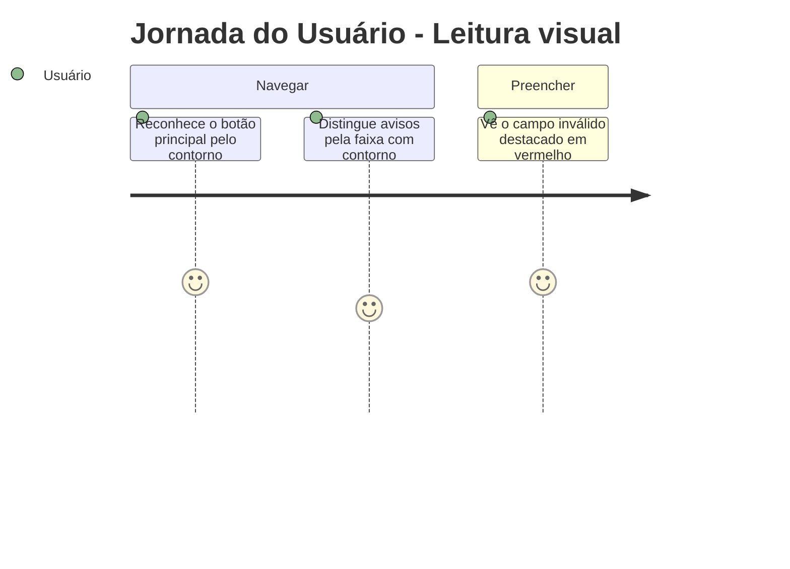
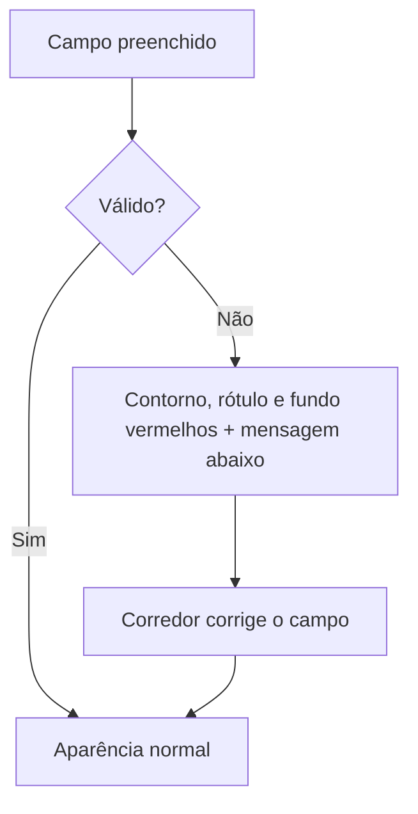

# Identidade Visual - Design System - Regras de Negócio

## Índice

- [1. Resumo da Funcionalidade](#1-resumo-da-funcionalidade)
- [2. Jornada do Usuário](#2-jornada-do-usuário)
- [3. Regras de Negócio por Funcionalidade](#3-regras-de-negócio-por-funcionalidade)
- [4. Validações e Restrições](#4-validações-e-restrições)
- [5. Fluxos de Processo](#5-fluxos-de-processo)
- [6. Casos de Uso e Cenários](#6-casos-de-uso-e-cenários)

## 1. Resumo da Funcionalidade

**Propósito**: dar ao app uma identidade visual única e consistente, com um tema escuro de acento violeta.
**Usuários**: corredores e personais (de forma transparente).
**Valor de Negócio**: reconhecimento do produto e leitura clara de avisos, erros e ações.
**Frequência de Uso**: em todas as telas.
**Impacto Operacional**: define como o corredor distingue ação, aviso e erro.

## 2. Jornada do Usuário

### Pontos de Contato

- Todas as telas: botões, cartões, faixas de aviso, campos e avatar.

## 3. Regras de Negócio por Funcionalidade

### 3.1. Aparência

**Regras Aplicadas**:

- Tema escuro com acento violeta.
- O acento aparece como **linha e brilho**; nunca como grandes áreas preenchidas.
- O botão principal é de **contorno**, não preenchido.
- Espaçamento denso e cantos arredondados de 8 px.

### 3.2. Avisos e erros

**Regras Aplicadas**:

- Avisos informativos usam a **faixa com contorno** na cor do acento.
- O **vermelho é exclusivo de erro em campo de formulário**: nunca decoração, nunca foco, nunca destaque.
- O erro aparece no próprio campo, com a mensagem abaixo dele, e some quando o campo é corrigido.
- Erros que não pertencem a um campo (recusa do servidor, falha de rede) aparecem no aviso do topo.

### 3.3. Avatar

**Regras Aplicadas**:

- O avatar mostra a inicial desde o primeiro instante; a foto entra por cima quando chega.
- Sem foto, sem rede ou com a foto falhando, o avatar continua visível e tocável, porque é o botão que abre o menu da conta.

## 4. Validações e Restrições

### Controle de Acesso

- Não aplicável.

### Dados e Entrada

- Nenhuma cor, tamanho ou raio solto nas telas: tudo vem dos tokens do tema.

### Restrições do Sistema

- A tipografia declarada é Inter, com títulos até o peso 500.

## 5. Fluxos de Processo

## 6. Casos de Uso e Cenários

### Caso de Uso 1: Corrigir um campo inválido

**Ator Principal**: personal
**Objetivo**: publicar a ficha
**Pré-condições**: ficha com um exercício sem nome

**Fluxo Principal**:

1. Toca em publicar.
2. O campo do exercício fica vermelho com a mensagem.
3. Digita o nome; o vermelho some.

**Pós-condições**: campo normal.

### Matriz de Cenários

| Cenário | Entrada | Ação do Sistema | Resultado Esperado |
| --- | --- | --- | --- |
| Campo inválido | Valor recusado | Realça o campo | Vermelho e mensagem abaixo |
| Erro de rede | Falha ao publicar | Aviso no topo | Nenhum campo realçado |
| Avatar sem foto | Conta sem imagem | Mostra a inicial | Gatilho visível |
| Foto que falha | URL quebrada | Mantém a inicial | Sem espaço vazio |
| Botão desabilitado | Campos incompletos | Estilo desabilitado | Não responde ao toque |
