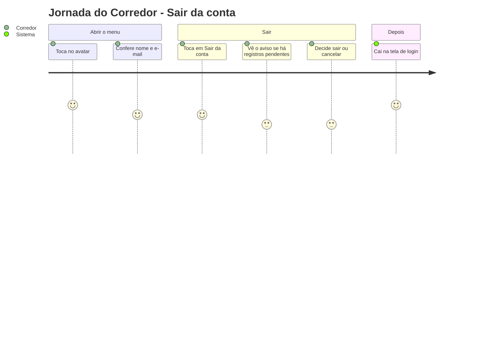
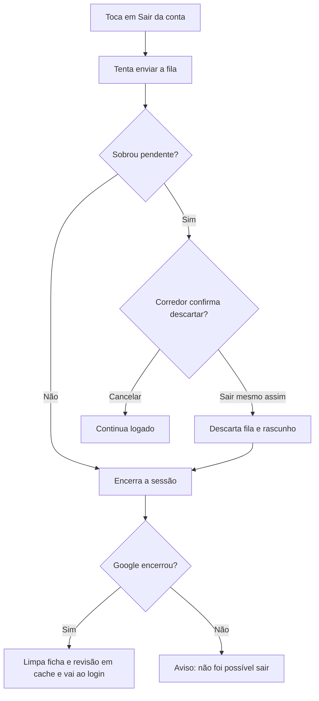

# Menu da Conta e Saída - Conta - Regras de Negócio

## Índice

- [1. Resumo da Funcionalidade](#1-resumo-da-funcionalidade)
- [2. Jornada do Usuário](#2-jornada-do-usuário)
- [3. Regras de Negócio por Funcionalidade](#3-regras-de-negócio-por-funcionalidade)
- [4. Validações e Restrições](#4-validações-e-restrições)
- [5. Fluxos de Processo](#5-fluxos-de-processo)
- [6. Casos de Uso e Cenários](#6-casos-de-uso-e-cenários)

## 1. Resumo da Funcionalidade

**Propósito**: mostrar ao corredor com qual conta está logado e permitir sair sem perder registros por descuido.
**Usuários**: corredores e personais.
**Valor de Negócio**: evita registrar treino na conta errada e protege o histórico que ainda não foi enviado.
**Frequência de Uso**: ocasional; o menu é aberto pelo avatar no cabeçalho.
**Impacto Operacional**: a saída pode descartar registros não enviados, e só acontece com confirmação.

## 2. Jornada do Usuário

### Pontos de Contato

- **Avatar no cabeçalho**: foto da conta ou, sem foto, a inicial do nome ou do e-mail.
- **Menu lateral**: nome, e-mail e o botão "Sair da conta" no rodapé.
- **Diálogo "Sair da conta?"**: aparece só quando há registros não enviados.

## 3. Regras de Negócio por Funcionalidade

### 3.1. Identidade na conta

**O que faz**: mostra nome e e-mail da conta Google e uma foto ou inicial.

**Regras Aplicadas**:

- O avatar existe sempre; sem foto, usa a inicial; sem nome nem e-mail, usa "?".
- O nome só aparece se a conta informa nome (contas corporativas muitas vezes não informam).
- A identidade vem do aparelho e não é guardada pelo app.

### 3.2. Sair da conta

**O que faz**: encerra a sessão neste aparelho.

**Regras Aplicadas**:

- **Antes de sair, o app tenta enviar** o que estiver na fila; com conexão, o corredor nem percebe.
- **Registros pendentes exigem decisão**: o aviso diz o número exato ("1 registro..." ou "N registros ainda não foram enviados e serão perdidos").
- **Descartar vem antes de sair**: nenhum registro de um corredor pode sobrar para o próximo (ADR-005).
- **Se a saída falhar, o corredor continua logado** e é avisado; o app nunca diz "você saiu" sem ter saído.
- **Após sair**, a ficha e a revisão em cache da conta são apagadas e o corredor vai ao login.

**Cenários de Uso**:

- **Principal**: sai sem pendentes e cai no login.
- **Alternativo**: há pendentes, confirma "Sair mesmo assim" e os registros são descartados.
- **Exceção**: o Google recusa encerrar a sessão; aparece "Não foi possível sair".

**Resultado Esperado**: sessão encerrada sem expor dados ao próximo usuário do aparelho.

## 4. Validações e Restrições

### Controle de Acesso

- **Permissões**: qualquer usuário autenticado.

### Dados e Entrada

- **Dados Obrigatórios**: nenhum.
- **Limitações de Volume**: o aviso conta fila mais o rascunho de registro combinado.

### Restrições do Sistema

- **Dependências**: módulo nativo do Google; a conexão só ajuda a esvaziar a fila.

## 5. Fluxos de Processo

## 6. Casos de Uso e Cenários

### Caso de Uso 1: Sair com registro pendente

**Ator Principal**: corredor
**Objetivo**: trocar de conta no aparelho
**Pré-condições**: sem conexão e com um registro na fila

**Fluxo Principal**:

1. Abre o menu e toca em "Sair da conta".
2. O app tenta enviar e não consegue.
3. Vê o aviso com "1 registro" e escolhe "Sair mesmo assim".
4. A fila é descartada, a sessão encerrada e o login aparece.

**Pós-condições**: aparelho sem dados do corredor anterior na fila.

### Matriz de Cenários

| Cenário | Entrada | Ação do Sistema | Resultado Esperado |
| --- | --- | --- | --- |
| Sair sem pendências | Toque em Sair, fila vazia | Encerra a sessão | Vai ao login |
| Cancelar saída com pendências | Cancela ou toca fora do diálogo | Mantém a sessão e libera o botão | Continua logado |
| Confirmar descarte | "Sair mesmo assim" | Descarta fila e rascunho antes de sair | Vai ao login |
| Falha ao encerrar a sessão | Google recusa | Mantém a sessão | Aviso "Não foi possível sair" |
| Conta sem foto | Identidade sem foto | Usa a inicial | Avatar visível e tocável |
| Conta sem nome | Identidade só com e-mail | Mostra só o e-mail | Menu sem linha de nome |
| Voltar no Android com o menu aberto | Gesto de voltar | Fecha o menu | Permanece na tela |
| Toque duplo em Sair | Dois toques seguidos | Ignora o segundo | Uma única tentativa |
