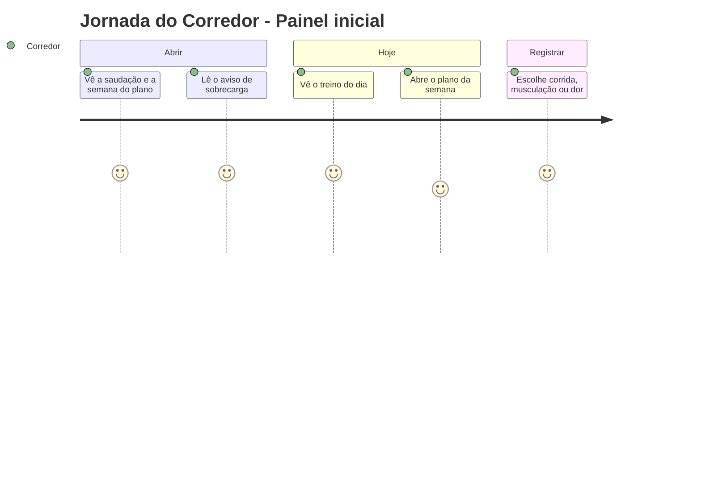
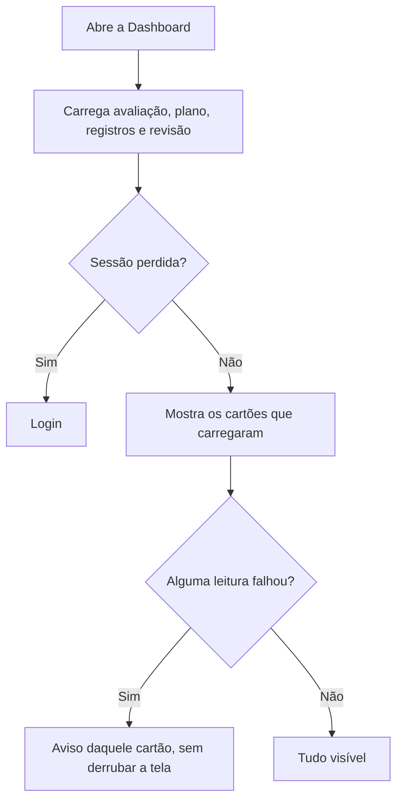

# Painel Inicial - Dashboard - Regras de Negócio

## Índice

- [1. Resumo da Funcionalidade](#1-resumo-da-funcionalidade)
- [2. Jornada do Usuário](#2-jornada-do-usuário)
- [3. Regras de Negócio por Funcionalidade](#3-regras-de-negócio-por-funcionalidade)
- [4. Validações e Restrições](#4-validações-e-restrições)
- [5. Fluxos de Processo](#5-fluxos-de-processo)
- [6. Casos de Uso e Cenários](#6-casos-de-uso-e-cenários)

## 1. Resumo da Funcionalidade

**Propósito**: responder "estou me sobrecarregando?" e "o que faço hoje?" logo ao abrir o app.
**Usuários**: corredores (e personais na aba própria).
**Valor de Negócio**: o aviso de sobrecarga é a promessa central do produto; o painel também mostra o treino do dia, o avanço do plano e a última revisão.
**Frequência de Uso**: toda abertura do app.
**Impacto Operacional**: é o ponto de partida para registrar, ver histórico e abrir o plano.

## 2. Jornada do Usuário

### Pontos de Contato

- Cabeçalho com avatar, saudação e etiqueta de contagem.
- Cartões: revisão do treino, sincronização pendente, plano da semana, registrar.
- Botão "Ver histórico".

## 3. Regras de Negócio por Funcionalidade

### 3.1. Cabeçalho

**Regras Aplicadas**:

- A saudação usa **só o primeiro nome**; sem nome, só "Bom dia/Boa tarde/Boa noite". Nunca o e-mail.
- A madrugada é noite.
- A linha informa em que semana e fase do plano o corredor está; sem planejamento, convida a criar um.
- A etiqueta mostra as semanas até a prova, ou "É hoje" no dia da prova.

### 3.2. Aviso de sobrecarga

**Regras Aplicadas**:

- O aviso vem pronto do servidor; o app só exibe.
- Há três estados: **reunindo dados**, **sem risco** e **risco com sugestão**. "Reunindo dados" nunca é apresentado como "sem risco".
- Se a leitura falha, o app diz que não conseguiu, em vez de mostrar um aviso antigo.
- Registros ainda pendentes de envio geram o aviso "A avaliação acima ainda não considera eles".

### 3.3. Plano da semana e avanço

**Regras Aplicadas**:

- O cartão mostra o treino de hoje do plano do Steady.
- O avanço conta treinos registrados, inclusive os ainda pendentes na fila.
- Não conseguir ler os registros **nunca** vira "0%".
- Corredor que entrou no meio do plano vê uma nota explicando o percentual.
- "Ver plano da semana" abre o dia de hoje; sem planejamento, leva ao formulário de criação.

### 3.4. Revisão do treino

**Regras Aplicadas**:

- Mostra a última revisão: comparação, recomendação e explicação.
- Sem explicação, o corredor pode pedir nova tentativa; a comparação e a recomendação continuam válidas.
- O corredor pode confirmar a leitura ("Entendi") ou contestar ("Isso não faz sentido").
- Quando plano e ficha têm corridas incompatíveis, aparece um aviso de conflito uma única vez; fechar o aviso não resolve o conflito e nenhuma recomendação é escolhida.

## 4. Validações e Restrições

### Controle de Acesso

- A aba Personal só aparece para quem tem essa função.

### Dados e Entrada

- Nenhuma entrada, só leitura e atalhos.

### Restrições do Sistema

- **Dependências**: conexão para avaliação, revisão e histórico; plano e revisão têm cópia local usada quando a rede falha.
- A tela recarrega ao voltar de qualquer registro.

## 5. Fluxos de Processo

## 6. Casos de Uso e Cenários

### Caso de Uso 1: Começar o dia de treino

**Ator Principal**: corredor
**Objetivo**: saber o treino de hoje e se há risco
**Pré-condições**: planejamento criado

**Fluxo Principal**:

1. Abre o app e lê a saudação e a semana do plano.
2. Confere a avaliação de sobrecarga.
3. Toca em "Ver plano da semana" e cai no dia de hoje.

**Pós-condições**: corredor sabe o que fazer.

### Matriz de Cenários

| Cenário | Entrada | Ação do Sistema | Resultado Esperado |
| --- | --- | --- | --- |
| Saudar pelo primeiro nome | Conta com nome completo | Usa o primeiro nome | "Bom dia, João" |
| Conta sem nome | Nome ausente | Saúda sem nome | "Bom dia" |
| Sem planejamento | Nenhum plano | Convite no cabeçalho; botão leva ao formulário | "Crie seu planejamento..." |
| Histórico insuficiente | Menos de 14 dias | Estado "reunindo dados" | Não afirma "sem risco" |
| Falha ao ler o avanço | Histórico indisponível | Esconde o percentual com aviso | Nunca "0%" |
| Registro pendente | Item na fila | Aviso de sincronização pendente | Corredor sabe que a avaliação está atrasada |
| Revisão sem explicação | Explicação indisponível | Botão "Tentar novamente" | Pode repetir sem perder a recomendação |
| Revisão contestada | Toca em "Isso não faz sentido" | Registra a contestação | Botão some |
| Conflito de prescrições | Plano e ficha incompatíveis | Alerta uma única vez | Nenhuma recomendação escolhida |
| Sessão perdida | 401 em qualquer leitura | Vai ao login | Tela de login |
| Conta sem papel de personal | Roles sem Personal | Esconde a aba | Só Dashboard e Planejamento |
