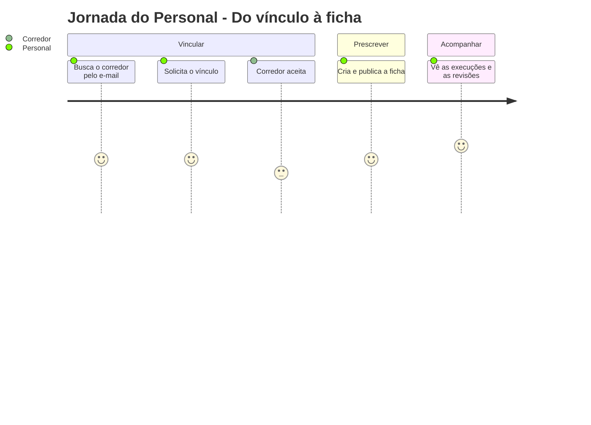
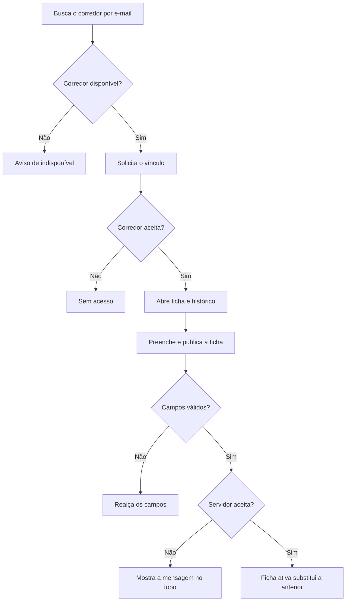

# Painel do Personal - Personal - Regras de Negócio

## Índice

- [1. Resumo da Funcionalidade](#1-resumo-da-funcionalidade)
- [2. Jornada do Usuário](#2-jornada-do-usuário)
- [3. Regras de Negócio por Funcionalidade](#3-regras-de-negócio-por-funcionalidade)
- [4. Validações e Restrições](#4-validações-e-restrições)
- [5. Fluxos de Processo](#5-fluxos-de-processo)
- [6. Casos de Uso e Cenários](#6-casos-de-uso-e-cenários)

## 1. Resumo da Funcionalidade

**Propósito**: permitir ao personal acompanhar corredores que o autorizaram: prescrever a ficha, ver o que foi executado e ler as revisões.
**Usuários**: personais (contas com essa função, concedida pelo administrador).
**Valor de Negócio**: dá ao personal dados fiéis para ajustar a carga e ao corredor uma prescrição individual.
**Frequência de Uso**: ao montar ou ajustar fichas e ao acompanhar a semana.
**Impacto Operacional**: nada é visto sem vínculo aceito; a ficha nova substitui a anterior sem apagar histórico.

## 2. Jornada do Usuário

### Pontos de Contato

- Aba **Personal** (só para quem tem a função), tela do corredor, formulário da ficha e histórico detalhado.

## 3. Regras de Negócio por Funcionalidade

### 3.1. Vínculo

**Regras Aplicadas**:

- O e-mail serve só para **encontrar** o corredor; conhecer o e-mail não dá acesso.
- O corredor precisa **aceitar** a solicitação antes de o personal ver ficha ou histórico.
- Corredor que já tem vínculo ativo aparece como indisponível.
- O personal acompanha vários corredores; o corredor tem no máximo um vínculo ativo.
- Qualquer lado pode encerrar o vínculo; encerrado, o acesso termina.
- A lista mostra o **nome** da conta Google; sem nome, o e-mail.

### 3.2. Ficha de treino

**Regras Aplicadas**:

- A ficha tem três treinos de musculação (Empurrada, Puxada, Inferiores) e três prescrições de corrida (terça, quinta e sábado).
- **Todo treino de musculação exige ao menos um exercício**; o último exercício de uma lista não pode ser removido.
- Cada exercício tem nome, séries e repetições (inteiros); tempo em segundos e observação para o corredor são opcionais.
- A observação aceita até 200 caracteres e é só texto, nunca interpretada como formatação.
- Cada corrida tem descrição obrigatória e, opcionalmente, distância, faixa de duração e faixa de esforço. Em branco é ausência, nunca zero.
- Em faixa, o máximo exige o mínimo e precisa ser maior que ele.
- Os limites (séries, repetições, esforço) são verificados pelo servidor; se recusar, o personal vê a mensagem no topo.
- Publicar uma ficha nova **substitui** a ativa; o histórico de execuções já registradas não muda.
- As cargas começam vazias para o corredor.

### 3.3. Histórico do corredor

**Regras Aplicadas**:

- Musculação e corrida aparecem juntas, **do mais recente para o mais antigo**, para o treino de hoje ficar no topo.
- Exercício não feito aparece como "Não realizado".
- Quando há revisão, o personal vê a comparação, a recomendação, a explicação e se o corredor confirmou a leitura.

## 4. Validações e Restrições

### Controle de Acesso

- **Permissões**: função Personal (concedida administrativamente, nunca pelo app) e vínculo ativo para ver dados do corredor.
- **Hierarquia**: um personal só vê os corredores que o aceitaram.

### Dados e Entrada

- **Dados Obrigatórios**: nome, séries e repetições de cada exercício; descrição de cada corrida.
- **Formatos Aceitos**: números com vírgula ou ponto na distância; inteiros nos demais.

### Restrições do Sistema

- **Dependências**: conexão para tudo; a ficha não é rascunhada no aparelho.

## 5. Fluxos de Processo

## 6. Casos de Uso e Cenários

### Caso de Uso 1: Publicar a primeira ficha

**Ator Principal**: personal
**Objetivo**: prescrever os treinos da semana
**Pré-condições**: vínculo aceito

**Fluxo Principal**:

1. Abre o corredor na lista de vinculados.
2. Toca em "Criar Ficha" e preenche os três treinos e as três corridas.
3. Toca em "Publicar ficha completa".
4. Vê "Ficha publicada e ativa".

**Pós-condições**: o corredor passa a ver a ficha no detalhamento do dia.

### Matriz de Cenários

| Cenário | Entrada | Ação do Sistema | Resultado Esperado |
| --- | --- | --- | --- |
| Buscar corredor existente | E-mail válido | Mostra nome e disponibilidade | Pode solicitar vínculo |
| Corredor não encontrado | E-mail desconhecido | Mensagem de não encontrado | "Corredor não encontrado." |
| Corredor com vínculo ativo | Indisponível | Mostra o aviso | Sem botão de solicitar |
| Solicitar vínculo | Toque em Solicitar | Envia a solicitação | Aguarda o aceite do corredor |
| Exercício em branco | Nome vazio ao publicar | Realça o campo | Nada vai ao servidor |
| Vários campos inválidos | Dois exercícios com erro | Realça todos | Corrigir campo apaga só o erro dele |
| Faixa invertida | Máximo menor que o mínimo | Realça o máximo | Mensagem no campo |
| Remover o último exercício | Lista com 1 item | Não permite | Mínimo de 1 por treino |
| Limite de domínio estourado | 40 séries | Servidor recusa | Mensagem no topo |
| Publicar com sucesso | Ficha completa | Substitui a ficha ativa | "Ficha publicada e ativa" |
| Ver histórico | Corredor com treinos | Linha do tempo | Treino de hoje no topo |
| Encerrar vínculo | Toque em Encerrar | Encerra e volta | Acesso removido |
| Falha ao carregar o histórico | Servidor fora | Ver débitos | Mostra "Nenhuma execução registrada" |
