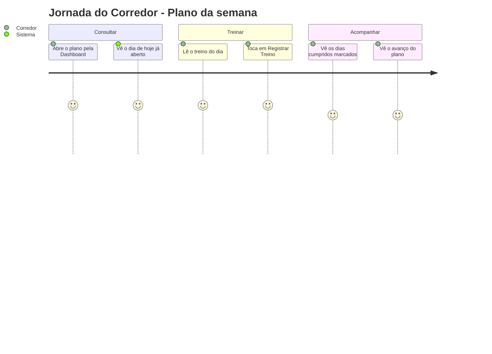
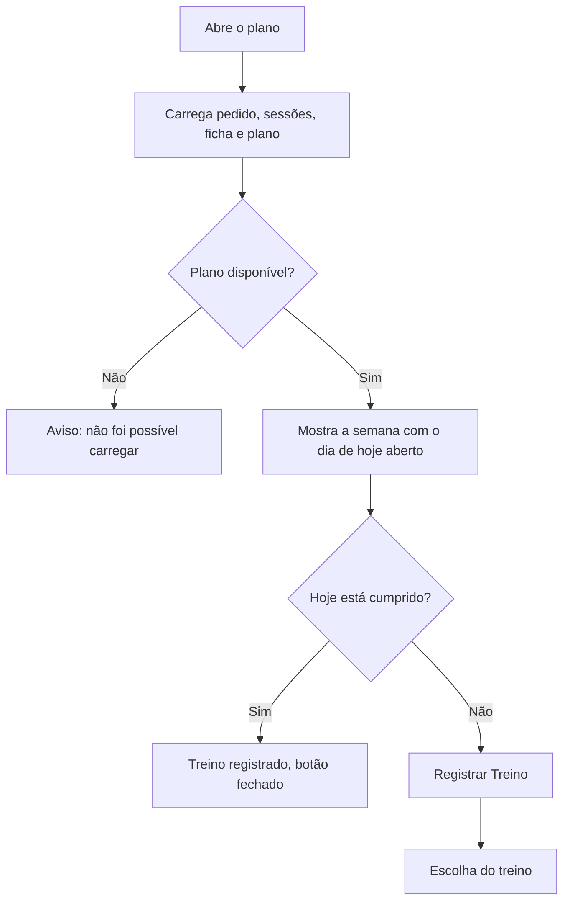

# Plano e Semana - Plano - Regras de Negócio

## Índice

- [1. Resumo da Funcionalidade](#1-resumo-da-funcionalidade)
- [2. Jornada do Usuário](#2-jornada-do-usuário)
- [3. Regras de Negócio por Funcionalidade](#3-regras-de-negócio-por-funcionalidade)
- [4. Validações e Restrições](#4-validações-e-restrições)
- [5. Fluxos de Processo](#5-fluxos-de-processo)
- [6. Casos de Uso e Cenários](#6-casos-de-uso-e-cenários)

## 1. Resumo da Funcionalidade

**Propósito**: mostrar ao corredor o plano de 24 semanas, o que fazer em cada dia e quanto do plano já foi percorrido.
**Usuários**: corredores.
**Valor de Negócio**: dá estrutura e constância ao treino rumo à primeira maratona.
**Frequência de Uso**: diária.
**Impacto Operacional**: o dia do plano decide o treino sugerido e quando o botão de registro fecha.

## 2. Jornada do Usuário

### Pontos de Contato

- Documento do plano com quatro seções: **Seus dados**, **Fases**, **Semana**, **Regras**.
- Botão **Registrar Treino** no dia de hoje.
- Avanço do plano na Dashboard.

## 3. Regras de Negócio por Funcionalidade

### 3.1. Onde o corredor está no plano

**Regras Aplicadas**:

- A contagem é **de trás para frente a partir da data da prova**: o polimento cai sempre nas 4 últimas semanas, qualquer que seja o dia em que o plano foi criado.
- As fases são Base (semanas 1 a 8), Construção (9 a 16), Pico (17 a 20) e Polimento (21 a 24).
- Prova a mais de 24 semanas: o plano ainda não começou. Prova passada: nada a mostrar.

### 3.2. Estado de cada dia

**Regras Aplicadas**:

- **Cumprido**: tudo o que o dia previa tem registro naquela data.
- **Parcial**: só terça e quinta, dias com musculação e corrida, quando falta uma delas.
- **Não feito**: dia passado que previa treino e não tem registro.
- **Sem marca**: domingo, dias futuros, o dia de hoje ainda vazio e tudo fora da janela do plano.
- O estado nunca é "marcado" à mão: é consequência dos registros.
- Registros ainda pendentes na fila já contam (o corredor foi confirmado na hora).

### 3.3. Avanço do plano

**Regras Aplicadas**:

- O avanço **começa em zero e só sobe**; não é nota de aderência.
- O total é fixo: 24 semanas x os dias com treino na grade. Quem entra no meio do plano não chega a 100%, e o app explica em qual semana o corredor entrou.
- Não conseguir ler os registros **nunca** vira 0%.

### 3.4. Registrar o treino de hoje

**Regras Aplicadas**:

- O botão só existe no dia de hoje: o registro é sempre da data de hoje.
- Com o dia cumprido, o botão vira "Treino registrado" e fica fechado, para não duplicar o registro (registros não se apagam).
- Dia parcial continua aberto, para registrar o que falta.
- Histórico ilegível não bloqueia o registro.

### 3.5. Treino do dia no plano

**Regras Aplicadas**:

- Sem a ficha do personal, a semana mostra os exercícios do plano do Steady; com ficha, ela substitui o detalhamento do dia.
- Offline, o app mostra a última ficha salva e avisa.
- Quando o plano não pode ser lido e não há cópia, o app diz que não conseguiu, em vez de mostrar uma semana vazia.

## 4. Validações e Restrições

### Controle de Acesso

- O corredor vê só os próprios pedidos; o plano em si é o mesmo documento versionado do Steady.

### Dados e Entrada

- Parâmetros de link (`section`, `day`) são entrada externa: só um dígito de 0 a 6 abre um dia; seção desconhecida abre em "Seus dados"; `mobilidade` (link antigo) abre em "Semana".

### Restrições do Sistema

- **Dependências**: plano e ficha têm cópia local; sessões registradas precisam do servidor (e da fila local).
- **Calendário**: sempre local, nunca UTC.

## 5. Fluxos de Processo

## 6. Casos de Uso e Cenários

### Caso de Uso 1: Cumprir o treino do dia

**Ator Principal**: corredor
**Objetivo**: registrar o treino de terça (musculação e corrida)
**Pré-condições**: planejamento criado e ficha publicada

**Fluxo Principal**:

1. Abre o plano pela Dashboard; o dia de hoje vem aberto.
2. Toca em "Registrar Treino" e registra a musculação.
3. O dia fica parcial; registra também a corrida.
4. O dia fica cumprido e o botão fecha.

**Pós-condições**: avanço do plano incrementado.

### Matriz de Cenários

| Cenário | Entrada | Ação do Sistema | Resultado Esperado |
| --- | --- | --- | --- |
| Dia cumprido | Tudo o previsto registrado | Marca cumprido | Botão "Treino registrado" |
| Dia parcial | Só a musculação em dia combinado | Marca parcial | Botão continua aberto |
| Dia passado sem registro | Data passada sem sessões | Marca não feito | Sinal de falha no dia |
| Hoje ainda vazio | Hoje sem registro | Sem marca | Botão aberto |
| Domingo | Dia sem treino | Sem marca | Sem botão |
| Registro pendente na fila | Item ainda não enviado | Conta como feito | Dia fecha na hora |
| Histórico ilegível | Falha de leitura | Sem marcas, registro liberado | Nunca "0%" |
| Prova a mais de 24 semanas | Data distante | Estado "ainda não começou" | Sem fase nem avanço |
| Link antigo de Mobilidade | `section=mobilidade` | Abre a Semana | Conteúdo encontrado |
| Dia inválido no link | `day=9` | Ignora | Nenhum dia aberto |
| Plano sem cópia e sem rede | Falha total | Aviso | Não mostra semana vazia |
| Entrou na semana 15 | Pedido criado no meio | Mostra o percentual com nota | Percentual não é lido como fracasso |
